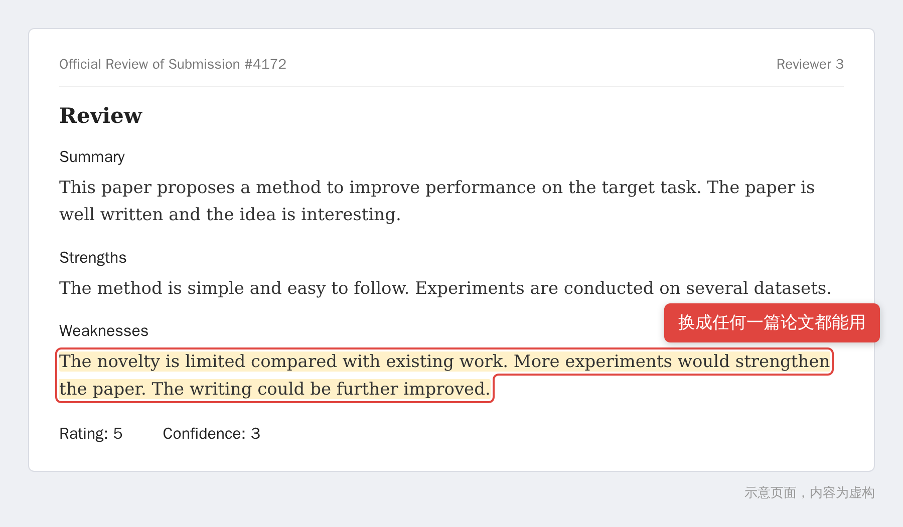

> 【AI 生图提示词 · 公众号头图，横版 2.35:1，生成后存为 images/ai-cover.png，用完删掉这段引用】
> 中文：深夜的书房，一盏台灯，桌上堆着打印出来的论文。一位疲惫的研究者盯着电脑屏幕，屏幕上是一份整整齐齐却空空荡荡的评审意见，只有灰色的横线。屏幕后面隐约有一只半透明的机械手在文档上盖章。冷色调，深蓝为主，点缀一点暖黄的台灯光，半写实插画风格，画面里不要出现任何文字。
> English: late-night study, desk lamp, a tired researcher staring at a monitor showing a neat but empty review document made of gray lines, a translucent robotic hand stamping the document from behind the screen, deep blue palette with warm lamp light, semi-realistic illustration, no text in the image, 2.35:1

# 你收到的审稿意见，可能根本不是人写的

先看一段审稿意见。这是我照着常见套路拼的，内容是虚构的，但你多半见过类似的：

Weaknesses 那一栏就三句话：创新有限，实验再多点，写作再改改。放到任何一篇论文底下都说得通，放在你的论文底下当然也不算错，只是对你一点用都没有。

以前碰到这种，大家的反应是“审稿人太敷衍了”。这两年多了个怀疑：写的人可能压根没读过论文，是让 AI 写的。

## 这个怀疑有依据

据媒体报道，ICLR 2026 收到的投稿约 1.9 万篇。第三方检测机构 Pangram Labs 统计了其中 7.58 万条评审意见，约 1.59 万条被判定为完全由 AI 生成，差不多五分之一。COLM 2026 也有类似的报道。

检测工具本身有误差，这些数字只能当个参考，但这件事在圈子里已经是公开话题了。

原因也不复杂：投稿量涨得比审稿人快。一个人手上压着好几篇，每篇要写几百字，旁边正好有个现成的大模型。不少会议明确规定审稿人不能把投稿内容交给外部 AI 工具，毕竟涉及还没发表的工作，可这种规定很难查。

## 怎么看出来

先说清楚，下面这些只能让你留个心眼，算不上证据：

- 通篇泛泛而谈，换一篇论文照样能用
- 优点缺点整整齐齐，像在填表
- 让你补做你已经做过的实验
- 对论文里根本没有的内容提意见
- 引用了查不到的文献
- 文字评价和最终打分对不上

> 【AI 生图提示词 · 文中插图，横版 16:9，生成后存为 images/ai-01-desk.png，用完删掉这段引用】
> 中文：一张长桌两端，左边坐着一位研究生，面前摊着打印的论文和一杯冷掉的咖啡；右边是一台发着微光的笔记本，屏幕里伸出一只手递过来一张写满灰色横线的纸。两边隔着长长的桌面，气氛有点荒诞。扁平插画，低饱和配色，画面里不要出现任何文字。
> English: a long table, a grad student on the left with printed papers and cold coffee, on the right a glowing laptop whose screen extends a hand handing over a sheet covered in gray lines, absurd mood, flat illustration, muted palette, no text, 16:9

## 收到这样的意见怎么办

我的建议是，回复里别写“我怀疑你是 AI”。你证明不了，领域主席看到的只会是一个情绪激动的作者。

把意见一条条拆开，分三种情况处理。

**审稿人说的和事实不符。** 拿原文说话，写清页码、表号、公式。比如他说没有消融实验，而你的表 3 就是：

> 感谢审稿人的意见。我们在第 6 页表 3 给出了消融实验（分别去掉模块 A、B、C 的结果），并在第 7 页第二段做了分析。为了方便查找，修订版里我们把表 3 的标题改成了“消融实验”。

语气平静，事实清楚，顺手把“你没看到”变成“我们让它更好找”。

**审稿人说的是套话。** 比如“创新性有限”，这种话没法反驳，也别空对空，把它变成能检验的改动：

> 我们理解审稿人关心本方法与 X 方法的区别。为此在 3.2 节新增了对比，并补充了 Y 数据集上的实验，结果见表 5。

这样不管这条意见是谁写的，你的回复都扎实，而且回复本来就是写给领域主席看的。

**意见离谱到明显没看过你的论文。** 比如评价的对象根本不是你这篇。可以按会议的规定，私下向领域主席或程序主席反馈，附上具体事实，别放进公开回复里。

不管哪一种，评审原文、你的回复、各版本的修改稿都留着，以后申诉用得上。

## 写论文的时候就可以堵一堵

既然审稿人可能偷懒，那就让偷懒的人也挑不出“你没写”：

- 摘要里把贡献一条条列出来
- 实验设置、超参数、数据划分写全
- 消融实验的标题直接叫“消融实验”，别让人去找
- 局限性自己先写
- 关键结论放进图表标题里

偷懒的审稿人，不管是人还是 AI，多半是在按关键词找“缺了什么”。东西摆在明处，他就没话可说。

写论文的人用 AI，审论文的人也用 AI，中间只剩一份文档在两台机器之间传来传去。反正 rebuttal 是你自己写的，认真写，总会有人认真看。
