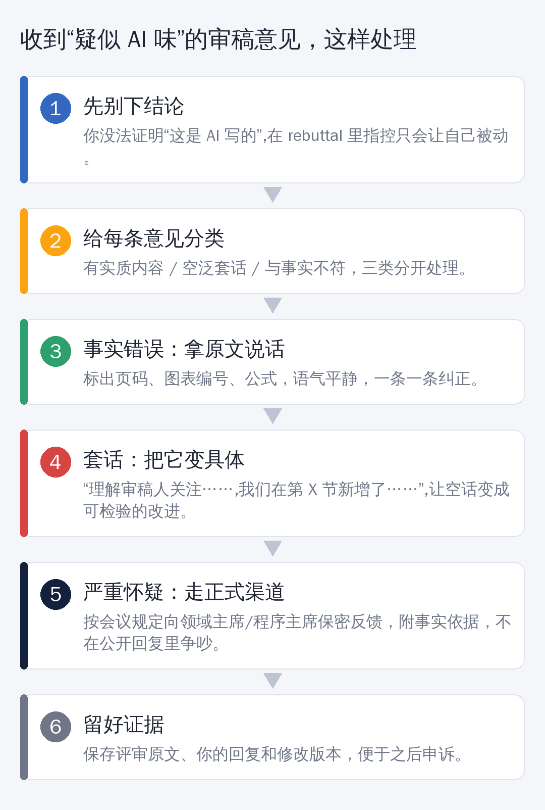

# 你收到的审稿意见，可能根本不是人写的

想象这样一个场景。

你熬了小半年，终于把论文投了出去。Rebuttal 期开始，你手抖着点开审稿意见：

> 建议作者补充更多实验。
> 创新性有限，与已有工作相比提升不够明显。
> 写作还可以进一步改进。

每一句都对，每一句都空。你盯着屏幕想：这是在认真读我的论文吗？

**越来越多的证据显示：写下这些话的，有可能不是人。**

## 这不是猜测

据媒体报道，ICLR 2026 的投稿量创下纪录，约 1.9 万篇。第三方检测机构 Pangram Labs 对 7.58 万条评审意见做了统计，**约 1.59 万条被判定为“完全由 AI 生成”，占比约五分之一**。

另有报道称，COLM 2026 同样被 AI 写的审稿意见“淹没”。

> 需要说明：这些数字来自检测工具的统计，检测本身有误差，也不是官方结论。但“审稿被 AI 稀释”这件事，已经成了学术圈公开讨论的话题。

## 为什么会这样

原因其实很朴素：**投稿量涨得比志愿审稿人快得多**。

一位审稿人一次要看好几篇论文，每篇都要写几百字的意见。时间不够，又有一个随手可用的大模型，于是……你懂的。

不少会议明确规定：审稿人不得把投稿内容交给外部 AI 工具，因为这会泄露未发表的工作。但规定归规定，执行起来很难。

## “AI 味”审稿意见长什么样

先说清楚：**下面这些特征只能让你提高警惕，不能当作证据。**

- 通篇泛泛而谈，换成任何一篇论文都能用
- 优点缺点像模板，结构整齐得过分
- 要求你补充“你其实已经做过”的实验
- 对论文里根本不存在的内容提意见
- 引用了找不到的文献
- 文字评价和最终打分明显对不上

## 收到这样的意见，该怎么办

**第一，先别下结论。** 你没法证明“这是 AI 写的”。在 rebuttal 里直接指控，只会让自己陷入被动。

**第二，把每条意见分类。** 有实质内容的，认真改；空泛套话的，见第四步；与事实不符的，见第三步。

**第三，事实错误，拿原文说话。** 比如审稿人说“没有消融实验”，而你的表 3 就是消融实验。回复时写清楚：

> 感谢审稿人的意见。我们在第 6 页表 3 中已给出消融实验（逐项移除模块 A、B、C 的结果），并在第 7 页第二段进行了分析。为便于阅读，我们在修订版中将该表标题改为“消融实验”。

注意：**语气平静，事实清晰，顺手把“你没找到”变成“我们让它更好找”。**

**第四，套话要“变具体”。** 对于“创新性有限”这种没法反驳的话，不要空对空，而是把它转成可检验的改进：

> 我们理解审稿人关注本方法与 X 方法的区别。为此，我们在第 3.2 节新增了对比，并补充了在 Y 数据集上的实验，结果见表 5。

这样一来，不管这条意见是人写的还是 AI 写的，**你的回复都是扎实的**。

**第五，严重怀疑时，走正式渠道。** 如果意见里出现明显的幻觉（引用不存在的内容、评价对象根本不是你的论文），可以按会议规定，向领域主席或程序主席保密反馈，附上事实依据。不要在公开回复里争吵。

**第六，留好证据。** 保存评审原文、你的回复和修改版本，以备之后申诉。

## 反过来想：怎么写，才不容易被“套话”打中

既然审稿环节可能有 AI 参与，你的论文最好做到：**让一个粗心的审稿人（无论是人还是 AI）也找不到“你没写”的理由。**

- 摘要里明确写出贡献，最好逐条列出
- 实验设置、超参数、数据划分写完整
- 消融实验、对比实验的标题直白，别让人“找不到”
- 主动写局限性，别等别人来指出
- 关键结论放在图表标题里，一眼可见

## 最后

用 AI 写论文的人，遇上了用 AI 审论文的人。

如果两边都只是在让机器和机器对话，科研就成了一场没有人在场的会议。**真正稀缺的，永远是那个认真读、认真问问题的人。**

下一篇，我们聊聊：当 AI 十分钟就能“发明”一个创新模块时，研究生的创新还值多少钱？

---

*想看哪个主题？评论区告诉我。*
