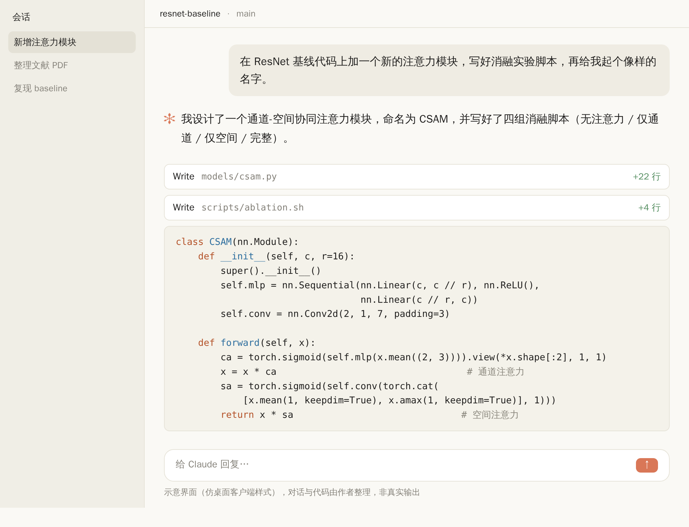
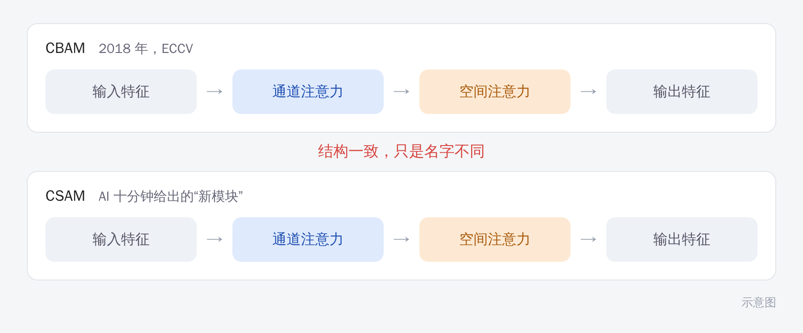

对 AI 说一句：“在 ResNet 基线上加一个新的注意力模块，写好消融实验脚本，再起个像样的名字。”

不到十分钟，你会拿到这样的东西：

它叫 CSAM，“通道-空间协同注意力”，听上去挺新。但把代码拆开看，就是先做一次通道注意力，再做一次空间注意力，前后串起来。这正是 2018 年 ECCV 上 CBAM（Convolutional Block Attention Module）的结构，AI 只是换了个名字。

把两个结构并排画出来，看得更清楚：

这也不能全怪 AI。过去几年的“新模块”，不少就长这样：一个像样的名字，一张结构图，一张涨了零点几个点的表。AI 做的，是把这套流程压缩到了十分钟。

## 模块不值钱了，学术圈已经有反应

NeurIPS 2025 有一篇立场论文，担心 AI 生成的综述类论文越来越多，会拖垮学术记录，把这种现象比作对论文系统的 DDoS 攻击。媒体也报道过，有人声称自己一年发表了 100 多篇 AI 论文。

我的判断是，“在 A 里加一个 B”这类创新，审稿人会越来越没耐心。评审的时间有限，同类的东西看得太多，一眼就能认出“又一个注意力变体”。

> 【AI 生图提示词｜scene｜warm｜16:9｜生成后存为 imgs/04-scene-reviewer-pile.png，用完删掉本引用块】
> FOCAL POINT：一位简化的人形剪影（不要写实人脸）坐在书桌前，桌上叠着高高一摞几乎一模一样的论文，每篇封面上只有一个不同颜色的小方块标记。
> ATMOSPHERE：傍晚的办公室，窗外是暖橘色的夕阳，台灯亮着，空气里有一点疲惫的安静。
> MOOD：无奈，略带幽默。
> COLORS：暖色调为主（奶油、橘、陶土色）。颜色名称只是渲染指导，不要作为文字出现在画面里。
> STYLE：flat vector，干净的黑色轮廓线；构图留白，主体偏左；画面里不要出现文字。
> ASPECT：16:9

## 哪些事交给 AI，哪些自己来

我自己的做法，是把科研里的事分成两堆：

| 可以交给 AI | 得自己来 |
|---|---|
| 复现基线，跑通开源代码 | 选问题，判断值不值得做 |
| 画图、排版、统一格式 | 提假设，想清楚为什么会有效 |
| 翻译润色，整理文献笔记 | 设计一个能被证伪的实验 |
| 写样板代码和实验脚本 | 判断结果可不可信，怎么解释 |

> 【AI 生图提示词｜framework｜sketch-notes + macaron｜16:9｜生成后存为 imgs/02-framework-two-tracks.png，用完删掉本引用块】
> ZONES：左右两栏并排，中间一条细虚线分隔。左栏顶部是一个小机器人图标，下方竖排四张圆角便签卡片；右栏顶部是一个简化的人形剪影（不要写实人脸），下方竖排四张圆角便签卡片。
> LABELS：左栏标题「交给 AI」，卡片：「复现基线」「画图排版」「翻译润色」「样板代码」；右栏标题「自己来」，卡片：「选问题」「提假设」「设计能证伪的实验」「判断结果可信吗」。文字少而大，手写体风格。
> COLORS：左栏淡蓝色块，右栏淡桃色块，背景暖奶油色。颜色名称只是渲染指导，不要作为文字出现在画面里。
> STYLE：sketch-notes，黑色略带抖动的手绘线条，粉彩信息框，填色轻微错位；构图干净，大量留白，无复杂背景。
> ASPECT：16:9

左边那一堆，放心交给 AI。右边那一堆才是读研真正在练的东西，AI 暂时替不了：它不了解你手里的数据，也不为结论负责。

## 三个自查问题

做完一个工作，问自己：

1. 把 AI 关掉，我能讲清楚这个方法为什么有效吗？
2. 换一个数据集，结论还成立吗？
3. 这个贡献，能写成“发现了 X”，还是只能写成“提出了 Y 模块”？

**三个都答不上来，多半是个换了名字的 CBAM。**

## 去哪里找新的创新点

如果你现在的想法还是“在 A 里加一个 B”，可以换三个方向找：

- 看失败样本。现有方法总在哪些样本上出错，这些错误有没有共同点？先把原因讲清楚，比再叠一层网络有价值。
- 跨领域借方法。别的领域早就解决过类似的问题，能不能搬过来？前提是你弄懂了它为什么管用。
- 挑数据和评测的毛病。数据集有没有偏差，评测指标是不是在奖励错误的行为？这类工作更容易让人记住。

> 【AI 生图提示词｜infographic｜sketch-notes + macaron｜16:9｜生成后存为 imgs/05-infographic-three-directions.png，用完删掉本引用块】
> ZONES：三张并排的圆角卡片，每张卡片上方一个图标（依次为放大镜、双向箭头、天平），下方一行说明；三张卡片下方各有一条细线，汇到底部居中的一句话。
> LABELS：卡片标题「看失败样本」「跨领域借方法」「挑评测的毛病」；说明「错在哪些样本」「别的领域怎么解」「指标在奖励什么」；底部「先有问题，再有模块」。文字少而大，手写体风格。
> COLORS：三张卡片依次为淡蓝、淡薄荷绿、淡桃色，背景暖奶油色。颜色名称只是渲染指导，不要作为文字出现在画面里。
> STYLE：sketch-notes，黑色略带抖动的手绘线条，粉彩信息框；构图干净，大量留白，无复杂背景。
> ASPECT：16:9

AI 在这三件事上都帮得上忙，查资料、跑实验、验证想法，都很快。但你得先有一个值得验证的想法。
