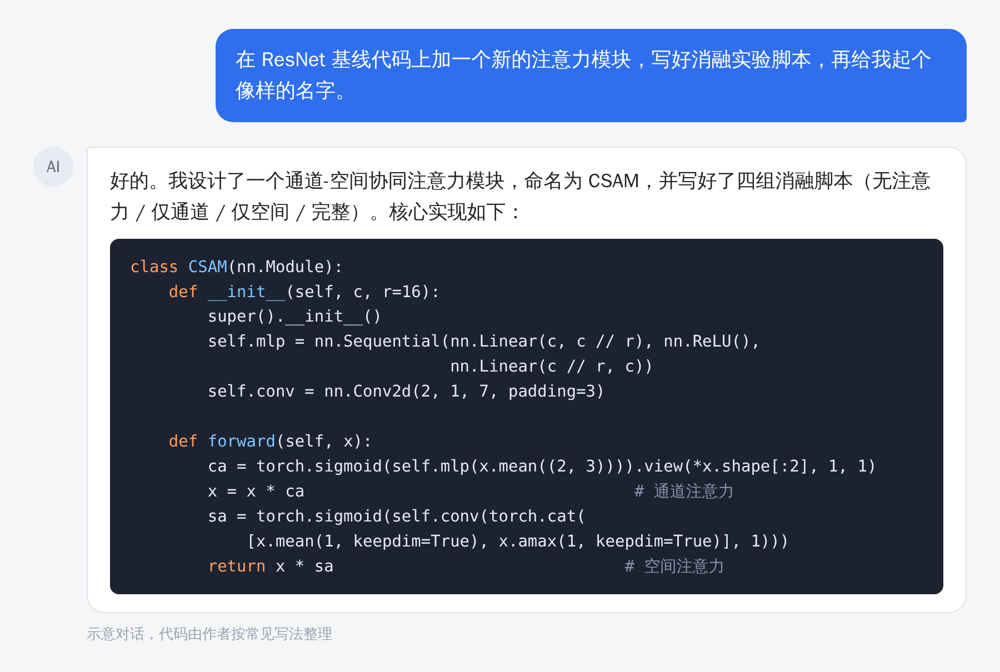

> 【AI 生图提示词 · 公众号头图，横版 2.35:1，生成后存为 images/ai-cover.png，用完删掉这段引用】
> 中文：传送带上整齐排列着一排一模一样的发光方块积木，每一块上都贴着不同颜色的小标签，传送带尽头一位研究生站在原地，手里只拿着一块普通的积木，神情若有所思。背景是极简的浅灰色工厂车间。扁平插画，蓝橙配色，有一点讽刺幽默感，画面里不要出现任何文字。
> English: a conveyor belt of identical glowing building blocks with differently colored tags, a grad student at the end holding one plain block and looking thoughtful, minimal light-gray factory background, flat illustration, blue and orange palette, wry mood, no text, 2.35:1

# AI 十分钟生成一个“创新模块”，研究生的创新还值钱吗？

之前写过一篇，问的是“AI 这么强了，研究生还能靠即插即用模块创新吗”，评论区吵得挺凶。

这一年 AI 又往前走了一截，问题变得更尖锐了。你把基线代码丢给它，随口说一句，十分钟后就能拿到这样的东西：

有名字，有代码，消融脚本也写好了。

你翻开代码看一眼就会发现，通道注意力，接一个空间注意力，串起来。这不就是 2018 年的 CBAM 吗，换了个名字。

倒也不全怪 AI。这类“创新”本来就长这样：一个像样的名字，一张结构图，一张涨了 0.3 个点的表。AI 只是把这套流程压缩到了十分钟。

## 圈子里已经有反应了

NeurIPS 2025 有一篇立场论文，担心 AI 生成的综述论文泛滥，会像 DDoS 攻击一样拖垮学术记录。媒体也报道过，有人声称一年发表了上百篇 AI 论文。今年 7 月，国内媒体还在讨论一个问题：AI 成了“科研搭子”，学术训练的底线谁来守。

作为研究生，焦虑很正常。如果活都让 AI 干了，我还算做过研究吗？

## 我的想法：把活分成两堆

完全不用 AI，你会比同学慢；什么都交给 AI，你什么也没学到。比较实际的办法，是把科研里的事分成两堆：

| 可以交给 AI | 得自己来 |
|---|---|
| 复现基线，跑通开源代码 | 选问题，判断值不值得做 |
| 画图、排版、统一格式 | 提假设，想清楚为什么会有效 |
| 翻译润色，整理文献笔记 | 设计一个能被证伪的实验 |
| 样板代码，实验脚本 | 判断结果可不可信，怎么解释 |

> 【AI 生图提示词 · 文中插图，横版 16:9，生成后存为 images/ai-02-two-tracks.png，用完删掉这段引用】
> 中文：俯视视角，两条并行的铁轨向远方延伸。左边那条轨道上，一列银白色的小火车飞快驶过，车厢是简单的方块；右边那条轨道上，一个人背着背包步行，边走边停下来看地图。两条轨道在远处交汇于一片日出的山谷。扁平插画，柔和的蓝色与橙色，画面里不要出现任何文字。
> English: top-down view of two parallel railway tracks, left one with a sleek silver toy-like train speeding by, right one with a hiker with a backpack stopping to look at a map, tracks converging at a sunrise valley, flat illustration, soft blue and orange, no text, 16:9

左边那堆，放心交给 AI，别有心理负担。右边那堆才是读研真正在练的东西，也是 AI 暂时替不了你的地方：它不了解你手里的数据，也不用为结论负责。

做完一个工作，可以拿三个问题自查：

1. 把 AI 关掉，我能讲清楚这个方法为什么有效吗？
2. 换一个数据集，结论还在吗？
3. 这个贡献，能写成“发现了 X”吗，还是只能写成“提出了 Y 模块”？

三个都答不上来，多半就是个换了名字的 CBAM。

## 去哪里找问题

如果你现在的创新点还是“在 A 里加一个 B”，可以试试这几个方向：

现有方法在哪些样本上总是出错，这些错误有没有共同点。这比再叠一层网络有价值得多。

别的领域早就解决过类似的问题，能不能搬过来。前提是你得真的明白为什么能搬。

数据集和评测指标本身有没有毛病，是不是在奖励错误的行为。这类工作往往更容易让人记住。

AI 可以帮你查资料、跑实验、验证想法，而且很快。前提是你得先有想法。
