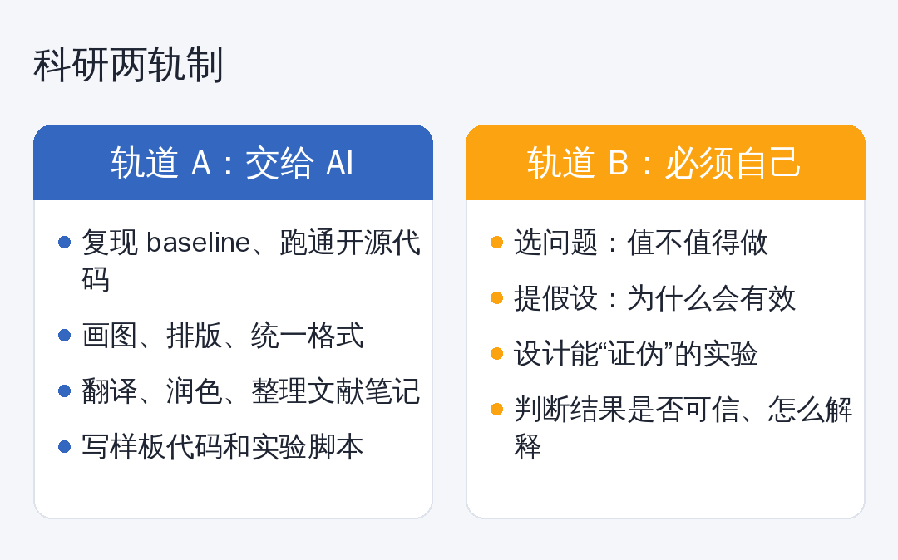

# AI 十分钟生成一个“创新模块”，研究生的创新还值钱吗？

前一阵，大家还在争论一个问题：**即插即用模块，还能不能发论文？**

现在问题变了。

你把 baseline 的代码丢给 AI，说一句：“给我加一个注意力变体，再写好消融实验脚本。”十分钟后，一个“新模块”、一份“实验设计”、一段“方法描述”，全都有了。

如果模块可以十分钟量产，**它还值多少钱？**

## 创新正在通货膨胀

这不是危言耸听。

NeurIPS 2025 的立场论文就警告过：AI 生成的综述论文泛滥，像对科研记录发起“DDoS 攻击”。媒体也报道过，有人声称一年发表了上百篇 AI 相关论文。

当“产出一篇论文”的成本趋近于零，**单纯堆模块、调组合的边际价值，也趋近于零。**

另一方面，今年 7 月，国内媒体也在讨论一个更根本的问题：当 AI 成为“科研搭子”，**谁来守住学术训练的底线？**

作为研究生，你的焦虑很合理：

> 如果 AI 能把活都干了，我还算做过研究吗？

## 我的答案：科研两轨制

我不建议你“拒绝 AI”，那只会让你比同学慢。也不建议你“全交给 AI”，那你就真的什么都没学到。

**折中的办法是把科研拆成两条轨道。**

**轨道 A：交给 AI。** 复现 baseline、跑通开源代码、画图排版、翻译润色、整理文献笔记、写样板代码。这些事，AI 做得比你快，你也没必要练。

**轨道 B：必须自己扛。** 选什么问题、为什么这个问题值得做、假设是什么、实验怎么设计才“能证伪”、结果出来后怎么判断可不可信。

**轨道 B 才是你读研真正在训练的东西。** 也是未来几年里，唯一不会贬值的能力。

## 三问自检：你的工作在哪条轨道上？

做完一个工作，问自己三个问题：

**1. 没有 AI，我能讲清楚这个方法为什么有效吗？**
讲不清楚，说明你只是搬运工。

**2. 换一个数据集，结论还成立吗？**
只在一个数据集上“有效”的模块，审稿人最爱拒。

**3. 我的贡献，能不能说成“发现了 X”，而不是“提出了 Y 模块”？**
“提出了 Y 模块”是工具，“发现了 X”才是知识。

## 从“造模块”转向“找问题”

如果你的创新点还停留在“在 A 里加一个 B”，建议试试这三个来源：

**① 分析失败案例。** 现有方法在哪些样本上稳定出错？这些错误有什么共同点？这比再叠一层网络有价值得多。

**② 跨领域迁移。** 别的领域早已解决的类似问题，能不能搬过来？前提是你真的理解为什么能搬。

**③ 数据和评测的缺陷。** 现有数据集有没有偏差？评测指标是不是在奖励错误的行为？这类工作往往更容易被记住。

AI 可以帮你 **找资料、跑实验、验证想法**，但“哪里值得挖”，只能靠你自己。

## 最后

AI 时代，模块不稀缺，代码不稀缺，甚至论文都不稀缺。

**稀缺的是：知道什么值得做的人。**

让 AI 替你干活，别让它替你思考。

---

*你怎么看？你觉得现在的论文，创新点还重要吗？欢迎留言。*
