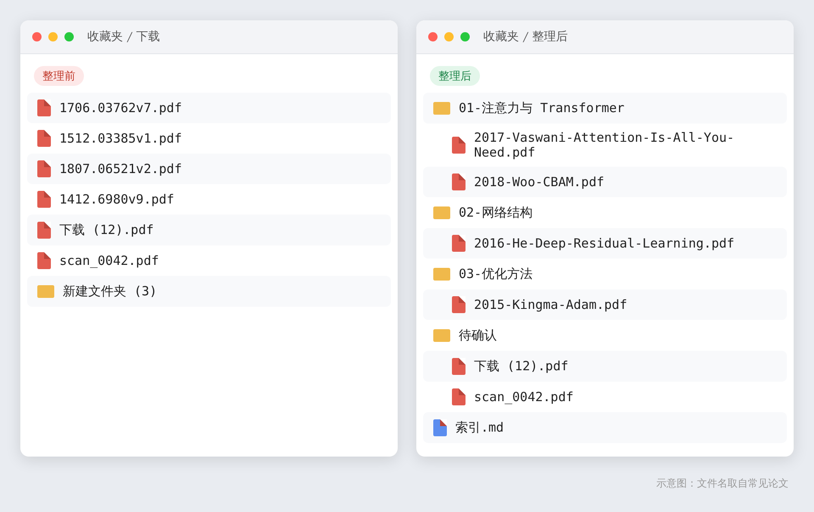
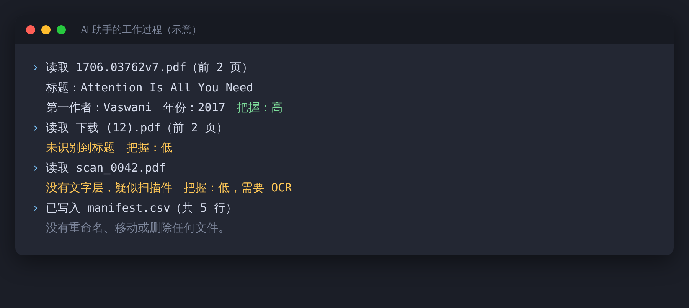
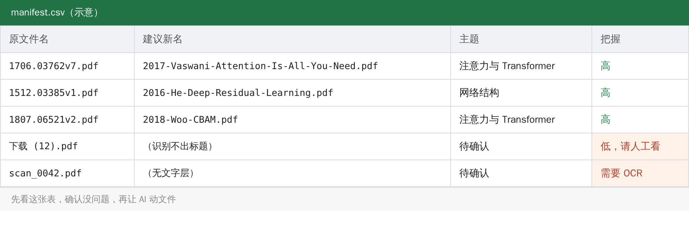
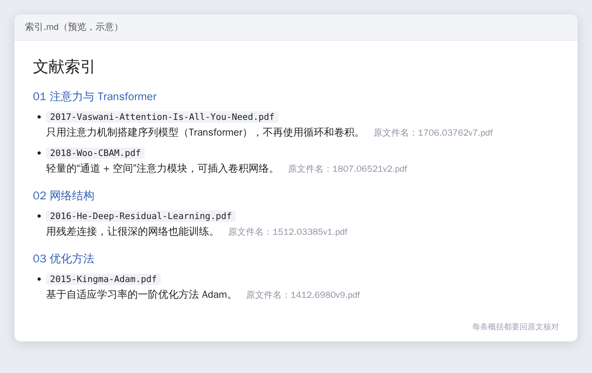

打开你的下载文件夹，大概率会看到这些：`1706.03762v7.pdf`、`下载 (12).pdf`、`1-s2.0-S0925231222012345-main.pdf`，还有一个叫“新建文件夹 (3)”的目录。

当时都想着“先存着，以后看”。现在要找某篇论文，只能一个个点开，看了标题才知道它是什么。

这种活很适合交给 AI：读文件，认标题，改名，分类，全是机械的事。下面这套做法，核心是先让它出方案，你确认以后它再动手。



## 先说三个前提

- 要用 Codex、Claude Code 这类能读写本地文件的 AI 助手，并且在这个文件夹里启动。网页版的聊天框读不到你电脑里的文件。
- PDF 的内容会被发给模型服务。未发表的稿件、有保密要求的材料，不要放进来。
- 先复制一份，整理只在副本上做，原件不动。

## 第一步：复制一份

Windows 直接在资源管理器里复制整个文件夹就行。macOS 或 Linux 用命令行也可以：

```bash
cp -r ~/Downloads/文献 ~/文献整理
cd ~/文献整理
```

然后在“文献整理”这个文件夹里启动你的 AI 助手。

## 第二步：只出方案，不动文件

给它的第一条指令：

```text
请读取当前文件夹里每个 PDF 的前两页，识别论文标题、第一作者、发表年份。
先不要重命名、移动或删除任何文件。
把结果写成 manifest.csv，列包括：原文件名、建议新文件名、主题分类、把握程度（高/低）。
新文件名格式：年份-第一作者姓-英文短标题.pdf
主题分类请根据内容归纳，不超过 8 类。
识别不出标题、或者没有文字层的扫描件，把握程度标“低”，并写明原因。
```

助手运行起来大概是这样：



它会生成一张这样的表：



## 第三步：自己过一遍表

花五分钟看一下 manifest.csv，重点看两处：标“低”的行，以及主题分类合不合理。

AI 容易认错的，常见是几类文件：扫描版 PDF、中文文献、一个 PDF 里装了好几篇文章的合集。这些要自己判断。


> 【AI 生图提示词｜infographic｜sketch-notes + macaron｜16:9｜生成后存为 imgs/05-infographic-three-hard-cases.png，用完删掉本引用块】
> ZONES：三张并排的圆角卡片，每张上方画一个文件图标（依次带有扫描纹理、中文字符轮廓、叠在一起的多页文档），下方一行说明；每张卡片右上角一个小的黄色警示三角。
> LABELS：卡片标题「扫描版 PDF」「中文文献」「合集文件」；说明「没有文字层」「标题格式不统一」「一个文件里有多篇」；底部一行「这三类，自己判断」。文字少而大，手写体风格。
> COLORS：三张卡片依次为淡蓝、淡薰衣草紫、淡桃色，背景暖奶油色。颜色名称只是渲染指导，不要作为文字出现在画面里。
> STYLE：sketch-notes，黑色略带抖动的手绘线条，粉彩信息框；构图干净，大量留白，无复杂背景。
> ASPECT：16:9

## 第四步：确认以后再执行

表没问题了，再给第二条指令：

```text
manifest.csv 我已确认，请按它执行：
1. 把文件复制（不是移动）到“整理后/”下对应的主题子文件夹，使用建议的新文件名。
2. 把握程度为“低”的文件放进“整理后/待确认/”，不要改名。
3. 生成“整理后/索引.md”：每篇一行，包含新文件名、一句话概括、原文件名。
4. 不要删除任何原文件。
```

执行完，打开索引.md，大概是这样：




> 【AI 生图提示词｜flowchart｜sketch-notes + macaron｜16:9｜生成后存为 imgs/03-flowchart-workflow.png，用完删掉本引用块】
> ZONES：从左到右五个圆角方块，用带箭头的曲线依次连接；第三个方块旁边画一个小的放大镜图标，第五个方块旁边画一个小的打勾图标。
> LABELS：①「复制一份」②「AI 出方案」③「你确认」④「再执行」⑤「抽查」；每个方块下方一行小字：①「原件不动」②「先不改文件」③「看标“低”的」④「只复制不删除」⑤「随机开 10 篇」。
> COLORS：方块依次为淡蓝、淡薄荷绿、淡桃色、淡薰衣草紫、淡黄；背景暖奶油色。颜色名称只是渲染指导，不要作为文字出现在画面里。
> STYLE：sketch-notes，黑色略带抖动的手绘线条，粉彩信息框；构图干净，大量留白，无复杂背景。
> ASPECT：16:9

## 做完再抽查

随机打开十来篇，核对改名对不对，索引里那句话的概括和原文是否一致。AI 的概括可能有偏差，以后要写进论文的信息，一定要回原文确认。

## 它和 Zotero 怎么分工

| | 本文的做法 | Zotero 这类文献管理软件 |
|---|---|---|
| 适合 | 一次性清理历史堆积的 PDF | 长期管理、引用、多设备同步 |
| 引用格式 | 不负责 | 能生成各种引用格式 |
| 门槛 | 会用 AI 编程助手 | 安装软件；部分 AI 插件需要自备 API Key |

我的建议是，用这套办法把存量理一遍，之后新读的文献直接进 Zotero。

收藏夹里的文件，多半不是不想看，是找不到。理完之后，至少找得到了。
