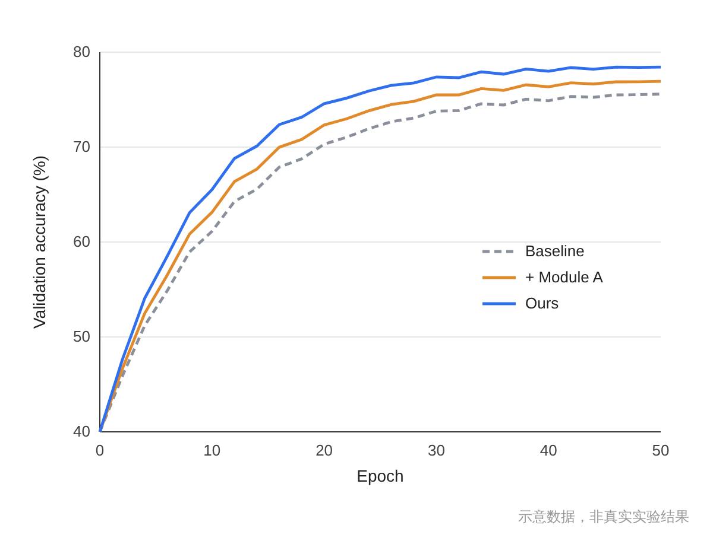

很多“Codex 一键出图”的教程，最后给你的是一张好看的 PNG。拿去投稿之前，先想想你要画的是哪一类图。

## 数据图：让 AI 写代码，别让它“画”

折线图、柱状图、热力图，数据都来自你的实验。这类图要让 AI 写绘图代码（比如 Python 的 matplotlib），由代码读取你的数据文件来生成。

原因有三点：

- 数字来自文件，不会被图像模型“画偏”。
- 代码可以复现。审稿人要求换配色、改字号，改一行重新运行就行。
- 能导出 PDF 或 SVG 这样的矢量图，放大不糊。



给 AI 的指令可以这样写：

```text
读取 results/acc.csv，画一张三条曲线的折线图：
横轴 Epoch，纵轴 Validation accuracy (%)。
字体 Arial，图宽 8.5 cm（单栏），分辨率 300 dpi，
配色对色盲友好，Baseline 用灰色虚线，Ours 用蓝色实线。
同时导出 PDF 和 PNG，不要修改 csv 里的任何数字。
```

多数期刊对图的宽度、字号有要求，单栏宽度大多在 8.5 到 9 厘米左右，具体以目标期刊的作者指南为准。

## 示意图：草稿用生图，定稿要能改

框架图、流程图、机制图属于这一类。有两种做法：

| 做法 | 好处 | 问题 |
|---|---|---|
| 用 Codex 的原生生图功能（imagegen）直接出 PNG | 快，版式有想象力 | 图里的文字常出错，改一个字就得整张重生成 |
| 让 AI 生成可编辑文件（draw.io 的 .drawio、Visio 的 .vsdx） | 每个框、每个字都能改 | 版面不如生图灵活，多一步导入软件 |


> 【AI 生图提示词｜comparison｜sketch-notes + macaron｜16:9｜生成后存为 imgs/02-comparison-png-vs-editable.png，用完删掉本引用块】
> ZONES：左右两栏，中间一条竖直分隔线。左栏画一张漂亮但带有几处小红叉标记的流程图缩略图，旁边一个“重新生成”的循环箭头；右栏画同一张流程图，但每个方框都带着小小的编辑手柄，旁边一支铅笔图标。
> LABELS：左栏标题「直接出 PNG」，要点：「好看」「文字易错」「改字要重来」；右栏标题「可编辑文件」，要点：「每个字能改」「版式要自己调」。文字少而大，手写体风格。
> COLORS：左栏淡桃色，右栏淡薄荷绿，背景暖奶油色。颜色名称只是渲染指导，不要作为文字出现在画面里。
> STYLE：sketch-notes，黑色略带抖动的手绘线条，粉彩信息框；构图干净，大量留白，无复杂背景。
> ASPECT：16:9

社区里已经有人把两者结合起来。比如开源的 Research Figure Pipeline 插件，先用图像模型生成各个模块的画面，再用 Visio 做连线和排版，最后输出可编辑的 .vsdx；也有人让 Codex 通过 draw.io 的 MCP 直接修改 .drawio 文件。这些信息来自个人博客和 GitHub 项目，具体步骤以各项目的 README 为准。

我的建议是，用生图找版式灵感，定稿换成可编辑格式重画一遍，图里的文字全部自己核对。

另外有几个社区里被人踩过的坑：

- 在终端里用 `$imagegen` 生成的图，默认存放在 Codex 的会话输出目录，在提示词里写“保存到某某路径”不一定生效，需要自己把图拷出来。
- 用第三方中转 API 的话，各家对生图的支持差异很大，先拿一张简单的图试一下。

## 实验原始图像：不要碰

显微照片、凝胶电泳图、实物照片这类实验图像，多数期刊明确禁止用生成式 AI 来创建或修改，不管是“补全”“美化”还是“去噪”。这是学术诚信的红线。

示意图用了 AI，也要看期刊对 AI 使用声明的要求，该写的要写上。

## 一张表看完

| 图类型 | 怎么画 | 红线 |
|---|---|---|
| 数据图 | AI 写代码，读取真实数据 | 数字不能由生图模型“画”出来 |
| 示意图 | 生图出草稿，可编辑格式定稿 | 文字逐字核对，按期刊要求声明 |
| 实验原始图像 | 原图加必要的标注 | 不得用 AI 生成或修改 |

一键出图省的是排版的时间，省不掉的是你对每张图负责。
