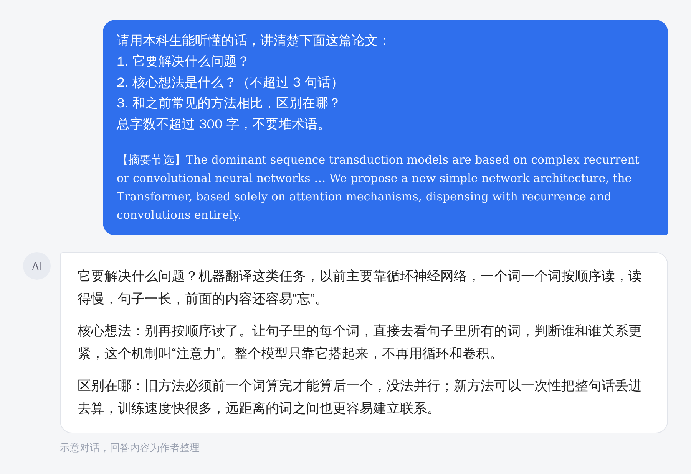

> 【AI 生图提示词 · 公众号头图，横版 2.35:1，生成后存为 images/ai-cover.png，用完删掉这段引用】
> 中文：组会教室的后排，一位新生缩在座位里，面前的笔记本摊开着，周围的空气里飘着一圈圈看不懂的英文缩写和公式（用抽象的线条和字母形状表示，不要有可辨认的文字）。他旁边坐着一个半透明的、像学长一样的发光人影，正笑着指向笔记本。暖色调教室灯光，半写实插画，温暖治愈风。
> English: back row of a seminar room, a new grad student shrinking in his seat, abstract swirling acronyms and formulas in the air (abstract shapes only, no legible text), a translucent glowing senior-student figure beside him smiling and pointing at his notebook, warm classroom light, semi-realistic, warm and comforting, 2.35:1

# 组会听不懂？开会前 30 分钟，让 AI 当你的“私人学长”

研一新生大概都经历过这一幕：师兄在台上讲得起劲，PPT 一页翻过一页，满屏是你没见过的缩写。你低头假装记笔记，心里只有一句话，千万别点我。

有人把这段时间叫“研一落差期”：本科用的还是 Windows，进了实验室，直接换成了 Linux。

这事不用熬夜补一周的课就能缓解。我整理了一套开会前 30 分钟的做法，全程只要三条提示词。

## 开会前 30 分钟：先搞懂它在讲什么

拿到师兄师姐要讲的那篇论文（或者 PPT），把摘要、引言、结论贴给 AI，用下面这条：

```
请用本科生能听懂的话，讲清楚下面这篇论文：
1. 它要解决什么问题？为什么这个问题重要？
2. 核心想法是什么？（不超过 3 句话）
3. 和之前常见的方法相比，区别在哪？
总字数不超过 300 字，不要堆术语。

【论文内容】
（粘贴摘要、引言、结论）
```

效果大概是这样，这里拿大家都熟的 Transformer 那篇的摘要做示意：



这一步不是为了看懂细节，是先在脑子里搭个架子，后面听到什么，都往架子里放。

## 开会前 20 分钟：把术语过一遍

组会听不懂，十有八九卡在术语上。再来一条：

```
请列出这篇论文里，刚入门的研究生最可能不懂的 10 个术语。
每个术语请给出：
- 一句话解释
- 一个生活类比
- 它在这篇论文里起什么作用
```

清单存下来。攒上几个月，你就有了一本自己的小词典。

## 开会前 10 分钟：想好一个问题

沉默的新生容易被忽略，问了离谱问题的新生容易被记住。问一个合理但不尖锐的问题，最划算：

```
假设你是刚入门的研究生，读完这篇论文后，
请提出 3 个合理的问题，并说明每个问题为什么有价值。
问题不要太尖锐，要像认真读过论文的人会问的。
```

挑一个，改成你自己的话。原样念 AI 的问题，导师追问两句就露馅了，改写的过程，本身就是你在理解。

## 开会的时候：三栏笔记

随手画三栏就行：

| 听懂的 | 没听懂的 | 想问的 |
|---|---|---|
| | | |

没听懂的先记下来，别硬撑，也别装懂。

## 散会之后

24 小时内，把“没听懂的”那一栏拿去问 AI，再对照论文原文确认一遍。AI 的总结有可能出错，原文才算数。这个习惯养上几个月，你读文献的速度会明显不一样。

## 几个提醒

组里没发表的工作、导师的课题材料，别直接传给公共的 AI 工具。先问问师兄师姐或导师，组里有没有这方面的规定。

AI 总结里的数字和结论，用之前回原文核对。

这套办法的目的是让你跟得上组会，不是让你蒙混过关。

读研最难受的，往往是一个人闷着。等组会能听懂了，再练着自己提问题，那是下一步的事。
