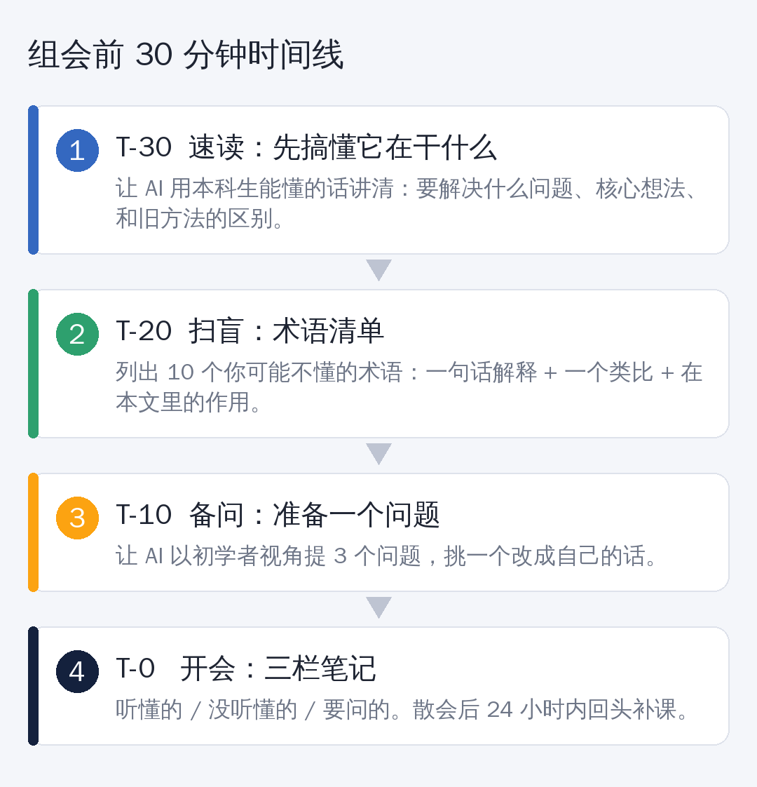

# 组会听不懂？开会前 30 分钟，让 AI 当你的“私人学长”

研一新生，大概都经历过这一幕：

师兄在台上讲得眉飞色舞，PPT 一页接一页，满屏都是你没见过的缩写。你低头假装记笔记，心里只有一个念头——**千万别点我名。**

有人把这个阶段叫作“研一落差期”：本科还是 Windows，一进实验室，直接给你换成了 Linux。

好消息是，这个问题**有解**，而且不需要你熬夜补一周的课。

下面是我整理的一套“组会前 30 分钟速通法”。



## T-30：先搞懂“它在干什么”

拿到师兄师姐要讲的那篇论文（或 PPT），先别硬啃。把摘要、引言、结论贴给 AI，用这句提示词：

```
请用本科生能听懂的话，讲清楚下面这篇论文：
1. 它要解决什么问题？为什么这个问题重要？
2. 核心想法是什么？（不超过 3 句话）
3. 和之前常见的方法相比，区别在哪？
总字数不超过 300 字，不要堆术语。

【论文内容】
（粘贴摘要、引言、结论）
```

目标不是“看懂细节”，而是**先在脑子里搭一个框架**。后面听到什么，都能往框架里放。

## T-20：术语扫盲

组会听不懂，十有八九是卡在术语上。再来一句：

```
请列出这篇论文里，一个刚入门的研究生最可能不懂的 10 个术语。
每个术语请给出：
- 一句话解释
- 一个生活类比
- 它在这篇论文里起什么作用
```

把这份清单存下来。**这是你的私人词典**，攒几个月，你会发现组会越来越轻松。

## T-10：准备一个问题

沉默的新生，容易被忽视；问了蠢问题的新生，容易被记住。**问一个“合理但不尖锐”的问题，是最划算的。**

```
假设你是一个刚入门的研究生，读完这篇论文后，
请提出 3 个合理的问题，并说明每个问题为什么有价值。
问题不要太尖锐，要像是认真读过论文的人会问的。
```

然后——**请挑一个，改成你自己的话。**

原样念 AI 的问题，导师追问两句你就露馅了。改写的过程，才是你真正理解的过程。

## T-0：开会时，三栏笔记

打开笔记本，画三栏：

| 听懂的 | 没听懂的 | 想问的 |
|---|---|---|
| | | |

没听懂的不要紧，**记下来**。别硬撑，别装懂。

## 会后 24 小时内：补课

回头把“没听懂的”一栏问 AI，再对照论文原文确认。

这一步最重要：**AI 讲的可能有误，原文才是准的。** 养成“AI 解释 + 原文核对”的习惯，几个月后，你读文献的速度会明显不一样。

## 三个提醒

**1. 别让 AI 替你“假装懂”。** 目的是跟上组会，不是蒙混过关。

**2. AI 的总结可能出错。** 重要结论、数字，一定回到原文核对。

**3. 注意保密。** 组里还没发表的工作、导师的课题材料，不要直接传给公共 AI 工具。需要时，先问问师兄师姐或导师，组里是否有规定。

## 最后

读研最怕的，不是笨，而是**一个人闷头硬扛**。

AI 不是用来帮你偷懒的，是用来帮你**更快地进入状态**。等你能听懂组会了，下一步，就是练习提出自己的问题。

---

*你们组会有过哪些“社死”时刻？评论区聊聊。*
