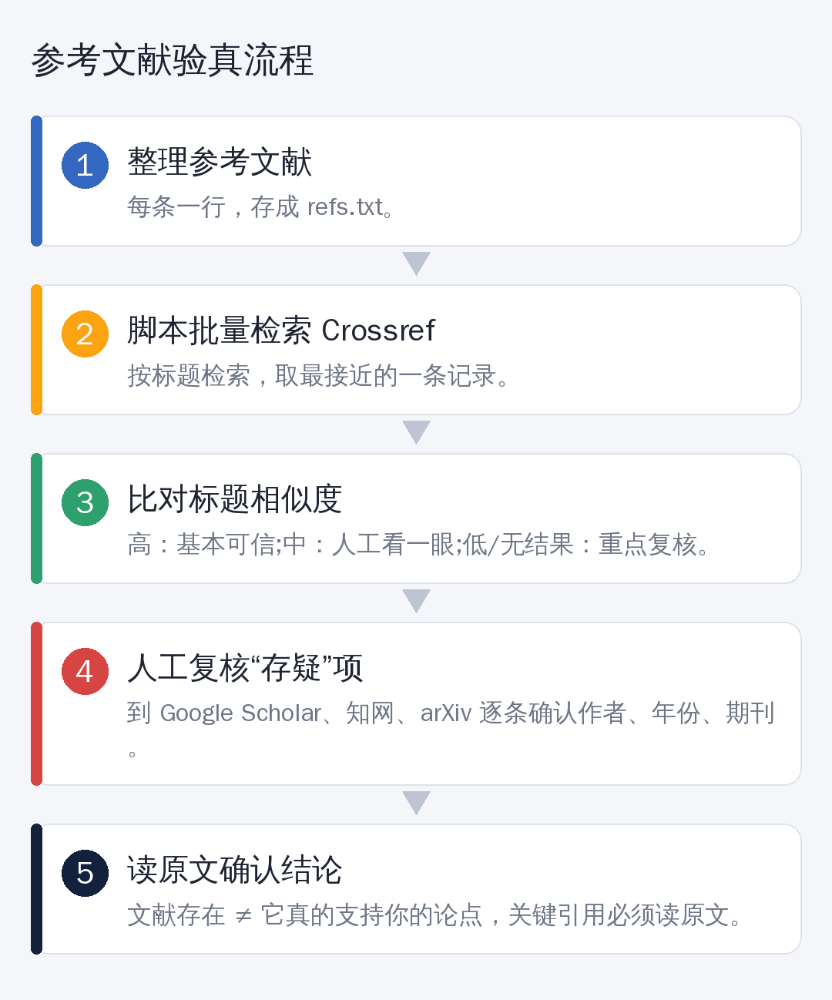

# 连顶会论文都被查出假引用，你的参考文献查了吗？

先讲一个让人后背发凉的事。

据媒体报道，AI 检测机构 GPTZero 曾对一批顶会论文做抽查：**随机抽取的 300 篇里，有 50 多篇存在严重问题**，其中就包括——**根本不存在的参考文献**，甚至虚构的作者。

连顶会论文都能漏过去，更别说你熬夜写出来的那篇综述了。

> 说明：以上数字来自媒体转述，具体口径请以原始调查为准。但“AI 会编造参考文献”这件事，大模型的使用者几乎都遇到过。

## 为什么 AI 会编参考文献

一句话：**大模型不是在“查”文献，是在“写”一条看起来像文献的文字。**

作者名、年份、期刊名、页码，每一项都合理，拼在一起就成了一篇“幽灵论文”。它不会提醒你“我不确定”。

## 人工验真，三步就够

只有几条文献，手动查就行：

1. **查 DOI。** 有 DOI 的，在 doi.org 打开，看看能不能跳转到正确的论文。
2. **搜标题。** 到 Google Scholar、知网、arXiv 直接搜完整标题，看有没有对应结果。
3. **核对信息。** 作者、年份、期刊、页码是否一致。

但如果你有 60 条、100 条参考文献呢？

## 批量验真：一个免费小脚本

Crossref 是一个公开的学术文献元数据库，**免费，不用注册**，可以通过网址查询。思路很简单：



把参考文献一行一条存进文本文件，脚本逐条去 Crossref 检索，取最接近的一条，比对标题相似度，**相似度高的标“基本可信”，低的标出来让你复核**，最后输出一张表格。

核心的请求只有几行：

```python
import urllib.parse, urllib.request, json

url = "https://api.crossref.org/works?" + urllib.parse.urlencode(
    {"query.bibliographic": 参考文献文本, "rows": 1})
data = json.load(urllib.request.urlopen(url, timeout=20))
best = data["message"]["items"][0]   # 最接近的一条
print(best["title"], best["DOI"])
```

完整脚本（带相似度判断、结果导出 CSV）我放在文末，需要的朋友自取。

使用方法：

```
python check_refs.py refs.txt
```

屏幕会逐条显示判断结果，同时导出 `refs_result.csv`，用 Excel 打开就能筛选。

## 脚本给出的结果怎么看

| 判断 | 意思 | 你该做什么 |
|---|---|---|
| 基本可信 | 标题与 Crossref 记录高度一致 | 关键引用仍建议读一下原文 |
| 存疑 | 有相似的文献，但不完全一致 | 人工看一眼作者、年份 |
| 未找到匹配 | 没查到相近的记录 | 重点复核 |

## 一个重要提醒：“查不到”≠“造假”

Crossref 不是全世界文献的总目录。**arXiv 预印本、很多中文文献、部分图书和会议论文，它可能没有收录。**

所以脚本只是**帮你缩小范围**：把 100 条缩到 10 条需要人工看的，而不是替你下结论。

## 比“文献存在”更重要的一件事

文献真实存在，**不代表它真的支持你的论点。**

AI 还有另一种常见错误：引用了一篇真实的论文，却把它的结论说反了，或者编出了论文里根本没有的数据。

所以，**你论文里的关键引用，一定要自己打开读一遍。** 脚本帮你过滤“幽灵论文”，读原文才能过滤“张冠李戴”。

## 给自己定三条规矩

- AI 给的文献，**一律先验真再引用**
- 关键论点的引用，**必须读过原文**
- 让 AI 帮你找文献时，优先使用**能给出可点击来源**的工具，而不是纯靠模型“回忆”

## 最后

AI 编造文献不是你的错，**但论文里每一条引用，都是你的责任。**

花十分钟做一次“体检”，比答辩时被老师问一句“这篇文献我怎么没见过”要好得多。

---

*需要完整脚本和示例文件？在后台回复关键词领取。*
