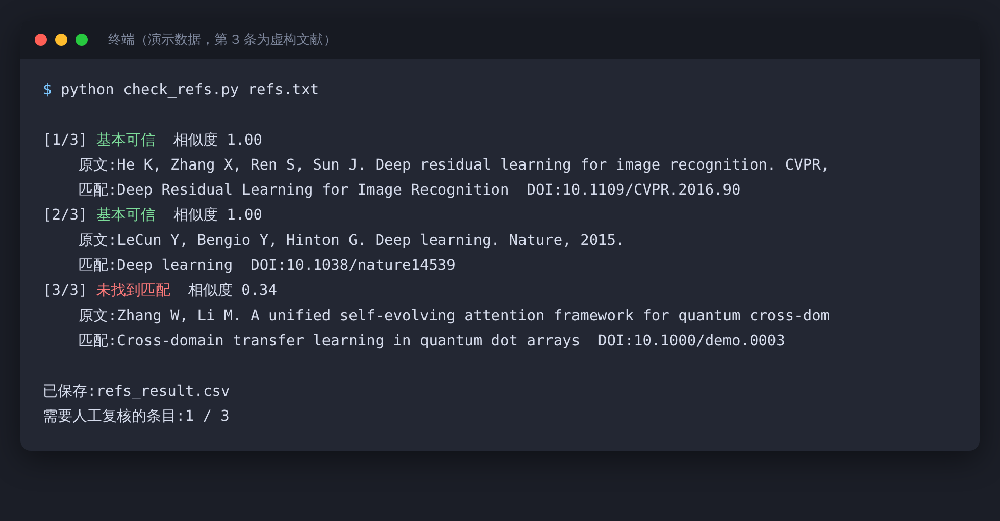
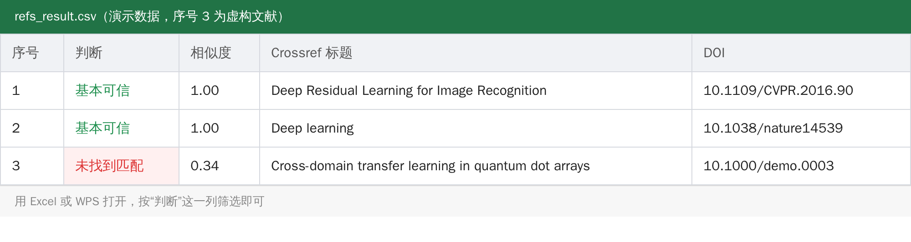

> 【AI 生图提示词 · 公众号头图，横版 2.35:1，生成后存为 images/ai-cover.png，用完删掉这段引用】
> 中文：一排高高的书架，大部分书整齐地立着，其中有几本书的轮廓是半透明的、泛着淡淡的幽灵蓝光，像是并不真实存在。一位研究生举着手电筒，正在照其中一本半透明的书。昏暗的图书馆氛围，深蓝与青色为主，略带悬疑感，半写实插画，画面里不要出现任何文字。
> English: tall library shelves, most books solid but a few translucent with a faint ghostly blue glow, a grad student shining a flashlight on one of the ghost books, dim library mood, deep blue and teal, slightly mysterious, semi-realistic illustration, no text, 2.35:1

# 连顶会论文都被查出假引用，你的参考文献查了吗？

先说一件让人后背发凉的事。

据媒体报道，AI 检测机构 GPTZero 曾抽查过一批顶会论文：随机抽的 300 篇里，有 50 多篇存在严重问题，其中就包括根本不存在的参考文献，甚至虚构的作者。（数字来自媒体转述，具体口径以原始调查为准。）

顶会都能漏过去，你熬夜赶出来的那篇综述，就更难说了。

## 为什么 AI 会编参考文献

大模型并不是去“查”文献，它是在“写”一条看起来像文献的文字。作者、年份、期刊、页码，每一项单看都合理，拼在一起就成了一篇“幽灵论文”。而且它不会提醒你它其实没把握。

## 条数少，手动查就行

1. 有 DOI 的，到 doi.org 打开，看能不能跳到正确的论文
2. 没有的，把完整标题放进 Google Scholar、知网或者 arXiv 搜
3. 搜到了，核对作者、年份、期刊、页码

可要是有 80 条呢？

## 条数多，交给脚本

Crossref 是一个公开的学术文献元数据库，免费，不用注册，可以直接通过网址查询。思路很简单：把参考文献一行一条存进文本文件，脚本逐条去 Crossref 检索，取最接近的一条，比对标题相似度，最后输出结果。

核心的请求就这几行：

```python
import urllib.parse, urllib.request, json

url = "https://api.crossref.org/works?" + urllib.parse.urlencode(
    {"query.bibliographic": 参考文献文本, "rows": 1})
data = json.load(urllib.request.urlopen(url, timeout=20))
best = data["message"]["items"][0]   # 最接近的一条
print(best["title"], best["DOI"])
```

完整脚本带了相似度判断和导出表格，放在文末。运行很简单：

```
python check_refs.py refs.txt
```

屏幕上会逐条显示结果：



> 截图里是演示数据，第 3 条是我虚构的文献，用来演示“查不到”的情况。

同时会导出一份表格，用 Excel 或 WPS 打开，按“判断”这一列筛选就行：



三种结果的意思：

| 判断 | 意思 | 你要做的 |
|---|---|---|
| 基本可信 | 标题和 Crossref 记录高度一致 | 关键引用仍建议读一下原文 |
| 存疑 | 有相似的文献，但不完全一致 | 人工看一眼作者和年份 |
| 未找到匹配 | 没查到相近的记录 | 重点复核 |

## “查不到”不等于造假

Crossref 不是世界上所有文献的总目录。arXiv 预印本、很多中文文献、一部分图书和会议论文，它可能没收录。

所以脚本的作用是缩小范围：把 100 条缩成 10 条需要你亲自看的，而不是替你下结论。

## 比“文献存在”更要紧的一件事

文献真实存在，不代表它真的支持你的论点。

AI 还有一种更隐蔽的错：引用了一篇真实的论文，却把它的结论说反了，或者写出了论文里根本没有的数据。所以论文里的关键引用，一定要自己打开读一遍。脚本能帮你过滤“幽灵论文”，过滤不了“张冠李戴”。


> 【AI 生图提示词 · 文中插图，横版 16:9，生成后存为 images/ai-04-flashlight.png，用完删掉这段引用】
> 中文：特写镜头，一只手拿着放大镜，正在检查一页参考文献列表，其中一行文字在放大镜下变成了散开的灰色像素，像是在消失。桌面上放着一杯茶和一支笔。柔和的台灯光，暖黄色调，半写实插画，画面里不要出现可辨认的文字。
> English: close-up of a hand holding a magnifying glass over a reference list, one line dissolving into scattered gray pixels under the lens, tea and pen on the desk, soft lamp light, warm yellow tones, semi-realistic illustration, no legible text, 16:9

## 给自己定几条规矩

AI 给的文献，先验真再引用。关键论点的引用，必须读过原文。让 AI 帮忙找文献时，尽量用能给出可点击来源的工具，别纯靠模型凭记忆生成。

AI 编造文献不是你的错，但论文里每一条引用都算在你头上。花十分钟做次“体检”，总比答辩时被问一句“这篇文献我怎么没见过”要好。

---

需要完整脚本和示例文件，后台回复关键词领取（关键词自己设置）。
