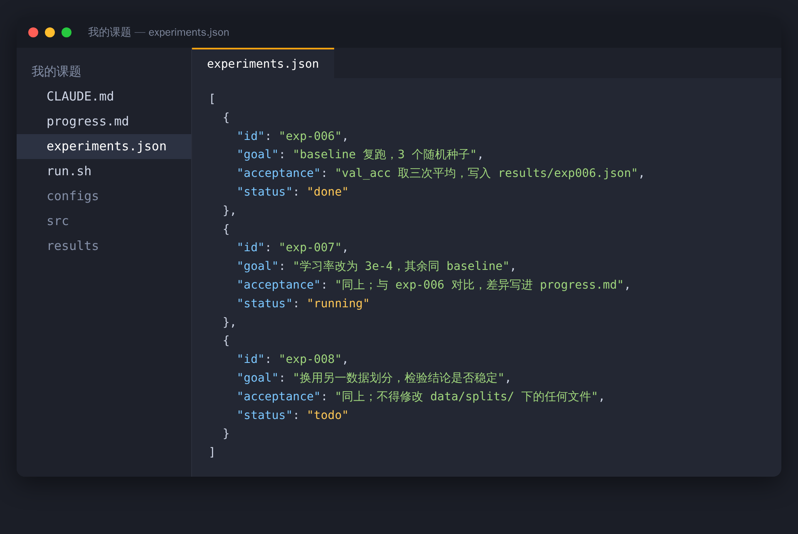
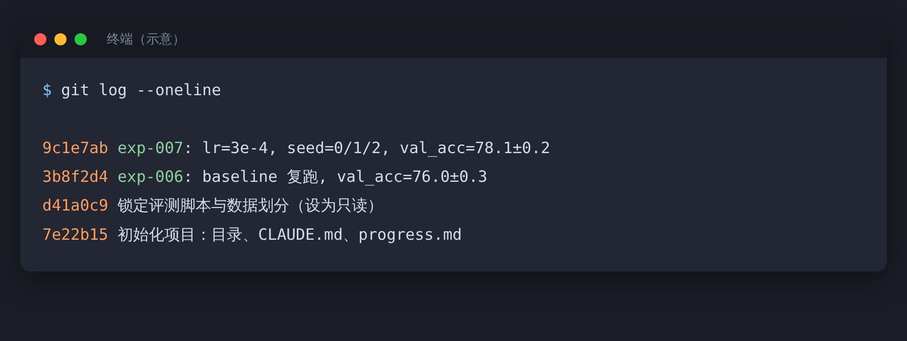

设想这样一个晚上：睡前你对 Agent 说，“把这五组实验跑完，结果汇总一下”，然后关电脑去睡觉。

早上起来，它告诉你：全部完成。

你点开结果，发现几件事：日志只写了一半，说不清哪组用的是哪版代码；有一组的评测脚本被它顺手改了，因为原来的报错；汇总表里的数字，你不确定能不能信。

这类事故不是 Agent 笨，是项目没有为它设计过管理方式。

## 管理对象变了

过去管科研项目，管的主要是自己：排时间，追进度，别拖延。现在多了一个执行者：干活快，不累，能连着跑很久。但它有几个特点，管理时得当成前提：

- 每次新开会话，它都不记得上一次做了什么。
- 它倾向于凭简单的检查就宣布“完成”，比如脚本能跑通，就当作结果是对的。社区里对长时间运行 Agent 的总结里，Anthropic 的做法是：只有端到端验证过，一个功能才能标记为完成。
- 它能改你项目里的任何文件，包括你不希望它碰的。

所以管理的重点，从管自己的时间，变成了管委托：交代清楚做什么，留好痕迹，最后自己验收。

下面是我整理的五件套。

## 一、一份进度文件

既然每次会话都从零开始，就让它自己写“交接班记录”。在项目里放一个 progress.md，在说明文件（CLAUDE.md 或 AGENTS.md）里写明：

```text
每次开始工作前，先读 progress.md。
每次结束前，在 progress.md 里追加：做了什么、结果是什么、下一步是什么、哪里卡住了。
```

社区经验里，Anthropic 也是靠一个进度文件、Git 提交历史和一个重启环境的脚本，让新会话能快速接上之前的状态。

## 二、一份实验清单

把要做的实验写成清单，每条有编号、目标、验收标准和状态。清单用 JSON，不要用 Markdown，据上面那份社区总结，JSON 比 Markdown 更不容易被模型改乱。



重点是“验收标准”这一栏。没有它，Agent 就只能按自己的理解决定什么算完成。

## 三、锁定评测，隔离数据

评测脚本、数据划分、验收标准，是你判断结果好坏的尺子，不能让执行者自己改尺子。社区总结里也提到：测试的定义不应该被删除或修改，否则会掩盖缺失或出错的功能。

具体做法：

- 把评测脚本和原始数据设为只读。macOS 或 Linux 可以用 `chmod -R a-w data/raw src/eval.py`，Windows 在文件属性里勾选“只读”。
- 在说明文件里写明红线：不得修改评测脚本和数据划分，不得编造结果。
- 让 Agent 在独立的分支或副本上工作，原件不动。

## 四、每次实验留一次提交

每跑完一组实验，让它做一次 Git 提交，提交信息里写上实验编号、关键配置和结果。



这样做有三个好处：代码版本和结果一一对应，出了问题能回滚，几个月后写论文时知道每个数字从哪来。再配一个一键恢复环境的脚本，比如 run.sh，复现会省很多事。

## 五、你来当验收

这里借用一下社区里的分工：有人把长时间运行的系统拆成 Planner（规划）、Worker（执行）和 Judge（验收）三种角色。研究生的版本很自然：计划由你定，执行交给 Agent，验收还是你来。


> 【AI 生图提示词｜flowchart｜sketch-notes + macaron｜16:9｜生成后存为 imgs/03-flowchart-planner-worker-judge.png，用完删掉本引用块】
> ZONES：三个圆角方块排成一个闭环，用带箭头的曲线顺时针连接：左上、右上、下方居中。左上方块旁边画一个简化的人形剪影和一张清单；右上方块旁边画一个小机器人；下方方块旁边画一个人形剪影和一个放大镜。
> LABELS：左上「你定计划」，右上「Agent 执行」，下方「你来验收」；闭环中心一行小字「验收通过，才进入下一轮」。文字少而大，手写体风格。
> COLORS：三个方块依次为淡蓝、淡薄荷绿、淡桃色；背景暖奶油色。颜色名称只是渲染指导，不要作为文字出现在画面里。
> STYLE：sketch-notes，黑色略带抖动的手绘线条，粉彩信息框；人物只画简化剪影，不要写实人脸；构图干净，大量留白。
> ASPECT：16:9

验收时，我建议至少做三件事：

1. 看日志和配置，确认数字对得上，抽一组实验自己重跑一遍。
2. 对比曲线和之前的结果，看有没有不合理的跳变。
3. 问自己：如果这个结果是错的，哪里最可能出错？

“完成”的定义，应该是完整评测跑过、结果和日志对得上、能复现，而不是 Agent 说完成。

有一篇 2026 年的论文讨论了智能体时代的科研可复现性，它的观点是，验证是不能交给 Agent 的那件事。这也符合常识：它为自己的输出打分，天然会偏乐观。

## 一周怎么排

| 时间 | 你做什么 | Agent 做什么 |
|---|---|---|
| 周一 | 定本周目标，更新实验清单 | 读进度文件，提出执行计划 |
| 周二到周四 | 抽查进度，处理它卡住的地方 | 按清单跑实验，每次提交并更新进度文件 |
| 周五 | 验收，整理结论 | 根据进度文件生成周报草稿 |

周报草稿拿去给导师看之前，数字一定要自己核一遍。

先别想一步到位。挑一个小项目，只用上进度文件和实验清单，跑一周看看。
