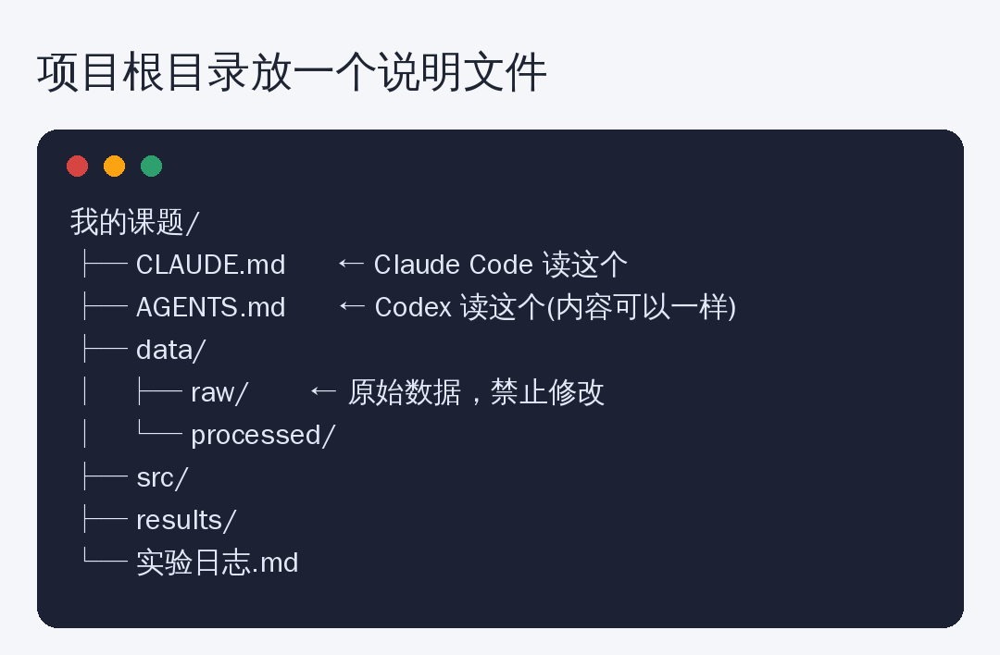

# 你的 AI 为什么总是不懂你的课题？因为你没给它写这份“入职手册”

你有没有遇到过这种情况：

- 每次开新对话，都要把课题背景重新讲一遍
- AI 擅自改了你的代码结构，还换了一个你从没用过的库
- 它不知道哪份数据不能动，一不小心把原始数据覆盖了
- 同一个项目，今天写出来的风格和昨天完全不一样

这些问题，**不是 AI 笨，是你没给它一份“入职手册”。**

想象一下，一个新来的实习生，第一天你什么都不说，直接让他改代码——出事是迟早的。

## 解决办法：在项目根目录放一个说明文件

现在主流的 AI 编程工具，都支持一个约定：**打开项目时，自动读取根目录下的一份说明文件。**

- **Claude Code** 读取的是 `CLAUDE.md`
- **Codex** 读取的是 `AGENTS.md`

文件里写什么，AI 每次开工前就会先看一遍。你只要写一次，**以后每次对话都不用重复解释。**



如果你两个工具都用，两个文件内容可以一模一样，各存一份。

## 一份能直接用的模板

下面是适合研究生课题的模板，复制过去，把方括号里的内容换成你自己的：

```markdown
# 项目说明

## 课题一句话
[例如：研究 XX 模型在小样本场景下的泛化能力]

## 目录结构
- data/raw/      原始数据，**绝对不要修改或删除**
- data/processed/ 预处理后的数据，可重新生成
- src/           源代码
- results/       实验结果和图
- 实验日志.md     每次实验的记录

## 运行方式
- 环境：Python [版本]，依赖见 requirements.txt
- 训练：python src/train.py --config configs/xxx.yaml
- 评测：python src/eval.py

## 代码规范
- 新增代码放进 src/，不要改动已有文件的整体结构
- 不要引入新的第三方库，除非先和我确认
- 函数加简短中文注释

## 红线（必须遵守）
1. 不得修改 data/raw/ 下的任何文件
2. 不得编造实验结果、数据或参考文献
3. 改动较大时，先说明方案，等我确认再动手
4. 每次完成实验，把设置和结果追加到 实验日志.md
```

## 为什么这几条最有用

**“课题一句话”**：让 AI 知道你在做什么，给出的建议不再偏题。

**“目录结构”**：AI 不会乱放文件，也不会重复造轮子。

**“红线”**：这是最值钱的部分。尤其是第 2 条——**不得编造结果**。对于科研来说，这是底线。

**“实验日志”**：让 AI 每次实验后自动记录设置和结果。一个月后你想复现，就不用翻聊天记录了。

## 进阶：让说明文件越用越好

用一段时间后，你会发现 AI 老在某个地方犯同样的错误。这时：

- 把这个错误对应的规则，**加一条进说明文件**
- 比如“画图时统一使用 300dpi、字体用 Arial”
- 它下次就不会再犯

这份文件会逐渐变成**你课题组的“规范文档”**。师弟师妹接手项目时，直接拿去用，也一样好使。

## 几个提醒

**1. 别把密钥、账号、未公开的敏感数据写进去。** 这份文件很可能会被上传、提交到仓库。

**2. 写得越具体越好，但也别写成小作文。** 几十行足够，太长反而容易被忽略。

**3. 它不是万能的。** 即使有了说明文件，AI 仍可能出错。**它生成的代码和结果，你都要自己检查。** 建议先在一个小项目上试试效果。

**4. 具体行为以工具当前版本为准。** 这类工具更新很快，如发现文件名或读取方式有变化，请查看官方文档。

## 最后

多数人用 AI，是“每次从零开始聊”；会用的人，是**把经验沉淀成文件**，让 AI 每次都站在上一次的肩膀上。

花 10 分钟写一份“入职手册”，**可能省下你未来几十小时的重复解释。**

---

*你们课题有哪些“绝对不能让 AI 碰”的东西？评论区聊聊。*
