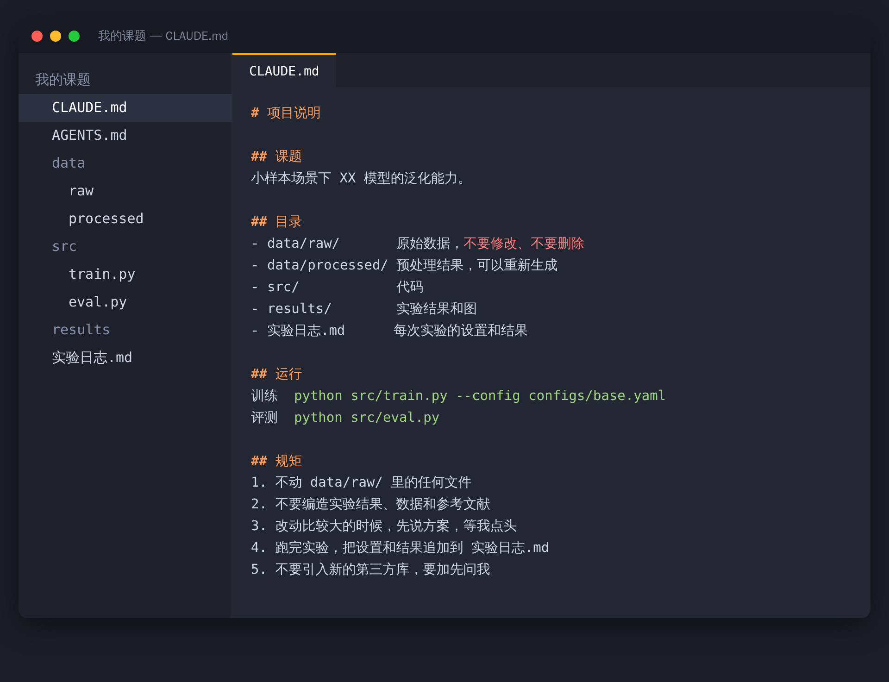

> 【AI 生图提示词 · 公众号头图，横版 2.35:1，生成后存为 images/ai-cover.png，用完删掉这段引用】
> 中文：一张整洁的实验室办公桌，桌上摆着一本厚厚的、封面是简单图标的“员工手册”，旁边站着一个小小的圆头机器人，正抬头认真地看着一位研究生递过来的手册。背景是白板和一排书架，柔和的晨光。扁平插画，暖米色和蓝色配色，温馨有趣，画面里不要出现任何文字。
> English: a tidy lab desk with a thick handbook with a simple icon cover, a small round-headed robot looking up attentively as a grad student hands it the handbook, whiteboard and bookshelves behind, soft morning light, flat illustration, warm beige and blue, cozy and playful, no text, 2.35:1

# 你的 AI 为什么总是不懂你的课题？因为你没给它写这份“入职手册”

你可能遇到过这些：

每次开新对话，都要把课题背景重新讲一遍。AI 擅自改了你的代码结构，还换了个你从没用过的库。它不知道哪份数据不能动，一不小心把原始数据覆盖了。同一个项目，今天写出来的风格和昨天完全两样。

这些问题，多半不是 AI 笨，是没人告诉过它规矩。

想象一个新来的实习生，第一天你什么都不交代，直接让他改代码，出事是迟早的。

## 在项目根目录放个说明文件

现在主流的 AI 编程工具有个共同的约定：打开项目时，会先读根目录下的一份说明文件。

Claude Code 读的是 `CLAUDE.md`，Codex 读的是 `AGENTS.md`。文件里写什么，AI 每次开工前就先看一遍，你写一次，以后不用再重复解释。两个工具都用的话，内容可以一模一样，各放一份。

课题文件夹大概长这样，右边是打开的 CLAUDE.md（示意）：



## 一份能直接改着用的模板

把方括号里的内容换成你自己的：

```markdown
# 项目说明

## 课题
[一句话说明你在研究什么]

## 目录
- data/raw/       原始数据，不要修改、不要删除
- data/processed/ 预处理结果，可以重新生成
- src/            代码
- results/        实验结果和图
- 实验日志.md      每次实验的设置和结果

## 运行
训练  python src/train.py --config configs/base.yaml
评测  python src/eval.py

## 规矩
1. 不动 data/raw/ 里的任何文件
2. 不要编造实验结果、数据和参考文献
3. 改动比较大的时候，先说方案，等我点头
4. 跑完实验，把设置和结果追加到 实验日志.md
5. 不要引入新的第三方库，要加先问我
```

几个地方我觉得最值：

“课题”那一句，能让 AI 知道你在做什么，给的建议不容易跑偏。“目录”能让它别乱放文件，也别重复造轮子。

“规矩”是最重要的。尤其是不许编造结果那一条，对科研来说是底线。

“实验日志”是个小技巧：让 AI 每跑完一次实验就记一笔设置和结果。一个月后你想复现，不用再去翻聊天记录。


> 【AI 生图提示词 · 文中插图，横版 16:9，生成后存为 images/ai-05-handbook.png，用完删掉这段引用】
> 中文：一张俯拍的桌面，一本翻开的笔记本，页面上是用简单线条画的流程图和打勾的清单，旁边放着一支铅笔、一杯咖啡和一个小小的机器人摆件，机器人手里举着一面小旗子。暖色调的柔和光线，扁平插画风格，画面里不要出现可辨认的文字。
> English: overhead view of a desk, an open notebook with simple line-drawn flowcharts and tick-box lists, a pencil, a coffee, a tiny robot figurine holding a small flag, warm soft light, flat illustration, no legible text, 16:9

## 用久了会越来越顺

跑一段时间之后，你会发现 AI 总在某个地方反复犯同样的错。这时候，把对应的规则加一条进说明文件就行。比如“画图统一用 300dpi，字体用 Arial”。下次它就记住了。

这份文件慢慢会变成你们课题组的规范文档。师弟师妹接手项目时直接拿去用，一样好使。

## 几点提醒

别把密钥、账号和没发表的敏感数据写进去，这份文件很可能会被一起提交或上传。

写得具体比写得长重要。几十行就够，太长反而容易被忽略。

有了说明文件，AI 照样会出错，它写的代码和跑出来的结果，你还是要自己检查。建议先拿一个小项目试试效果。

这类工具更新很快，文件名和读取方式以官方文档为准。

多数人用 AI 是每次从零开始聊，会用的人是把经验写成文件，让它每次都接着上一次往下做。花十分钟写一份入职手册，大概能省下之后几十个小时的重复解释。
