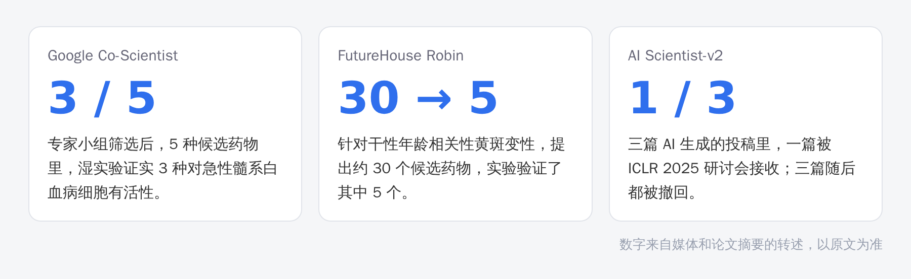
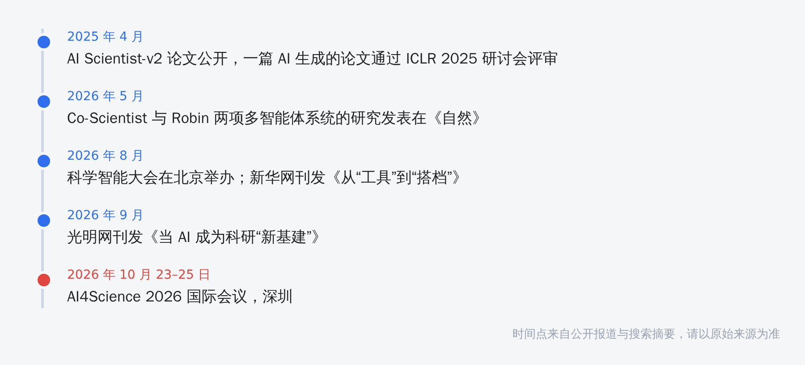

最近这类标题你大概刷到不少：“AI 科学家来了”“全自主发现新药”。

与其争论，不如把几个公开案例里的数字摆出来，看看它们实际做到了什么。

## 三个案例，各做到哪一步

**Co-Scientist。** 谷歌 DeepMind 基于 Gemini 做的多智能体系统，设计上面向多个学科，但首批验证集中在生物医学。据报道，针对急性髓系白血病，专家小组筛选了系统提出的假设，湿实验证实 5 种测试药物里有 3 种有抗白血病活性。

**Robin。** FutureHouse 的系统。针对干性年龄相关性黄斑变性，它收到一个提示后提出了约 30 个候选药物，实验验证了其中 5 个，研究者认为 ripasudil 和 KL001 比较有希望。

**AI Scientist-v2。** Sakana 的系统。三篇 AI 生成的投稿里，有一篇通过了 ICLR 2025 研讨会的评审，平均评分 6.33；三篇随后都被撤回，这本来就是一项实验。论文自己也承认，当前版本不能稳定达到顶会甚至研讨会的水平。

这三个案例都是真的。但数字放在一起看，能得出的结论比标题要克制得多。

## 媒体的说法和论文的说法

有评论指出，Co-Scientist 和 Robin 都高度依赖人类来定义问题、筛选预测，实验也是人做的，系统自己并不动手做实验。

也有科普把 Robin 写成“完全自主”地发现了药物。这个说法，比论文自己的表述要夸张。

> 【AI 生图提示词｜comparison｜sketch-notes + macaron｜16:9｜生成后存为 imgs/02-comparison-media-vs-paper.png，用完删掉本引用块】
> ZONES：左右两栏，中间一条竖直分隔线。左栏画一个大大的报纸标题块，里面是一个机器人头像，旁边几颗星星；右栏画一个简化的人形剪影在实验台前，手里拿着试管，旁边一个小机器人递过来一张清单。
> LABELS：左栏标题「媒体标题」，要点「完全自主」「AI 科学家」；右栏标题「论文里」，要点「人定义问题」「人筛选候选」「人做实验」。文字少而大，手写体风格。
> COLORS：左栏淡桃色，右栏淡薄荷绿，背景暖奶油色。颜色名称只是渲染指导，不要作为文字出现在画面里。
> STYLE：sketch-notes，黑色略带抖动的手绘线条，粉彩信息框；人物只画简化剪影，不要写实人脸；构图干净，大量留白。
> ASPECT：16:9

## 国内这两个月的几个信号

10 月 23 日到 25 日，AI4Science 2026 国际会议将在深圳举行。8 月，新华网刊发了《从“工具”到“搭档”，AI 应怎样助力科研》；9 月，光明网刊发了《当 AI 成为科研“新基建”》。财新“赛先生”的专栏则讨论了科研智能体会不会在 2026 年崛起，认为未来三五年里，“自主 AI 科学家”可能大幅抬高科学研究的上限。

地方上，四川提出要做面向科学研究的“天府·慧研”科学基础大模型和专用智能体。上海人工智能实验室的负责人近期也提到，AI 正在从早期的辅助工具，走进问题定义、假设生成、方案设计和实验验证这些环节（据报道）。

## 把科研拆成五步，看 AI 在哪一步

下面这张表是我根据公开案例做的整理，不是哪篇论文的结论：

| 环节 | AI 在公开案例里做了什么 | 仍然要人来的部分 |
|---|---|---|
| 问题定义 | 帮忙梳理和扩展相关问题 | 判断这个问题值不值得做 |
| 假设生成 | 批量提出候选（Robin 约 30 个） | 筛选，判断新不新、可不可行 |
| 方案设计 | 起草实验方案 | 评估成本和风险 |
| 实验执行 | 公开案例里由人完成 | 全部 |
| 结果验证 | 帮忙读数据 | 解释结果，复现，负责 |

> 【AI 生图提示词｜framework｜sketch-notes + macaron｜16:9｜生成后存为 imgs/04-framework-five-stages.png，用完删掉本引用块】
> ZONES：从左到右五个圆角方块，用箭头依次连接；每个方块上方有一个小图标（依次为问号、灯泡、图纸、试管、放大镜），下方并排两个小圆点：一个代表机器人（填色深浅表示 AI 参与程度），一个代表人形剪影（始终是实心）。
> LABELS：「问题定义」「假设生成」「方案设计」「实验执行」「结果验证」；底部一行小字「AI 参与程度因环节而异」。文字少而大，手写体风格。
> COLORS：五个方块依次为淡蓝、淡薄荷绿、淡桃色、淡薰衣草紫、淡黄；背景暖奶油色。颜色名称只是渲染指导，不要作为文字出现在画面里。
> STYLE：sketch-notes，黑色略带抖动的手绘线条，粉彩信息框；构图干净，大量留白，无复杂背景。
> ASPECT：16:9

## 对研究生意味着什么

假设变便宜了。Robin 一个提示就能给出约 30 个候选，那“判断哪个值得做”就变贵了。这和之前写过的两堆事情是一回事：生成和整理可以交给 AI，选问题、判断、解释，得自己来。

现在就能做的有三件事：

1. 把你自己的课题流程拆成这五步，标出每一步 AI 已经参与了多少。
2. 练习把想法写成“可以被证伪”的假设，而不是“我觉得有用”。
3. 保留过程记录。AI 参与得越多，你越需要能说清楚“这一步是谁做的、依据是什么”。

> 【AI 生图提示词｜scene｜warm｜16:9｜生成后存为 imgs/05-scene-lab-bench.png，用完删掉本引用块】
> FOCAL POINT：明亮的实验台，一位简化的人形剪影（不要写实人脸）拿着一支移液器，旁边一个小机器人递来一张写满分子小图标的清单。
> ATMOSPHERE：清晨的实验室，窗外有柔和的阳光，台面整洁，有一盆小植物。
> MOOD：合作，平静，略带好奇。
> COLORS：暖色调为主（奶油、浅橘、淡蓝）。颜色名称只是渲染指导，不要作为文字出现在画面里。
> STYLE：flat vector，干净的黑色轮廓线；构图留白，主体偏左；画面里不要出现文字。
> ASPECT：16:9

科研智能体会越来越强，这没什么好怀疑的。但现在看公开的案例，真正做出判断并为结论负责的，还是人。
