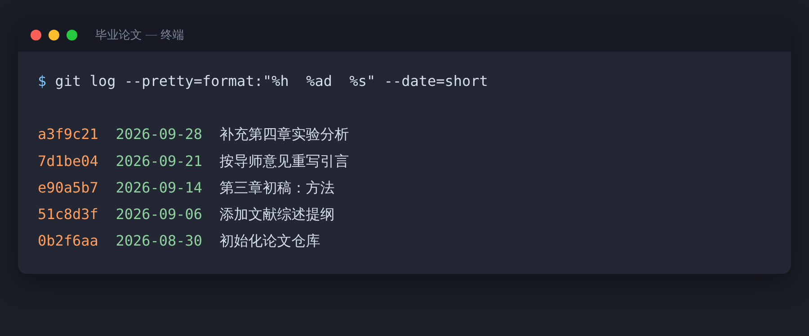

> 【AI 生图提示词 · 公众号头图，横版 2.35:1，生成后存为 images/ai-cover.png，用完删掉这段引用】
> 中文：一位学生坐在电脑前，屏幕上是一份检测报告，一个红色的警示圆环占满了半个屏幕，他一脸错愕，一只手还握着笔。桌上整齐摆着几本带便利贴的笔记本和一叠手写草稿，暗示他其实一直认真写作。夜晚的宿舍书桌，冷蓝色屏幕光和暖黄台灯光对比，半写实插画，画面里不要出现可辨认的文字。
> English: a student at a computer, a large red warning ring on the screen, bewildered with a pen still in hand, neat notebooks with sticky notes and a stack of handwritten drafts on the desk, night dorm desk, cool screen light versus warm lamp light, semi-realistic illustration, no legible text, 2.35:1

# “我自己写的论文，AIGC 率却很高？”被误判之后，你需要这五份证据

假设有这么个场景。

你一个字一个字写完了开题报告，提交系统一检测：AIGC 疑似率 40%。

你愣住了：我明明没用 AI 写啊。

这不一定是个例。高校对 AI 使用的监管越来越严，不少同学开始担心：万一被误判了，怎么办？

## 先冷静：检测结果不等于定论

AI 文本检测本质上是一个概率判断。它没法确定“这段话是谁写的”，只能说“这段话的风格像不像 AI 写的”。

所以，结果有误判的可能，这是常识。多数检测服务在说明里也会注明仅供参考，具体以你们学校和所用平台的规定为准。另外，规范、严谨、套路化的学术写作，恰恰容易被判得“像 AI”。

这意味着，你需要能证明“这是我写的”。与其出了事再解释，不如平时就留好痕迹。

## 五份能自证的材料

**一、写作的版本历史。** 这是最有说服力的一份。Word、WPS 的历史版本，Overleaf 的 History，Git 的提交记录，都能清楚地显示论文是一点一点长出来的，而不是某一天整段粘贴出现的。

一个论文仓库的提交记录大概是这样（示意）：

**二、文献阅读的痕迹。** Zotero 里的批注，带日期的读书笔记，摘录的重点。读过哪些文献、读到了什么，一目了然。

**三、原始数据和实验记录。** 数据文件、代码、实验日志、中间结果的截图。这是 AI 最难替你“编”出来的部分。

**四、和导师的修改往来。** 邮件、聊天记录里的修改稿和意见。一来一回的修改，本身就是写作过程的证明。

**五、早期的提纲和草稿。** 手写提纲，思维导图，最初的几版粗稿。别嫌它们丑，丑反而真实。

> 【AI 生图提示词 · 文中插图，横版 16:9，生成后存为 images/ai-06-notes.png，用完删掉这段引用】
> 中文：俯拍的书桌，桌面上摊开着一本满是荧光笔划线和便利贴的笔记本、一叠带涂改痕迹的手写提纲、一台打开着文档的笔记本电脑，电脑屏幕侧边露出一列时间线形状的历史记录条（只用抽象的线条和圆点表示，不要有文字）。暖色调自然光，半写实插画，真实而有生活气息。
> English: overhead desk with a notebook full of highlights and sticky notes, a stack of handwritten outlines with corrections, a laptop with a document open and a timeline-shaped history bar at the side (abstract lines and dots only), warm natural light, semi-realistic illustration, lived-in feel, no text, 16:9

## 如果真的被判定了

先别慌，也别急着承认，更别急着吵。

先弄清楚判定的依据和处理流程。去查学校的申诉渠道，研究生院或教务处的通知里，通常会写怎么申请复核。把上面五份材料准备好，有版本历史的，导出来留证。再申请人工复核，并主动跟导师说明情况。

还有一点：别立刻拿“降 AI 率”的工具硬改。把自己的话改成一堆别扭的句子，既拉低文章质量，还可能引入错误。

## 平时就把痕迹留好

写作的时候开着版本记录，隔一段时间手动存一份带日期的版本。用 Overleaf 或者 Git 管理论文，每次改动都有据可查。文献用 Zotero 管，边读边批注。实验数据和代码统一归档，别散落在各处。

如果你用 AI 做过润色或翻译，保留前后对比，并按学校和期刊的规定做声明。

这篇文章的目的，是帮你保护自己的原创，不是教你规避检测。每个学校、每个期刊对 AI 的规定都不一样，请以所在单位最新的正式文件为准。

最好的防误判，其实是一份扎实、有迹可循的研究过程。
