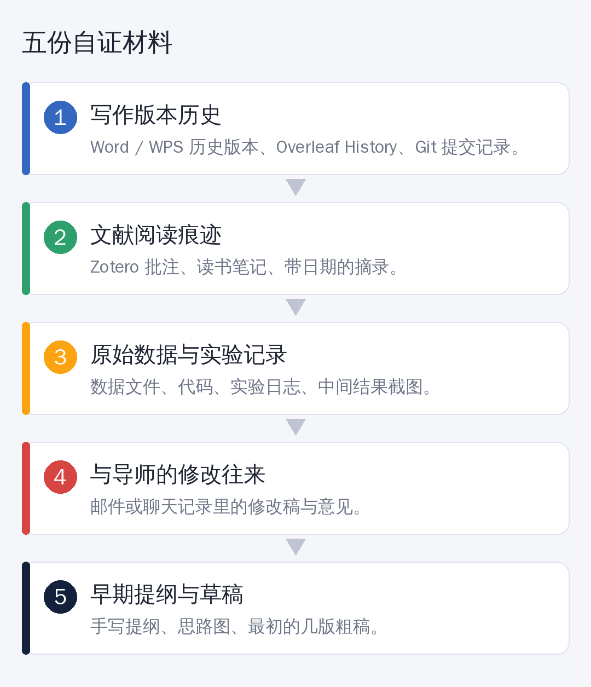

# “我自己写的论文，AIGC 率却很高？”被误判之后，你需要这五份证据

假设有这样一个场景。

你一个字一个字写完了开题报告，提交系统一检测：**AIGC 疑似率 40%。**

你愣住了：我明明没用 AI 写啊。

这不是个例。随着高校对 AI 使用的监管收紧，越来越多同学担心：**万一被“误判”了怎么办？**

## 先冷静：检测结果不等于定罪

AI 文本检测，本质上是一个**概率判断**，它没法确定“这段话是谁写的”，只能说“这段话的风格像不像 AI 写的”。

所以：

- 检测结果存在误判的可能，这是常识
- 多数检测服务在说明里也会注明“仅供参考”（具体以你们学校和所用平台的规定为准）
- 规范、严谨、套路化的学术写作，**恰恰容易被判得“像 AI”**

这意味着：**你需要能证明“这是我写的”。** 与其被动解释，不如提前留痕。

## 五份自证材料

**① 写作版本历史**
最有说服力的一份。Word、WPS 的历史版本，Overleaf 的 History，Git 的提交记录，都能清楚展示论文是**一点一点长出来的**，而不是某一天突然粘贴出现的。

**② 文献阅读痕迹**
Zotero 里的批注、带日期的读书笔记、摘录的重点。读过多少文献、读到了什么，一目了然。

**③ 原始数据和实验记录**
数据文件、代码、实验日志、中间结果截图。**这是 AI 最难替你“编”出来的部分。**

**④ 与导师的修改往来**
邮件、聊天记录里的修改稿和意见。一来一回的修改痕迹，本身就是过程的证明。

**⑤ 早期提纲和草稿**
手写提纲、思维导图、最早的几版粗稿。别觉得它们丑，**丑，才是真实。**

## 如果真的被判定了，怎么办

1. **别慌，也别急着承认或争吵。** 先弄清楚判定依据和处理流程。
2. **查学校的申诉渠道。** 研究生院或教务处的通知里，通常写明了如何申请复核。
3. **准备上面五份材料，** 有版本历史的，导出截图或文件。
4. **申请人工复核，** 并主动向导师说明情况。
5. **不要立刻用“降 AI 率”工具硬改。** 把自己的文字改成一堆别扭的句子，既影响质量，还可能引入错误。

## 比事后自证更重要的：事前留痕

从今天起，养成这几个习惯：

- **写作时开启版本记录**，定期手动保存带日期的版本
- **用 Overleaf 或 Git** 管理论文，每次改动都有记录
- **文献用 Zotero 管理**，边读边批注
- **实验数据和代码，统一归档**，别散落在各处
- **如果用 AI 做过润色或翻译，** 保留前后对比，并按学校和期刊的规定声明

## 一个提醒

这篇文章的目的，是帮你**保护自己的原创**，而不是教你规避检测。

AI 工具用得好，是助手；用得越界，就是风险。**每个学校、每个期刊对 AI 的规定都不同，请以你所在单位的最新正式文件为准。**

## 最后

最好的“防误判”，是一份**扎实、有迹可循**的研究过程。

写论文的时候，**多留一份底**，答辩的时候，才能多一份底气。

---

*你们学校对 AIGC 检测有什么规定？欢迎在评论区分享。*
