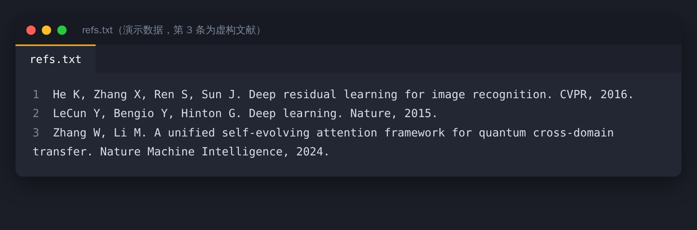
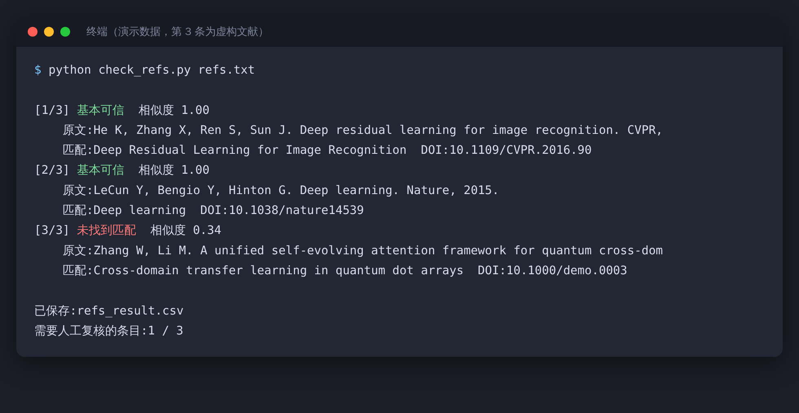
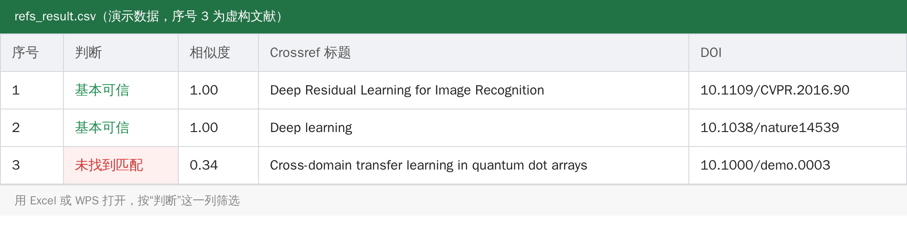

2026 年 5 月 28 日，《医学伦理学杂志》撤回了一篇论文。

原因是作者用生成式 AI“检索并解读”参考文献来源，投稿前没有逐条核验，结果引用了多篇根本不存在的文献。

这不是孤例。据转述，《柳叶刀》上有一项审计研究，核查了 250 万篇生物医学论文，发现虚假引用的出现率升到了原来的 12 倍以上。这是二手转述，原文还没有核对，数字先当作参考。

## 为什么会有“幽灵论文”

大模型不是去“查”文献，它是在“写”一条看起来像文献的文字。作者、年份、期刊、页码，每一项单看都合理，拼在一起，就成了一篇不存在的论文。它也不会告诉你它其实没把握。

连专门为学术写作做的开源工具也躲不开。academic-research-skills 的 README 里自己写了一条：它的展示稿，在发表之后做的审计里，68 条最终参考文献中仍有 21 条有问题。

## 手动自查，五步

1. 把参考文献整理成一行一条，存成文本文件。
2. 有 DOI 的，到 doi.org 打开，看能不能跳到正确的论文。
3. 没有 DOI 的，把完整标题放进 Google Scholar、知网或 arXiv 搜一下。
4. 搜到了，核对作者、年份、期刊、页码是否一致。
5. 关键引用，打开原文读一遍，确认它真的支持你写的那句话。

前四步是“它存在吗”，第五步是“它说了你写的这句吗”。很多问题出在第五步：文献是真的，结论被说反了，或者写出了论文里没有的数据。



## 条数多，交给脚本

如果有 80 条，手动查太慢。Crossref 是一个公开的学术文献元数据库，免费，不需要注册，可以直接通过网址查询。

思路很简单：逐条拿去检索，取最接近的一条，比对标题相似度。相似度高的标“基本可信”，低的标出来，留给你人工复核。核心请求只有几行：

```python
import urllib.parse, urllib.request, json

url = "https://api.crossref.org/works?" + urllib.parse.urlencode(
    {"query.bibliographic": 参考文献文本, "rows": 1})
data = json.load(urllib.request.urlopen(url, timeout=20))
best = data["message"]["items"][0]   # 最接近的一条
print(best["title"], best["DOI"])
```

完整脚本 `check_refs.py` 在文章文件夹里，用法是：

```bash
python check_refs.py refs.txt
```

屏幕上会逐条显示结果：



> 截图里是演示数据，第 3 条是虚构的文献，用来演示“查不到”的情况。

同时会导出一张表格，用 Excel 或 WPS 打开，按“判断”这一列筛选就行：




> 【AI 生图提示词｜flowchart｜sketch-notes + macaron｜16:9｜生成后存为 imgs/04-flowchart-five-steps.png，用完删掉本引用块】
> ZONES：从左到右五个圆角方块，用带箭头的曲线依次连接；第二、三个方块旁边各有一个小图标（依次为链接、放大镜），第五个方块旁边有一个打开的书本图标。
> LABELS：①「整理成一行一条」②「用 DOI 反查」③「搜标题」④「核对作者年份」⑤「读原文」；每个方块下方一行小字：①「存成文本」②「doi.org」③「学术搜索」④「期刊页码」⑤「结论对不对」。文字少而大，手写体风格。
> COLORS：方块依次为淡蓝、淡薄荷绿、淡桃色、淡薰衣草紫、淡黄；背景暖奶油色。颜色名称只是渲染指导，不要作为文字出现在画面里。
> STYLE：sketch-notes，黑色略带抖动的手绘线条，粉彩信息框；构图干净，大量留白，无复杂背景。
> ASPECT：16:9

## 结果怎么看

| 判断 | 意思 | 你要做的 |
|---|---|---|
| 基本可信 | 标题与 Crossref 记录高度一致 | 关键引用仍然要读原文 |
| 存疑 | 有相似的文献，但不完全一致 | 人工看作者和年份 |
| 未找到匹配 | 没查到相近的记录 | 重点复核 |

“查不到”不等于造假。Crossref 不是世界上所有文献的总目录，arXiv 预印本、很多中文文献、部分图书和会议论文，它可能没有收录。中文文献可以直接到知网核对。

脚本的作用是缩小范围：把 100 条缩成 10 条需要你亲自看的，而不是替你下结论。


> 【AI 生图提示词｜scene｜warm｜16:9｜生成后存为 imgs/05-scene-magnifier.png，用完删掉本引用块】
> FOCAL POINT：特写，一只手握着放大镜，对着一页参考文献列表，其中一行文字在放大镜下变成散开的灰色小方块，像要消失；桌上放着一杯茶和一支笔。
> ATMOSPHERE：柔和的台灯光，暖黄色调，安静的夜晚书桌。
> MOOD：专注，略带悬疑。
> COLORS：暖黄、奶油、浅棕为主，灰色方块作点缀。颜色名称只是渲染指导，不要作为文字出现在画面里。
> STYLE：flat vector，干净的黑色轮廓线；构图留白；画面里不要出现可辨认的文字。
> ASPECT：16:9

## 给自己定几条规矩

AI 给的文献，先验真再引用。关键论点的引用，必须读过原文。让 AI 帮忙找文献时，优先用能给出可点击来源的工具，别纯靠模型凭记忆生成。

AI 编造文献不是你的错，但论文里每一条引用，都算在你头上。
