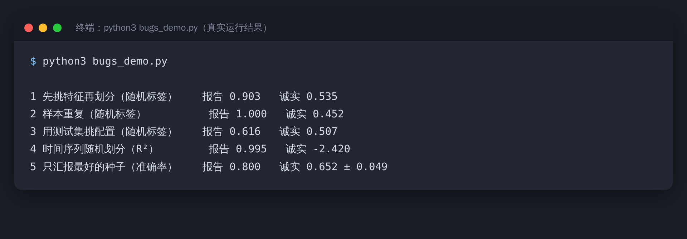
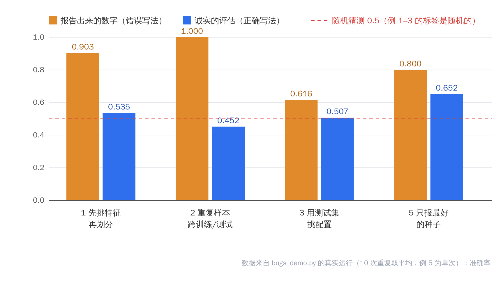
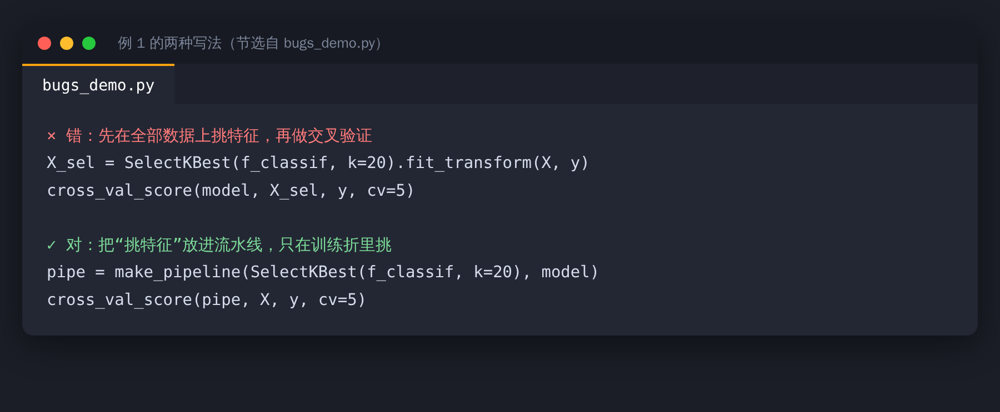

先看五组数字。

下面是同一个脚本跑出来的结果。前三行用的是随机生成的标签，也就是说，真实准确率应该在 0.5 左右，跟抛硬币一样。



“报告”那一列，是错误写法给出的数字；“诚实”那一列，是正确评估的结果。差距最大的一行，报告了 1.000，诚实评估是 0.452。



脚本 `bugs_demo.py` 在文章文件夹里，只依赖 numpy 和 scikit-learn，可以自己跑。数据都是随机生成或合成的，真实项目里虚高的幅度会因数据而异，但原理是一样的。

这五类错误有一个共同点：代码不会报错，指标还很好看。AI 写的代码尤其容易这样，因为它的目标是“跑通”，不是“评估得对”。

## 一、先挑特征，再划分数据

错在哪：在全部数据上、用了标签去挑特征，然后才做交叉验证。挑特征的时候，模型已经“看过”测试折的答案。

结果：随机标签上，报告 0.903，诚实评估 0.535。

怎么查：任何用到标签的预处理（挑特征、调阈值、过采样），都必须放在划分之后，只在训练折里做。最稳妥的写法是把它们放进流水线：



## 二、同一个样本出现在训练集和测试集

错在哪：数据里有重复样本（同一个人的多条记录、同一张图的多次增强、爬取时重复的条目），随机划分后，同一条数据同时落进训练集和测试集。

结果：1-近邻在随机标签上，报告 1.000，按样本分组划分后只有 0.452。

怎么查：划分之前先去重，或者按“人”“病例”“图片 ID”分组划分（GroupShuffleSplit 之类）。

## 三、用测试集挑最好的配置

错在哪：试了很多组超参数或模型，挑在测试集上最好的那个，再把这个分数当作最终结果。

结果：60 个配置里挑最好的，随机标签上报告 0.616，用验证集挑、测试集只用一次，是 0.507。

怎么查：划成训练、验证、测试三份，挑配置只看验证集，测试集只在最后用一次。

## 四、时间序列用了随机划分

错在哪：数据有时间趋势，却用随机划分来评估，相当于让模型看到了“未来”。

结果：一个带趋势的合成序列，随机划分的 R² 是 0.995，按时间先后划分，R² 是 -2.420，比直接预测平均值还差。

怎么查：凡是跟时间有关的数据，训练集必须早于测试集。

## 五、只汇报最好的随机种子

错在哪：同样的代码换 20 个随机种子跑，每次结果都不一样，只挑了最好的那一个写进论文。

结果：最好的一次 0.800，20 次平均 0.652，标准差 0.049。

怎么查：汇报多个种子的均值和标准差，别汇报最大值。


> 【AI 生图提示词｜infographic｜sketch-notes + macaron｜16:9｜生成后存为 imgs/04-infographic-five-bugs.png，用完删掉本引用块】
> ZONES：五张圆角卡片排成一行（或两排：三张加两张），每张卡片上方一个小图标（依次为漏斗、重复的两页纸、放大镜指着测试集、时钟、骰子），下方一行说明。
> LABELS：「先挑特征」「样本重复」「测试集挑配置」「随机划分时序」「只报最好种子」；说明「划分之后再做」「去重或分组」「验证集挑，测试一次」「按时间先后」「报均值和标准差」。文字少而大，手写体风格。
> COLORS：五张卡片依次为淡蓝、淡薄荷绿、淡桃色、淡薰衣草紫、淡黄；背景暖奶油色。颜色名称只是渲染指导，不要作为文字出现在画面里。
> STYLE：sketch-notes，黑色略带抖动的手绘线条，粉彩信息框；构图干净，大量留白，无复杂背景。
> ASPECT：16:9

## 怎么让 AI 帮你查，而不是替你信

下面这条指令，可以直接丢给 AI 助手：

```text
请检查这份实验代码里，评估是否可能虚高：
1. 任何用到标签的预处理，是否在划分之前做了？
2. 训练集和测试集之间，是否有重复样本或同一个体？
3. 超参数是不是在测试集上挑的？
4. 数据有没有时间顺序？如果有，是否按时间划分？
5. 结果是否只汇报了单个随机种子？
逐条给出代码里的具体行号和判断，不要改代码。
```

AI 的检查也会有疏漏，所以最终还是要你自己看。更实际的做法，是把这几条写进项目的说明文件（AGENTS.md 或 CLAUDE.md）：

```markdown
## 评估规则
- 凡是用到标签的预处理，必须放在划分之后，并只在训练集里拟合
- 超参数只能用验证集挑选，测试集只能在最后使用一次
- 涉及时间的数据，必须按时间先后划分
- 结果必须汇报多个随机种子的均值和标准差
```


> 【AI 生图提示词｜scene｜warm｜16:9｜生成后存为 imgs/05-scene-too-good.png，用完删掉本引用块】
> FOCAL POINT：一位简化的人形剪影（不要写实人脸）站在一块白板前，白板上画着一条陡峭上升到顶的曲线，他一手托着下巴，另一只手拿着放大镜，眼神怀疑。
> ATMOSPHERE：明亮的办公室，下午的光线，桌上有一杯咖啡。
> MOOD：怀疑，略带幽默。
> COLORS：奶油、淡蓝、浅橘为主。颜色名称只是渲染指导，不要作为文字出现在画面里。
> STYLE：flat vector，干净的黑色轮廓线；构图留白，主体偏左；画面里不要出现可辨认的文字。
> ASPECT：16:9

指标好得出乎意料的时候，先别高兴，先查一遍。
