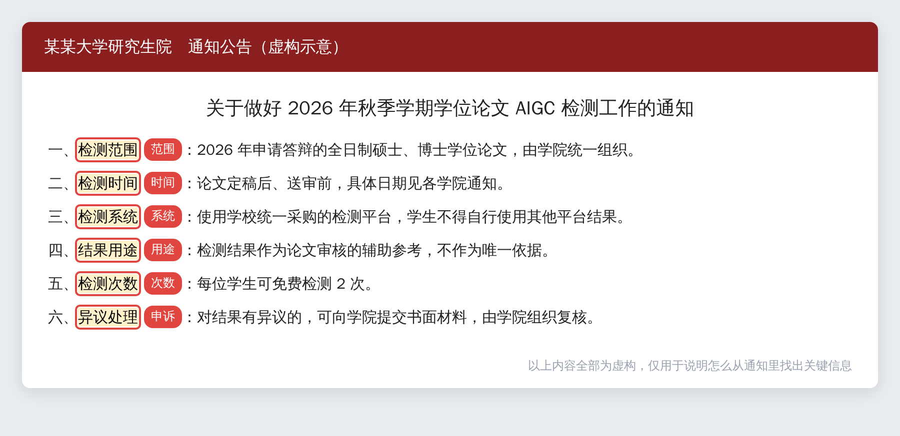
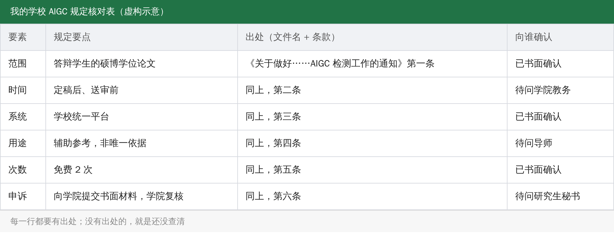

搜“AIGC 检测红线”，你会看到一堆数字：本科 30%，硕士 15% 到 20%，博士 10%。

不同的网页，对同一所学校给出的数字还不一样。这些数字大多来自工具推广类文章，不能直接用。

这篇不给数字。

## 各校的做法本来就不一样

几所高校 2026 年发布的通知，做法差别不小（以下来自搜索摘要，通知原文没有逐份核对，请以学校原文为准）：

- 山东建筑大学 2026 年春季学期对研究生学位论文做 AIGC 检测，采用抽检，抽检比例为各学院申请答辩总人数的 20%。
- 北京工商大学从 2026 年起，把 AIGC 检测作为学位论文审核的辅助工具。
- 中国地质大学（武汉）的通知里，把 AIGC 检测称为首次检测、试行。
- 东北财经大学发了通知，试用一款国产平台的 AIGC 检测工具。
- 南京财经大学红山学院对本科论文，规定学生自检后再由学院和学校抽检，每个系统每人检测两次。

同样是“检测”，有的是抽检，有的是辅助，有的是试行，有的是全员。同样是“15%”，在不同学校，可能是硬性要求，也可能只是参考线。

整个过程只有三步：

> 【AI 生图提示词｜flowchart｜sketch-notes + macaron｜16:9｜生成后存为 imgs/02-flowchart-three-steps.png，用完删掉本引用块】
> ZONES：从左到右三个圆角方块，用带箭头的曲线依次连接；每个方块上方一个图标（依次为放大镜、清单、信封）。
> LABELS：①「找到通知」②「抓六个要素」③「书面确认」；每个方块下方一行小字：①「研究生院网站」②「填核对表」③「留下回复」。文字少而大，手写体风格。
> COLORS：方块依次为淡蓝、淡薄荷绿、淡桃色；背景暖奶油色。颜色名称只是渲染指导，不要作为文字出现在画面里。
> STYLE：sketch-notes，黑色略带抖动的手绘线条，粉彩信息框；构图干净，大量留白，无复杂背景。
> ASPECT：16:9

## 第一步：找到通知

去你们学校研究生院的网站，进“通知公告”，搜“AIGC”或“学位论文检测”。再问一下学院的研究生秘书，或者翻翻班级群里转发的通知。

要找的是文件，不是别人转述的数字。

## 第二步：抓出六个要素

每份通知，至少要读出这六件事：

> 【AI 生图提示词｜infographic｜sketch-notes + macaron｜16:9｜生成后存为 imgs/03-infographic-six-items.png，用完删掉本引用块】
> ZONES：六张圆角小卡片排成两排（每排三张），每张卡片上方一个图标（依次为人群、日历、齿轮、天平、计数器、信封），下方一行说明；中间一条细线汇到底部居中的一个打勾图标。
> LABELS：「范围」「时间」「系统」「用途」「次数」「申诉」；说明「谁要测」「什么时候测」「用哪个平台」「辅助还是硬性」「能测几次」「有异议找谁」。文字少而大，手写体风格。
> COLORS：六张卡片依次为淡蓝、淡薄荷绿、淡桃色、淡薰衣草紫、淡黄、淡粉；背景暖奶油色。颜色名称只是渲染指导，不要作为文字出现在画面里。
> STYLE：sketch-notes，黑色略带抖动的手绘线条，粉彩信息框；构图干净，大量留白，无复杂背景。
> ASPECT：16:9

- 范围：哪些论文要测，硕士博士都测吗，还是只抽检？
- 时间：什么时候测，定稿后、送审前，还是答辩前？
- 系统：用学校的哪个平台，能不能用别的平台的结果？
- 用途：结果是辅助参考，还是硬性红线？超出以后怎么处理？
- 次数：能测几次，要不要付费？
- 申诉：对结果有异议，找谁，交什么材料？

把它们填进一张表，每一行都写上出处，也就是文件名加条款：

没有出处的一行，就是你还没查清楚的一行。

## 第三步：向学院书面确认

通知里没写清楚的，去问研究生秘书或学位办。问完以后，把回复留下来，截图或者邮件都行，别只是口头问一下。

通知可能会更新。答辩前，再看一次最新的版本。

> 【AI 生图提示词｜scene｜warm｜16:9｜生成后存为 imgs/05-scene-student-notice.png，用完删掉本引用块】
> FOCAL POINT：一位简化的人形剪影（不要写实人脸）站在学院公告栏前，手里拿着笔记本，公告栏上钉着几张写满灰色横线的通知（不要有可辨认的文字），他在认真对照。
> ATMOSPHERE：傍晚的教学楼走廊，暖色夕阳从窗户斜照进来。
> MOOD：专注，踏实。
> COLORS：暖橘、奶油、淡蓝为主。颜色名称只是渲染指导，不要作为文字出现在画面里。
> STYLE：flat vector，干净的黑色轮廓线；构图留白，主体偏左；画面里不要出现可辨认的文字。
> ASPECT：16:9

## 有一件事要提前做

检测结果可能有误判，这是 AI 文本检测的特点。所以更要平时留好写作过程的材料：文档的版本历史、文献笔记、原始数据和实验记录、和导师的修改往来。万一结果有争议，这些是你最有力的依据。

这篇文章的目的，是帮你弄清规则，不是教你规避检测。每个学校和期刊的规定都不一样，请以你所在单位的最新正式文件为准。

文章里的通知截图是虚构的示意，数字和条款都是编的，只用来说明怎么读。
