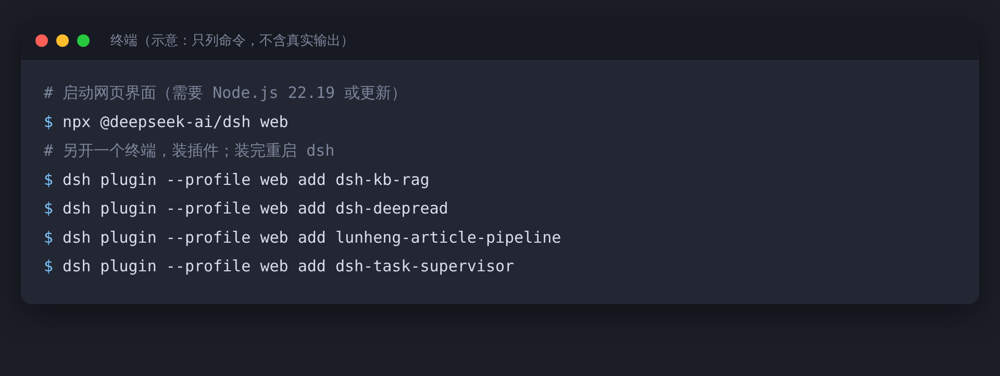
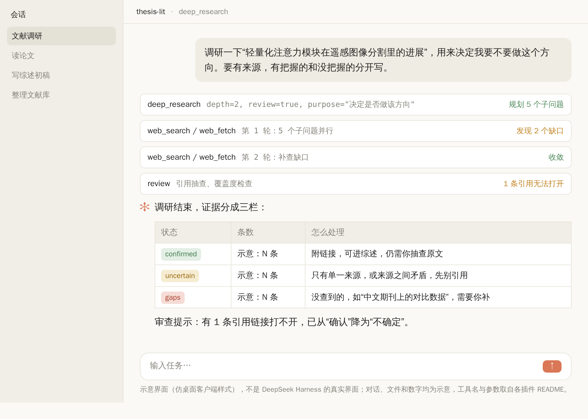
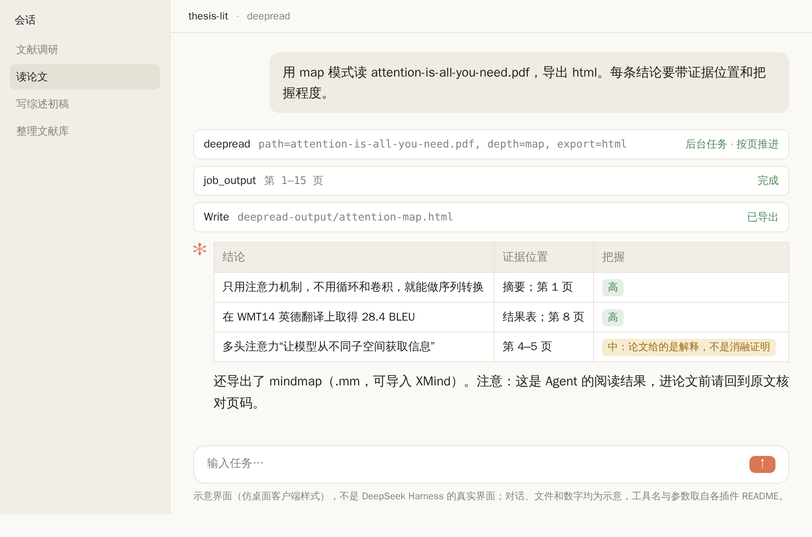
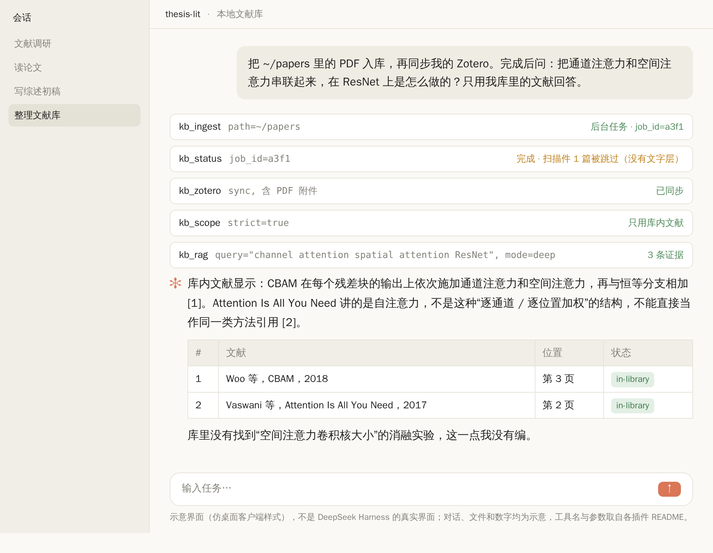
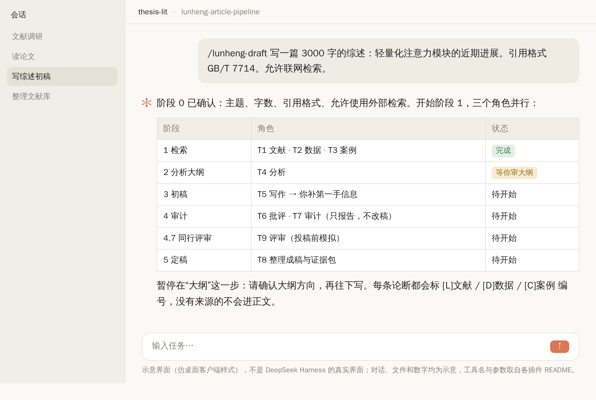
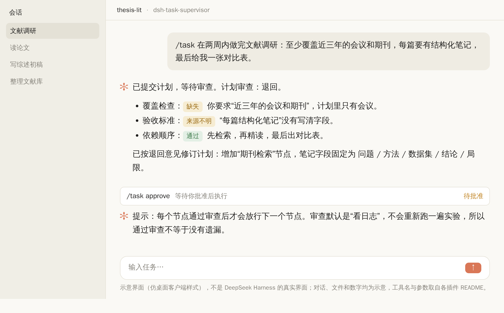
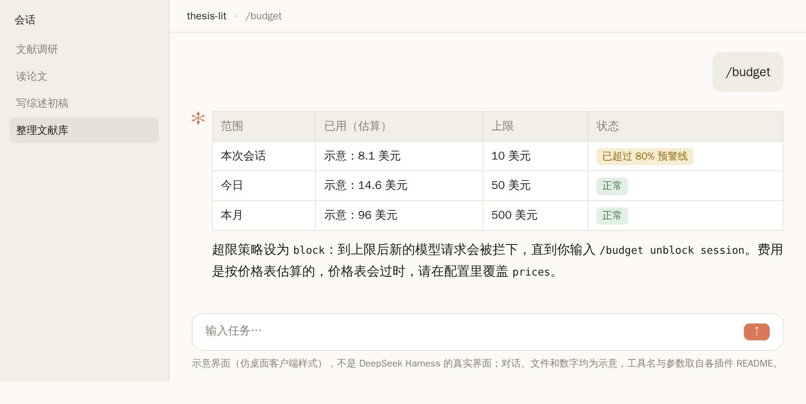

先说一件容易被忽略的事：DeepSeek Harness 刚装好的时候，并不会做科研。

它没有“读 PDF”的按钮，没有文献库，也不知道什么叫“引用要核对”。你打开网页界面，面前就是一个能聊天、能调用基础工具的 Agent。科研要用的东西，都得自己装。

这不是缺点，是它的设计。官方仓库的说法是“万物皆插件”：Agent 的循环、工具、界面，都是插件。所以问题就变成了：做科研，该装哪几个？装完之后，一条完整的流程怎么串起来？

这篇文章就回答这两件事。写之前我读了清单和其中八个插件仓库的说明，下面的功能、命令和限制都来自它们自己的 README。

先把话说在前面：**我没有在真实环境里把这些插件逐个跑过**。文中的“使用演示”截图是按 README 描述的行为模拟的，图上都写了“示意”。你装的时候，以你自己机器上的结果为准。

## 一、先弄清楚 DeepSeek Harness 是什么

DeepSeek Harness，命令行名字叫 dsh，是 DeepSeek 官方放在 GitHub 上的开源 Agent 运行环境，MIT 许可证。几个要点：

- 启动一条命令：`npx @deepseek-ai/dsh web`，会在本机打开 `http://127.0.0.1:3080` 的网页界面。需要 Node.js，具体版本，不同插件的说明里写的是 22.19 或更新。
- 它目前是**开发者预览版**。官方 README 里有一句大写的警告：会有破坏兼容性的改动。运行之前还要先读仓库里的安全说明（SAFETY.md）。
- 插件用 `dsh plugin` 命令管理，底层交给 pnpm，所以 npm 包、GitHub 地址、本地路径都能装。装完要重启 dsh，已经打开的会话要新开一个，因为工具是在会话启动时加载的。
- 只有声明了 `dsh.bundle.patch` 的包才会成为生效的插件层。装完之后可以在网页界面的 Settings → Plugins 里看到和管理。

有一个社区整理的清单叫 awesome-deepseek-harness，按用途把插件分成了核心、Agent 编排、上下文与搜索、记忆与知识、界面主题、仪表盘等好几类，条目非常多。科研相关的，集中在“研究、文献、论文”这一类。




> 【AI 生图提示词｜framework｜sketch-notes + macaron｜16:9｜生成后存为 imgs/01-framework-pipeline.png，用完删掉本引用块】
> ZONES：画面横向五个格子，用箭头从左到右连起来，每格一个简化图标。格子下方，用一条细线把五格框成一个整体，线上方标“一条流水线”；整体下面再画一个小的“管家”图标，用虚线连向五个格子。
> LABELS：五格依次为「找」「读」「存」「写」「管」；每格下一行小字：「调研」「精读」「文献库」「成稿」「预算与监督」。
> COLORS：五格用五种柔和的粉彩，背景暖奶油色。颜色名称只是渲染指导，不要作为文字出现在画面里。
> STYLE：sketch-notes，黑色略带抖动的手绘线条，粉彩信息框；构图干净，大量留白。
> ASPECT：16:9

## 二、科研流水线：找、读、存、写、管

我把科研里最耗时间的环节，拆成五步，每一步对应一类插件。

1. **找**：围绕一个问题，把网上的资料查一遍，分清楚哪些靠谱、哪些存疑。
2. **读**：把一篇论文读成“结论 + 证据 + 位置”，而不是一段看起来很顺的总结。
3. **存**：把你自己的 PDF 和 Zotero 做成本地可检索的库，让回答只能引用库里有的文献。
4. **写**：把检索、分析、写作、审计拆成多个角色，长文不是一口气吐出来。
5. **管**：盯住任务有没有跑偏，盯住花了多少钱。

下面逐步说。每个插件都写三件事：它做什么，怎么装，**哪里要小心**。

## 三、找：用 dsh-deep-research 做有止损的文献调研

**它做什么。** dsh-deep-research 是一个“自适应深度研究”插件。普通的“帮我查一下”，是搜几次就写总结。它不一样，它跑的是一个闭环：先把问题拆成子问题，每个子问题定好验收标准；第一轮并行去查；查完看哪些子问题还有缺口，再补查；某一轮没有新增信息，就停。

它暴露一个叫 `deep_research` 的工具，几个参数值得知道：

| 参数 | 作用 |
|---|---|
| `topic` | 调研的题目（必填） |
| `purpose` | 这次调研要支持什么决定，比如“决定要不要做这个方向”。写了它，拆出来的子问题会更有针对性 |
| `questions` | 你自己列好的问题，一行一个；填了就跳过自动拆分 |
| `depth` | 1 初步，2 默认，3 穷尽；轮数上限是 depth + 1 |
| `synthesize` | 默认 true，会写成综合报告；false 只返回三栏证据 |
| `review` | 默认 false；打开后会抽查引用链接能否打开、是否真的支持结论，并标出矛盾和过度自信 |

最值得抄的是输出方式：证据分成 **confirmed（确认）、uncertain（不确定）、gaps（缺口）** 三栏。做科研最怕的就是一份看起来“什么都查到了”的报告。有 gaps 这一栏，等于它被要求承认“这里我没查到”。

**怎么装。** README 给的命令（把 `<profile>` 换成 `web`）：

```
dsh plugin --profile web add git+https://github.com/dsh-external/dsh-deep-research.git
```

**哪里要小心。**

- 它没有自带搜索，用的是 dsh 内置的 web_search 和 web_fetch。搜得好不好，取决于你配的搜索源。
- 自适应轮次加并行子 Agent，会成倍地消耗调用次数。README 的建议是规划和综合用强模型，具体的查资料用便宜的模型。它有 `plannerModel`、`researcherModel`、`synthesizerModel`、`reviewerModel` 几个配置项可以分别指定。
- 它依赖 dsh 官方的工作流引擎，有的 Web 配置里没带，插件会一直处于“待加载”。
- 一个我自己觉得必须提醒的细节：README 里的安装地址属于 dsh-external 组织，而仓库页面显示在另一个账号名下。**装之前，务必自己核对来源**。这一点，第八节会专门讲。



上图是模拟的使用演示：用 `depth=2` 和 `review=true` 调研一个方向，结束后证据分成三栏，被审查出打不开的引用，会从“确认”降到“不确定”。图里条数我写的是“示意：N 条”，因为这是我编的场景，不是真实结果。

这类调研最适合的用法，是**开题前、选方向时**。它帮你快速摸清一个方向有什么、缺什么，不是帮你交综述。

## 四、读：用 dsh-deepread 读成“结论 + 证据 + 位置”

**它做什么。** DeepRead 的定位是“证据优先的阅读”。它把文章、书、PDF 拆成一条条结论，每条结论都挂着证据和原文位置，再画成知识地图。

它有两种形态：给 Codex 和 Claude Code 用的便携 Skill，和给 DeepSeek Harness 用的宿主插件。后者暴露一个 `deepread` 工具，几个模式很有意思：

- `quick`：快速摘要。
- `deep`：默认，深度阅读。
- `map`：列出结论、证据、把握程度和相互关系。
- `feynman`：用“费曼学习法”的流程，带间隔复习，适合啃一篇难懂的论文。
- `book`：整本书，分段处理。

还能导出：`md` 报告、`mm`（FreeMind 思维导图，README 说 XMind 可以导入）、`html` 网页报告，或者 `all`。另外有个 `estimate` 参数，只估算费用，不调用模型。读一本书之前先估一下，是个好习惯。

**怎么装。** README 里宿主插件的命令：

```
dsh plugin --profile web add dsh-deepread
```

如果遇到 `ERR_PNPM_ADDING_TO_ROOT` 的报错，改成加 `-w` 的写法。

**哪里要小心。**

- **扫描版 PDF 要先做 OCR**，没有文字层的它读不了。
- 它自带的是纯 JS 的 PDF 提取，README 说支持中文映射和页码标记，但复杂排版（双栏、公式、表格）提取效果如何，我没有测，请你自己拿一篇真论文试。
- 费用估算用的是按汉字数的经验公式，只是个大概。
- 默认输入上限是 40 万字符、最多 20 段，可以改。



图里我挑了《Attention Is All You Need》这篇大家都熟的论文：摘要里的“只用注意力机制”、结果表里的 28.4 BLEU，都是论文里真有的内容，所以标“高”把握；而“多头注意力能让模型从不同子空间获取信息”，论文给的是解释而不是消融证明，所以标“中”。这就是 map 模式的价值：**让你一眼分清哪些是论文证明了的，哪些只是作者的说法**。

不过要说清楚：这是 Agent 读出来的结果，进你的论文之前，页码和数字都要回到原文核对。

## 五、存：用 dsh-kb-rag 把你的文献库变成“只能引库内文献”的助手

这是我认为对研究生**最有用**的一个。

**它做什么。** kb-rag 是一个本地、离线的文献知识库：把你的 PDF 文件夹和 Zotero 文库，索引进一个 SQLite 文件。向量检索和重排序用的是本地的 bge 模型，**不花 API 费用，也不上传你的文献**。

它提供十个工具，常用的几个：

- `kb_ingest`：把一个文件夹的 PDF 入库，增量更新，自动去重。文件多了（默认超过 25 个）会转到后台，返回一个 job_id，用 `kb_status` 查进度。
- `kb_zotero`：同步本地 Zotero 文库，含 PDF 附件。
- `kb_fetch`：按 DOI 或 arXiv 编号下载 PDF，先试出版社版本，再试开放获取。
- `kb_search`：关键词加向量的混合检索，返回带出处的段落。
- `kb_rag`：基于证据回答问题，带编号引用。
- `kb_scope`：设定检索范围，可以设成“严格只用库内文献”。
- 还有 `kb_dedup`、`kb_clear`（清空索引，需要 `confirm=true`）、`kb_stats`。

回答里每条证据会显示标题、作者、年份、期刊、DOI、章节和 PDF 页码。DOI 是可点的链接，Zotero 里的条目还有“在 Zotero 中打开”。更关键的是：如果一段话里引用了别的论文，它会把这个引用解析出来，去你的库里匹配，匹配上的标 `[in-library]`。

对付“AI 编造参考文献”，这个设计很对路：**你让它只用库里的文献回答，库里没有的，它只能说没有**。

**怎么装。** README 推荐的方式：

```
npx dsh-kb-rag-install
```

它会装 Python 依赖、跑一个冒烟测试、启用插件、下载模型。只想装插件，用 `dsh plugin --profile web add dsh-kb-rag`。**不要**在 dsh 的配置目录里运行 `npm install dsh-kb-rag`，README 说会和 pnpm 的目录结构冲突。装完重启 dsh，并新开会话。

**哪里要小心。**

- **没有 OCR**：没有文字层的扫描件会被跳过。
- **英文检索更好**。引擎层面跨语言检索偏弱，README 说是由 Agent 把中文问题改写成英文再去检索，并且建议用 3 到 12 个词的英文关键词串，年份、作者、章节限制放在 `filters` 里，不要写在查询里。
- 第一次查询要加载模型，会比较慢。
- 在国内网络环境下下载模型，可能要设置镜像，README 里给的是把 `HF_ENDPOINT` 设为 `https://hf-mirror.com`。
- 它的关键词检索在内存里做，不适合几十万片段以上的超大库。对研究生的文献库来说够用。



看图里最后一句：“库里没有找到空间注意力卷积核大小的消融实验，这一点我没有编。”这就是你该要求的回答方式。**一个好的科研助手，价值一半在于它会说“没有”**。

如果你的需求更简单，还有一个叫 dsh-kb-sieve 的，思路不同：它不用大模型做检索，纯词法匹配（FTS5 BM25），把 Markdown、文本、Word、PDF 变成一个“可审计的包”，里面有清单、哈希和原文，相同输入得到相同的包。它的取舍很明确：**宁可检索笨一点，也要每一步都能复核**。缺点是只懂字面，不懂同义改写，而且大文件很吃内存。

## 六、写：用 Lunheng 流水线写长文，别指望一口气写完

**它做什么。** Lunheng（轮衡）是一个长文写作流水线。它自己的说法是“是写作流水线，不是文本生成器”，面向学术论文、行业分析、评论等 2000 字以上的长文。

它把一篇文章拆给九个角色：

- T1 文献侦察、T2 数据侦察、T3 案例侦察：并行去找材料；
- T4 分析：出分析大纲，**由人审**；
- T5 写作：写初稿，**由人补充第一手信息**；
- T6 批评同伴：写批评报告；
- T7 审计：逐项检查，**只报告，不改稿**；
- T9 同行评审：按六个维度给一份“投稿前模拟”的评审意见，并匹配期刊；
- T8 定稿：整理成稿和证据包，由协调者运行。

要点有三个：

1. 每一条论断，必须对应文献编号 [L]、数据编号 [D]，事件类论断还要有案例编号 [C]。没有来源的，不进正文。
2. 审计角色**只写报告，不改稿**，修改由写作角色做，最多两轮。这是在避免“审的人同时改，改完自己说没问题”。
3. 中间有人工检查点。它不是让你交代一句话就去睡觉。

它注册了十一个 `/lunheng-` 开头的命令，包括 draft（起草）、resume（继续）、cite（引用）、audit（审计）、status（状态）、rollback（回滚）等。

**怎么装。** README 的命令：

```
dsh plugin --profile web add lunheng-article-pipeline
dsh --profile web --dump-config
```

要求 dsh 5.5.0 以上、Node `^22.19.0 || >=24.0.0`、pnpm。

**哪里要小心。这一节我想说得认真一点。**

- 它的说明里自己写了一堆局限：**不做第一手数据收集，不做统计分析，不提取原始图表数据，不跑代码**（除了白名单脚本）。所以它写的是“综述、评论、分析”，不是“实验论文”的方法和结果。
- 数值核对往往停在“待人工复核”，因为付费墙和离线来源它抓不到。
- 一次完整运行会调度 15 个以上的子 Agent，主要的 token 消耗在读取上下文上，README 说可能要跑几个小时。
- T9 的评审是模拟，**不能替代真实的同行评审**。
- 它默认中文优先：角色提示词、交付物、文件名都是中文。

还有一件和插件无关、但你必须想清楚的事：**用 AI 写出来的稿子，学校和期刊怎么规定，你要先查**。这个插件把每句话都要求有来源，对学术诚信有帮助；但它不会替你回答“能不能用、要不要声明”。可以先看公众号之前那篇《你们学校的 AIGC 检测红线是多少》。



## 七、管：任务不跑偏，钱不乱花

前面几个是“干活”的插件。Agent 一旦连着跑几个小时，就需要“管”的插件。

### 任务监督：dsh-task-supervisor

它加了一个 `/task` 命令。你交一个目标，主 Agent 先做调查、提交计划；**计划会被审查，通过后才会执行**。审查会检查：计划是不是覆盖了你原来的全部要求，验收标准是从哪来的，依赖顺序合不合理，需要的能力有没有。任务是个依赖图，一个节点通过审查，下一个才放行。

装法（README 验证过的版本组合是 Node 24 加某个 dsh 候选版本）：

```
dsh plugin --profile web add dsh-task-supervisor@0.1.4
dsh web
```

它最实用的一点，是**在动手前拦住“漏掉你一半要求”的计划**。图里我模拟了一个场景：你说“覆盖近三年的会议和期刊”，计划里只写了会议，审查就会退回。

它自己也很坦诚地写了局限：默认的审查是“看对话和工具结果的日志”，**不会重新跑一遍产品**；一次只能跑一个任务；而且“通过审查，不保证没有遗漏”。README 里也没有证明它比其他做法更能提高长任务的成功率。所以它是一道额外的关卡，不是保险。



### 成本控制：dsh-budget

它按模型、会话、每天统计 token 和估算的美元花费，可以设上限。默认会话 10 美元、每天 50 美元、每月 500 美元；达到 80% 预警；超限时可以选 `alert`（只通知）、`block`（拦下新请求，直到你用 `/budget unblock` 解开）或 `degrade`（换更便宜的模型）。

有两点要注意：

- 它的 README 自己标注了**已冻结**（2026 年 10 月 5 日起不再加新功能），建议新项目用 dsh-cost-meter。我没有读过后者，所以这里只是转述，你自己决定用哪个。
- 价格表会过时，费用只是估算；统计在进程内，重启之后可能清零，要看存储有没有启用。

DeepSeek 的 API 单价我这里**不写具体数字**：我查到的几个来源对 V4 Pro 的价格和优惠截止时间说法不一致，请你以官方定价页为准。可以确定的是，对于会连着跑几个小时的 Agent，**先设好预算上限，比事后看账单要好**。



### 另外几个值得知道的

- **dsh-plan-execute**：规划和执行交给不同的模型，也就是“强模型想，便宜模型做”。我只看到一句话的介绍，没有读到它的细节。
- **dsh-background-agents**：持久的后台子 Agent，适合长时间的检索。
- **dsh-memento**、**dsh-mneme** 一类记忆插件：跨会话记住你的研究偏好。记忆插件会把你的信息存下来，装之前先看它存在哪、能不能审批。
- **dsh-session-search**：跨 Agent 的会话搜索，能找回你在 OpenCode、Claude Code 里的旧对话。

## 八、装插件之前，先做这五个检查

第三方插件，本质上是**运行在你电脑上的代码**。dsh 目前还是预览版，插件生态由社区自发维护。装之前花一分钟：

1. **核对来源**。仓库属于谁？README 里的安装地址和仓库页面是不是同一个账号？前面说的 deep-research 就是一个例子。
2. **看星标和维护状态**。我看过的几个插件，有的只有个位数星标，有的 README 自己标了“已冻结”。个位数星标不代表有问题，但意味着没有多少人审过。
3. **先在隔离的配置里试**。用一个单独的 profile，别一上来就装进你日常科研用的那个。README 里也常给 `--profile <name>`，就是为这个。
4. **别把数据和密钥交出去**。需要 API Key 的插件，用环境变量，不要把密钥写进会提交到 Git 的文件里。涉及未发表的数据、受保密协议约束的资料、含个人信息的数据，先想清楚能不能给 Agent 看，不确定就先别给。
5. **读它的“局限”那一节**。好的 README 会写局限。本文提到的几个插件，都老实写了，这是个好信号；如果一个插件什么局限都不写，要小心。

还有一条和科研直接相关：**不要让 Agent 替你做“证明结果是对的”这件事**。它可以帮你找、读、整理、起草，但数字对不对、引用是不是真的、结论站不站得住，必须由你回到原文和原始数据去确认。

## 九、一周怎么上手

不用一次装完。我的建议是按“风险从低到高”，分几步走：

| 天 | 做什么 | 装哪个 | 检验标准 |
|---|---|---|---|
| 第 1 天 | 装好 dsh，用一个单独的 profile，设好预算上限 | dsh 本体、预算类插件 | 能打开网页界面，能看到花费 |
| 第 2–3 天 | 把已有文献入库，试“只用库内文献回答” | dsh-kb-rag | 问一个你清楚答案的问题，看它会不会编 |
| 第 4–5 天 | 精读几篇你熟悉的论文，对照原文检查页码和结论 | dsh-deepread | 随机抽 5 条结论，核对原文 |
| 第 6 天 | 拿一个真实的小方向做一次调研 | dsh-deep-research | gaps 栏里写的缺口，你自己能不能补上 |
| 第 7 天 | 把一个小任务交给任务监督 | dsh-task-supervisor | 计划有没有被退回过，原因合不合理 |

Lunheng 放在最后，等你前面几步都顺了再用。它最重、最耗资源，也最容易让人产生“已经写完了”的错觉。

最小的一套，三个就够：**kb-rag 管文献库，deepread 管精读，deep-research 管选题调研**。写作和监督，等你有了真实的需求再加。


> 【AI 生图提示词｜infographic｜sketch-notes + macaron｜16:9｜生成后存为 imgs/08-checklist-before-install.png，用完删掉本引用块】
> ZONES：画面是一张竖排的五项清单，每项前面一个打勾框，右侧一个小图标；顶部一个放大镜图标。
> LABELS：标题「装插件之前」；五项依次为「核对来源」「看维护状态」「先用隔离配置」「别交出密钥和数据」「读局限那一节」。
> COLORS：背景暖奶油色，五项用不同的柔和粉彩底色。颜色名称只是渲染指导，不要作为文字出现在画面里。
> STYLE：sketch-notes，手绘线条，大量留白，文字少而大。
> ASPECT：16:9

## 十、补一个选项：换一个 Harness 也行

如果你已经习惯 Claude Code 或 OpenCode，不一定要换到 dsh 上来。DeepSeek 官方文档提供了 Anthropic 兼容的接口，地址是 `https://api.deepseek.com/anthropic`，社区的接入指南里是把密钥放在 `ANTHROPIC_AUTH_TOKEN`，把模型名换成 DeepSeek V4 系列。OpenCode 也可以通过它自己的 `/connect` 流程接入 DeepSeek。具体的环境变量和模型名，请以 DeepSeek 官方文档为准，因为这类名字更新得很快。

这篇文章里讲的几个插件，有的有便携 Skill 的版本，比如 DeepRead 就同时提供了给 Codex 和 Claude Code 用的形式。所以你也可以把它理解为：**科研流水线的思路，是通用的；插件，是换了 Harness 也能找到对应物的**。

## 最后

回到开头那个问题：做科研，该装哪几个？

一个能回答的版本：**先装能让你“少编、可复核”的，再装能让你“快”的**。kb-rag 的“只用库内文献回答”、deepread 的“结论带证据和位置”、deep-research 的“缺口一栏”，这三个都是在逼 AI 承认自己不知道。比起一个什么都能写的 Agent，**一个知道自己哪里不确定的 Agent，才是做科研能用的**。

如果你已经在用 DeepSeek Harness 做科研，或者装了别的好用的插件，欢迎在评论区告诉我，我会挑实测过的整理进下一篇。
