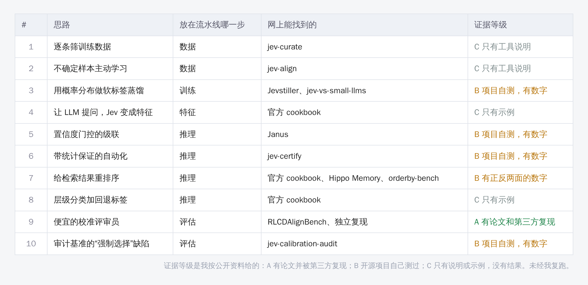
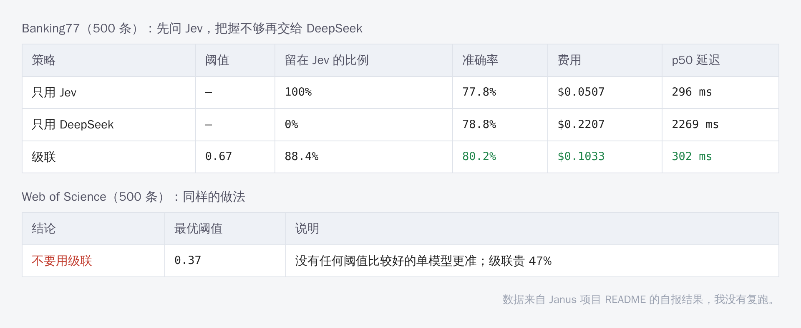

先说一个会让你少走弯路的结论：Jev 不是用来当骨干网络的。

如果你打算“把 Jev 换进我的模型里，看精度涨不涨”，这条路走不通。它是一个在线 API，你拿不到权重，也不能微调。它的输出也不是特征向量，而是一个带概率的答案。

那它对做深度学习的人有什么用？

用处在**模型的外面**：筛数据、造软标签、判断什么时候该让大模型接手、给你的模型当评审员、审计你用的数据集。这些位置，过去要么靠人工，要么靠一个贵又慢、概率还不准的大模型。Jev 的卖点正好是便宜、快、概率能用。

这篇文章，我从 GitHub 上的社区项目里挑了十个思路。每个都有现成的项目可以参考，每个都能变成一组论文里的实验。

**先交代几件事，你再决定要不要往下读：**

- 本文假设“Jev”指 TypeSafe AI 的 Jev。你之前提到的“Jev”我一直没把握，现在只找到这一个。如果你指的是别的，请告诉我。
- Jev 是 2026 年 9 月中旬才发布的，**官方没有公开训练方法的论文**，第三方的评测大多是个人项目自测。所以下面每个思路我都标了证据等级。
- 我没有用过它的 API，**没有跑过任何一个项目**。数字都是各项目自己报的，我只做了转述。

## Jev 到底是什么

它自己的定位是“System One 模型”，就是只做快速直觉判断，不写长篇大论。你给它一段输入（叫 state），再给几个带选项的问题，它一次返回所有答案，每个答案带概率。

问题有三种：

- **Choice**：从几个选项里选一个，返回每个选项的概率和一个置信度。
- **Score**：在一个有序的评分尺度上打分，比如 0 到 2 分的“沮丧程度”。
- **Noul**：一个是非判断，返回 0 到 1 的“是”的概率。

调用起来像这样（示意，不同 SDK 版本读取结果的写法不完全一致，请以官方文档为准）：

```python
from typesafe_sdk import Choice, TypeSafeClient

with TypeSafeClient() as client:
    response = client.system_one(
        state={"document": text},
        questions={"topic": Choice(
            instructions="这条评论主要在说什么？",
            criteria={"物流": None, "质量": None, "价格": None})},
    )
    print(response.choices["topic"].choice)
```

社区整理的资料里提到几个数字：单次请求上下文约 64k token，价格约每百万输入 token 0.042 美元，延迟从几十毫秒到几百毫秒不等。这些在不同来源里说法不一致，**请以官方控制台为准**。官方宣传的“比传统大模型快百倍、便宜数百倍”，是厂商自己的说法，没有被我核实。

三条硬限制，会决定你哪些想法行得通：

1. **只支持文本。** 图像、音频、视频都不行。
2. **英文为主。** 其他语言要自己验证。
3. **校准是整体意义上的。** 官方原话大意是：校准描述的是一批预测，不是每一个答案。Noul 的概率接近 0.5，表示“它不确定”，不是“中等程度”。

所以，“通用深度学习任务”这几个字要打个折扣：**凡是输入能变成文字的任务，都能用**，比如文本分类、检索、问答、代码、表格转文字、图像描述文字；纯像素级的视觉任务，只能用在数据和评估环节，不能进推理。


> 【AI 生图提示词｜framework｜sketch-notes + macaron｜16:9｜生成后存为 imgs/01-framework-pipeline.png，用完删掉本引用块】
> ZONES：画面从左到右一条流水线，五个方框用箭头连接；正中央偏下，一个小小的“外挂”圆形图标，用五根虚线连向每个方框。
> LABELS：五个方框依次为「数据」「训练」「推理」「评估」「审计」；圆形图标旁标「Jev：带概率的判断」；图的上方一行小字「不是骨干网络，是外挂」。
> COLORS：五个方框用柔和的粉彩，背景暖奶油色。颜色名称只是渲染指导，不要作为文字出现在画面里。
> STYLE：sketch-notes，手绘线条，大量留白，文字少而大。
> ASPECT：16:9

## 十个思路总览

下面这张表是全文的地图。证据等级是我按公开资料给的：A 有论文并被第三方复现；B 开源项目自己测过，有数字；C 只有工具说明或示例，没有结果。



每个思路我都按同一个格式写：**做法、网上有什么、能立什么创新点、坑在哪**。

## 一、数据环节

### 思路 1：用 Noul 逐条筛训练数据

**做法。** 把“这条样本是不是高质量”“答案是不是真的对”写成 Noul 问题，对训练集每一条打一个概率，低于阈值的丢掉，或者作为权重。

**网上有什么。** jev-curate，一个 Rust 写的数据筛选工具，读 JSONL 和 Parquet，对每一行跑 Choice、Score、Noul 判断，输出“保留”和“拒绝”两个文件，原样保留数据。自带几个预设，比如数学推理、反谄媚、代码正确性。吞吐量不同来源说法差别很大，一个写实测每秒 24 行，另一些列表写 1500 行以上，我都没验证。

**创新点怎么立。** “用 LLM 过滤数据”已经有很多人做了，不要只做“筛了之后涨了多少”。更站得住的问题是：**用概率做软权重，是否比 0/1 硬过滤更好？**固定同样的训练预算，对比：随机、困惑度过滤、Jev 硬阈值、Jev 软权重。再加一个“过滤了多少、过滤掉的都是什么”的分析。

**坑。** 评审会问：你是不是只是让一个更强的模型帮你挑了数据，涨点是不是来自“更强的模型的知识泄漏”？所以要控制：筛数据的模型的知识，和被训练的模型要评测的能力，有没有重叠。

### 思路 2：不确定样本的主动学习

**做法。** 先让 Jev 对一批没标的数据打概率，把它拿不准的样本挑出来请人标，再用人标的结果去改进问题的定义。

**网上有什么。** jev-align，Sutro 做的命令行工具，描述为实验性。每一轮挑出“模棱两可的行”加一份随机抽查，让你标注；然后用 GEPA 这个优化器，根据你标的结果提出改后的问题定义，你再决定接不接受。它支持二分类、多分类、多标签和打分，默认取数据的前 1000 行，每轮 5 到 20 个标签。

**创新点怎么立。** 这是经典的“主动学习”换了一个选样本的打分函数。你可以做：Jev 的概率不确定性，对比你自己模型的熵、间隔采样、随机采样，看到达同样精度需要多少标注。

**坑。** jev-align 的说明里自己写了一个陷阱：“无标注模式”可以靠“对每一行都信心满满地给同一个答案”来降低不确定性，所以**不确定性下降不等于正确**。另外它没有公开不确定性是怎么算的，你要自己定义并写进论文。

## 二、训练环节

### 思路 3：用 Jev 的完整概率分布做软标签蒸馏

**做法。** 让 Jev 给大量无标注数据标注，保留它输出的**整个概率分布**，用来训练一个你自己的小模型。推理时小模型自己回答，不再调 API。

**网上有什么。** 两个项目，结论恰好互补。

Jevstiller 是一个代理服务：一开始所有请求都转给 Jev，攒够数据后用一个冻结的句子编码器加逻辑回归，在 Jev 的完整概率分布上训练学生模型；输入不像训练数据时（用 kNN 距离判断）仍然转给 Jev，另外永远保留 2% 的抽查。它自报，在 Banking77 上，71.9% 的请求由本地模型回答，与 Jev 的一致率 99.50%，本地延迟约 15 毫秒，Jev 约 300 毫秒；在 TweetEval 情感上，本地回答比例只有 22.2%，因为 Jev 自己和数据集标签也只有 64% 到 74% 吻合。

jev-vs-small-llms 是一个对比项目：在安全检测任务上，把 Jev 和没微调的 0.8B 到 9B 开源模型、微调后的 4B 模型比。自报结果里，微调后的 4B 在两个外部评测上超过了 Jev（比如 C-SafeQA 上 AUROC 0.945 对 0.843），而且**用真实标签或混合监督，常常比纯模仿 Jev 更好**。作者自己也写了局限：只跑了一个随机种子，公开基准可能有污染。

**创新点怎么立。** 这两个项目合起来，给了你一个现成的研究问题：**什么时候“模仿一个校准过的教师”比“用真实标签”好？**可以做的实验：教师软标签、硬标签、混合三种监督，在标注量从少到多的几个点上画曲线；再加“教师本身有系统性偏差”的情形。

**坑。** Jevstiller 自己写得很清楚：**与 Jev 一致不等于准确**，Jev 错了，学生往往也错成同样的样子。这一点在论文里必须单独报告“对真实标签的准确率”。

### 思路 4：让大模型提问题，Jev 把问题变成特征

**做法。** 先让一个 LLM 提出一批“可能有用”的问题（“这条评论是不是在抱怨价格”），用 Jev 把每条文本对这些问题的回答变成数值特征（概率），喂给 CatBoost 之类的下游模型，再看验证集上哪里错，把错误反馈给 LLM，让它提出下一批问题。

**网上有什么。** Jev 官方 cookbook 里有一个“自动特征发现”的例子，按社区整理的描述：LLM 提问，Jev 产生数值特征，CatBoost 的错误反馈进循环。特征表、验证集划分和最终模型都留在标准的机器学习工具里。我没有打开官方原文，只看到了社区的转述。

**创新点怎么立。** “问题即特征”有一个很好的论文卖点：**可解释**。每一维特征都是一句人话。你可以对比：句向量特征、手工特征、问题特征，在小样本下的精度和可解释性；以及“搜索出来的问题”和“专家写的问题”的差别。

**坑。** 验证集被反复用来指导提问，**要留一份从头到尾没碰过的测试集**，否则你是在对验证集过拟合。

## 三、推理环节

### 思路 5：置信度门控的级联

**做法。** 先问便宜快速的 Jev，它很有把握就直接用，没把握再交给更强但更贵的大模型。

**网上有什么。** Janus，一个 Python 包，专门“在你的数据上测出什么时候该转交”。它的核心不是给你一个默认阈值，而是用你自己的标注数据测一个。作者在两个各 500 条的数据集上测了，Jev 做主、DeepSeek 做后备：



Banking77 上，设阈值 0.67，级联比两个单模型都准一点，费用比只用大模型少 53%。Web of Science 上，没有任何阈值比好的单模型更准，结论是“别用级联”，最优阈值也从 0.67 掉到了 0.37。

**创新点怎么立。** 这个例子里最有价值的一句话是：**阈值不能搬家**。你可以立的问题有：阈值能不能随数据集自适应？数据分布变了以后，怎么发现原来的阈值已经失效？把“成本—准确率”的帕累托曲线画出来，比报一个点更有说服力。

**坑。** 数据是 500 条、两个数据集，**远不够支撑“通用”的结论**。你需要多个数据集、多个模型对，并且固定模型版本号（Janus 自己也提醒：别名会漂移，路由时要用具体版本号）。

### 思路 6：带统计保证的自动化

**做法。** 不满足于“大概够准”，而是要一个**有限样本下的保证**：每个进来的请求，被自动处理且被处理错的概率，不超过 5%。

**网上有什么。** jev-certify，用共形风险控制（conformal risk control）在 Jev 的概率上选阈值，再用一小批人工标注做审计。在 CLINC150 上自报：目标 5% 的情形，阈值 0.831，自动处理 84.75%，实测每请求的静默误路由损失 2.25%，低于目标；目标 1% 在这套数据上不可行，因为 Jev 有 56.4% 的答案概率恰好是 1.0，其中有 9 条是错的。

**创新点怎么立。** 这是**最贴近“可靠机器学习”主题**的一个，也最像一篇正经论文。更重要的是它自己暴露了失效场景：作者把校准集里“超出范围的请求”占比 13%，换成测试时 42.9%，5% 的保证被突破了 3.6 倍；另一个场景里，来了校准集中从没出现过的新类别，损失直接到 1.0，而且“统计上无法补救”。**怎么在分布变化下仍然保持保证**，就是你的研究问题。

**坑。** 这里的保证成立的前提是校准数据与线上数据**可交换**；它约束的是“每个请求的误路由”，不是“被自动处理的那部分里的错误率”。这两个概念不要在论文里混着写。

### 思路 7：给检索结果重排序

**做法。** 先用 BM25 或向量检索拿到一个候选集，再对每个“问题—段落”问一个 Noul，用概率排序。

**网上有什么。** 官方 cookbook 有一个法律检索的重排序例子，Milvus 也有对应的重排序适配器。但独立测试的结论是**有好有坏**：Hippo Memory 在两个语料上排序更好，但没有显示出比本地交叉编码器更好的回答质量；jev-orderby-bench 在 360 条主题数据上通过了 6 道门槛，在 306 对人工打分的购物数据上，6 道门槛里 4 道没过，而且把 40 行放在一个批次里，会让原本通过的门槛变成失败。

**创新点怎么立。** “Jev 当重排器”本身不新。换个角度：**用 Jev 的概率给交叉编码器挖难负例，或者当教师分数来训练交叉编码器**，这是我的推演，网上我没找到现成实现，需要你自己做。对比对象是现成的交叉编码器。

**坑。** 官方和社区的共同教训：**分类准不代表排序准**，批次大小会影响结果。

### 思路 8：层级分类加回退标签

**做法。** 面对几百上千个类别的标签树，一层层问 Choice；哪一层没把握，就停在上一层的父类，不硬猜叶子。

**网上有什么。** 官方有两个 cookbook：层级分类（按概率走标签树，在分支和叶子两处都记录错误）和“低置信度时回退到更宽标签”的年报行业分类。我只读到了社区的一句话介绍。

**创新点怎么立。** 这是**选择性分类（selective classification）加上层级结构**，很适合发展成论文：评价指标不再只是准确率，而是“在每个粒度上给出多少覆盖率、多高精度”。可以对比：硬猜叶子、固定回退、概率驱动回退。

**坑。** 官方例子是年报分类，规模和难度未知，我没有看到公开的数字。

## 四、评估和审计环节

### 思路 9：便宜的校准评审员，当作生成模型的“故障探测器”

**做法。** 想判断一个模型的输出有没有出问题（谄媚、幻觉、提示注入等），不用再训练一个检测器，直接问 Jev 一个通用问题，取它的概率。

**网上有什么。** 这是证据最强的一个。论文《Just Ask Jev》配套了 RLCDAlignBench：44 个基准、10 类失败、7193 条带标签的检测样本，目标模型是五个小的开源模型。作者报告通用问题零样本的 AUROC 中位数是 0.886，在 31 个基准里的 25 个上超过了有监督的 TF-IDF 和长度基线。更难得的是**有第三方复现**：一位研究者用作者的代码和数据跑了 5 个基准、1155 条样本，AUROC 与论文的差距中位数只有 0.0036，并且重新核对了论文里的几个数字（比如 63 倍便宜）都对得上。

复现者还发现了一个很有用的事实：用 0.5 做阈值，在 TensorTrust 上 AUROC 是 0.9476，却只抓到了 8.8% 的失败；用 10 个标注校准阈值后，F1 的中位数提升了 0.254。**排序好，不等于阈值能直接用。**

**创新点怎么立。** 如果你的论文提出了一个新的训练方法或新的对齐方法，可以拿它当**低成本的自动评估**，并加上“用 10 条标注校准阈值”的步骤。也可以做一个：这种通用问题探测器，在你自己领域的数据上还成立吗？

**坑。** 复现者自己写明：只复现了 5 个基准，最难的几类（越狱、欺骗、隐私）因为数据有害被刻意排除了；只测了英文；论文里没写 Jev 的版本，无法判断 0.0036 的差距来自版本变化还是随机性。数据有门槛：需要在 Hugging Face 上申请访问，用途限于研究。

### 思路 10：审计基准的“强制选择”缺陷

**做法。** 用 Jev 的概率去检查一个基准数据集有没有设计缺陷：比如题目没有“无法回答”的选项时，模型是不是被逼着编一个答案。

**网上有什么。** jev-calibration-audit，一位独立作者只用公开接口和公开数据做的审计。在韩语偏见基准 KoBBQ（约 8.1 万条）上，对 300 条“信息不足”的题目，有“未知”选项时，Jev 95% 选了“未知”；把这个选项拿掉后，这些题的准确率掉到 0%，选刻板印象答案的比例从 3% 升到 79%，校准误差（ECE）从 0.023 涨到 0.793，而它的置信度几乎没变。

**创新点怎么立。** 这是一类很容易发论文的工作：**基准分析**。“把选项拿掉，模型的置信度没变，但答案全错了”，这个现象在你自己的任务上、在你自己的模型上成立吗？你可以把方法迁移到一个你关心的基准，做一份系统的审计。

**坑。** 摘要里没有给样本量、置信区间；作者提醒小样本下 ECE 有噪声底（n=60 时，完美的模型也有约 0.045）。作者也强调，结果依赖模型版本。

## 用闭源 API 写论文，要守的六条规矩

以上十个思路，都有一个共同的风险：**你的结果建立在一个你看不到内部的服务上**。TypeSafe 没有公开训练方法、奖励函数和校准方法，有评论就直说“没有论文、没有奖励函数、没有可靠性图”。评审会盯这一点。我建议：

1. **固定版本号。** 用 `jev-1.13.0` 这样的具体版本，不要用 `jev-latest`。别名会漂移，社区里有人专门做了“模型换了之后阈值是否失效”的检查工具（jevcal）。
2. **保存完整的概率分布和每次返回的版本号**，不要只存最终的标签。
3. **报告成本和延迟，并注明走的是官方接口还是第三方网关。**
4. **放一个开源替代做对照。** 社区有用开源模型复现 Jev 类接口的尝试（比如 openjev-sglang），但作者自己说是早期实验，而且已被归档，只是复现，不是 Jev 本身。能做到的话，用它或同类做消融，会让评审放心得多。
5. **阈值要在有代表性的标注数据上定，换了模型或数据后重新定。** jevcal 的建议是每个问题至少 100 条左右的标注，少于这个数，阈值不太可靠。
6. **说明数据权限和许可。** 比如 RLCDAlignBench 的数据涉及有害内容，需要申请；它的数据许可，论文和仓库说法不一样（CC BY 4.0 与 CC BY-NC 4.0），用之前自己确认。


> 【AI 生图提示词｜infographic｜sketch-notes + macaron｜16:9｜生成后存为 imgs/04-checklist-closed-api.png，用完删掉本引用块】
> ZONES：一张竖排清单，六个方框，每个方框前一个打勾框；顶部一个“锁”的图标。
> LABELS：标题「用闭源 API 写论文」；六项依次为「固定版本号」「存完整概率」「报告成本」「放开源对照」「重新定阈值」「查数据许可」。
> COLORS：背景暖奶油色，六项用不同的柔和粉彩底色。颜色名称只是渲染指导，不要作为文字出现在画面里。
> STYLE：sketch-notes，手绘线条，大量留白，文字少而大。
> ASPECT：16:9

## 十个里怎么挑

如果你时间有限，我的建议是看三件事：

- **手上有什么。** 有一批没标的文本数据，选 1、2、3；有一个现成的分类器要落地，选 5、6、8；你做的是生成模型或对齐，选 9；做的是数据集或评测，选 10。
- **证据强不强。** 想求稳，从证据等级 A、B 的开始：9、3、5、6、10、7。C 的几个，意味着网上只有示例，没有人告诉你它到底行不行，你得自己做完整验证。
- **别人做了多少。** 数据筛选（1）和重排（7）已经很多人做；校准保证（6）、软标签对比（3）、基准审计（10）还有空间。

**我最看好的两个方向：**

1. **思路 3 加 6 的组合：在校准的教师下，做有保证的蒸馏。**两个现成项目已经暴露了互补的问题（模仿不等于准确，保证在分布变化下会失效），把它们接起来，就是一个完整的研究问题。
2. **思路 10：把“强制选择”的审计迁移到你自己的领域。**成本低，实验短，是个干净的实证贡献。

有一个我没有找到现成实现、但自己觉得值得试的方向：**用 Jev 对同一样本重复判断的不一致程度，当作标签噪声的信号，用来给样本的损失加权或安排课程**。官方有“自一致性”的 cookbook，但是否有人把它用到训练里，我没有查到。如果你做了，请务必先查重。

## 最后

读到这里你可能发现：这十个思路里，**没有一个是在改网络结构**。

这正是 Jev 的位置。它不会替你设计一个更好的模块，但它能让数据、标注、评估和部署这些“不性感但决定论文成败”的环节，便宜很多。

另外，别忘了一件事：**这个模型发布才一个月**。我读到的所有“结果”，都是早期的个人项目自测，其中不少作者自己也写了很多局限。我们能做的，是把这些线索，变成有控制、可复现、有对照的实验。

你如果已经试了其中某一个，欢迎告诉我结果。
