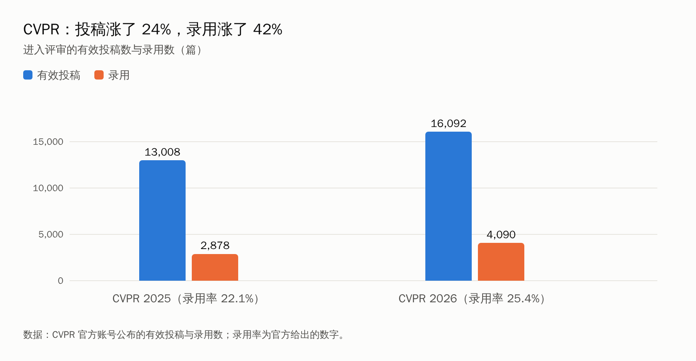
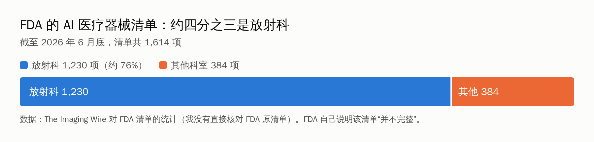

先给一个数字：CVPR 2026 进入评审的有效投稿是 16,092 篇。

一年前，CVPR 2025 是 13,008 篇。涨了 24%。

如果你正在做一个“在某某基准上提出新模块”的计算机视觉课题，这个数字可能会让你心里一紧：赛道这么挤，我还能发出来吗？

我花了不少时间找数据、找专家的原话，想给你一个比“凉了”或“没事”更有用的回答。先说结论，再展开：

- **门没有关。** 顶会投稿和录用都还在涨，一两年内不会突然变难到发不出去。
- **但“换模块刷点”的价值在掉。** 强基础模型成了默认基线，Agent 十分钟能生成一个新模块，评审也更累了。
- **医学和遥感有机会，但机会不在“再做一个更准的模型”。** 在医学，缺的是真实世界的验证；在遥感，缺的是标注、时间和任务定义。
- **普通研究生的出路，是从“做模块的人”变成“解决问题的人”和“证明它真的行的人”。**

## 一、先看数据：论文在涨，涨的不是同一种东西

CVPR 官方公布：2026 年 16,092 篇投稿进入评审，推荐录用 4,090 篇，录用率 25.42%；2025 年是 13,008 篇、2,878 篇、22.1%。投稿涨了约 24%，录用数涨了约 42%，录用率反而升了三个多百分点。

别的顶会也一样。NeurIPS 2025 的投稿是 21,575 篇，上一年是 17,491 篇（来自一篇 arXiv 论文的统计，涨约 23%）。ICLR 2026 官方回顾说有 19,525 篇有效投稿，76,139 份评审，18,054 名评审人。斯坦福《2026 AI Index》说，AI 相关的计算机科学论文十年间从 10.2 万篇涨到 25.8 万篇，增长主要来自机器学习、计算机视觉和生成式 AI。

这些数据放在一起，能得出两点：

**第一，没有哪个迹象说明发表的门正在关上。** 相反，规模越大，容纳的论文越多。

**第二，压力转移到了评审系统上。** ICLR 2026 有独立机构（Pangram Labs）分析，约 21% 的评审“完全由 AI 生成”，超过一半出现 AI 使用痕迹（经《自然》报道，数字是第三方估计，不是官方统计）。评审人更累、质量更不稳定，意味着：一篇平庸的论文，运气成分更大；一篇扎实的论文，也更可能被误伤。

再看热点。CVPR 官方说，投稿最多的几个领域是：图像和视频生成、视觉与语言推理、多模态学习、多视图和传感器三维重建，以及医学与生物视觉。最佳论文和最佳学生论文，都和三维有关。

**我没有找到的东西：** 一个可靠的“传统计算机视觉论文占比”或“增量式论文占比”的数据。所以，“灌水还能持续多久”这个问题，我没法用一个统计数字回答。下面的判断，都是基于侧面证据的推断，我会标明。

## 二、“传统计算机视觉”到底在被什么冲击

我先说明我的用法：这里的“传统计算机视觉”，指的是在固定数据集上做分类、检测、分割这类判别任务，靠换模块、加注意力、改损失来提升几个点的那种研究。不是说计算机视觉整体。

冲击来自三方面：

1. **强基础模型成了基线。** CLIP、DINOv2、SAM 这类模型，线性探测或简单适配就能在很多任务上给出很强的结果。你的新模块如果打不过“基础模型加一个线性层”，评审会问。
2. **模块创新被 Agent 压低了成本。** 我在第 1 篇里写过：一个注意力模块，Agent 十分钟就能设计、写好，消融脚本也一并给你。创新点如果只是“结构上换了个组合”，它的稀缺性在下降。
3. **视觉的位置在变。** 视觉越来越多地成为多模态大模型的“输入接口”，而不是一个独立的任务。Karpathy 评论 DeepSeek-OCR 时提出了一个问题：对大模型来说，像素是不是比文本更好的输入？他甚至说，大模型的输入也许应该全部是图像。（这一段我只看到了他帖子的转述，没有读到原帖。）

## 三、专家们怎么说

我只引用搜索中能核对到的原话。每条都标了出处和限制，**转引的就是转引，没有读过原文的我会写明**。

**Yann LeCun（2024 年在 X 上发的帖子，搜索结果中的原文）：**

> LLMs are useful, but they are an off ramp on the road to human-level AI. If you are a PhD student, don't work on LLMs. Try to discover methods that would lift the limitations of LLMs.

我的翻译：大模型有用，但它是通往人类水平 AI 路上的一个岔路口。如果你是博士生，别做大模型，去找能突破它局限的方法。他后来在 ETH 的演讲里又说了类似的话，主张学术界转向联合嵌入架构和世界模型，这一段我只看到了媒体转述，没有看到演讲原文。

**李飞飞（《Fast Company》转述，她的文章在 2025 年底发表）：**

> We firmly believe that spatial intelligence is the next frontier of artificial intelligence.

意思是：我们坚信，空间智能是人工智能的下一个前沿。《The Neuron》还转引她的一句话：现在的大模型是“eloquent but inexperienced, knowledgeable but ungrounded”（能说会道但缺乏经验，知识丰富但没有根基）。她的公司 World Labs 做的就是三维“世界模型”。

**Karpathy（2025 年秋天在 X 上评论一篇关于放射科的文章，搜索结果中的原文）：**

> Expectation: rapid progress in image recognition AI will delete radiology jobs (e.g. as famously predicted by Geoff Hinton now almost a decade ago). Reality: radiology is doing great and is growing.

意思是：预期是图像识别的快速进步会让放射科的工作消失，现实是放射科发展得很好，还在增长。

**Geoffrey Hinton（2016 年的发言，多个来源一致）：**

> People should stop training radiologists now.

2025 年《纽约时报》回访时，他承认自己当时说得太宽泛，没有说清楚指的只是图像分析（这一点来自媒体报道，我没有读《纽约时报》原文）。

**Saining Xie 等人（Cambrian-1 论文，我只读到摘要的转述）：** 论文的核心观点之一是，多模态大模型里“视觉部分”的设计选择，往往没有被充分研究，和视觉表示学习的研究脱节了。他们用大语言模型和视觉指令微调当作评估各种视觉表示的接口。

**我怎么看这几段话：**

第一，**没有一位专家说计算机视觉“死了”。** 他们说的是：重心在移动，从“识别图像里有什么”，转向“理解三维世界、视频、与物理世界的交互”，以及“视觉作为多模态系统的一部分”。

第二，**要注意说话人的位置。** LeCun 在 2026 年创立了押注世界模型的公司（《麻省理工科技评论》称之为对大语言模型的“反向下注”），李飞飞的 World Labs 做的是空间智能。他们的判断很有价值，但他们也有各自的利益。这不是说他们说错了，是提醒你：**专家的方向建议，要和你自己的资源一起看**。

第三，**LeCun 那句话是对“大模型”说的，不是对“视觉”说的。** 把它改写成“别做计算机视觉”，是误读。

> 【AI 生图提示词｜comparison｜sketch-notes + macaron｜16:9｜生成后存为 imgs/01-comparison-two-paths.png，用完删掉本引用块】
> ZONES：左右两栏，中间一条竖直分隔线。左栏画一条向上的小台阶，台阶越往上越窄，上面站着几个并排挤着的简化小人剪影；右栏画一条蜿蜒的小路，通向远处的一栋小房子（代表医院）和一座小山（代表遥感的地形），路上一个简化小人拿着放大镜。
> LABELS：左栏标题「刷点路线」，旁边小字「越挤越窄」；右栏标题「问题路线」，旁边小字「越走越宽」。
> COLORS：左栏淡蓝，右栏淡桃色，背景暖奶油色。颜色名称只是渲染指导，不要作为文字出现在画面里。
> STYLE：sketch-notes，黑色略带抖动的手绘线条，粉彩信息框；构图干净，大量留白；人物只画简化剪影。
> ASPECT：16:9

## 四、医学影像：热闹的是“论文”，缺的是“证据”

**先看规模。** 美国 FDA 的 AI 医疗器械清单，截至 2026 年 6 月底共 1,614 项，其中放射科 1,230 项，约 76%。2026 年第二季度新增 89 项，放射科 66 项（74%）。这些数字来自 The Imaging Wire 对清单的统计，我没有直接核对 FDA 原清单，FDA 自己也说这份清单“并不完整”。

**再看证据。** 斯坦福《2026 AI Index》新增了医学章节。它引用的“临床 AI 现状报告”回顾了 500 多项研究，发现：近一半的临床 AI 研究仍依赖模拟情景或考试题，**只有约 5% 使用了真实的临床数据**（这个 5% 来自二手报道，我没有打开章节 PDF 核对）。同一份 AI Index 还说，多模态生物医学 AI 的论文数，比两年前多了 2.7 倍。

**病理学的基础模型，是一个很好的观察窗口。** 一项发表在《自然·生物医学工程》的基准，用 13 个队列、约 6,800 名患者，比较了 19 个病理基础模型，说独立的外部评估一直很有限；在低发病率的任务上，表现最好的 Prov-GigaPath 平均 AUROC 只有 0.74，Virchow 是 0.73，CONCH 是 0.72。另一项预印本发现，多数模型的嵌入向量主要按医院或扫描仪聚类，而不是按癌种聚类，换到没见过的中心，性能明显下降。还有研究发现，标注数据足够时，专用的小模型能追平甚至超过基础模型，而且耗电更少。（这几条来自搜索摘要，多为预印本，我没有逐篇核对。）

**还有一个“预言失败”的故事。** Hinton 2016 年说该停止培养放射科医生。结果呢？据《Works in Progress》的一篇文章，2025 年美国放射科住院医师项目提供了创纪录的 1,208 个名额，比上一年多 4%，空缺率处在历史高位。文章给的原因包括：模型在基准上赢了人，但到了医院环境里难以复现；监管和保险对完全自主的放射科模型迟迟不肯放行；诊断只占放射科医生工作时间的一小部分；成本降低反而会增加需求。这些数字和“收入 52 万美元”的说法来自二手转述，我没有核对原文。

**这对做医学影像的研究生意味着什么？**

- **“在公开数据集上比别人高一点”，几乎不再是贡献。** 公开数据集上的高分，和真实医院里的可用，是两回事，这是证据层面的共识。
- **缺口在“证据”。** 多中心外部验证、前瞻性研究、对扫描仪和人群差异的稳健性、罕见病例、和临床工作流的结合、不确定性如何呈现给医生。这些，都是论文能写、而且写出来有分量的东西。
- **你需要临床合作者。** 没有医生帮你定义“什么算对”，你做不了上面任何一件事。

## 五、遥感：基础模型把“特征提取”做成了公共设施

2025 年 7 月，Google DeepMind 发布 AlphaEarth Foundations，给地球表面每个 10 米的小块生成一个 64 维的嵌入向量，按年发布，放进 Google Earth Engine，覆盖 2017 到 2024 年。DeepMind 称，在他们测试的各类任务上，它的平均误差比对比模型低 24%，在标注数据稀少的场景下优势更明显。这是厂商自己的说法。

独立评测怎么说？

- 一项覆盖美国六个都市圈的研究发现，AlphaEarth 在多数变量上表现最好最稳定，Prithvi 通常排第二，Clay 稍低，但 Clay 偶尔也能追平或超过。说明这几个模型捕捉的信息，部分是互补的。
- 一项农业基准发现，AlphaEarth 在 15 个对地观测任务上，不重训就超过了业务化的模型；但同时指出：空间迁移能力有限、可解释性低、对时间不敏感。评测者还指出，这类嵌入大多只在土地利用/覆盖制图上被评估过，而且早期的测试都在同一地区、同一时段内。
- 一份从业者的写作提醒了一个很容易踩的坑：嵌入是按年的，用 2024 年的嵌入去配 2023 年的产量标签，等于把未来的信息漏进了模型，会让精度虚高。

（以上来自搜索摘要，其中一些是博客和聚合站，我没有逐篇核对论文原文。）

**历史数据也值得看一眼。** 一些文献计量研究显示，遥感深度学习的论文在 2016 到 2021 年间爆发式增长，比如变化检测领域有综述说年均增长约 99%，语义分割的论文从 2017 年起显著增加。**但我没有找到 2024 到 2025 年的年度数据，所以不能说它饱和了，也不能说没饱和。** 如果你要在论文里写这个判断，请自己在 Web of Science 或 Scopus 上，按年份检索一遍。

**这对做遥感的研究生意味着什么？**

- “用 CNN/Transformer 做某一个数据集上的分割或变化检测，提出一个新模块”，已经是最拥挤的一类。
- **基础模型把“把卫星图变成特征”这一步，变成了免费的公共基础设施。** 值钱的东西，转移到了：高质量的地面真值和标注、任务本身的定义、时间维度（变化、物候）、不确定性、区域适配，以及对结论的物理和领域解释。
- 做遥感的人，**天然有“数据在手、领域在手”的优势**，这一点是做通用视觉的人没有的。

## 六、我的五个预测

下面是**我的判断，不是事实**。每条都写了依据和“什么情况会让我改口”。

| # | 预测 | 把握 | 依据 | 什么会让我改口 |
|---|---|---|---|---|
| 1 | 未来一两年，顶会投稿和录用数继续增长，“门”不会关上 | 较高 | CVPR、NeurIPS 最近一年投稿都涨了 20% 以上，CVPR 录用率还升了 | 会议突然大幅限投，或录用率明显下降 |
| 2 | 三年内，“强基础模型加简单适配”成为多数任务的默认基线，评审会要求你和它比 | 中高 | 基础模型已被广泛用作特征提取器；独立基准在比较它们 | 出现新的、基础模型明显失效的主流任务类型 |
| 3 | 医学影像论文的重心，从“指标更高”转向外部验证、跨中心稳健性和工作流 | 中 | 证据缺口被多个来源反复指出；监管清单快速增长 | 前瞻性验证研究仍然很少被发表和引用 |
| 4 | 遥感里，基础模型嵌入成为公共基础设施，竞争转向标注、任务和时间维度 | 中 | 嵌入已进入公共平台，独立评测已指出它们的边界 | 嵌入在时间变化和跨区域迁移上被证明足够好 |
| 5 | 评审和发表制度会更严：限投、评审人责任、对 AI 评审的检测 | 中 | ICLR 2026 已在执行 AI 评审检测；arXiv 也在调整规则 | 评审质量问题被别的办法缓解 |

**那么，“还能发多久”？** 我不给年份。我给一个判断标准，你可以现在就用：

> **你的贡献，在把对比基线换成“强基础模型加简单适配”之后，还成立吗？**

成立，说明你的价值不依赖于“模型不够强”这个前提，这个方向还能走很久。不成立，说明它已经走到头了，不管会议还收不收。

## 七、普通研究生怎么破局

先做个自测。一共五题，答“是”的越多，越需要调整方向：

1. 你的创新点，是不是“把几个已有模块换了个组合”？
2. 你的实验，是不是只在公开数据集上，且没有外部数据验证？
3. 你有没有拿“基础模型加线性层”当基线比过？（没比过，先别急着讲故事）
4. 如果让 Agent 在一小时内按你的思路生成一个类似的模块，你的创新点还剩什么？
5. 你能不能说清楚，你的结果对一个**真实用户**（医生、测绘员、农业部门）有什么用？

如果多数是“是”，下面六条路，你至少要走一条。

> 【AI 生图提示词｜infographic｜sketch-notes + macaron｜16:9｜生成后存为 imgs/04-infographic-six-ways.png，用完删掉本引用块】
> ZONES：画面中间一个简化的人形剪影站在路口，向外发散出六条小路，每条路尽头一个小图标。
> LABELS：六条路依次为「从模块到问题」「做评估者」「和基础模型共存」「数据与基准」「复合型」「工程与开源」。文字少而大，手写体风格。
> COLORS：六条路用六种柔和的粉彩，背景暖奶油色。颜色名称只是渲染指导，不要作为文字出现在画面里。
> STYLE：sketch-notes，手绘线条，大量留白，人物只画简化剪影。
> ASPECT：16:9

### 第一条：从“模块”到“问题”

别问“我能在哪个基准上刷出新高”，问“谁有什么问题，现有办法为什么不行”。医学里可能是“某类病灶在跨医院时漏检”；遥感里可能是“某地区的某作物，云多的季节没法监测”。问题来自领域，不来自 arXiv。

**怎么做：** 找一个愿意跟你聊的领域人，每周花一小时，只问他“工作里最烦的三件事”，然后判断哪件可以用视觉解决。

### 第二条：做“评估者”

在模型越来越容易生成的时代，**证明一个东西真的行，比做出一个东西更稀缺。** 这是医学和遥感里最明确的缺口：

- 外部验证：换个医院、换个地区、换个传感器，结果还成立吗？
- 稳健性：对扫描仪、光照、云层、季节的变化敏感吗？
- 数据与基准的审计：这个数据集有泄漏吗？测试集和训练集是不是同一批病人、同一块区域？
- 评价指标：精度之外，临床或应用上真正在意的是什么？

这类工作的好处是：**不太怕被 Agent 替代，也不太怕被基础模型“碾压”**，因为你的价值在于回答“它到底行不行”。可以参考我上一篇文章里“审计基准的强制选择缺陷”那个思路。

### 第三条：和基础模型共存，而不是对着干

- **第一步就把“基础模型加线性探测”当基线**，把它跑出来，再决定你的方法有没有存在的必要。
- 你可以研究：怎么在小样本下高效适配；怎么让基础模型在特定领域（比如病理切片、SAR 影像）里不失效；怎么把领域知识（物理规律、解剖结构）注入进去。
- 也可以研究它的失效：什么时候基础模型不如小模型，为什么。前面提到的病理和遥感的独立评测，已经给了你很多现成的切入点。

### 第四条：数据和基准

把一份高质量的数据整理出来，标清楚标注规范，做一个有意义的基准，并且公开。**这是普通研究生里最容易做出“被引用的东西”的方式之一**，尤其是你手里有别人没有的数据（有合作医院、有实地调研）。前提是：数据许可、隐私和伦理，要先搞清楚。

### 第五条：做“复合型”的人

医学影像要懂一点临床终点、成像原理、监管路径；遥感要懂一点地学过程、传感器特性、野外验证。**你不需要成为医生或地学家，但要能听懂他们的话，并且让他们愿意和你合作。** 找一位合作导师，哪怕只是挂名的临床/领域指导，能帮你避开大半的“做完才发现不能用”的坑。

我这次没有去查**中国**的监管路径、医院合作的具体规定，或者国内遥感行业的数据，所以这一条在你所在的环境里怎么落地，需要你自己和导师确认。

### 第六条：工程化与开源

把一个流程做成别人能复现、能直接用的工具：数据处理脚本、评估代码、可复现的实验配置。这一条在“论文数”上不一定立竿见影，但在**求职和合作**上很有分量：它证明你不只会跑实验，还能把东西做成。

### 一份十二个月的行动表

| 时间 | 做什么 | 检验标准 |
|---|---|---|
| 第 1 个月 | 把基础模型线性探测跑一遍，当作你方向的“新基线”；做上面的五题自测 | 知道自己的方向在基线之上还剩多少空间 |
| 第 2–3 个月 | 找到一位领域合作者，和他聊出三个真实问题 | 有一个“我能用视觉解决”的问题 |
| 第 4–6 个月 | 用你有的数据，先做一个外部验证或稳健性分析（哪怕规模小） | 得到一组“换了环境之后”的结果 |
| 第 7–9 个月 | 针对前面发现的失效点，做改进；对比基础模型基线和你的方法 | 改进在新环境中依然成立 |
| 第 10–12 个月 | 整理成论文，同时把数据或代码整理成可复用的资产 | 有一篇论文，加一个别人能用的东西 |

### 用 AI Agent 的时候，守住几件事

Agent 能让你把“执行”环节加速很多，但**判断力和品味不能外包**。我在前面几篇里写过：给它的数据要有边界、评测脚本要锁定、版本要留痕、结果要自己验收。再加一条：**当 Agent 十分钟就能做出你的“创新点”，就该问问自己，真正的创新点是不是应该在问题的选择上。**

## 八、这篇文章没做到的地方

为了让你判断可信度，我列出我没做到的：

- **没有找到“增量论文占比”的数据**，所以“灌水”的判断是推断，不是统计。
- **专家原话**我只引用了能核对到的几位，主要来自 X 帖子和媒体转述，其中一部分没读到原文。没有找到国内学者的可靠原话，所以没有写，宁缺毋滥。
- **医学和遥感的数据**大多是美国和国际的，中国的监管、行业数据我没有查。
- **遥感论文年度数量**，2024–2025 年的数据我没找到。
- 一些二手数字（如放射科收入、5% 的真实临床数据比例）没有核对原文。
- 我没有训练或运行任何模型，没有自己的实验结果。

## 最后

“传统计算机视觉还能灌多久”，是个有点悲观的问题。我更愿意把它改成：**什么样的研究，不会因为模型变强而变得没价值？**

答案大概是：**问题来自真实世界，证据经得起检验，方法和基础模型共存。**

对普通研究生来说，这反而是个好消息。因为那些最难被模型取代的部分，恰好是一个有耐心、愿意走进医院、走进田野的人，最擅长的部分。

你是做医学影像还是遥感？目前卡在哪一步？评论区告诉我，我会挑几个具体的情形，下一篇专门写。
