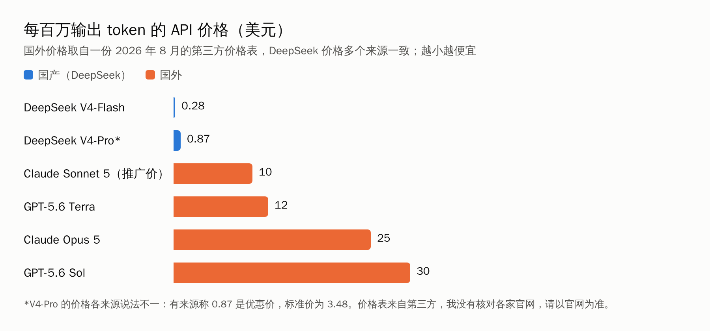
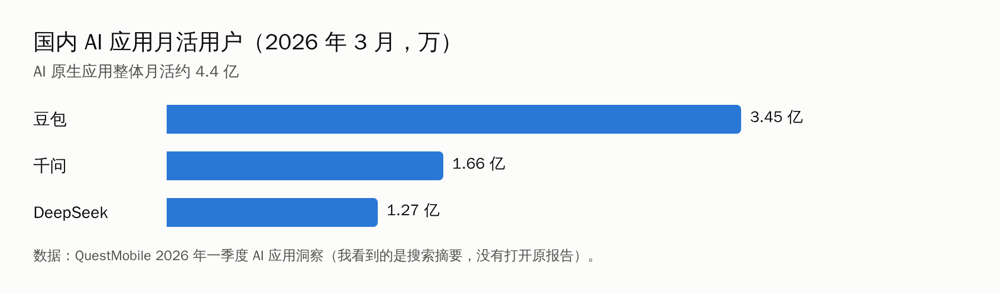

先说一个很现实的问题：很多人想用 Claude 或 Codex，第一步就卡住了。

2025 年 9 月 5 日，Anthropic 发布公告，停止向多数股权由中国资本持有的公司及其子公司提供 Claude 服务，无论这家公司在哪里。OpenAI 更早，2024 年 7 月 9 日起就阻止来自不支持地区的 API 访问，中国内地在其中。

这里有一个限定：上面说的是**公司和 API**。个人用户在大陆能不能顺利使用、怎么付款，我没有查到可靠的官方条文，请你以各家官网的“支持地区”页面为准。

所以对大多数普通人来说，国产 AI 不是“替代品”，而是**第一个能直接用上的选项**。这篇文章想回答三件事：

1. 国产模型和智能体，相比 Codex 和 Claude，到底好在哪、差在哪？
2. 普通人怎么把 AI 当杠杆，真正提升自己的能力，而不是多了一个忙碌的借口？
3. 职场人、自学的人、全职妈妈、学生，各自该怎么用？

先交代三件事：

- **我没有用过 WorkBuddy 和这些模型的付费版，没有自己的实测。** 下面的体验描述来自公开的评测文章，我都标了来源性质。
- **你要求的“真实使用截图”，我没有放。** 我这里只能访问 GitHub，网上的截图我拿不到；而且把别人的截图直接放进文章，有版权风险。文中用【截图占位】标出了每一张该截什么、怎么截，你自己用几分钟就能补上，这样才是你自己的“真实使用”。
- 价格和榜单数字变化很快，多数来自第三方整理，我写明了。

## 一、先把话说在前面：国外模型在最难的活上，仍然更强

别急着喊“国产逆袭”。在编程智能体这类最难的任务上，公开资料显示国外模型领先：

| 评测 | 国外 | DeepSeek V4-Pro | 说明 |
|---|---|---|---|
| SWE-bench Pro | Claude Opus 4.7 约 64.3%；GPT-5.5 约 57.7%–58.6% | 约 55.4% | 厂商和第三方博客的数字，各家测法不同 |
| Terminal-Bench 2.0 | GPT-5.5 约 82%–83%；Opus 4.7 约 69.4% | 约 67.9% | 同上 |

（以上来自几篇第三方对比文章的转述，**不是独立评测**，不同来源用的测试版本和方法不完全一致，只能当大致参考。）

美国 NIST 下属的 CAISI 在 2025 年 9 月 30 日发布过一份对 DeepSeek 模型的评估，结论里有几条值得普通人知道：

- 在软件工程和网络安全任务上，最好的美国模型比最好的 DeepSeek 模型多解决 20% 到 80% 的任务。
- 在模拟环境里，基于 DeepSeek R1-0528 的智能体，比 GPT-5 和 Opus 4 更容易被恶意指令带偏，平均高 12 倍。
- 越狱测试里，R1-0528 对 94% 的明显恶意请求照做，美国参考模型是 8%。
- 在政治敏感问题上，DeepSeek 模型复述不准确或有误导性说法的次数，是美国参考模型的 4 倍。

要说明的是：**这份评估针对的是 2025 年的旧版本（R1、R1-0528、V3.1），已经过去一年**，现在的 V4 是否改善，我没有找到同等权威的评估。另外这是美国政府机构做的评估，立场和方法也值得读原文判断。

所以第一个结论是：**如果你要做的是复杂的软件工程、需要智能体长时间自主跑，国外模型目前更强。** 但这不是大多数普通人的日常。

## 二、国产模型的优势，在另外几件事上

### 优势 1：便宜，差一到两个数量级

按一份 2026 年 8 月的第三方价格表：DeepSeek V4-Flash 每百万输出 token 0.28 美元，V4-Pro 0.87 美元；对比表中 Claude Sonnet 5 是 10 美元（推广价），Claude Opus 5 是 25 美元，GPT-5.6 Sol 是 30 美元。另一篇文章估算，旗舰国外模型相对 DeepSeek V4，输入贵约 11.5 倍，输出贵约 28 到 34 倍。

要注意：V4-Pro 的价格，不同来源说法不一，有的说 0.87 美元是优惠价、标准价是 3.48 美元。国外模型的名称和价格，我也只看到这一份表，没有逐家核对官网。

**对普通人意味着什么？** 你用网页或 App，多数不直接付 API 的钱。但 API 便宜，意味着更多的软件、小程序、智能体，能负担得起在背后用它，最后你用的产品就更便宜，免费额度更大。

### 优势 2：开放权重，意味着你可以把它“搬回家”

DeepSeek V4 于 2026 年 4 月 24 日以预览版发布并开源，分 Pro 和 Flash 两个版本。开源许可证，不同来源写的是 MIT 或 MIT/Apache 双协议，请以官方许可证文件为准。

开放权重对研究者和公司的意义很大：可以在自己的服务器上运行，数据不出门；也可以微调。对普通人来说，间接的好处是：**更多做隐私敏感场景的产品，可以选择私有化部署。**

### 优势 3：中文和本地办公生态

WorkBuddy 是腾讯云 CodeBuddy 团队 2026 年 3 月 9 日推出的桌面端 AI 智能体。公开资料说它能做的事包括：用自然语言下达任务，整理文件、分析表格、生成报告；把复杂任务拆成多步执行并自我校验；支持多个智能体并行；内置 MCP 和 Skills 扩展；有文件夹级授权和高危操作拦截；能连接企业微信、QQ、飞书、钉钉；模型可在混元、DeepSeek、GLM、Kimi、MiniMax 之间切换。

这里面最实在的，是**它长在国内的办公软件旁边**：你的同事在企业微信、飞书，它就能接到那里；你的文件是 WPS 和 Excel，它直接处理。

### 优势 4：拿来就能用

QuestMobile 的数据显示，2026 年 3 月，国内 AI 原生应用的月活用户约 4.4 亿，其中豆包 3.45 亿、千问 1.66 亿、DeepSeek 1.27 亿。

这说明一件事：**使用门槛已经低到“打开 App 就行”。** 对绝大多数普通人，这就是国产 AI 最大的优势：不需要特殊网络，不需要外币卡，不需要先学一堆东西。

### 优势 5：长上下文

DeepSeek V4 宣传支持 100 万 token 的上下文，可以一次读很长的文档。这是厂商的宣传口径，我没有测。实际效果取决于文档类型，长文档里细节遗漏、张冠李戴的问题，国内外模型都可能有。

### 一张表看清楚

| 方面 | 国产的优势 | 国外的优势 | 我的把握 |
|---|---|---|---|
| 复杂编程智能体 | 接近但落后 | 领先 | 中（多为厂商和第三方转述） |
| 价格 | 明显便宜 | 贵 | 较高（方向确定，具体数字以官网为准） |
| 开放权重 | DeepSeek、Qwen 等开放 | 主要是闭源 | 较高 |
| 中文和国内办公生态 | 强 | 弱 | 高（但缺少我自己的对比测试） |
| 大陆用户可得性 | 直接可用 | 受限 | 公司和 API 层面较高；个人账号我没查到 |
| 安全和稳健性 | 有评估指出短板（2025，旧版本） | 评估中表现更好 | 中偏低（评估较旧） |

还有一点：**开发者在选什么？** a16z 和 OpenRouter 的研究覆盖 2025 年约 100 万亿 token 的使用，中国开源模型平均占每周用量的约 13%，个别周接近 30%；另有报道称，到 2026 年 9 月中旬那一周，中国模型占了 OpenRouter 上 57% 到 67% 的用量。但也有媒体指出，封闭模型仍占了绝大部分收入。这说明：**国产模型在开发者里靠“便宜”赢了用量，但“赚钱”这件事上，目前仍是国外闭源模型领先。**（这几条是二手报道，我没有读原报告。）

## 三、WorkBuddy 到底怎么样：公开评测的说法

既然你问到了，这里把我读到的公开评测汇总一下。**这些都是别人的体验，不是我的，多数是自媒体文章，参考价值有限。**

**好的方面：**
- 对中文指令的理解比较准，能直接操作本地的 Excel、PPT 等文件。
- 适合重复性的整理类工作。
- 下载即用，不用自己搭环境。

**被反复提到的问题：**
- **积分消耗快，是争议最大的点。** 有人一个多月用掉 12,000 积分，日均约 400；免费版每月 500 积分，当月有效不累积；读取文件、多步骤调研、长文档生成最耗积分。有评测建议多用混元，慎用 GLM 和 MiniMax，因为后者消耗更快。
- **PPT 设计感不足，数据准确性不稳定。** 需要具体指令和人工复核。
- 首次处理大量文件，云端虚拟机启动约二十秒；大文件上传可能失败。
- 计费规则不够透明，2026 年 5 月的涨价让一些用户不满。

**价格：** 来源说法不一。腾讯云页面列出团队旗舰版活动价约 316 元每用户每月；代理商称企业旗舰版 198 元每人每月起；也有文章说基础功能免费、新用户送 5000 积分。**请一定以官网当前页面为准。**

另外，有一篇知乎文章的标题称 WorkBuddy 上线三个月就有 1200 万日活，这是自媒体的说法，我没有找到官方确认，不建议直接引用。

> 【截图占位｜请自己截取，存为 imgs/04-screenshot-workbuddy-official.png，截完删掉本引用块】
> 截什么：WorkBuddy 官网首页或下载页，要能看到当前的版本、价格或积分说明。
> 怎么用：图下写一句“截图时间：某年某月某日”，因为价格会变。

> 【截图占位｜请自己截取，存为 imgs/05-screenshot-workbuddy-credits.png，截完删掉本引用块】
> 截什么：你自己用了几次任务之后，WorkBuddy 里显示的积分余额和消耗记录。
> 为什么重要：这是读者最关心的真实成本，你的截图比任何评测都有说服力。

## 四、AI 杠杆是什么，不是什么

我们把话说清楚：杠杆，是用一点力撬动更大的东西。放到 AI 上：

> **杠杆的效果 = 你的判断力 × AI 的执行力**

AI 的执行力在快速增长，而且越来越便宜。**判断力这一项，只能你自己来**：要做什么，做到什么程度算对，哪里不能出错。如果判断力是零，再大的执行力也是零。

最近的调查也提醒了我们另一面：

- ADP 的《职场人 2026》覆盖 36 个市场、逾 39,000 名员工，中国有 73% 的员工每周多次使用 AI，26% 几乎每天使用。报告还说，每天使用 AI 的人，认为“生产力下降”的可能性反而更高。
- 花旗对中国 1,800 名受访者的调查（2026 年 3 月）认为中国 AI 应用是“高渗透、浅使用”，受访者的效率提升约 4.3%。
- 一份 2026 年全球职场报告称，80% 的员工已经使用 AI，但 AI 并没有减少工作量，反而放大了工作活动的总量。

这些都是调查和媒体转述，我没有读原始报告。但方向很一致：**用得多，不等于用得好。** 很多人只是把原来的工作用 AI 做得更快，然后被分配了更多的工作。

怎么避免？我的建议是三条原则：

1. **先定目标和验收标准，再让 AI 动手。** 没有验收标准，你不知道它做对没有。
2. **小步快跑。** 一次交给它一小件事，检查，再继续。别一次交一整个大项目。
3. **省下的时间，要投到“判断类”的事情上。** 比如学新东西、做更重要的决定、和人沟通。如果省下的时间，只是被更多重复的活填满，杠杆就没起作用。

> 【AI 生图提示词｜framework｜sketch-notes + macaron｜16:9｜生成后存为 imgs/01-framework-leverage.png，用完删掉本引用块】
> ZONES：画面中央一个跷跷板，支点在中间偏左；短的一端站着一个简化的人形剪影（代表“你”），长的一端放着一个很大的箱子（代表“成果”），支点上方一个小标签。
> LABELS：支点标「你的判断」，长的一端的箱子标「AI 的执行」，上方一行小字「判断 × 执行」。文字少而大，手写体风格。
> COLORS：背景暖奶油色，跷跷板和箱子用柔和的粉彩。颜色名称只是渲染指导，不要作为文字出现在画面里。
> STYLE：sketch-notes，手绘线条，大量留白，人物只画简化剪影。
> ASPECT：16:9

## 五、四类人，四套打法

下面每一套，我都按同一个格式：**痛点、选什么工具、三个具体用法（附可复制的提示词）、一周怎么试、避坑**。

**提示词我没有逐条实测**，它们是常见的好用写法，你用的时候按自己的情况改。

### （一）职场人：把重复的活交出去，把时间换成判断

**痛点：** 周报、会议纪要、数据整理、PPT 初稿，占掉大量时间，又不创造差异。

**选什么：** 先用免费的 DeepSeek 或豆包网页版，处理文字类任务；需要操作本地文件、表格、PPT 的，再考虑 WorkBuddy 这类桌面智能体。公司的资料能不能传，先看公司规定。

**三个用法：**

1. **周报和复盘。** 把你这周的零散记录（工作日志、聊天记录里自己写的要点）丢给它：

> 下面是我这周的工作记录。请整理成周报，分四部分：本周完成、遇到的问题、下周计划、需要协调的事。要求：不要编造我没写的内容，缺信息的地方用【待补充】标出。

关键是最后一句：**让它标出缺口，而不是自己补。**

2. **会议纪要变行动清单。** 把会议的文字记录给它：

> 请从下面的会议记录里，提取所有“谁、在什么时间前、做什么”的行动项，列成表格。没有明确负责人或时间的，单独列出来问我。

3. **Excel 清洗（用 WorkBuddy 这类智能体）。** 让它处理本地表格：

> 请处理这个文件夹里的销售表：统一日期格式，去掉重复行，按月份汇总。**先不要覆盖原文件，把结果另存为新文件**，并告诉我你改了哪些地方。

**一周怎么试：** 周一先只用第一个用法，周五看周报花了多少时间；周二周三试第二个；下周再试第三个。每个用法，你先记下“以前花多久”，才知道有没有真的省。

**避坑：**
- 客户名单、合同、未公开的财务数据，不要直接发给任何在线模型，除非公司有明确许可。
- 数字、日期、人名，每次都要自己核对。公开评测里，WorkBuddy 的数据准确性不稳定，PPT 也只适合当初稿。
- 省下来的时间，别全交给更多的任务。

> 【截图占位｜请自己截取，存为 imgs/06-screenshot-work-weekly.png，截完删掉本引用块】
> 截什么：用上面的“周报”提示词，在 DeepSeek 或豆包里生成一份周报的界面（先把真实姓名、公司名、客户名打码或换成虚构内容）。要能看到“【待补充】”被标出来的那几处。

### （二）自学者：让 AI 当陪练，不是当答案机

**痛点：** 想学一门新东西（语言、编程、财会、考证），但没有计划，也没人带，学着学着就放弃了。

**选什么：** DeepSeek 或豆包的网页版就够。长文档（教材、论文、政策文件），可以试 DeepSeek 的长上下文，但它的细节容易漏，重要的内容要回原文核对。

**三个用法：**

1. **先让它做“学习地图”。**

> 我想在 3 个月内学会【你的目标，比如：用 Excel 做数据分析】。我每周能学 5 小时，现在的基础是【你的基础】。请给我一个按周的计划，每周有：要学的内容、一个小练习、一个检验自己是否学会的问题。

2. **让它出题，而不是给答案。** 这是最重要的一条：

> 我正在学【某个知识点】。请不要直接给我讲解，先问我 3 个问题，检验我理解到什么程度。等我回答之后，再指出我哪里错了、为什么错。

3. **费曼学习法。** 你讲给它听：

> 我来用自己的话解释【某个概念】，请你扮演一个完全没学过的人，听完后告诉我哪里讲得不清楚、哪里跳步了。

**一周怎么试：** 选一个你本来就想学的小知识点，连续 7 天，每天 20 分钟，只做“出题 + 你回答 + 它批改”。一周后你会知道，这种学法适不适合你。

**避坑：**
- 别让它替你总结之后就以为自己学会了。**能自己讲出来，才算学会。**
- 模型会一本正经地编错，尤其是冷门知识、具体数字、引用。有疑问的，回到教材或权威来源核对。
- 考证类的内容，考纲、政策要以官方发布为准。

> 【截图占位｜请自己截取，存为 imgs/07-screenshot-study-quiz.png，截完删掉本引用块】
> 截什么：用“出题”提示词，你和 AI 就某个知识点来回两三轮的对话界面。要能看到它指出你错在哪里的那一段。

### （三）全职妈妈：先管好时间，再谈提升

我先说一个我的判断：网上关于“宝妈靠 AI 月入过万”的内容很多，但**我搜到的案例，大多是自述，没有第三方核实，不少文章本身在卖课或引流。** 其中一篇提到一位二胎妈妈三个月变现 2.6 万元，文章同时在推广课程和投稿渠道，收入无法核实。另一篇文章总结得很到位：**AI 降低了副业的门槛，但没有降低成功的门槛**，关键仍是理解客户需求，并且人工润色。

所以这一节，我把重点放在**稳妥的、不花钱的事**上，副业放最后，并且给你一个防坑清单。

**痛点：** 时间碎片化，被家务和孩子切成很多小块；自己想学点东西、保持和社会的连接，但没有整块的时间。

**选什么：** 手机上的豆包、DeepSeek、千问 App 就够，语音输入对碎片时间特别友好。

**三个用法：**

1. **家庭事务的“外脑”。**

> 我家 3 口人，一周预算【多少钱】，孩子【几岁】不吃【什么】。请给我一周的晚餐菜谱，要求每道菜 30 分钟内做完，并按菜谱生成一份采购清单，按“蔬菜、肉蛋、调料”分类。

日程、采购清单、旅行安排、孩子的就医记录整理，都是这类。

2. **把碎片时间变成学习。** 比如每天孩子午睡的 20 分钟：

> 我想学【一门技能，比如：办公软件 / 英语口语 / 财务基础】。请把它拆成每天 20 分钟能完成的小任务，一共 30 天。每天的任务要具体，到最后能产出一个我能拿给别人看的小成果。

“能产出小成果”很重要：它让你的学习留下痕迹，将来无论是找工作还是接私活，都有东西可以展示。

3. **陪孩子学习，但要守规矩。** 教育部基础教育教学指导委员会 2025 年 5 月发布的《中小学生成式人工智能使用指南（2025 年版）》是指导性文件，里面有几条家长需要知道：
   - 小学阶段，**禁止学生独自使用开放式内容生成功能**；应在教师、家长帮助下适度使用。
   - 学生不得直接复制 AI 生成内容作为作业或考试答案。
   - 使用时要保障个人隐私和数据安全。

   （这些来自新闻报道，我没有读到指南原文，请以教育部官网为准。）

   所以，家长的角色是**陪着用**：让孩子问问题，你和他一起看答案对不对，别把手机直接递给孩子。

**一周怎么试：** 只试第一个用法（一周菜谱 + 采购清单）和第二个用法的前三天。看看“AI 帮你想”这件事，有没有真的让你省心。

**如果你想试试副业，先看这份防坑清单：**
- **不要先交学费。** 凡是先让你买课、买“内部渠道”、交“加盟费”的，都要警惕。
- **不要信“月入过万”。** 要看有过程的案例：投入了多少时间、在哪个平台、失败过几次。
- **先用最小的成本验证。** 比如用 AI 帮你改一份简历、整理一份资料，免费帮熟人做一次，看有没有人愿意付费。
- **别刷单，别碰“垫付”。** 这不是 AI 的问题，是骗局。
- 你的优势是**你对人和生活的理解**，不是你会写提示词。

> 【截图占位｜请自己截取，存为 imgs/08-screenshot-mom-menu.png，截完删掉本引用块】
> 截什么：用“一周菜谱和采购清单”的提示词，在手机 App 里得到结果的截图。把真实的家庭信息（孩子的年龄以外的具体信息）去掉。

### （四）学生：把 AI 当陪练，别当枪手

**痛点：** 作业多、概念难、写作难；同时学校对 AI 的使用有各种规定，一不小心就踩线。

**先说规矩：**
- 中小学阶段，参照上面的教育部指南：不能直接复制 AI 内容作为作业或考试答案。
- 大学和研究生阶段，每所学校、每个期刊对 AI 的使用和检测的要求不同，**先查你自己学校的规定**，具体可以看公众号之前那篇《你们学校的 AIGC 检测红线是多少》。
- 我没有找到 2026 年针对中国大学生使用 AI 比例的权威调查。我只看到一篇小样本的报道：采访了 20 个成都的大学生，其中约 70% 的核心需求是“提升学习效率”。样本太小，只能当一个侧面。

**选什么：** 免费的网页版 App 就够，不用急着买会员。

**三个用法：**

1. **先自己做，再让它批改。**

> 这是我对这道题的解答：【你的解答】。请不要直接给我正确答案，先告诉我：我的思路哪一步是对的，哪一步有问题，问题出在哪个概念上。

2. **把难懂的概念，换一种讲法。**

> 请用一个生活中的例子，给一个高一学生解释【某个概念】。然后给我出 2 道检验题。

3. **写作：让它当“读者”，而不是“作者”。**

> 这是我写的一段话：【你的段落】。请站在一个第一次读到的读者角度，告诉我：哪里看不懂、哪里逻辑跳了、哪里可以更具体。不要帮我改写，只指出问题。

写作这件事，**别让它代写**。原因不只是规定：你没有练过的能力，不会变成你的。

**一周怎么试：** 选一门你觉得最难的课，每天花 15 分钟，用第一个用法，做一道题就让它批改一次。

**避坑：**
- 作业里的参考文献，**AI 会编造不存在的文献**，每一条都要自己查。
- 不要把个人信息、未公开的成绩单、身份信息发给任何模型。
- 用了 AI 帮忙的地方，按学校的要求声明。

> 【截图占位｜请自己截取，存为 imgs/09-screenshot-student-feedback.png，截完删掉本引用块】
> 截什么：用“先自己做、再让它批改”的提示词，你和 AI 的一次对话界面。要能看到它只指出问题、没有直接给答案。

## 六、到底怎么选：一张决策表

| 你的情况 | 我的建议 |
|---|---|
| 刚开始，只想试试 | 先用 DeepSeek、豆包、千问任意一个的网页或 App，免费，够用 |
| 经常要处理本地文件、表格、PPT | 试试 WorkBuddy 这类桌面智能体，先用免费额度，留意积分消耗 |
| 要读很长的文档 | 试 DeepSeek 的长上下文，但重要结论回原文核对 |
| 涉及隐私、公司机密 | 先看公司规定；有条件的，考虑私有化部署的开放权重模型 |
| 要做复杂的编程项目 | 目前国外模型更强，如果你能合规稳定地使用，可以对比一下 |
| 孩子要用 | 家长陪同，遵守学校和教育部的要求 |

**别急着买贵的。** 国产 AI 的价格和额度调整很频繁，先用免费的，摸清自己的使用习惯，再决定要不要付费。

## 七、一个月行动计划

| 周 | 做什么 | 检验标准 |
|---|---|---|
| 第 1 周 | 选一个工具，只做一件事：把你最烦的一项重复工作，用它试一次，记下前后时间 | 知道“省了多少” |
| 第 2 周 | 加上“让它标出缺口”的习惯：每次都让它列出“我不确定的地方” | 开始分辨它哪里会错 |
| 第 3 周 | 把省下的时间，固定投到一件“判断类”的事：学一个技能、写一个总结、做一个决定 | 有一个能拿出来的小成果 |
| 第 4 周 | 复盘：哪些用法留下来，哪些放弃；有没有被“更多的任务”填满 | 决定下个月的重点 |

## 八、这篇文章的局限

- **没有我自己的实测和截图。** 体验类的内容，来自公开评测；【截图占位】需要你自己补。
- **没有对国内外模型做同题对比测试。** 编程榜单数字是转述，不是独立评测。
- **价格、榜单、积分规则变化很快**，我都写了来源性质，请以官网为准。
- **没有查到**：个人用户在大陆使用 Claude 和 Codex 的具体条款；中国大学生使用 AI 的权威比例；WorkBuddy 官方的用户数据。
- 提示词没有逐条实测。
- 一些二手数字（价格、占比、用户数）我没有读到原始来源。

## 最后

国产 AI 的优势，不在“最强”，而在“**你现在就能用上、而且用得起**”。国外模型在最难的任务上更强，这一点没必要回避。

但 AI 当杠杆这件事，从来不取决于你用的是哪一个模型，而取决于你**在那一端用什么力**：你知道自己要什么，能判断结果对不对，也愿意把省下来的时间，花在更值得的事情上。

你是上班族、学生，还是在家带娃？你最想先把哪件事交给 AI？评论区告诉我，我挑几个具体的场景，下一篇专门写。
