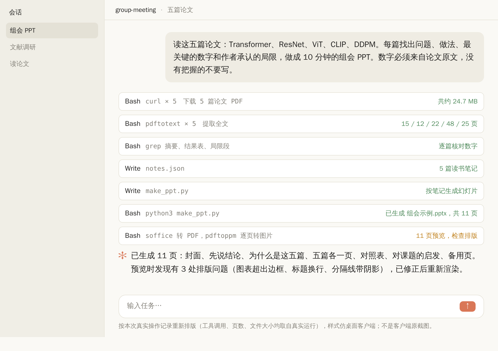
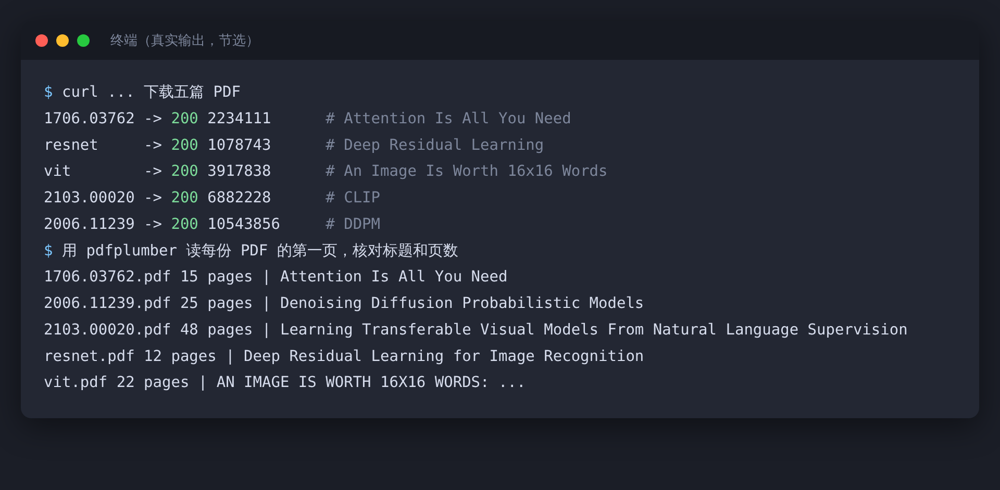
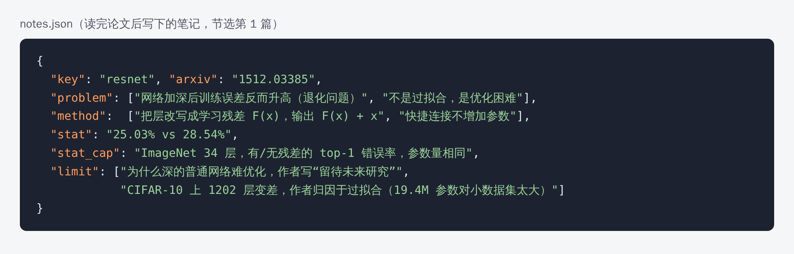
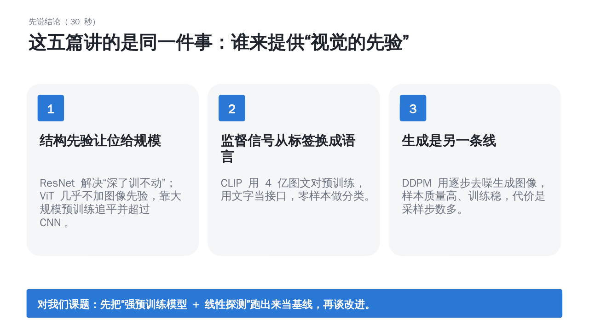
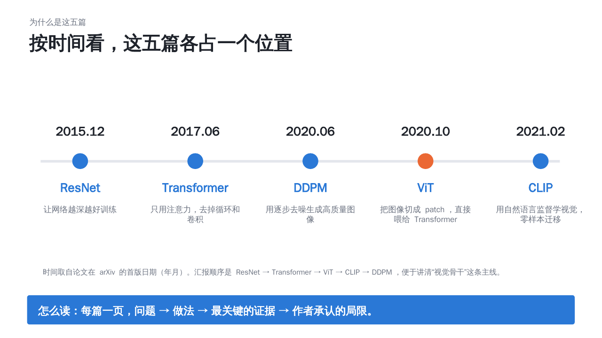
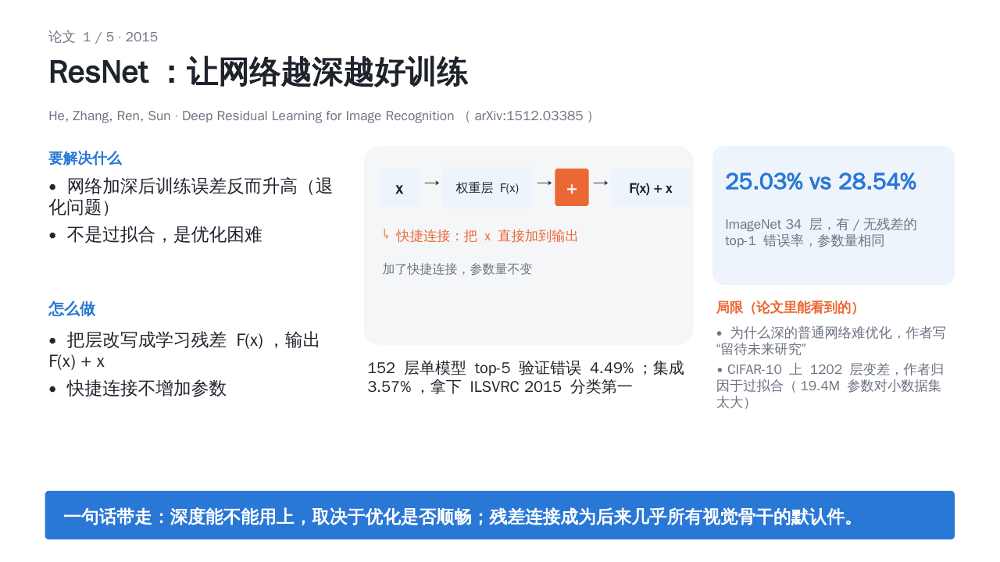
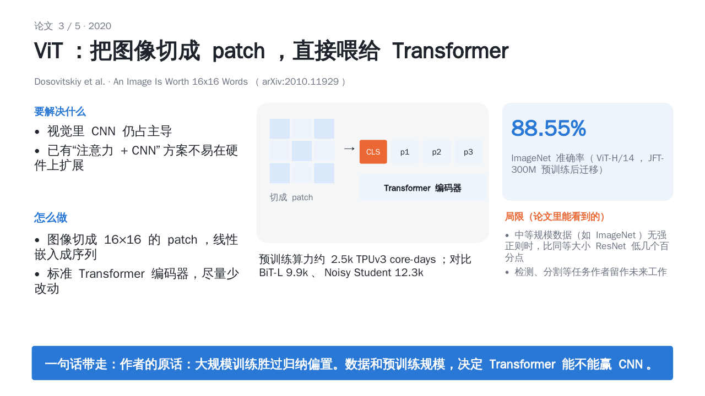
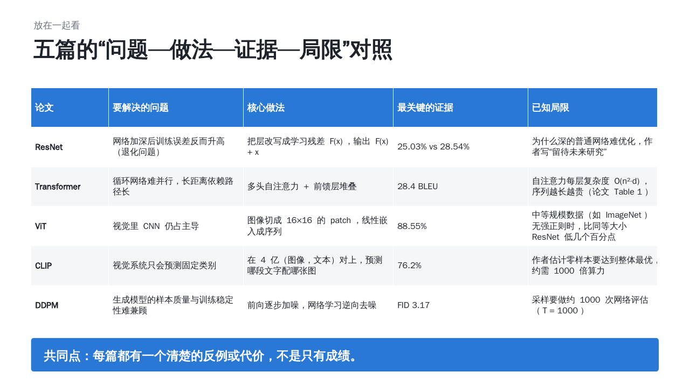
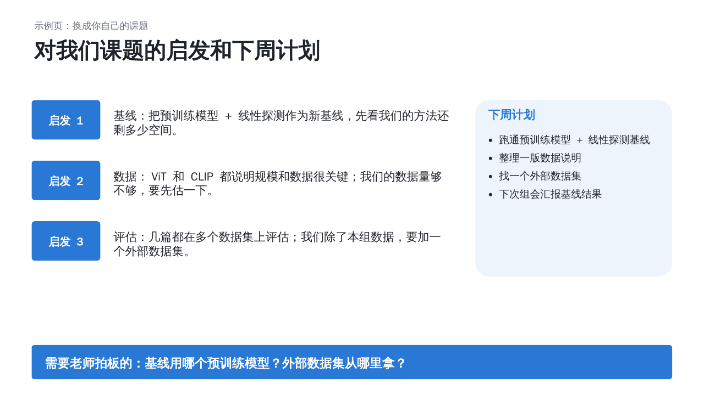
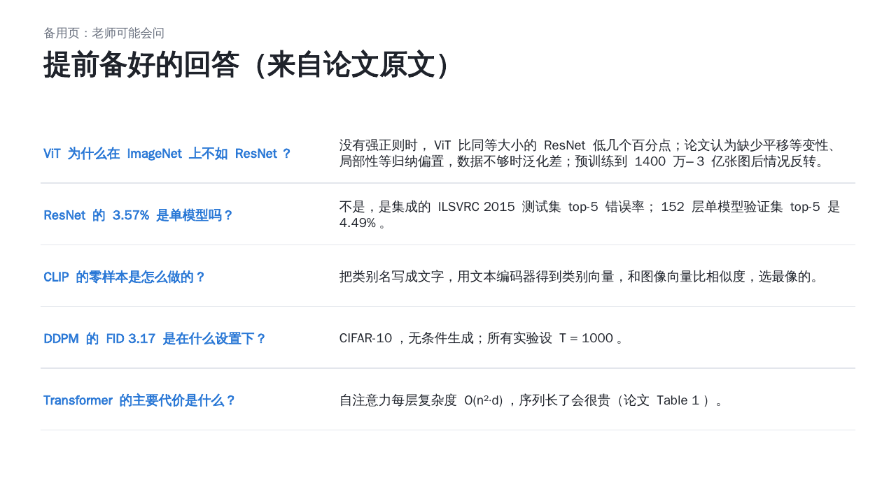

先说一个大家都经历过的场景。

组会前一天晚上，你手里有五篇论文，每篇二三十页。你想把它们都讲清楚，又知道只有十分钟。

最后常见的结果是：每篇讲一遍摘要，老师问一句“所以这和我们的课题有什么关系？”，你愣住了。

这篇文章，我把这件事**真的做了一遍**：用 Agent 帮我读五篇论文，做成一份 11 页的组会 PPT，每一步都有截图。后面还有 **10 条备会小技巧**，用大白话讲，你拿去就能用。

**先说清楚几件事：**

- 题目里的“十分钟”，是**汇报的时长**，不是准备时间。准备时间我没有掐表，而且我建议你别压缩：核对数字这一步，值得多花点时间。
- 示范用的五篇论文，是 ResNet、Transformer、ViT、CLIP、DDPM，都是真实论文，我提取了它们的 PDF 文本，重点读了摘要、关键结果和局限部分（没有逐页精读）。你的课题肯定不是这五篇，这里只是示范**流程**。
- “老师满不满意”，我没法保证，每个课题组口味不同。但我会告诉你，老师通常在乎的几件事，怎么提前准备好。

## 一、整个流程：五步

这张图是这次操作的真实记录（按实际的工具调用和结果重新排版，样式是仿桌面客户端，不是客户端的原截图）。五步是：

1. **选五篇有主线的论文。** 别凑数，要能串成一条线。
2. **拿到全文。** 摘要不够，要读全文里的结果表和局限部分。
3. **每篇填同一张“五格卡”。** 问题、做法、证据、局限、和我何干。
4. **回原文核对每个数字。** 这一步不能交给 AI。
5. **生成 PPT，再渲染出来看一遍。** 别信“已生成”三个字，要自己看。

下面一步步说。

### 第 1 步：选五篇，要有主线

我选的是 ResNet、Transformer、ViT、CLIP、DDPM。主线是“**视觉的先验从哪来**”：ResNet 解决“深了训不动”，Transformer 提供通用骨干，ViT 把它搬到视觉，CLIP 用语言做监督，DDPM 走生成路线。

你自己组会的五篇，也该有一句话的主线。**如果你说不出这五篇的共同点，老师也听不出来。** 这句话，就是你 PPT 的“先说结论”页。

### 第 2 步：拿到全文，并确认拿对了

这是我真实的终端输出：五个文件都下载成功，我用程序读了每份 PDF 的第一页，核对**标题和页数**，确认拿到的是对的论文，不是错版本。

这一步看起来多余，但**下错版本、读成别的论文，你自己是很难发现的。** 花 10 秒核对标题，值得。

关于论文的获取：我用的是公开可下载的 PDF。你自己的话，用学校的数据库或 arXiv 就行。

### 第 3 步：每篇填同一张“五格卡”

读完摘要、结果和局限部分后，我给每篇论文填了**同一张表**：

| 格子 | 要回答的问题 |
|---|---|
| 问题 | 它要解决什么？为什么以前的办法不行？ |
| 做法 | 核心做法一两句话说完 |
| 证据 | 最关键的一个数字，在什么设置下测的 |
| 局限 | 作者自己承认的局限，或者论文里能看到的代价 |
| 和我何干 | 对我们的课题意味着什么 |

上图是第一篇（ResNet）的笔记。**用同一个格式，是整篇的关键**：五篇放在一起，你才能对比；老师也能快速抓到重点。

下面这个提示词，你可以直接用（把方括号里换成你的）：

> 请读这篇论文的全文，不要只读摘要。按下面五项整理，每项不超过两句话：
> 1. 要解决的问题；2. 核心做法；3. 最关键的一个数字（注明测试集、设置、是单模型还是集成）；4. 作者自己承认的局限，或论文里能看到的代价；5. 对【我的课题：……】的启发。
> 要求：所有数字必须来自论文原文，并注明在第几页或哪张表；没有把握的写“待核对”，不要编。

最后一句是重点：**要求它标出处、允许它说“待核对”。**

### 第 4 步：回原文核对数字（这一步你自己来）

我把每个要写进 PPT 的数字，都回原文搜了一遍。举几个核对时发现的细节：

- ResNet 的 **3.57%**，是**集成模型**在 ILSVRC 2015 测试集上的 top-5 错误率；而**单个 152 层模型**在验证集上的 top-5 错误率是 **4.49%**。如果你只写“3.57%”，老师问“是单模型吗？”，你就答不上来了。我把这条放进了备用页。
- ViT 的 88.55%，是 **ViT-H/14 在大规模数据集 JFT-300M 上预训练后**的 ImageNet 准确率，不是“直接在 ImageNet 上训练”的结果。论文里说，在 ImageNet 这种中等规模数据上训练、又没有强正则时，ViT 比同等大小的 ResNet 低几个百分点。
- CLIP 的 76.2%，是**零样本**的 ImageNet 准确率，和原版 ResNet-50 相当，而且没有用那 128 万张标注图。
- Transformer 的 28.4 BLEU，是 WMT14 **英德**翻译；英法是 41.8。

**这一步为什么不能交给 AI？** 因为组会上被问到“这个数是在什么设置下的”，答的人是你。AI 可以帮你把数字找出来，**但你必须看过原文，知道这个数字从哪来。**

### 第 5 步：生成 PPT，然后渲染出来看一遍

笔记写好后，我让 Agent 按笔记生成了幻灯片，共 11 页。重点是：**生成之后，我把它渲染成图片，一页页看了。** 渲染检查时发现了三个问题：

- 示意图超出了边框；
- 有一页的标题太长换了行；
- 备用页的分隔线带着难看的阴影。

都修好之后，成品是这样的：

**先说结论（30 秒）：**

**为什么是这五篇：**

**每篇一页，结构完全一样：问题、做法、证据、局限，最后一句话带走：**

**五篇放在一起对照：**

**对我们课题的启发和下周计划（示例页，要换成你自己的课题）：**

整份 PPT 的结构：

| 页 | 内容 | 时间 |
|---|---|---|
| 1 | 封面 | 10 秒 |
| 2 | 先说结论 | 30 秒 |
| 3 | 为什么是这五篇 | 40 秒 |
| 4–8 | 五篇各一页 | 每篇约 70 秒，共约 6 分钟 |
| 9 | 五篇对照 | 50 秒 |
| 10 | 对课题的启发和下周计划 | 1 分钟 |
| 11 | 备用页：老师可能会问 | 不讲，被问再翻 |

加起来九到十分钟。这是我凭经验估的，**你一定要自己计时彩排一次**。

文件我也放在了文章对应的文件夹里（`组会示例.pptx`），生成它的脚本和读书笔记都在，你可以直接改。示意图都是用形状自己画的，没有复制论文里的图。**你自己汇报时如果要放论文里的原图，记得标明出处。**

## 二、老师为什么会满意：我的几点观察

这是我的判断，不是调查结果：

1. **有结论，不是堆摘要。** 第二页就说了“这五篇讲的是同一件事”。
2. **每篇都讲到了代价。** 局限放在每页固定的位置，老师一眼能看到你读得深不深。
3. **数字有出处。** 被问到，你答得上来。
4. **有“和我们何干”和下一步。** 不是读完就完了。

> 【AI 生图提示词｜infographic｜sketch-notes + macaron｜16:9｜生成后存为 imgs/11-infographic-five-box-card.png，用完删掉本引用块】
> ZONES：画面中央一张卡片，卡片被分成五个横向的格子，从上到下排列，每个格子左侧一个小图标。卡片旁边一个简化的人形剪影在竖大拇指。
> LABELS：卡片标题「五格卡」；五个格子依次为「问题」「做法」「证据」「局限」「和我何干」。文字少而大，手写体风格。
> COLORS：五个格子用五种柔和的粉彩，背景暖奶油色。颜色名称只是渲染指导，不要作为文字出现在画面里。
> STYLE：sketch-notes，手绘线条，大量留白，人物只画简化剪影。
> ASPECT：16:9

## 三、备会的 10 条小技巧：拿去就能用

下面这部分，换个轻松的口气讲。每一条都很短，挑你用得上的。

### 技巧 1：先问清楚，这次组会老师想听什么

同样是“讲五篇论文”，老师想要的可能不一样：是想让你**帮大家扫盲**，还是想**为课题选方向**，还是想检查你**读得够不够深**？

**小贴士：** 提前一两天，用一句话问老师：“这次我准备讲这五篇，主线是 XX，您看想侧重哪方面？”花 30 秒，能省你很多返工。

### 技巧 2：论文不要从头读到尾，用三遍读法

这是 S. Keshav 的经典方法《How to Read a Paper》：

- **第一遍（五到十分钟）：** 快速扫一遍，看标题、摘要、引言、小标题、结论，得到一个整体印象，并决定要不要继续读。
- **第二遍：** 抓住内容，但先不抠细节：看图、看表、看结果。
- **第三遍：** 深入理解，需要时再动手推一推。

**小贴士：** 五篇论文准备组会，通常“第一遍扫五篇、第二遍精读 2–3 篇、第三遍只对最关键的那篇”，就够了。（原论文里每一遍具体花多久，我只核实了第一遍的“五到十分钟”，别的请你看原文。）

### 技巧 3：每篇都填同一张“五格卡”

问题、做法、证据、局限、和我何干。上面已经讲过了。

**小贴士：** 先自己填一遍，再让 Agent 填，对比一下。**如果你们填的不一样，说明有一个人理解错了**，这时回原文看，最有收获。

### 技巧 4：数字回原文，别信二手

别人的博客、综述、AI 的总结，都可能写错数字或写漏条件。

**小贴士：** 每个要上 PPT 的数字，旁边记一下“第几页、哪张表”。被老师问到时，你能直接翻到。

### 技巧 5：一页只讲一个观点，标题写成一句话

不要把标题写成“实验结果”，写成“**152 层单模型 top-5 错误率 4.49%，集成 3.57%**”这种带结论的句子。

**小贴士：** 写完标题，只看标题，能不能讲出一个完整的故事？不能，就改标题。

### 技巧 6：先说结论，再讲过程

老师没有耐心听你从背景讲起。第二页就说结论：“这五篇讲的是同一件事……”

**小贴士：** 结论页要能在 30 秒内讲完。讲不完，说明你自己还没想清楚。

### 技巧 7：给时间做预算

十分钟，大约 8–10 页的主体内容。我的粗略分配：开头结论一分钟，每篇一分钟出头，收尾一分钟，备用页不算。

**小贴士：** **彩排一遍，掐表。** 第一次彩排，几乎一定会超时。超了，删内容，别加速。

### 技巧 8：把“局限”和“反例”留一个固定位置

老师最爱问的，往往就是“这个方法什么时候不行”。

**小贴士：** 每篇固定留一个格子写局限。找不到作者承认的局限，就看实验里它**输给谁、在哪个数据集上输**。

### 技巧 9：准备一页“备用页”，预判老师会问什么

把你能想到的 5 个问题，连答案一起放在最后一页。我放的是：“ViT 为什么在 ImageNet 上不如 ResNet？”“ResNet 的 3.57% 是单模型吗？”这类，都是我核对数字时发现的容易混淆的点。

**小贴士：** 好的备用页，来自你读论文时“咦，这里怎么回事”的那些瞬间。读的时候随手记下来。

### 技巧 10：结尾一定有“和我们课题的关系”和“下周做什么”

别以“谢谢大家”结束。结束在“**所以我建议下周先做 XX，需要您拍板的是 YY**”。

**小贴士：** 好的结尾，老师能直接回答“可以”或“换个方向”。这样你的汇报就变成了一次决策，而不是一次朗读。

### 小彩蛋：用 AI 做组会，三条规矩

1. **AI 帮你整理，你来负责。** 被问到的是你，不是它。
2. **让它标出处，允许它说“不确定”。** 编造的数字，是 AI 最常犯的错之一。
3. **署名和出处要清楚。** 用到论文里的图，标明来源；如果课题组或学校对 AI 辅助有规定，按规定来。

## 四、我这次没做到的，和你要自己补的

- **我读的是五篇经典论文，不是你的课题。** 你的课题的“和我何干”那一页，只有你自己能写。
- **我没有掐表**，十分钟是按字数估的。
- **我没有真的在组会上讲过**，所以“老师是否满意”，是我的判断，不是结果。
- **PPT 渲染我用的是 LibreOffice**，字体用的是文泉驿正黑，放到你电脑的 PowerPoint 里，字体会变成微软雅黑，排版可能有细微差别，**请你打开检查一遍**。
- 我读论文时，用的是 PDF 的文本提取，**图里的内容我没有逐张去看**。如果你要讲某张图，请你自己看图。

## 最后

组会汇报，好看的不是 PPT，而是你的**判断**：你为什么选这五篇，它们共同说明什么，对我们的课题意味着什么。

Agent 可以帮你把读、整理、排版这些“体力活”做得快一点。但判断这件事，只能你自己来。

你下一次组会是讲论文，还是汇报进展？把你的情况留言，我挑几个，下一篇专门写“汇报进展”版本。
