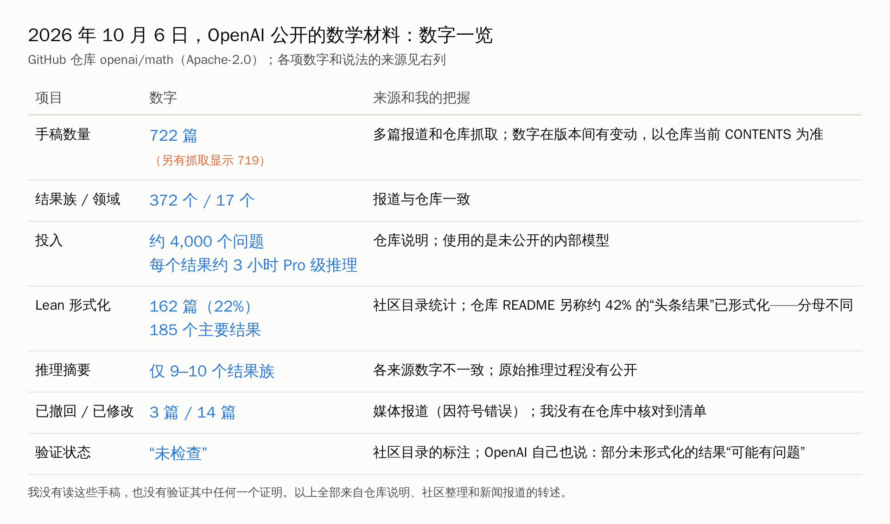
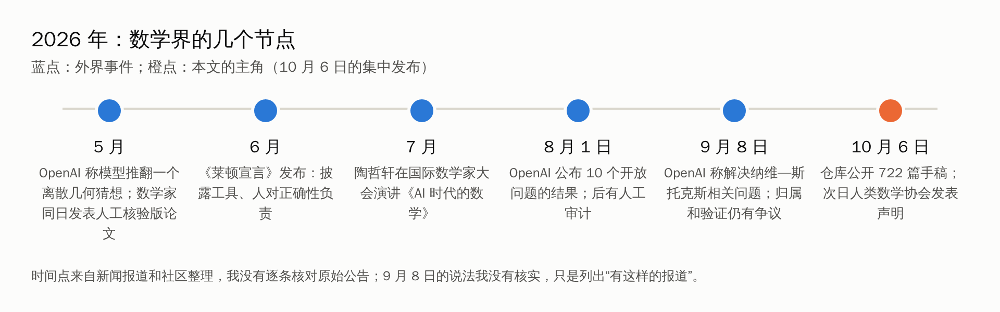

2026 年 10 月 6 日，OpenAI 在 GitHub 上放出了一个叫 `openai/math` 的仓库，里面有 722 篇数学手稿。

不是 722 篇已经发表的论文，也不是 722 个被确认的定理。是 722 份由一款**未公开的内部模型**生成的手稿，涉及 372 个“结果族”、17 个数学领域，其中有些题目，是你听过名字的。

数学界的反应很分裂：有人说“懵了”，有人说这是“力量的展示，不是学术”，有人要求先公开提示词和过程。

如果你不是数学家，你可能会想：**这和我有什么关系？** 我做的是计算机视觉、材料、经济学、生物，我读研读博，还有意义吗？毕业能找到工作吗？我该怎么用 AI，才不会被 AI 替代？

我花了几天，把能找到的事实、数据和各方说法都读了一遍，写成这篇文章。**先说清楚：** 我没有读这些手稿，也没有验证其中任何一个证明，下面关于这次发布的内容，都来自仓库说明、社区整理和媒体、专家的公开发言。

## 一、先把事实摆清楚

几点说明：

**这是什么：** 一批手稿和配套材料。有些附带 Lean（一种形式化证明语言，能被程序检查）的证明，有些没有。OpenAI 在仓库里说，**部分没有形式化的结果“可能有问题”**，并承诺会尽快修正。修订以新版本的方式记录，旧版本仍然可以看。

**这不是什么：** 不是同行评审过的论文。社区整理的目录里，整体的审查状态写的是“未检查”。

**怎么做出来的：** 据仓库说明，绝大多数结果用的是同一个流程：一个未公开的内部模型，被抛了大约 4,000 个问题，每个结果平均耗费约 3 小时 ChatGPT Pro 级别的推理算力，再按重要性门槛汇总成“结果族”。有几个例外，比如黎曼 ζ 函数的无零点区域，其中一篇被人工编辑过以便阅读。**模型和算力本身没有公开**，所以有人把这次发布概括成“结果公开，模型不公开”。

**出了问题没有：** 据媒体报道，发布后因为发现符号错误，撤回了 3 篇、修改了 14 篇。这个数字我没有在仓库里核对到清单，请当作媒体说法。另外，8 月 1 日 OpenAI 公布的 10 个开放问题的结果，后来有人写了一篇预印本，对照 18 份评审意见做审计，结论是：**没有发现仍然成立的、对主要结果有实质影响的确认错误**，但也说明评审报告深浅不一、有些依赖只被部分检查过，其中一章还有“需要大修”的专家意见。

还有一个背景要说：9 月 8 日，OpenAI 曾宣布一个关于纳维—斯托克斯方程的结果。有报道说归属上有争议，另一些独立工作也在进行。**这个说法我没有核实，我没有把它当作事实。**

## 二、数学家们怎么说

我只引用能核对到来源的话，每条都标明是转述还是原话。

**振奋的一边：**

菲尔兹奖得主 Cédric Villani，在 OpenAI 9 月宣布纳维—斯托克斯结果之后，据报道说自己“被震住了”，并称这是“数学从未经历过的大灾变”（cataclysm）。（法国媒体的报道，经英文媒体转述，我没有读到原文；注意那条消息本身的归属还有争议。）

**质疑和担忧的一边：**

- 一份**人类数学协会（AHM）**的声明，由陶哲轩在他的博客上转载（10 月 7 日）。根据媒体转述，声明里有一句：“一次放出 700 多个文件，不是学术的展示，而是力量的展示。”并呼吁数学家们不要与 OpenAI 合作。（这段我没能打开原文，只看到转述，请你核对。）
- 麻省理工的 Sutherland 等多位数学家要求公开模型、提示词和计算过程；在能被复现之前，“一个智能体一次解决了某个问题”的说法，应当视为**未经证实**。
- 西北大学的 Krah 担心，数学靠合作和非正式交流，一次性公开大量成果，可能让研究者不再愿意分享未完成的想法。
- 学界还提出一个新概念，叫**“证明过剩”**：人类来不及逐项验证。

**陶哲轩本人的几个观点**（来自他的公开发言的转述）：

- 在国际数学家大会（2026 年 7 月）的演讲里，他说，AI 在数学研究里的快速崛起，造成了“**我们的数学价值观和实践的危机**”（科学美国人节选）。
- 他说，“解题”作为衡量数学的代理指标，“在证明稀缺的年代大体上是准确的，但在证明过剩的年代已经错位了”（媒体转述，他没有点名 OpenAI）。
- 他区分了两种“摩擦”：**人为的摩擦**（繁琐的计算），可以交给工具，只要你能抽查结果；**自然的摩擦**（真正的概念难度），值得你自己啃。一个把概念讲得太顺滑的工具，可能悄悄夺走学习者需要的那份困难。
- 他给出的实用规则：**只在你能“红队”（red-team，挑错）它输出的地方，才依赖 AI。**

**另一种声音：** Villani 对自己的博士生给过一个很极端的建议，据法新社报道，他对 Radio Classique 说，他让自己的博士生在整个读博期间**“千万别用”**生成式 AI 工具，理由是：研究、验证和理解的过程，比结果本身更重要，智力上的努力是在塑造研究者的头脑。这是他的个人立场，我觉得值得认真听，但不一定适合所有人，后面我会说我的看法。

**制度层面：** 2026 年 6 月发布的《莱顿宣言》（16 位研究者起草，据报道国际数学联合会表示支持），主张：披露所用的 AI 工具，人类对正确性和引用负责，不让自动系统署名。它不是禁止 AI，而是反对 AI 公司处理数学成果的方式，比如用新闻稿而不是同行评审来发布。（签署人数各来源不一致。）

## 三、这和“做研究的意义”有什么关系

这件事触动大家最深的，不是 722 这个数字，而是一个更根本的问题：

> 如果“把题解出来”这件事，AI 越来越快、越来越便宜，那做研究的人，剩下的价值是什么？

我的回答分三层。**这是我的判断，不是事实。**

### 第一层：做研究，是在训练“理解”

陶哲轩在一条帖子里说，在 AI 之前，证明之所以像“货币”，是因为写出证明需要理解，而证明展示了这份理解。Villani 也说，过程比结果重要。

对普通人来说，这一层最实在：**你读研读博，真正带走的不是那一篇论文，而是你能在不熟悉的问题面前，一步步搞清楚怎么回事的能力。** 这种能力，用 AI 一键生成的东西，替代不了。反而，当 AI 的输出越来越多，**能判断它对不对的人，会越来越稀缺。**

### 第二层：瓶颈从“生产”移到“判断”

有一篇 arXiv 论文的标题很精确：“**验证过剩，裁决稀缺**”。大意是：自动检查证明让“被认证的断言”变得便宜，但专家审查的能力是固定的，真正的瓶颈，转移到了“判断这个断言意味着什么、重不重要”。（我只看到了摘要性的转述，没有读原文。）

另一篇相关的论文也说，数学正在从“证明稀缺”走向“证明过剩”，验证、写作和同行评审都会承压。

放到你的领域也是一样：当“做出一个能跑的模型、写出一篇像样的论文”越来越容易，**选什么问题、怎么判断结果可信、值不值得做**，就成了真正拉开差距的东西。

### 第三层：责任

《莱顿宣言》的核心，是“人对正确性负责”。当你在组会上、论文里、项目里写下一个结论，**签字的是你，不是模型。** 能承担这份责任的人，是不可替代的。

### 这是不是数学才有的事？

别急着说“我又不是做数学的”。这次发布能引起这么大的反应，一部分原因是数学有一个特殊的优势：**证明可以被程序检查（Lean）**，所以 AI 的成果能被相对快速地验证。大多数领域没有这个条件：实验要做，数据要采，结果要复现。**我的推断是：在验证成本高的领域，“证明过剩”的冲击来得更慢，但“判断稀缺”这件事，同样存在。**

## 四、硕博的出路：数据怎么说

先说清楚：**我没有找到一份可靠的、全国范围的“硕博就业率和去向”的最新官方统计**，下面是能找到的片段，口径不一，请当作线索。

**总量：** 教育部预计，2026 届全国普通高校毕业生约 1270 万人，比上一届多 48 万。这是本专科加研究生的总数，**研究生的分项数字我没有查到。**

**博士去向（片段）：**
- 清华 2024 届博士，学术就业占比 47.8%，已连续五年超过 45%。
- 一项基于 2015—2020 年数据的研究，高校是博士最主要的去向，占 45.5%；人文社科博士留在高校的比例更高。
- 上海几所高校 2025 届的报告里，有一份数据显示，46.4% 的博士选择去做博士后，36.8% 进入企业。
- 注意：各校、各研究对“学术就业”“教育单位”“企业”的分法不同，**不能直接对比**。

**AI 对“入门岗位”的影响：**
- 斯坦福数字经济实验室的 Brynjolfsson 等人，用 ADP 的薪资数据研究发现：在 AI 暴露度高的职业里，**22 到 25 岁的早期职业者，就业相对下降了 16%**（2025 年 11 月版摘要），而有经验的员工就业基本稳定；这个研究后来更新过，有报道称数字变为约 19%，我没有核对更新版。变化主要通过**少招人**，而不是裁员。
- Indeed 的数据显示，截至 2026 年 5 月，入门级岗位发布数同比下降 7.5%，资深岗位上升 14.7%（来自二手报道）。
- **要注意：** 这些是美国数据，而且把变化归因于 AI，有争议：同样的数据，也可以用利率导致的招聘冻结来解释。

**一个专业的参考（美国）：** 美国劳工统计局预测，2024 到 2034 年，数据科学家就业增长 34%，2024 年薪资中位数 112,590 美元；数学家和统计学家合计增长 8%。这是美国的数据，**不能直接套到中国**。

**数学圈自己怎么看就业：** Quanta 杂志引用了加州理工一位博士生的话：“**这打破了我们的体系**。”文章的意思是，数学界的激励机制，不是为“解题变得容易、理解依然困难”的世界设计的。一位博士在博客里说得更直接：本来就需要博士学位的工作就很难找，现在更糟，因为部分技能正在被自动化。也有乐观的声音，比如 MIT 的 Etingof，预计数学家会少花时间在“冻土上刨食”。（均来自转述。）

**我对这些数据的读法：** 最坏的情形，**不是“没有博士需要了”，而是“入口变窄了”**：以前靠“把已知方法用到已知问题上、结果容易检验”的初级工作，是年轻人进入行业的台阶，而这一类工作，恰好是最容易被 AI 做的。

## 五、五个预测

**这是我的判断，不是事实。** 每条都写了依据和“什么情况会让我改口”。

| # | 预测 | 把握 | 依据 | 什么会让我改口 |
|---|---|---|---|---|
| 1 | “解决别人能解决的问题”本身的稀缺价值会继续下降 | 较高 | 722 篇手稿、Lean 验证的发展、多个领域类似的报道 | 这批成果被大面积证伪，且长期没有改善 |
| 2 | 评价体系会变：更看重问题选择、验证、解释和责任，而不是论文数量 | 中 | 陶哲轩的“Math 2.0”、《莱顿宣言》、各学会的声明 | 学界和用人单位继续只看发表数量 |
| 3 | 入门岗位变窄，但有能力“验证和判断”的人，岗位更稳 | 中 | 斯坦福的早期职业研究、证明过剩的讨论 | 后续数据显示入门岗位恢复，或判断类岗位也被压缩 |
| 4 | 验证成本低的领域（形式化数学、可测试的代码）先受冲击，验证成本高的领域（实验、临床、野外）后受冲击 | 中偏低 | 这次发布依赖 Lean，其他领域没有对应的廉价验证 | 其他领域也出现了廉价的自动验证手段 |
| 5 | 公开透明（披露 AI 使用、公开数据和代码）会成为学术信誉的一部分 | 中 | 《莱顿宣言》、要求公开提示词和过程的呼声 | 披露流于形式、没有后果 |

## 六、用 AI 当杠杆：六条做法

杠杆的意思，是用一点力，撬动更大的东西。放在 AI 上：

> **你的价值 = 你的判断力 × AI 的执行力**

AI 的执行力会越来越强、越来越便宜。**判断力那一项，是你要练的。** 下面六条，是我从上面的事实和各位专家的话里，总结出来的。

### 1. 让 AI 当“对手审稿人”，别当“枪手”

陶哲轩的规则：只在你能红队它的地方才依赖它。落到操作上：

> 下面是我的方法和结论：【粘贴】。请你扮演一个挑剔的审稿人，列出五个最可能被攻击的地方，每条说明为什么，以及我可以做什么实验或检查来回应。不要替我改写，只找问题。

**重点：** 它找出的问题，你要自己判断对不对，再自己去补。

### 2. 区分“人为的摩擦”和“自然的摩擦”

- **人为的摩擦**（格式、重复性的代码、文献整理、画图）：交给 AI，你抽查。
- **自然的摩擦**（你的核心概念、关键的推导、你自己课题的主要想法）：**你自己先啃。** 想不出来再问，而且问完要自己复述一遍。

Villani 的建议更极端（读博期间完全不用）。我的看法是：**如果你的目标是学术，尤其是理论类，前期多留一些自然摩擦；如果你的目标是应用或工业界，也要留，但比例可以小一点。** 判断标准是：这件事做完，你自己变强了吗？

### 3. 练“验证”这项硬功夫

AI 越多，会验证的人越值钱：

- 能复现别人的结果（包括 AI 给的结果）；
- 能写测试、做消融、查数据泄漏；
- 能读懂一个证明或实验设计，说出它依赖的假设。

**可以做的小练习：** 每周挑一篇你领域的论文，只复现它的一个关键结论，记录：能复现吗？依赖什么条件？哪里和论文说得不一样？

### 4. 养成“选问题”的品味

“证明过剩”的时代，问题的选择是稀缺的。一个简单的自检清单（受 DARPA 的海尔迈耶提问清单启发）：

- 这个问题，用大白话说，在解决什么？
- 现在是怎么做的？为什么不够？
- 如果成功了，谁会在乎，改变什么？
- 最大的风险是什么？

> 这是我的一个课题想法：【粘贴】。请你像一个资深同行，用上面四个问题挑战我。你觉得哪一个我最没想清楚？

### 5. 把“透明”做成习惯

《莱顿宣言》的核心之一是披露。你可以从现在开始：

- 记一份“AI 使用日志”：哪个环节用了什么工具，做了什么，你怎么核对的；
- 论文、报告里按学校和期刊的规定声明；
- 数据、代码尽可能可复现。

这不只是“合规”，它**让别人信任你**，也让你自己在被问到时有底气。

### 6. 做交叉，守住“你有而别人没有”的东西

AI 能做出通用的东西，但**你手里的数据、你和领域专家的合作、你对一个具体场景的理解**，是独特的。医学、遥感、材料、教育、社科，每个领域都有“AI 做不了，需要人去现场、去采集、去问”的部分。

**可以问自己：** 如果让 AI 自己去做我这个课题，它缺什么？缺的那些，就是我的位置。

### 一个六个月的行动表

| 月份 | 做什么 | 检验标准 |
|---|---|---|
| 第 1 个月 | 建立 AI 使用日志；用“对手审稿人”提示词审一次自己的工作 | 得到 3 条自己认可的批评 |
| 第 2 个月 | 选一篇论文做小复现；练习一次“自然摩擦”：自己推一个关键步骤 | 写出复现记录 |
| 第 3 个月 | 写一份“我的课题的四个问题”，找老师或同学讨论 | 一页纸，被别人挑战过 |
| 第 4 个月 | 找一位领域合作者，聊三个真实问题 | 有一个“我有而 AI 没有”的切入点 |
| 第 5 个月 | 把一个小结果做成可复现的包（代码、数据、说明） | 别人能跑通 |
| 第 6 个月 | 复盘：哪些环节 AI 让我变强，哪些让我变懒 | 调整下阶段的使用规则 |

## 七、三类读者，各有侧重

**做数学或理论的：** 冲击最直接。建议认真读陶哲轩的“Math 2.0”相关讨论和《莱顿宣言》，把重点放在“理解、解释、选问题、形式化验证”上。Lean 之类的工具，值得了解。

**做实验或应用的（工科、医学、遥感、材料……）：** 你有“数据和现场”的优势。别丢掉，也别全让 AI 做。你的竞争力在“采集、验证、解释、落地”。

**以就业为目标的硕士：** 入门岗位变窄是我最担心的一点。建议用上面的第 3、5、6 条：**做出别人能看到的、可验证的作品**，比如可复现的项目、公开的代码和数据，证明你不只是“会用 AI”，而是“能对结果负责”。

## 八、这篇文章没做到的

- **我没有读这 722 篇手稿，也没有验证任何证明。** 所有关于这次发布的内容，都来自转述。
- **专家的话大多是二手的**：陶哲轩的几句来自媒体转述，我没有打开他博客的原文；AHM 声明也一样。
- **各来源数字不一致**：手稿数（719 或 722）、推理摘要的数量、Lean 覆盖率（22% 与约 42%，分母不同）、签署《莱顿宣言》的人数等。我都标了。
- **就业数据多数是美国的**，中国的硕博去向，我只找到零散的单校数据，没有找到可靠的全国统计。
- **预测是我的判断**，我也可能错。
- **我没有探讨“AI 是否会真的取代某一类博士工作”这个更大的问题**，我只给了线索。

## 最后

回到开头的问题：普通人做研究，还有意义吗？

我的答案是：**有，但意义变了。**

以前，意义的一部分在“我解出了别人解不出的题”。以后，这一部分会越来越难单独成立。**留下来的，是理解、判断和责任**：你能搞清楚一件事到底是怎么回事，你能判断一个结论可不可信，你愿意为自己签字的东西负责。

这三样，恰好也是 AI 时代最稀缺的东西。

你现在读研读博，最担心的是什么？是论文、找工作，还是怕自己被替代？评论区告诉我，我挑几个具体的情况，下一篇专门写。
