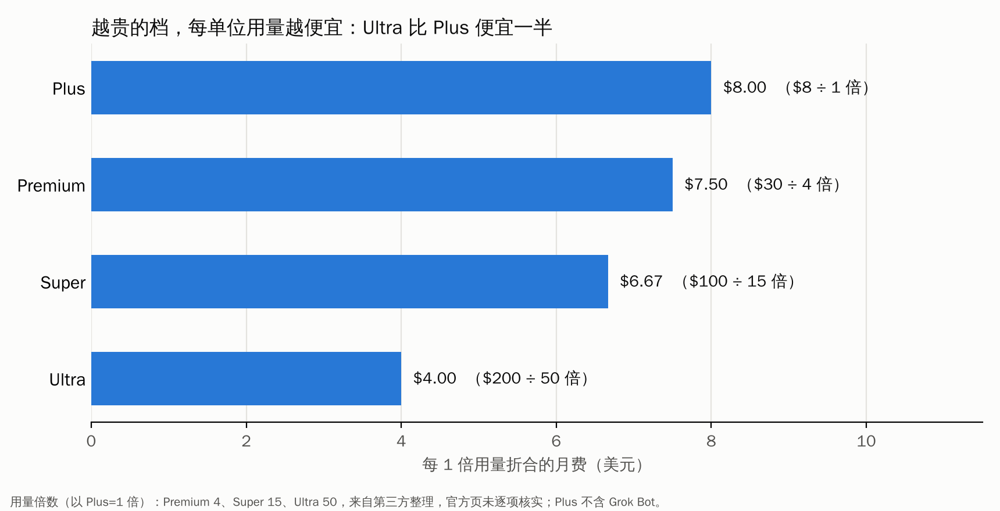
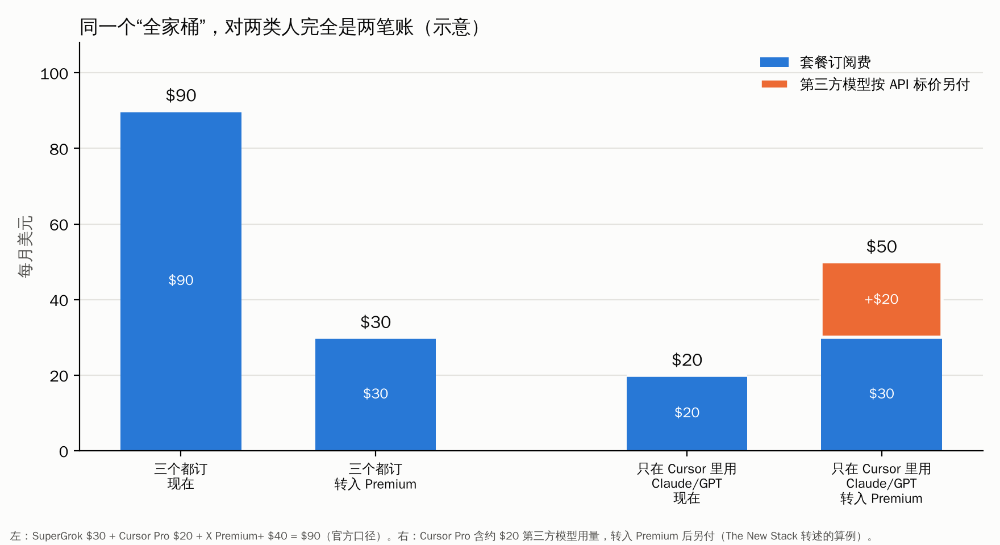

2026 年 10 月 12 日，马斯克旗下出了一件对普通用户影响很直接的事：**X、Grok 和 Cursor 合成了一个订阅**。（公告是 SpaceX 的 AI 部门发的，我没有找到马斯克本人的直接表态。）

名字叫 **The X Subscription**。X 的老会员、SuperGrok 的付费用户、Cursor 的程序员，从此可以在一个账号、一份账单、一个用量池里，同时用聊天、写代码、做图和视频，还有一个新的“Grok Bot”（一种在云端电脑上替你操作浏览器的智能体）。

标题里写“全家桶”，我先说清楚范围：**目前看到的报道里，没有 Starlink，也没有特斯拉。**特斯拉的媒体 Teslarati 的标题提到了“对特斯拉车主的影响”，但据我看到的摘要，SpaceX 和特斯拉都还没有说车里的 Grok 权益会怎么变。所以这个“全家桶”，装的是 **X + Grok + Cursor**。

这篇文章我想回答四件事：它到底是什么；账怎么算；最近大家怎么评价；我自己的判断。

先说前提：**这件事才两天，细节还在变。**我只能读到搜索摘要和转述，打不开 x.ai 官方公告、TechCrunch 这些页面本身；所有信息我都标了来源，哪些是官方口径、哪些是第三方整理，也分开写。

## 一、它到底是什么

先看表（价格是美元，月付；除非注明，来自官方公告的多家转述）：

| 档位 | 月费 | 年付（第三方整理） | 用量（相对 Plus，第三方整理） | 备注 |
|---|---|---|---|---|
| Free | 0 | — | 有限 | |
| Plus | 8 | 80 | 基础（1 倍） | 有 Cursor（据一家整理，只能用 Grok 模型），**没有 Grok Bot** |
| Premium | 30 | 300 | 4 倍 | 有 Grok Bot、Cursor 云端代理和 Origin；官方说它覆盖原来的 SuperGrok、Cursor Pro 和 X Premium+ |
| Super | 100 | 1,000 | 15 倍 | |
| Ultra | 200 | 2,000 | 50 倍 | |

团队版：Premium、Super、Ultra 按每个席位 30、100、200 美元收费，Plus 不提供团队版（来自一家第三方整理）。

几条规则，是评价里反复被引用的：

1. **共享用量池。**付费档的 Grok 和 Cursor 共用同一个每周用量池。Cursor 官方账号在 X 上的说法是：付费档“在 Cursor、Grok Build 和其他 Grok 产品之间共用一个用量池，同级别下 Grok 模型的编码用量是对应 Cursor 套餐的两倍”。（我引用的是搜索结果里 Cursor 官方帖子的标题文字。）
2. **第三方模型不在套餐里。**Claude、GPT 这类模型，在 Cursor 里依然能用，但**按 API 标价另外付费**，从预付额度里扣，可以设置消费上限。多家报道一致；The New Stack 的标题干脆写成“Claude 现在要另外付钱”。
3. **老用户可以不换。**现有的 SuperGrok、Cursor、X Premium 订阅者**保持原套餐、原价格、原权益**，转不转自己选。官方说，选择升级的话，旧套餐会终止并按未使用的时间**按比例退款**。据搜索摘要，Cursor 论坛里官方人员的回复大意是：没主动迁移的用户以后某个时间会被迁移，会提前通知，没有给时间表。
4. **转过去能不能转回来？**有一份通讯稿（Muskonomy）说账号合并后不可逆，客服也撤不回；官方页面摘要里我没看到这句，**所以这条我只当“未证实”**。

图 1 是我用上面“第三方整理的倍数”算的：**每 1 倍用量折合的月费**，Plus 是 8 美元，Premium 7.5，Super 6.67，Ultra 4。也就是说越买越划算，Ultra 比 Plus 便宜一半。**但这张图要小心看**：倍数不是官方逐项确认的，Plus 又不含 Grok Bot 和云端代理，几档并不完全同口径；还有一点，官方到现在没公布 Plus 到底有多少请求或 token 额度（24/7 Wall St 也指出了这一点）。

### 前因：为什么现在合并

这件事不是突然冒出来的。

- **SpaceX 买了 Cursor。**据多家报道，2026 年 4 月 SpaceX 拿到了以 600 亿美元收购 Cursor 母公司 Anysphere 的选择权，6 月行权，全股票交易，8 月 14 日交割完成，并入 SpaceX 的 AI 部门；
- **Grok 和 X 早就是一家。**据维基百科，2026 年 5 月马斯克宣布 xAI 不再作为独立公司存在，Grok 和 X 成为 SpaceX 的 AI 部门；
- **Grok Bot 8 月上线测试。**
- **9 月 30 日，彭博报道 SpaceXAI 在考虑重做 Grok 和 X 的订阅定价。**

名字上，不同媒体写法不一致：多数写 SpaceXAI，也有写 SpaceXSI（SpaceX Super Intelligence）。我看不出哪个更官方，所以文中用“SpaceX 的 AI 部门”。

## 二、账怎么算：同一个“全家桶”，对两类人完全是两笔账

**怎么读这张图：**每根柱子是一个月的总花费（美元），蓝色是套餐订阅费，橙色是按 API 标价另付的第三方模型费用。左边两根是“三个都订”的人，右边两根是“只在 Cursor 里用 Claude/GPT”的人，每组左边是现在，右边是转进 Premium 之后。

**能看到什么：**

- **左边（三个都订）：**SuperGrok 30 美元 + Cursor Pro 20 美元 + X Premium+ 40 美元 = 90 美元，转进 Premium 之后是 30 美元。这是官方的口径（“原来合计 90 美元，现在 Premium 覆盖了它们”）。
- **右边（主要用 Claude/GPT 写代码的 Cursor 用户）：**Cursor Pro 20 美元，其中含约 20 美元的第三方模型用量；转进 Premium 之后，订阅费 30 美元，同样那 20 美元的 Claude 用量要**另付**，合计 50 美元。这是 The New Stack 转述、一位 Substack 作者举的例子。

**这说明什么：**同一个“全家桶”，对“三样都订”的人是**省了 2/3**，对“只用 Cursor 里的 Claude/GPT”的人是**多花 30 美元（50 对 20）**。多出的钱里有 10 美元是“门槛”：据报道，Cursor 云端代理和 Origin 原来包含在 20 美元的 Pro 里，现在要至少 Premium（30 美元）才有。

**不能读出什么：**这是示意，不是实测。右边那个例子假定你每个月刚好用掉 20 美元的第三方模型额度，真实情况每个人不同；左边假定你原来真的三样都在付，而且都在用。**要知道自己的账，得打开 Cursor 的用量页面，把第三方模型的用量按 API 标价重算一遍。**这也是 Substack 和 Indexify 两位作者共同的建议。

## 三、最近的评价：赞成、反对、观望

下面是我读到的公开说法，按立场分开。**我没有做任何问卷统计，也没有读 Reddit 或 Hacker News（搜索没有返回相关讨论），这里的“评价”主要来自 Cursor 官方论坛、媒体和几位独立作者。**

### 觉得划算的

- **“这是个疯狂的好价格”**：AI 博主 Min Choi 在 X 上发帖说，Elon 把 Grok、Cursor 和 X Premium 打包成一个订阅，8 美元起，包含聊天、编码代理、图像和视频生成，30 美元加 Grok Bot，“this is a crazy deal”（这是他的原话）。
- **Cursor 论坛里有支持的人**：据搜索摘要，有评论者认为，一部分人平时就用 Grok 模型写代码，这对他们是好事。
- **官方的论点**：每个付费档的 Grok 编码用量至少是对应 Cursor 套餐的两倍；原来 90 美元的三样现在 30 美元。
- **一位 Substack 作者**（账号 johnaspinallsr）第一反应是松了口气，但建议先看自己的用量再决定，因为“打包只有在符合你的用法时才省钱”。一份指南的结论是：主要用 Grok 模型的重度 Cursor 用户，值得试试 Super 或 Ultra。

### 反对和担心的

- **Cursor 官方论坛，发布当天的主帖和回复几乎一边倒是批评。**一位长期的 Ultra 用户写道（据搜索摘要转引）：“月费现在只买 Grok 的用量，Claude 和 GPT 从第一次请求开始就按 API 标价计费，完全在套餐之外。”他认为这是 Cursor 在“自毁”——Cursor 的口碑一直是不绑定某个模型；还说第三方计费的变化藏在小字里，而且发布当天服务一度宕机。（这是一位用户的说法，不是官方确认。）
- **一个社区汇总**（来源不明，方法不详，我只当参考）报告的情绪分布是：约 15% 正面、35% 复杂、50% 怀疑，困惑主要集中在共享用量池和迁移上。还有评论者把这件事看成 **“AI 厂商开始圈地，各拉各的忠实用户”**。
- **The New Stack** 的报道标题是“X Subscription 把 Cursor 和 Grok、X Premium 打包了，但 Claude 现在要另外付钱”，并提到发布后 Cursor 论坛里 Pro、Pro+、Ultra 用户的问题集中在“换了会不会为同样的用量多花钱”。
- **24/7 Wall St** 的观点最直白：这个捆绑**悄悄把成本转给了开发者**；依赖第三方模型的开发者，虽然标价降了，实际要多花钱；SpaceX 也没说 Plus 档有多少请求或 token。它还把这件事读成“一次调价，没有宣布任何收入上的好处”。
- **GuruFocus** 指出，公司没有说希望转化多少用户、重度用户会消耗多少算力、这些套餐能带来多少利润。

### 资本市场：很平静

据 TipRanks 和 Stocktwits 的报道，SpaceX 股票（SPCX）10 月 12 日收盘 163.42 美元，涨 0.52%；这条消息是收盘后才出来的，盘后跌了约 0.63%，次日盘前基本持平，Stocktwits 上的散户情绪从“看多”滑到“中性”。

背景数字（据 SpaceX Q2 财报的报道转述）：AI 业务 Q2 收入 25.6 亿美元，同比增长 247%，但录得 13 亿美元的经营亏损；公司当季资本开支 183.7 亿美元，其中 158.3 亿美元用于 AI 算力。24/7 Wall St 另一篇文章引用 Similarweb 2026 年 5 月的数据说，Grok 的全球网页访问量在七个主要助手里排第五，在 ChatGPT、Gemini、Claude 和 DeepSeek 后面。（这一条我没核对原始数据。）

### 新东西 Grok Bot：评测普遍谨慎

Grok Bot 是 8 月上线的测试版，在云端电脑上用浏览器替你做事，可以“录一遍任务，把它变成可复用的技能”。几篇早期评测（Layer3Labs、Vellum、Cellcog 等）的共同点是：**值得试，但需要盯着**。

- 如果你已经订了包含它的套餐，试一试不用多花钱；
- 多个机器人**共享同一台云电脑**，所以共享浏览器 cookie、登录状态、文件和命令行凭据，这是被反复提到的安全风险；
- 评测者提到它可能编造事实、看错界面、把没做完的事报告成做完；
- 没有公布具体的数字额度，有评测说额度消耗很快，浏览器不稳定。

### 一个背景：Grok 值不值 30 美元，评价本来就分裂

在这次捆绑之前，各家评测对 SuperGrok（30 美元）的结论就不一致：多数认为它比 ChatGPT Plus 和 Claude Pro（各 20 美元）贵一半，**值得多付的主要理由是能用 X 上的实时数据**，和相对宽松的内容限制；也有评测转述说，反诽谤联盟（ADL）和 Common Sense Media 的评分里，Grok 在极端内容上是主流模型里最差的。这些评测写在几个月到几周前，**不是针对这次捆绑**，我只当背景。

## 四、我的判断（这一节是我的看法，不是事实）

**1. 这是一次“把 Cursor 变成 Grok 的前台”的动作，不只是一次降价。**你把 SuperGrok、Cursor 和 X 会员并成一个账，用量池共享，Grok 模型的编码用量翻倍，而 Claude 和 GPT 另外计费。这是明显地把用户往自家模型上引。对 SpaceX 来说，买 Cursor 花了 600 亿美元，让 Cursor 的用户多用 Grok，是最直接的变现逻辑。**批评者担心的“模型中立性”被改变，我觉得是对的。**

**2. 它对“三样都订”的人是真划算，对“只用 Cursor 里的 Claude”的人是真涨价。**这是图 2 的结论，也是最硬的一条：别听“90 变 30”，也别听“Claude 要加钱”，**去看你自己的用量**。

**3. 现在下结论太早。**Plus 的额度没公布，Grok Bot 的额度没有数字，迁移是否可逆各方说法不同，发布当天服务宕机的说法只有用户一方。我的建议是：**先别迁移，观察一到两周**，等官方把额度和迁移规则讲清楚。老用户本来就可以不换，没有不换的代价。

**4. 给不同的人。**

| 你是谁 | 我的建议 |
|---|---|
| 三样都在付费（SuperGrok + Cursor Pro + X Premium+） | 最可能省钱，但先确认自己真的在用这三样，以及迁移是否可逆 |
| Cursor Pro 用户，主要用 Claude/GPT | 先留在现在的套餐，把用量按 API 标价重算再决定 |
| Cursor Pro 用户，已经在用 Grok 模型 | 可以试 Premium，看“两倍编码用量”是否兑现 |
| 只是想要 Grok 聊天或 X 会员 | 没有紧迫理由，Plus 的额度未知，先观望 |
| 想试 Grok Bot | 它在 Premium 起步；先把它当测试品，别让它登录重要账号 |

## 五、给国内读者的几句实话

我查了一下国内怎么订阅，结果大多是**代充、虚拟信用卡和教程类站点**，推广味很重，我读不出可靠的信息。能确认的只有这几条（都来自这些站点和 GitHub 上的指南，**我没有实际操作过**）：

- 官方订阅页主要接受**境外 Visa / Mastercard**，支付宝、微信通常过不了官方结账；
- X 和 grok.com 在国内**访问不稳定**；
- 常见路线是境外信用卡、美区 Apple ID，或者人民币代充；**代充和第三方中转存在账号、资金和隐私风险**，服务商资质差别很大；
- 这次的新套餐在国内**怎么买、能不能买、价格是否一样**，我没有找到可靠信息。

所以，**国内读者没有必要急着去追这个“全家桶”**。想了解的话，先看官方公告和 Cursor 论坛的讨论，等价格和额度稳定了、你确实需要 Cursor 里的 Grok 模型再考虑。

## 六、这一篇你该带走的

1. **范围：**这是 X + Grok + Cursor，不含 Starlink 和特斯拉；
2. **五档：**Free、Plus 8、Premium 30、Super 100、Ultra 200（美元/月）；Grok 和 Cursor 共用每周用量池；
3. **关键的“暗门”：**Claude、GPT 等第三方模型**不在套餐里**，按 API 标价另付；
4. **算账：**三样都订的人省钱（官方口径 90 变 30），只用 Cursor 里第三方模型的人可能多花；先看自己的用量；
5. **评价：**Cursor 论坛偏批评，博主和官方偏正面，评测对 Grok Bot 普遍谨慎，市场反应平静；
6. **待确认：**Plus 的额度、迁移能否撤回、Grok Bot 的真实消耗、国内的购买方式。

## 参考来源

以下是我写这篇文章时参考的公开页面（**我只读到搜索摘要，没能打开页面本身**）：

- xAI 官方公告 [Introducing The X Subscription](https://x.ai/news/x-subscription) 与文档 [What is The X Subscription?](https://docs.x.ai/x-subscription/overview)
- [TechCrunch：SpaceXSI bundles X Premium, Grok, and Cursor into one subscription](https://techcrunch.com/2026/10/13/spacexsi-bundles-x-premium-grok-and-cursor-into-one-subscription/)
- [Engadget](https://www.engadget.com/2284943/x-subscription-bundles-premium-grok-cursor/) 、[Teslarati](https://www.teslarati.com/spacex-just-combined-grok-cursor-and-x-into-one-mega-plan/)
- [The New Stack：Claude now costs extra](https://thenewstack.io/x-subscription-cursor-pricing/)
- [Cursor 社区论坛：Introducing The X Subscription](https://forum.cursor.com/t/introducing-the-x-subscription/174450)、[Pulling third-party models out of the plan…](https://forum.cursor.com/t/pulling-third-party-models-out-of-the-plan-is-cursor-sabotaging-its-own-future/174505)
- [24/7 Wall St](https://247wallst.com/investing/2026/10/13/spacex-just-rolled-grok-cursor-and-x-into-one-subscription-the-top-tier-is-200-a-month/)、[GuruFocus](https://www.gurufocus.com/news/9120307/spacexai-launches-x-subscription-with-grok-ai-tools-spcx-stock-trades-at-163)、[TipRanks](https://www.tipranks.com/news/why-spacex-stock-is-rising)、[Stocktwits](https://stocktwits.com/news-articles/markets/equity/space-x-bundles-grok-x-and-cursor-into-new-subscription-tiers/cZxJyU5RB8r)
- [Substack（John Aspinall）](https://johnaspinallsr.substack.com/p/grok-cursor-and-x-premium-are-one)、[Indexify](https://indexify.substack.com/p/the-x-bundle-needs-a-second-cost)、[Kingy AI](https://kingy.ai/blog/new-x-subscription-included-extra-costs/)、[Cellcog](https://cellcog.ai/blog/the-x-subscription/)
- [Min Choi 的 X 帖子](https://x.com/minchoi/status/2109989890402426918)、[Cursor 官方 X 帖子](https://x.com/cursor_ai/status/2109783879490191502)
- Grok Bot 评测：[Layer3Labs](https://www.layer3labs.io/guides/grok-bot-review)、[Vellum](https://www.vellum.ai/blog/official-grok-bot-breakdown)
- 收购背景：[aiweekly](https://aiweekly.co/alerts/spacex-closes-60b-cursor-deal-folds-it-into-spacexai-unit)、[维基百科：Anysphere](https://en.wikipedia.org/wiki/Anysphere)
- 国内读者一节的信息来自 GitHub 上的几份代充和订阅指南，推广性质明显，仅作参考

> 【截图占位 1：x.ai 官方公告页的五档价格表（需要你自己打开页面截图）】
>
> 【截图占位 2：Cursor 论坛 “Introducing The X Subscription” 主帖的页面截图】
