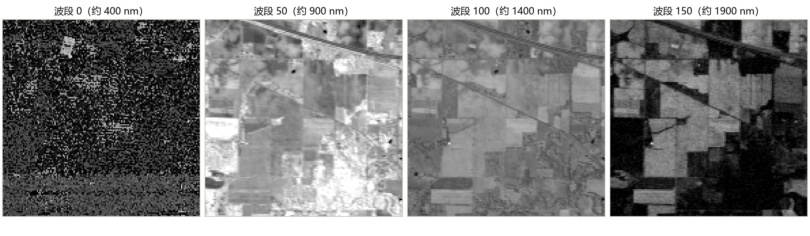
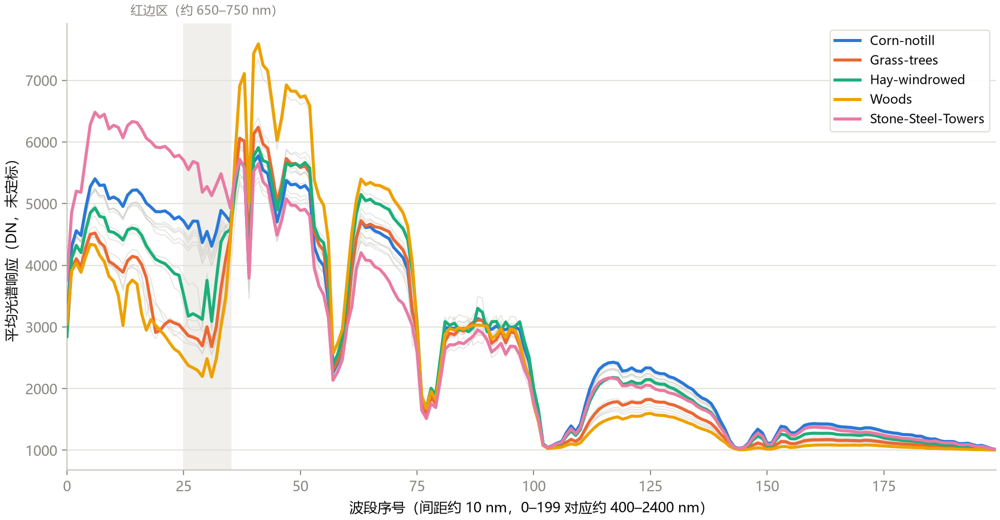
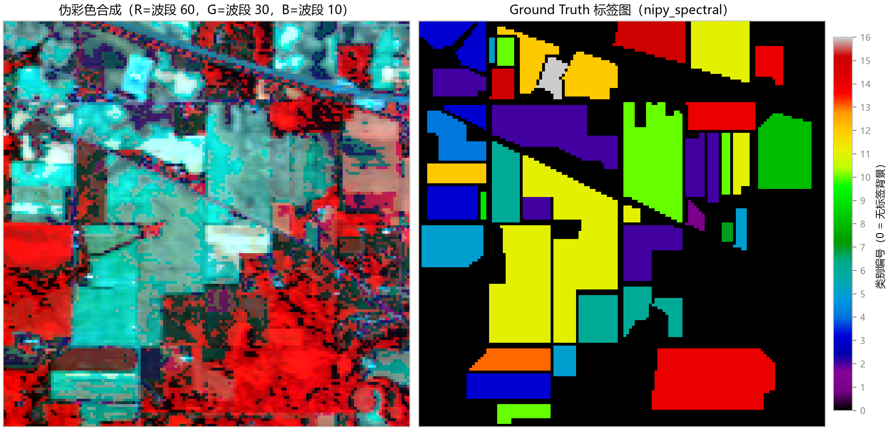
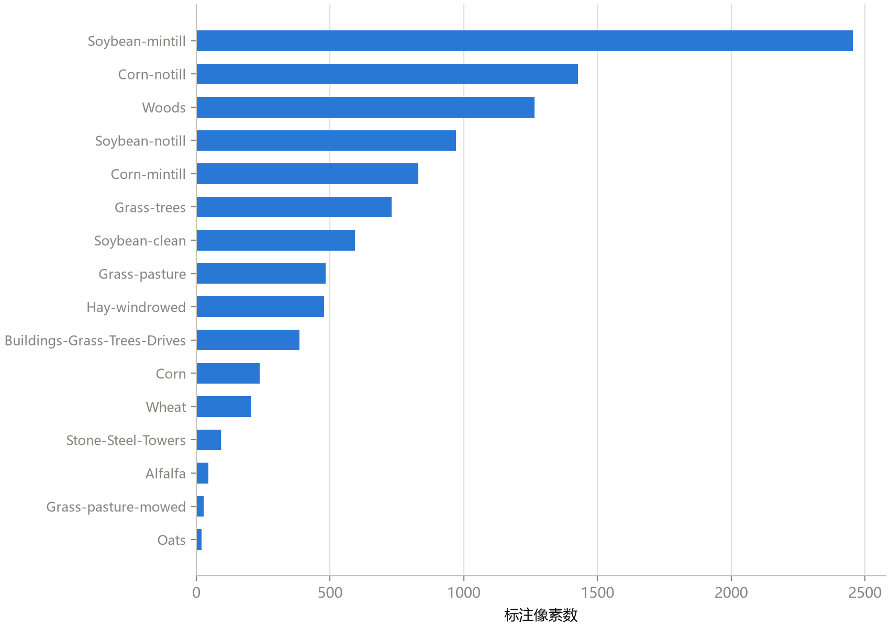

这是《高光谱图像分类》系列的第 1 篇。整个系列跟着开源课程 [HSI-Learning](https://github.com/masskx/HSI-Learning) 走，从数据、基线、深度模型，一直讲到怎么写论文，共 12 篇。每篇都会把课程里的图和结果拆开讲清楚：**横轴纵轴是什么，颜色代表什么，从图里能看出什么，又不能看出什么。**

第 1 篇不需要任何遥感或深度学习基础。读完你应该能回答一个问题：**高光谱图像到底是什么？**

## 一、先从你熟悉的照片说起

手机拍的照片，每个像素只记录三个数：红、绿、蓝（RGB）。这三个通道都很“宽”，每个通道把一大段波长的光加在一起。

但物质对光的反应，是随波长变化的。同一片绿色的叶子和一块绿色的塑料布，在人眼里都是绿的，但如果你把光按波长切得很细，它们的反射曲线会很不一样。比如健康植被在红光和近红外之间，反射率会陡然升高，这个陡坡叫**红边**；水在近红外几乎吸收全部的光。**每种物质的反射曲线，就像一个“指纹”。**

要看到这个指纹，相机就不能只记 3 个数，要记几十个甚至几百个、而且波长是**连续**的数。这就是高光谱成像。

课程里用一张表区分了三类影像：

| 类型 | 波段数 | 单个波段有多宽 | 波段是否连续 | 例子 |
|---|---|---|---|---|
| 全色 | 1 | 很宽 | — | QuickBird 全色 |
| RGB / 多光谱 | 3 到十来个 | 数十到上百纳米 | 不连续，“跳着采样” | Landsat（7–9 个波段）、Sentinel-2（13 个） |
| 高光谱 | 数十到数百个 | 约 5–10 纳米 | 连续，几乎无缝 | AVIRIS（224 个）、GF-5 AHSI（330 个） |

注意高光谱的关键并不是“波段多”，而是“**连续**”。因为相邻波段首尾相接，你可以给每个像素画出一条完整的光谱曲线，而不只是曲线上的几个点。这门学科因此叫“成像光谱学”：每个像素都要拿到一条光谱。

代价也有：波段切得越窄，每个波段分到的光越少，信噪比和空间分辨率都要让步。所以高光谱影像的空间分辨率一般比同期的多光谱卫星低。

## 二、数据立方体：一摞图，也是一束曲线

一张高光谱图像，在计算机里就是一个三维数组，叫**数据立方体**，写作 `(H, W, B)`：高 × 宽 × 波段数。

它同时是两种东西：

1. **固定波段，得到一张灰度图。** 取 `cube[:, :, b]`，就是“这片地在某个波长下长什么样”。
2. **固定位置，得到一条曲线。** 取 `cube[i, j, :]`，就是“这个像素在所有波长下的反射指纹”。

后面所有的分类模型，不管是 SVM 还是 Transformer，吃进去的都是这个立方体，或者它的一部分。

下面我们用课程里的第一个数据集 Indian Pines，把这两种看法都演示一遍。

## 三、第一张图：沿着波段方向切四刀



**怎么读这张图：** 四幅灰度图是同一块地（145×145 个像素）在四个波段下的样子，从左到右是波段 0、50、100、150。每幅图里越亮，表示这个波段下该处的数值越大。图用了统一的拉伸，方便比较。标题里的“约 400 nm、900 nm……”是按波段序号粗略换算的波长，只能当参考。

**能看到什么：**

- **波段 0：全是噪点。** 靠近蓝光的这个波段信噪比很低，画面像雪花。说明不是每个波段都有用。
- **波段 50：最清楚。** 田块的边界、道路、斜穿画面的铁路和公路都能看出来。这是近红外附近的波段，植被的反射很强，对比度最好。
- **波段 100 和 150：越来越暗，细节减弱。** 波段 150 的画面里很多地块是接近全黑的。这两个位置对应的是大气中水汽强烈吸收的区域，到达传感器的能量很少。

**不能读出什么：** 不能说“波段 50 一定是最好的波段”。它是这四幅里最清楚的，但并没有证明它对分类最重要，更没有比较过另外 196 个波段。

这张图也解释了后面一个设定：**Indian Pines 为什么只有 200 个波段，而传感器本身有 220 个。** 原始数据里有 20 个水汽吸收严重的波段被剔除了，剩下的叫 `corrected` 版本。论文里用的几乎都是这个版本，仓库里还放着一份未裁剪的 `Indian_pines.mat`，只作对照。

## 四、第二张图：把视角换成“每个像素一条曲线”



**怎么读这张图：** 横轴是波段序号（0 到 199），纵轴是“平均光谱响应”，单位是**未定标的原始数值**，不是 0 到 1 的反射率。每条曲线是某一类地物所有已标注像素的平均光谱。灰色细线是没有被突出的 11 个类别，彩色的 5 条是代表类别。灰色竖带标出的是红边附近的区域。

**能看到什么：**

- 在波段 0 到 35 左右（可见光），**Stone-Steel-Towers（钢塔，粉色）整体最高**，这是人造金属材料的特征；
- 过了红边（竖带之后，波段 37 到 40 附近），所有曲线几乎同时陡升；植被类的曲线在随后的“高台”上分开：**Woods（树林，黄色）最高，达到约 7500**，Grass-trees（草树，橙色）次之；
- 同样在这个高台上，钢塔反而是几条里**偏低**的。也就是说，“谁更亮”要看是哪个波段区间，不能一概而论；
- 曲线上有几处深谷：约在波段 57、75 到 80 和 100 到 105。它们是剩余的水汽吸收痕迹；过了波段 105，所有曲线都落到很低的位置；
- 不同的类，曲线的形状不同、高低不同。这就是“光谱指纹”能区分地物的根据。

**不能读出什么：**

- 图里的 Grass-trees（橙）和 Woods（黄）形状非常像，只是高度差一点。**这说明光说“长得像不像”，这两类很难靠光谱彻底分开。** 这是后面要加入空间信息的动机之一，不是说它们一定分不开。
- 图画的是平均曲线，**抹掉了每一类内部的差异**。同一类的像素之间，光谱其实有很大的散布，这一点会在后面的章节里反复遇到。
- 课程原文把波段序号换算成了 400–2400 nm。要注意，corrected 数据删掉了一些波段，**序号和物理波长之间不是严格的线性对应**，所以这里宁可只用“波段序号”。仓库的数据说明里也专门提醒了这一点。

## 五、第三张图：伪彩色和标签图



**怎么读这张图：**

- **左图：伪彩色合成。** 人眼只能看 RGB 三个通道，高光谱有 200 个，没法直接看。常见的做法是挑三个波段，当作 R、G、B 三个通道显示。这里取的是红色通道 = 波段 60（近红外）、绿色通道 = 波段 30（红光）、蓝色通道 = 波段 10（绿光）。**这样植被会显示成红色**，叫标准假彩色。所以左图里的红色块不是红色的东西，而是植被茂密的地方。
- **右图：Ground Truth（地面真值）标签图。** 每个像素一个类别编号，用 `nipy_spectral` 色带上色，右边的色条给出了编号。**黑色 = 0 = 没有标注。**

**能看到什么：** 左右对照，可以看出标签图里的色块基本对应左图里能看出的田块。地块是**成片**的、边界整齐，这是农业场景的特点。标签图里大面积的黑色，不是“没有东西”，是**没有人标注**。

**不能读出什么：**

- 黑色（0）**不是一个类**。它是“未标注”，里面可能有道路、没调查的地块或别的东西。后面划分训练集、算指标，都要把它排除在外。如果把 0 当成“背景类”训练，指标就没法比较了。
- 标签图里颜色的深浅**没有大小含义**。颜色只是类别编号的映射，“类别 16 比类别 3 更重”这种解读是错的。
- 伪彩色是我们**人为选的三个波段**，换三个波段，画面颜色会完全不同，它是辅助看图的工具，不是物理真实的颜色。

## 六、第四张图：类别严重不均衡



**怎么读这张图：** 横轴是每一类被标注的像素数，纵轴是 16 个类别，按数量从多到少排列。全图共 21,025 个像素，其中被标注的是 10,249 个，约 48.7%。**这些数字我用仓库里的 `.mat` 文件重新数过，是对得上的。**

**能看到什么：** 最大的类 Soybean-mintill 有 2,455 个像素，最小的 Oats 只有 20 个，差了约 123 倍（我算出来是 122.8 倍）。最下面的 Alfalfa（46）、Grass-pasture-mowed（28）、Oats（20）三类加起来，不到全部标注的 1%。

**这为什么重要：**

- **总体准确率会被大类带着走。** 如果一个模型把所有大类都分对、小类全错，总体准确率仍然可能很高。第 3 篇会专门讲怎么用平均准确率和 Kappa 来补充。
- **小类几乎学不到东西。** 如果训练只拿每类的 10%，Oats 只有 2 个训练样本。
- **划分的方式会直接影响结果。** 这是第 3 篇的主题。

## 七、动手读一遍数据：不到 10 行代码

课程里的读取代码非常简单，读者可以自己在电脑上跑：

```python
from scipy.io import loadmat
import numpy as np

cube = loadmat("dataset/Indian_pines_corrected.mat")["indian_pines_corrected"]
gt = loadmat("dataset/Indian_pines_gt.mat")["indian_pines_gt"]
print(cube.shape)        # (145, 145, 200)
print(np.unique(gt))     # 0 到 16，0 = 未标注
band = cube[:, :, 50]    # 一张灰度图
spectrum = cube[60, 80, :]   # 一个像素的光谱曲线
```

三点提醒（也是课程里反复强调的）：

1. **键名不一样。** `indian_pines_corrected`、`salinas_corrected`、`paviaU` 各不相同，所以仓库用统一的配置表封装了读取函数。
2. **维度顺序。** 本课程用 `(H, W, B)`。很多深度学习代码用 `(B, H, W)`，读别人的代码，先确认波段是哪一维。
3. **数值不是反射率。** 这份数据的取值范围是 955 到 9,604，是未定标的原始数值。别因为“看起来是 0 到一万”就断定它是什么单位。

## 八、这一篇你该带走的

1. **高光谱图像 = 图像 + 光谱。** 立方体 `(H, W, B)`，既是一摞灰度图，也是一束曲线；
2. **关键是连续。** 连续的窄波段，让每个像素有一条可以辨认物质的光谱曲线；
3. **读图的三个提醒：** 伪彩色是人选的三个波段；标签 0 是“未标注”而不是类；曲线图画的是平均，抹掉了类内差异；
4. **Indian Pines 的三个事实：** 有的波段噪声大、有的波段被水汽吞掉、类别样本数相差两个数量级。后面的波段裁剪、模型设计和评价指标，都是在回应这三件事。

## 自测三问

1. 高光谱和多光谱最本质的区别是什么？
2. 为什么标签 0 的像素不参与训练和评测？
3. 图里 Grass-trees 和 Woods 的曲线很像，这对分类意味着什么？

（答案提示：连续性；它是未标注而不是一个类别；只看光谱容易混淆，需要空间信息。）

## 下一篇预告

下一篇不再只看 Indian Pines：我们把课程里的**三个数据集**，Indian Pines、Salinas、Pavia University，放在一起从头到尾介绍一遍，包括它们在地面上到底有多大、有多少类、哪些类特别多或特别少、一些必须知道的使用边界。

---

> 本系列配套的课程仓库：[masskx/HSI-Learning](https://github.com/masskx/HSI-Learning)。本文四张图来自课程第 1 章，类别数量等数字用仓库里的数据文件重新核对过。
