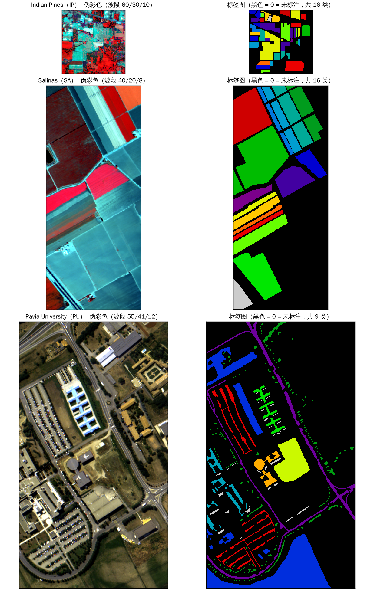
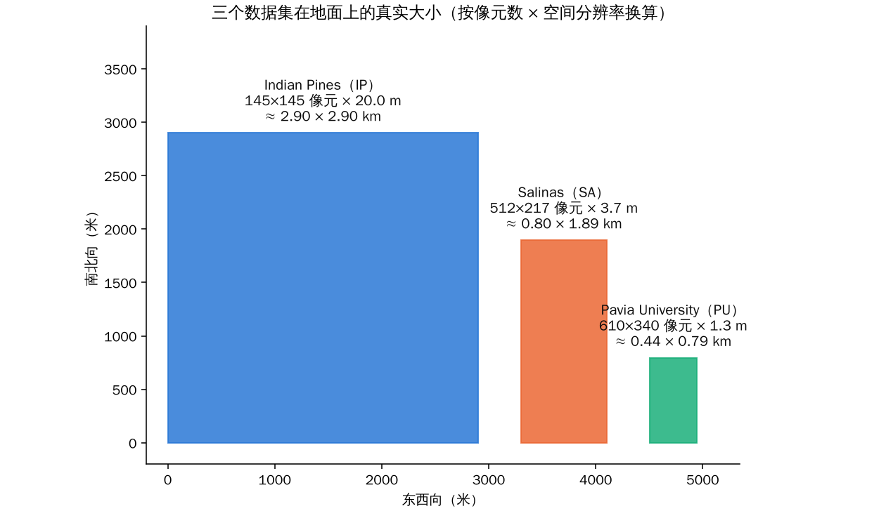
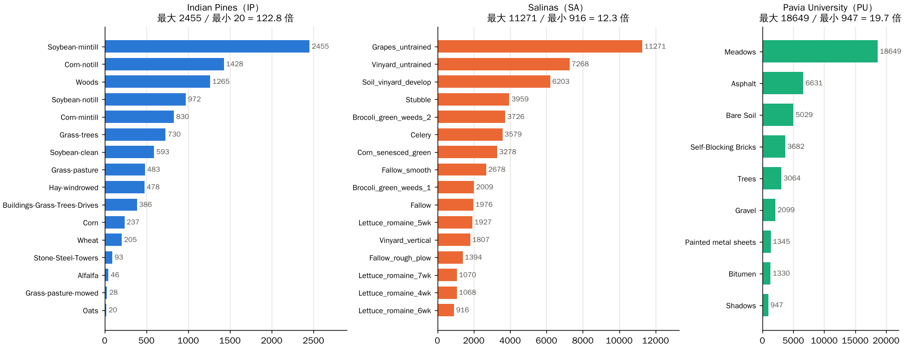
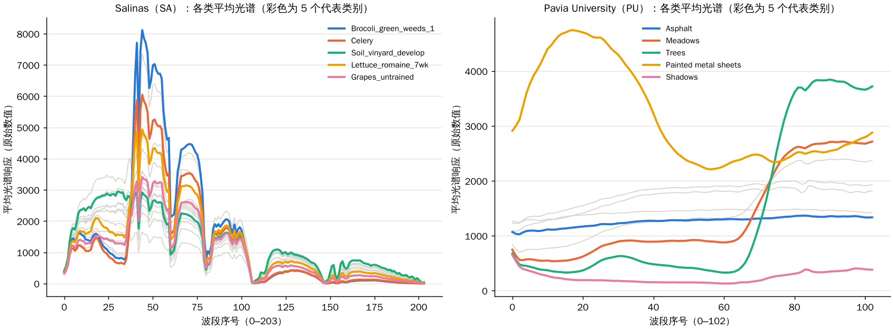

这是《高光谱图像分类》系列的第 2 篇。上一篇我们认识了高光谱立方体，只看了 Indian Pines 这一个数据集。

这一篇把课程里的**三个数据集**一次讲清楚：Indian Pines（IP）、Salinas（SA）、Pavia University（PU）。高光谱分类的论文，几乎都会在这三个里面挑两三个做实验，所以你迟早要和它们打交道。

**说明：** 这一篇里的数字，我都是用仓库里的 `.mat` 文件重新读出来、重新数的，不是抄书上的。三张我自己用代码重画的图（地图、尺度、类别分布和平均光谱）也是同样。个别我没法从数据文件里验证的说法（比如传感器的原始波段数），我会标明。

## 一、先看一张“身份证”

| | Indian Pines（IP） | Salinas（SA） | Pavia University（PU） |
|---|---|---|---|
| 传感器 | AVIRIS（机载） | AVIRIS（机载） | ROSIS（机载） |
| 拍摄年份 | 1992 | 1998 | 2001 |
| 形状 (H×W×B) | 145×145×200 | 512×217×204 | 610×340×103 |
| 像元大小 | 约 20 m | 约 3.7 m | 约 1.3 m |
| 像素总数 | 21,025 | 111,104 | 207,400 |
| 有标注的像素 | 10,249（48.7%） | 54,129（48.7%） | 42,776（20.6%） |
| 类别数 | 16 | 16 | 9 |
| 最大类 / 最小类 | 2,455 / 20 | 11,271 / 916 | 18,649 / 947 |
| 不均衡倍数 | **122.8 倍** | **12.3 倍** | **19.7 倍** |
| 数值类型 / 范围 | uint16，955 到 9,604 | int16，-11 到 9,207 | uint16，0 到 8,000 |
| 场景 | 农业（玉米、大豆、树林） | 农业（蔬菜、葡萄园、休耕地） | 城市（大学校园、道路、建筑） |

形状、标注数、类别数量、数值范围，是我读 `.mat` 得到的实测值。传感器、年份和像元大小来自课程第 1 章的表格，我没有独立验证。

有两点值得一看：

- **像元大小差了十几倍。** IP 是 20 米，一个像素就是一块篮球场的几十倍大；PU 是 1.3 米，大约能分辨出一辆车。后面会看到，这会直接影响每个像素是“纯”的还是“混合”的。
- **Salinas 的最小值是 -11。** 如果这是“反射率”，不应该有负数。它说明这批数据不是严格意义上的反射率，数值的单位和处理方式，不能只凭看起来像就断定。仓库的数据说明里也专门提醒了这一点。

## 二、第一张图：三个数据集长什么样

**怎么读这张图：** 每一行是一个数据集。左边是伪彩色合成（用三个波段当 RGB 显示，波段号写在标题里），右边是标签图（`nipy_spectral` 色带，**黑色 = 0 = 未标注**）。三行的图是按真实长宽比画的，所以 Salinas 和 Pavia 比 Indian Pines 大得多。

**能看到什么：**

- **Indian Pines（第一行）：** 一块不大的农田，标注是一块块形状规整的田块。标注覆盖了不到一半的画面，其余黑色。
- **Salinas（第二行）：** 田块很大、边界很整齐，像条带一样排布，标注覆盖了大部分田块。伪彩色里几种植被的颜色区分得很明显。
- **Pavia University（第三行）：** 左边的伪彩色接近真彩色，能看到校园里的房子、停车场、道路。右边标签里，既有大块的类别，也有很多**细碎、零散**的小斑点和细长的线条（比如沿道路的行道树、道路本身）。标注只覆盖大约 20% 的像素。

**这对分类意味着什么（我的解读）：**

- Salinas 里一个像素的周围，大概率是同一类。所以这个数据集上，把空间邻域也看进去，通常很“友好”；
- Pavia 里很多类是细长或小块的，一个像素周围经常有别的类。后面讲 patch（取一个小窗口）的时候你会看到，**窗口越大，混进别的类的可能性越高**；
- 课程自己的基准表里，Salinas 和 Pavia 上 2D CNN 的 OA 都超过 99%，课程把这个叫“饱和口径”：训练样本比 IP 多 4 到 5 倍，而且窗口有重叠。这个后面会专门讲。

**不能读出什么：**

- 不能从“看起来容易分”就推出“分类结果一定高”，这要看划分方式（第 3 篇）；
- 伪彩色是人为选的波段，颜色不等于真实颜色（Pavia 那一行例外，它挑的是接近真彩色的三个波段，所以看起来最自然）。

## 三、第二张图：它们在地面上到底有多大

**怎么读这张图：** 把每个数据集的“像元数 × 像元大小”换算成米，按**同一个比例**画在同一张图里。横轴是东西向、纵轴是南北向，单位是米。

**能看到什么：**

- **Indian Pines：约 2.9 km × 2.9 km。** 虽然只有 145×145 个像素，但因为每个像素 20 米，它实际覆盖的地面面积是三者中最大的；
- **Salinas：约 0.8 km × 1.9 km；Pavia University：约 0.44 km × 0.79 km。** 像素更多，但地面范围小得多。

**这张图想说的是：** “像素数”和“地面面积”是两回事。**IP 像素最少，但每个像素管的地面最大。** 这就是为什么 IP 里有那么多“混合像元”：一个 20 米 × 20 米的格子里，很可能同时有两种作物，或者作物加道路；而 PU 的 1.3 米像素，更多时候落在“纯”的地物上，却又会遇到“小物体、细长物体”的问题。

## 四、第三张图：类别有多不均衡

**怎么读这张图：** 三个子图分别是三个数据集，横轴是被标注的像素数，纵轴是各类别，按数量排序。每根条后面直接标了数字。子图标题里是最大类和最小类的倍数。注意：**三个子图的横轴刻度不一样**，不能直接比较条的长度，要看数字。

**能看到什么：**

- **Indian Pines：最大 2,455 / 最小 20，差 122.8 倍。** 最小的几个类（Oats 20、Grass-pasture-mowed 28、Alfalfa 46）非常稀少；
- **Salinas：差 12.3 倍。** 最大的是 Grapes_untrained（11,271），最小的是 Lettuce_romaine_6wk（916）。也有明显的不均衡，但最小的类也有近 1000 个像素；
- **Pavia University：差 19.7 倍。** Meadows（草地）有 18,649 个，Shadows（阴影）只有 947 个。

**这对后面意味着什么：**

- 三个数据集里，**IP 的“稀有类”问题最严重**，最小类只有 20 个，如果每类只取 10% 训练，Oats 只有 2 个样本；
- 所以 IP 上，同一个模型，**OA（总体准确率）和 AA（平均准确率）往往差得很远**。第 3 篇会解释这两个指标，并用课程里的实验结果说明；
- SA 和 PU 的最小类也有几百到上千个样本，相对“宽松”。这也是为什么论文里 SA、PU 的数字常常很高，IP 的数字更能拉开差距。

**不能读出什么：** 图里只看到“每类标注了多少个像素”，**不是”每类在真实世界里占多大比例”**。标注是人去挑着标的，很多地块没有标注，这个分布并不代表现实。

## 五、第四张图：Salinas 和 Pavia 的光谱长什么样

**怎么读这张图：** 左边是 Salinas，右边是 Pavia University。横轴是波段序号（Salinas 0–203，Pavia 0–102），纵轴是该类所有标注像素的**平均光谱响应（原始数值）**。灰色是没突出的类，彩色是 5 个代表类别。上一篇看过 Indian Pines 的同类图，这里补上另外两个。

**Salinas（左）能看到什么：**

- 曲线形状整体相似：前面有一个高峰（波段 40 到 50 附近，植被的近红外高台），中间有几处深谷，到后面逐渐变平变低；
- **Brocoli_green_weeds_1（西兰花，蓝色）的高峰最高**，约 8000，而 Soil_vinyard_develop（葡萄园裸土，绿色）的曲线整体更平，没有那么高的尖峰：裸土没有植被的红边；
- 波段 105 左右和 145 到 150 左右的位置，所有曲线都掉到接近 0：这是水汽吸收的区域，和 Indian Pines 的情形类似。

**Pavia（右）能看到什么：**

- **Painted metal sheets（涂漆金属板，黄色）** 的曲线完全是另一种形状：前段非常高、在波段 15 到 20 附近达到约 4,700，然后下降，是一个“大鼓包”；
- **Trees（树，绿色）** 在波段 70 以后陡升到约 3,800（近红外），**Meadows（草地，橙色）** 也在同一个位置升高，但没有树那么高；
- **Shadows（阴影，粉色）** 几乎贴着底部，响应最低，只有几百；
- **Asphalt（沥青，蓝色）** 比较平，数值适中。

**不能读出什么：**

- 图里画的是平均值，同一类内部的像素差别很大，这一点在后面的 t-SNE 图里会更清楚；
- Pavia 有 103 个波段，波长范围比 AVIRIS 窄（ROSIS 只覆盖可见光到近红外的一段），所以右图里没有那么多“水汽深谷”；
- 两张图纵轴的单位都是“原始数值”，不是反射率，**只能在同一个数据集内比较高低，不能把 Salinas 的 8000 和 Pavia 的 4700 直接对比。**

## 六、三个必须记住的“使用边界”

这是课程数据说明里写得最认真的部分，也最容易被忽略。

**1. GT = 0 是“未标注”，不是“背景类”。** 它代表这个位置没有标签，**不代表这里没有光谱，也不代表这里没有地物**。不要把 0 当成一个类去训练，也不要把它算进准确率。成绩只计算有标注的像素。

**2. 别随便把数值当成反射率。** 数值的单位，要看这份文件的处理说明。Salinas 有负数，说明不是严格的反射率。**PCA 的“主成分”也不是新的窄波段**，不能按“每个分量 10 nm”去解释。

**3. 数据文件的许可，不等于代码的许可。** 课程的数据说明里明确写了：
- 仓库的代码开源许可**不自动覆盖数据文件**，仓库也不授予第三方数据的再分发许可；
- 原始场景汇总入口是 EHU 的 Hyperspectral Remote Sensing Scenes 页面；
- 仓库里的 SA 和 PU 文件，是从 HybridSN 作者的仓库取得的，**镜像不是原始权属的证明**；
- 论文或课件里要引用时，需要引用场景的来源和提供方；许可证和是否允许再分发，**需要到原始页面逐项核对**，不能认为“能下载就是没有限制”。

另外，仓库里一份叫 `Data_Declaration` 的旧说明，里面的版本、尺寸、单位有互相矛盾的地方，课程只把它当作历史线索，**不作为精确的形状、波长或反射率单位的依据**。

## 七、新手怎么选数据集

我的建议（这是课程精神的概括，不是硬规定）：

| 你想做的事 | 建议 | 原因 |
|---|---|---|
| 入门、跑通流程 | 先用 **Indian Pines** | 小，跑得快；类别不均衡严重，能暴露很多问题 |
| 验证方法是不是“太依赖某个数据集” | 加上 **Salinas** 和 **Pavia** | 农业加城市，两种完全不同的场景 |
| 想看“稀有类”怎么处理 | **Indian Pines** | 最小类只有 20 个 |
| 想看“空间信息”的作用 | **Pavia** | 小目标和细长目标多 |
| 想看高分数是不是“饱和” | **Salinas、Pavia** | 样本多，划分不当很容易 99%+ |

## 八、这一篇你该带走的

1. **三个数据集：** IP（农业，20 米，16 类，最不均衡，122.8 倍）、SA（农业，3.7 米，田块大而整齐，12.3 倍）、PU（城市，1.3 米，目标零碎，只标注了 20.6%，19.7 倍）；
2. **“像素数”不等于“地面大小”：** IP 像素最少，但覆盖的地面最大；
3. **三条使用边界：** GT=0 是未标注；数值不要随便当反射率；数据许可要单独核对；
4. **数据特点会影响方法：** 类别不均衡决定看哪个指标；目标零碎决定窗口取多大。

## 自测三问

1. 为什么说“IP 的像素最少，但每个像素管的地面最大”？
2. Salinas 的最小值是 -11，这说明什么？
3. 为什么 Pavia 的标注率只有 20.6%，却不妨碍它被拿来做分类实验？

（提示：20 米 vs 1.3 米；它不是严格的反射率；成绩只计算有标注的像素，没标注的就是不参与。）

## 下一篇预告

下一篇讲一个看起来枯燥、但比任何模型都更决定“你的论文能不能站得住”的话题：**划分与评价**。同样的一个模型，换一种划分方式，准确率可以差十几个百分点；OA 很高，AA 可能很低。我们会用课程里的两张图，把“数据泄漏”和“混淆矩阵”讲清楚。

---

> 配套课程：[masskx/HSI-Learning](https://github.com/masskx/HSI-Learning)，数据说明见仓库 `dataset/README.md`。文中的图 1–4 是我用仓库里的 `.mat` 文件重新生成的，脚本在本系列的 `_工具/make_dataset_figs.py`。
