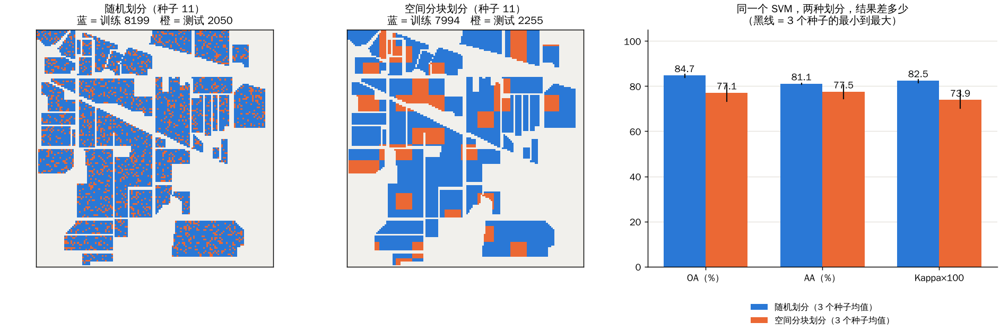
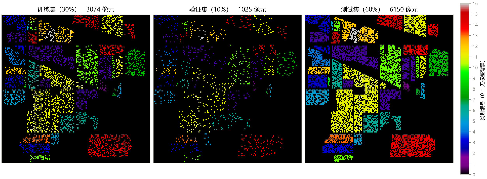
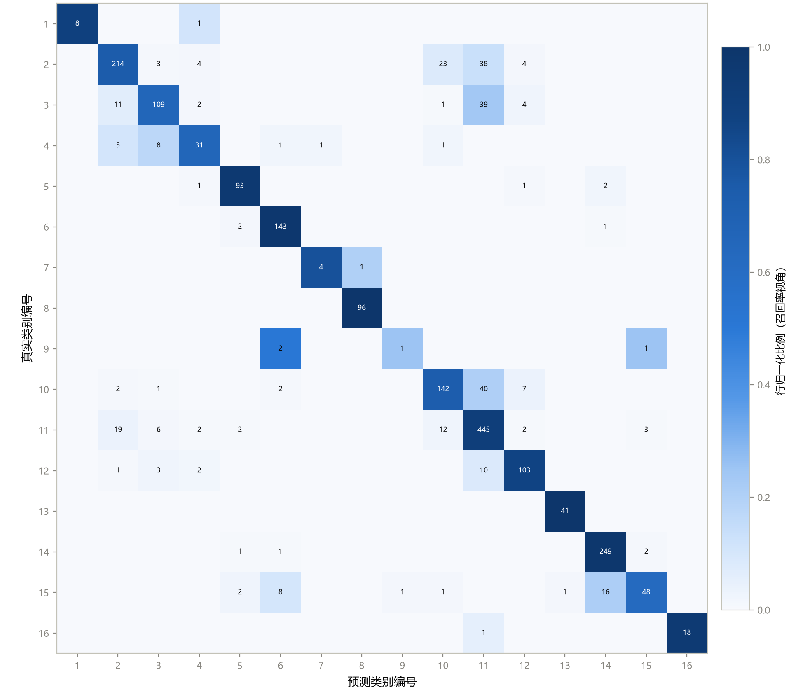

这是《高光谱图像分类》系列的第 3 篇。前两篇讲数据，这一篇讲一件更容易被忽略、却比选哪个模型更重要的事：**实验怎么做才可信。**

先看一个我自己跑的结果。同一个 SVM，同一份 Indian Pines 数据，只改一件事：训练集和测试集**怎么分**。



**怎么读这张图：**

- 左图和中图画的是同一个种子下的两种划分。蓝色是训练像素，橙色是测试像素，浅灰色是没有标注的地方。
- 左图是**随机划分**：每个像素独立地被抽进训练或测试，所以蓝色和橙色像“撒胡椒面”一样混在同一块田里。
- 中图是**空间分块划分**：把图像切成 10×10 像素的小方块，随机挑约 20% 的方块当测试区。橙色是成块的，一块田里一部分是测试，而训练用的是别的方块。
- 右图是三组指标的对比，三个随机种子取平均，黑线是最小到最大。

**能看到什么：**

- 随机划分：OA 84.7%，AA 81.1%，Kappa 0.825；
- 分块划分：OA 77.1%，AA 77.5%，Kappa 0.739；
- **OA 差了约 7.6 个百分点。** 三个种子的结果方向一致，没有交叉。

**要说清楚的地方：**

- 这是**一个简单的演示实验**，不是严谨的结论：只用了像素级的 SVM、10×10 的分块、3 个种子；
- 分块划分的测试集里**少了几个类**（3 个种子里分别有 13、14、13 个类出现在测试集），AA 只对出现的类求平均，所以 AA 的比较不完全对等；
- 它说明的是一个方向：**随机划分会让相邻的、几乎一样的像素分到训练和测试两边，成绩偏乐观**。偏乐观多少，取决于数据、模型和分块方式。

这就是这一篇的主题。我们按顺序讲：样本是什么、怎么分、指标怎么算、混淆矩阵怎么看，最后回到这张图。

## 一、先搞清楚“样本”是什么

有监督的高光谱分类，样本总体 = 标签图里**所有非零的像素**。Indian Pines 一共 10,249 个。每个样本的输入是 200 维的光谱（后面会升级成带空间邻域的小窗口），输出是 1 到 16 的类别。

标签 0 的 10,776 个像素**不是样本**，它们没有监督信号，也不参与任何指标。（这个数字我用数据文件核对过：21,025 − 10,249 = 10,776。）

数据极不均衡：最大类 2,455，最小类 20，相差 123 倍。这带来**两个相互独立的问题**：

1. **评测问题：** 总体准确率会被大类带着走，小类失败看不出来；
2. **学习问题：** 随机划分可能让小类分到太少的训练样本。

下面的几个设计，都是为了处理这两个问题。

## 二、训练、验证、测试：三个角色

- **训练集：** 模型学习用的（神经网络的权重、SVM 的支持向量）；
- **验证集：** 选模型用的：调超参数、决定训练到哪一轮、挑最好的存档；
- **测试集：** 最终成绩单，**只看一次**。

打个比方：练习册、模拟考、高考。模拟考的题和高考不能重合；如果你拿着高考成绩反复调整，就等于拿高考真题当练习册，分数会很好看，但那不是你真实的水平。

课程里用了两条协议：

| 协议 | 谁用 | 做法 |
|---|---|---|
| 80/20 两分 | 传统机器学习（SVM 等） | 分层划分，随机种子 11。SVM 没有“训练多少轮”的问题，不需要验证集 |
| 30/10/60 三分 | 深度学习 | 训练 30%、验证 10%、测试 60%。深度模型要训练很多轮，需要验证集挑存档 |

**分层采样**是什么意思？每个类别**单独**按比例抽。如果完全随机，一个只有 20 个样本的类可能一个训练样本都分不到。课程表 2-1 里每一行都严格是 30%/10%/60%：

| 类别 | 总数 | 训练 30% | 验证 10% | 测试 60% |
|---|---:|---:|---:|---:|
| Oats | 20 | 6 | 2 | 12 |
| Grass-pasture-mowed | 28 | 8 | 3 | 17 |
| Alfalfa | 46 | 14 | 5 | 27 |
| Soybean-mintill | 2,455 | 736 | 245 | 1,474 |
| **合计** | 10,249 | 3,074 | 1,025 | 6,150 |

（这几行我用课程的脚本重新跑过，数字一致。）



**怎么读这张图：** 三幅图分别是训练集、验证集、测试集，**颜色是类别编号**（和标签图一样，色条在右边），黑色是没有被选进这一个集合的地方。每幅图的标题给出像素数：3,074、1,025、6,150。

**能看到什么：** 三幅图都是散点状，覆盖了全部有标注的地块，而且每种颜色（每个类）在三幅图里都有出现，只是密度不同：训练集稀一些，测试集最密。这就是“按类别保比例、在空间上打散”的样子。

**不能读出什么：** 图里的“打散”恰恰是下一节要说的问题的来源：同一块田里的像素既有进训练的，也有进测试的。

## 三、OA、AA、Kappa：为什么要一起看

三个指标都从**混淆矩阵**来：一个 C×C 的表，第 (i, j) 格是“真实是第 i 类、被预测成第 j 类”的样本数。对角线是预测对的。

- **OA（总体准确率）：** 对角线之和 ÷ 总样本数。
- **AA（平均准确率）：** 先算每一类的召回率（这一类里有多少被找对了），再对 16 个类取平均，**每类权重一样**。
- **Kappa：** 从 OA 里扣掉“瞎猜也能蒙对的部分”。

### 一个能记一辈子的例子

3 类数据：A 类 900 个，B 类 90 个，C 类 10 个。一个“永远只说 A”的模型：

| 指标 | 数值 | 解读 |
|---|---:|---|
| OA | **90%** | 看上去很好，但全靠 A 类 |
| AA | **33.3%** | (100% + 0% + 0%) ÷ 3，B、C 全错，一下就暴露了 |
| Kappa | **0** | 随机猜也能蒙对 90%，扣掉之后一点都没有超出瞎猜 |

（这三个数是可以手算验证的：Kappa 的“蒙对率”是真实 A 占 90% × 预测 A 占 100% = 0.9，所以 (0.9 − 0.9) ÷ (1 − 0.9) = 0。）

### 真实数据：我重新跑了一遍

我把课程的脚本重新运行了一次（SVM，RBF 核，C=100，80/20 分层划分，随机种子 11，训练 8,199 个、测试 2,050 个）：

**OA 85.12%，AA 81.25%，Kappa 0.8292。** 和课程文字里的数字完全一致。

OA 和 AA 差了近 4 个点，来自小类：**Oats 的 4 个测试样本只对了 1 个，召回率 25%**；Corn-mintill 65.7%、Corn 66.0%、Buildings-Grass-Trees-Drives 62.3% 也偏低；而 Hay-windrowed 和 Wheat 是 100%。

**实践规则：三个指标一起报，再用混淆矩阵做错误分析。**

## 四、混淆矩阵怎么读



**怎么读这张图：**

- **行是真实类别，列是预测类别**，编号 1–16 对应上面表里的类别顺序（1 是 Alfalfa，2 是 Corn-notill，……，16 是 Stone-Steel-Towers）；
- 格子里的数字是样本数，**颜色是“行归一化”的比例**：每一行的比例加起来等于 1，所以颜色越深，表示“这一类里被分到这一列的比例越高”，也就是召回率的视角；
- 对角线（左上到右下）是预测对的；对角线之外的格子是**错误**，而且能看出错成了谁。

**能看到什么：**

1. **对角线整体是深色**，但深浅不一：第 8 行（Hay-windrowed）、第 13 行（Wheat）、第 6 行（Grass-trees）、第 14 行（Woods）几乎是纯深色，召回率 98% 以上；
2. **错误集中在第 11 列（Soybean-mintill）。** 我重新数了一遍：最大的几个错误格是 Soybean-notill → Soybean-mintill（40 个）、Corn-mintill → Soybean-mintill（39 个）、Corn-notill → Soybean-mintill（38 个），还有 Corn-notill → Soybean-notill（23 个）。**这几个类都是“玉米”和“大豆”的不同耕作方式，光谱曲线本来就很像，田块又靠在一起**；2050 个测试样本里一共错了 305 个；
3. **小类的行几乎是空的。** 第 9 行（Oats）一共只有 4 个样本，其中 2 个被分成第 6 类（Grass-trees），1 个被分成第 15 类（Buildings-Grass-Trees-Drives），只有 1 个对。

**怎么用这张图：** 以后你分析自己的模型，都先做这三步：看对角线是否均匀；看错误是否集中在某几列（说明有一个“吸引子”类）；看小类的行是不是几乎全错。

**不能读出什么：** 颜色深浅是行内比例，**不是绝对数量**。第 11 行的对角线那格是 445 个，第 1 行的 8 个同样是深色，但它们的样本数差了 50 多倍。要看绝对数量，必须看格子里的数字。

## 五、两个常见的坑，用一个实验讲清楚

### 坑 1：空间自相关造成的“泄漏”

回到文章开头那张图。相邻的像素，几乎总是同一块田里的同一种作物，光谱也几乎一样。随机划分会让“几乎一样的像素”同时出现在训练集和测试集里：模型可以“背邻居”，而不是学会真正的判别规则。成绩因此偏乐观。

课程里的立场很明确：**主流基准协议保留随机划分**（这样你的数字才能和几十年的文献比较），**空间不相交的划分**（按地块、按分块）用来估计真正部署时的表现，数字通常明显更低。**知道自己的数字属于哪种口径，比数字本身更重要。**

我的小实验正是为了看到这个差距：同一个 SVM，OA 从约 84.7% 降到约 77.1%。这只是一个方向性的演示，真正的报告要用更严格的设计（比如更大的分块、更多的种子、加上缓冲带）。

### 坑 2：验证集和测试集混用

所有选择（超参数、训练多少轮、挑哪个存档）只能依据验证集。测试集只在整个实验结束、写最终报告时碰一次。课程的训练引擎就是这么做的：训练过程只看验证精度存档，测试评估发生在训练完全结束之后。

### 两个小坑

- **稀有类的边界：** Oats 一共 20 个，30/10/60 能分成 6/2/12，勉强能用；再降训练比例，分层划分就可能没法满足每类至少一个样本，会报错。遇到报错别绕过去，要先想想这个实验设计还有没有意义。
- **指标口径：** OA 算的是测试集还是整张图？AA 有没有去掉缺席的类？划分比例和种子有没有公开？复现别人论文时，先核对这几项。

## 六、给 sklearn 用户的三个提醒

课程里的评价函数写法：

```python
labels = list(range(1, 17))
oa = accuracy_score(y_true, y_pred)
aa = recall_score(y_true, y_pred, labels=labels, average="macro", zero_division=0)
kappa = cohen_kappa_score(y_true, y_pred, labels=labels)
```

- **`labels=` 必须显式给：** 否则 sklearn 只会按“出现过的类”算，某一类缺席时 AA 的口径就变了。（我自己的分块实验里，测试集缺了几个类，所以我只能对“出现过的类”平均，并且在图里和文中说明了。）
- **`average="macro"` 才是 AA：** `"weighted"` 会退回到 OA 的口径。
- **`zero_division=0`：** 某一类一个都没预测对时，召回率记 0，这正是我们想要的。

## 七、对课程原文的两处核对发现

我重新运行脚本时，发现课程第 2 章的文字有两处和实际输出不完全一致，供作者修订时参考：

1. 文中说 Oats 的 4 个测试样本中，“1 个错成 Stone-Steel-Towers”。我重新跑出来的结果是：1 个被预测成第 15 类 **Buildings-Grass-Trees-Drives**。混淆矩阵图本身画的是对的，只是文字有误；
2. 文中的“玉米族与大豆族内部互混”举了三个例子，漏掉了数量最大之一：**Corn-mintill → Soybean-mintill（39 个）**，而且“Corn-mintill → Corn-notill 11 个”这个例子相对较小。

这两处不影响结论，但文字应当和图、数字对上。

## 八、这一篇你该带走的

1. **划分：** 分层、三分、固定种子；验证集选模型，测试集只看一次；
2. **指标：** OA 看整体，AA 看每一类，Kappa 扣掉瞎猜；三个一起报；
3. **混淆矩阵：** 看对角线是否均匀、错误是否集中在某一列、小类的行是否全错；
4. **泄漏：** 随机划分偏乐观，我的小实验里差了约 7.6 个 OA 点；写论文要说明口径。

## 自测三问

1. 训练比例 30%、验证比例 10% 时，测试集占总体的多少？（提示：10% 是占总体，不是占剩余。）
2. OA 很高、AA 很低，可能是什么原因？
3. 为什么随机划分会让结果偏乐观？

（答案提示：60%；小类被大类掩盖；相邻像素几乎相同，训练和测试里都有。）

## 下一篇预告

下一篇开始真正“训练模型”：**传统机器学习基线**，SVM、随机森林、KNN、逻辑回归，加上 PCA 降维。有一个很有意思的发现在等着我们：同样的几个模型，80% 训练和 10% 训练两种协议下，**排名会倒过来**。

---

> 配套课程：[masskx/HSI-Learning](https://github.com/masskx/HSI-Learning) 第 2 章。课程里的两张图（划分可视化、混淆矩阵）直接取自仓库；基线数字和分块对照实验，是我用仓库脚本和 `_工具/exp_split_leakage.py` 重新跑出来的。
