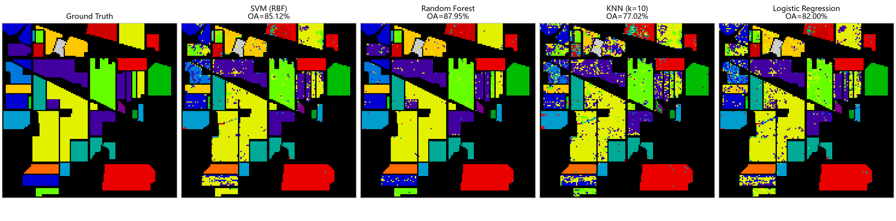
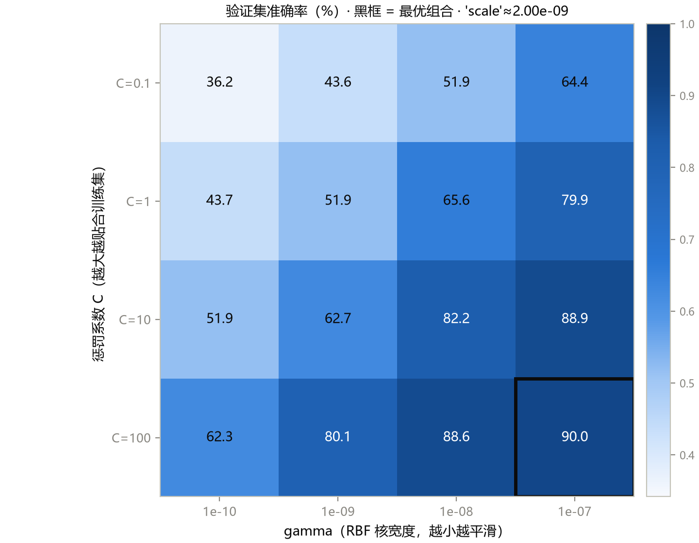
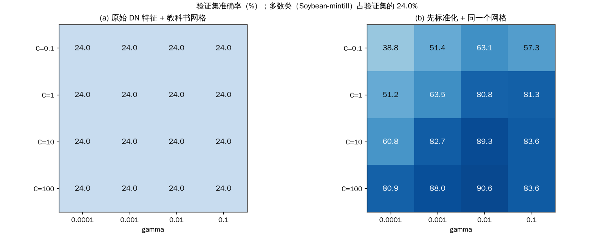
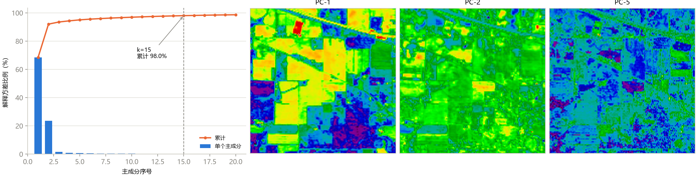

这是《高光谱图像分类》系列的第 4 篇。前三篇我们认识了数据、搞清楚了实验该怎么做。这一篇终于开始“训练模型”了，先从最朴素的开始：**传统机器学习基线**。

**为什么要先做基线？** 课程里有一句话说得很直白：之后每一个深度学习模型，都要回答同一个问题，**比这条线好多少、好在哪里、付出了什么代价。** 审稿人问的第一个实验问题，永远是“你比 SVM 好多少”。

这一篇的结果我都重新跑过。**SVM、随机森林、KNN 的数字和课程里完全一致**；逻辑回归有一点小差别，后面会专门说。

## 一、什么叫“像素级分类”

第 1 篇说过，立方体可以展平成一张表：`(145×145, 200)`，每一行是一个像素，每一列是一个波段。传统机器学习把**每一行当作一个独立样本**，用 200 个数预测一个类别。

> 注意：**每个样本是独立的，完全没有空间信息。** 这句话是整篇文章的伏笔。

课程里的展平脚本把背景（类别 0）也一起写了进去，训练前必须过滤掉。

还有一个很容易被忽略的事：**特征的尺度。** 这份数据的数值范围是 955 到 9,604，远大于 1。不同模型对它的反应完全不一样：

- **KNN** 依赖距离，但所有波段共用同一个尺度，相对关系不变，所以还能工作；
- **SVM（RBF 核）** 对尺度非常敏感，下面会专门讲；
- **逻辑回归** 用梯度优化，在没标准化的数据上收敛很慢。

## 二、四个模型各自是怎么回事

| 模型 | 一句话机制 | 它擅长 | 它容易在哪里出问题 |
|---|---|---|---|
| **SVM（RBF 核）** | 找一个“间隔最大”的边界，核函数让边界可以弯曲 | 高维、小样本 | 超参数（C、gamma）敏感 |
| **随机森林** | 很多棵决策树，投票 | 几乎不用调参，抗无关波段 | 小类样本少时被大类“淹没” |
| **KNN** | 找最近的 k 个邻居，投票 | 不用训练 | 200 维空间里“近邻”不可靠 |
| **逻辑回归** | 线性的 softmax | 小样本下退化最平缓 | 天花板低，没标准化会不收敛 |

## 三、先看结果：两张表，一个反转

课程里把四个模型放在两个协议下跑：

- **协议 A：** 80% 训练（8,199 个）、20% 测试（2,050 个）；
- **协议 A′：** 10% 训练（1,024 个）、90% 测试（9,225 个）。

我重新运行的结果如下。**加粗是课程里同样的数字；逻辑回归我这次的结果和课程不同，我把两个都列出来。**

| 模型 | 协议 | OA | AA | Kappa |
|---|---|---:|---:|---:|
| SVM（RBF，C=100） | A（80%） | 85.12 | 81.25 | 0.8292 |
| 随机森林（200 棵树） | A（80%） | **87.95** | 81.93 | **0.8618** |
| KNN（k=10） | A（80%） | 77.02 | 72.25 | 0.7365 |
| 逻辑回归 | A（80%） | 课程 82.00 / 我 82.73 | 课程 80.17 / 我 81.87 | 课程 0.7934 / 我 0.8026 |
| SVM + PCA-15 | A（80%） | 85.41 | **82.79** | 0.8333 |
| SVM（RBF，C=100） | A′（10%） | 72.08 | 64.84 | 0.6748 |
| 随机森林 | A′（10%） | **76.55** | 61.69 | **0.7290** |
| KNN | A′（10%） | 66.29 | 55.00 | 0.6113 |
| 逻辑回归 | A′（10%） | 课程 75.89 / 我 75.17 | 课程 70.00 / 我 70.21 | 课程 0.7238 / 我 0.7157 |

（SVM+PCA-15 我也复现了：85.41 / 82.79 / 0.8333。）

**最重要的不是哪一行，是两部分之间的变化：**

- **富样本（A，80% 训练）：** 按 OA，随机森林最高（87.95），SVM 次之；按 AA，SVM+PCA-15 最高（82.79）；
- **小样本（A′，10% 训练）：** 按 OA，随机森林仍最高（76.55）；**但按 AA 完全翻转：逻辑回归（约 70）> SVM（64.84）> 随机森林（61.69）。**

随机森林的 AA 从 81.93 掉到 61.69，掉得最厉害，说明树模型在样本变少时，**最先牺牲的是小类**。所以“哪个基线最强”，**没有一个和协议无关的答案**。这就是第 3 篇要求 OA、AA、Kappa 一起看的原因。

**关于逻辑回归的数字为什么不一样：** 我用的是课程的原脚本，同样的数据、同样的种子，SVM、随机森林、KNN 都分毫不差，只有逻辑回归不同。原因是逻辑回归在这份未标准化的数据上**跑满了 2000 次迭代仍未收敛**（sklearn 会发出收敛警告），未收敛的优化结果会随库的版本略有不同。这不是谁对谁错，而是一个提醒：**没有收敛的结果，换个环境就可能变**。课程自己的使用指南里也写着“跨环境变化保留，不追某个目标分数”。

## 四、第一张图：四个模型把整张图预测成什么样

**怎么读这张图：** 最左边是 Ground Truth（地面真值），后面四幅是四个模型对整张图的预测，颜色和类别编号的对应关系与标签图一样，黑色是没有标注的地方（不参与评价）。标题里的 OA 是该模型在测试集上的成绩。

**怎么看：** 重点不要看总体颜色，而是看**一块田的内部**。真值里一块田是纯色的；预测里，同一块田里有大量**零散的杂色斑点**，像撒了椒盐。

**能看到什么：**

- **随机森林（87.95%）和 SVM（85.12%）相对干净**，大部分田块是整块的颜色，只在边缘和个别位置有杂点；
- **KNN（77.02%）最碎**，很多田块内部全是斑点，尤其是左侧几个小田块；
- **逻辑回归**介于两者之间；
- 左下角那几块条状小田（真值里的橙色、蓝色、绿色小条）几乎所有模型都出现了黄色的杂色，说明这里很难。

**为什么会这样：** 每个模型只看一个像素自己的光谱，**完全不知道“它的邻居大概率和它是同一类”**。两个相邻的像素光谱稍有差别，就可能被分到不同的类。这种“**空间一致性缺失**”，是像素级方法共同的天花板，也是后面引入空间窗口（patch）的直接动机。

**不能读出什么：** 图里的预测是**整张图**，包含了训练样本的位置（模型见过这些像素的标签），所以这张图只能用来**看错误长什么样**，**不能用它估计准确率**。成绩只算测试集，这是第 3 篇的规矩。

## 五、SVM 的两个超参数，以及一次“整表塌成同一个数”的翻车

SVM（RBF 核）有两个要调的超参数：

- **gamma：** 控制“一个训练点的影响半径”。gamma 越大，影响半径越小，决策边界越碎，越贴着训练数据（过拟合方向）；gamma 越小越平滑（欠拟合方向）；
- **C：** 对分错的惩罚。C 越大，越拼命贴合训练集；C 越小，越容忍错误。

### 课程里的网格搜索

**怎么读这张图：** 这是一张热力图。**横轴是 gamma（从 1e-10 到 1e-7），纵轴是 C（从 0.1 到 100）**，每个格子里的数字是在验证集上的准确率（%），颜色越深越高。黑框是最优的格子。（调参只用验证集，测试集全程不碰。）

**能看到什么：**

- 整个图沿着**从左上到右下**一路变深：C 越大、gamma 越大，验证准确率越高；
- 最优格子是 **C=100、gamma=1e-7，验证准确率 90.0%**（精确值 90.05%，我重新跑出来也一致）；
- 课程用的默认 `gamma='scale'` 约等于 2.0e-9，落在第二列左右，C=100 那一行是 80.1%，对应测试集上的 85.12%。

**需要警惕的：** 最优格子在**网格的右下角边缘**。这是一个信号：**最优解可能还在更外面**，网格应该扩边重跑。课程总结了三个调参习惯：网格在对数尺度上取点；先粗后细；**最优解压边，说明网格没取够**。

**不能读出什么：** 图里是**验证集**的准确率，不是测试集。90.0% 不是这个模型最终的成绩。

### 为什么 gamma 的范围是 1e-10 到 1e-7？

这是课程里最值得抄走的一个细节，我自己重做了一遍。

RBF 核的公式是 `exp(-gamma × 距离²)`。这份数据没有标准化，两个像素之间的平方距离可以达到 10 的 8 次方量级。如果你照教科书把 gamma 设在 1e-4 到 1e-1，指数部分是 `-1e-4 × 1e8 = -10000`，`exp(-10000)` 在计算机里就是 0。**核矩阵变成了单位矩阵，SVM 就退化成一个“永远只说大类”的常数预测器。**

我把这件事实测了一下（同样的训练/验证划分，教科书的 gamma 网格），然后对照“先标准化再用同一个网格”：

**怎么读这张图：** 左右两张热力图，横轴是 gamma（1e-4 到 1e-1），纵轴是 C（0.1 到 100），格子里是验证准确率（%）。左图用的是**原始数值**，右图是**先做标准化**（每个波段减均值、除以标准差，只在训练部分上拟合）。图标题里写着：验证集里最大的类（Soybean-mintill）占 23.95%。

**能看到什么：**

- **左图 16 个格子，全部是 24.0%。** 这个数恰好等于多数类的占比：每一格里 SVM 都在输出同一个类别；
- **右图就正常了：** 准确率从左上角的 38.8% 一路升到最高 **90.6%**（C=100、gamma=0.01）。

**这说明什么：** 这不是数学细节，而是会让你整个调参实验**悄悄清零**的坑。你得到的 24.0% 看起来像是“SVM 不适合这份数据”，其实只是 gamma 和特征尺度没对上。**调参之前，先想一想特征的尺度**；要么按尺度设网格，要么先标准化。

**不能读出什么：** 右图的 90.6% 是验证集上的数字，而且是我用的一个较粗的网格，不是“标准化后 SVM 的最终成绩”。课程里用的是原始数据加 `gamma='scale'`，也有 85.12% 的测试成绩，两条路都走得通。

## 六、降维：PCA 做了什么

200 个相邻波段的相关性很高（相邻波段的相关系数普遍超过 0.9），带来三个问题：计算冗余、噪声波段稀释距离、以及传统机器学习里著名的 **Hughes 现象**：训练样本固定时，维度升高，精度**先升后降**。

所以降维是传统流程的标准组件。最常用的是 PCA（主成分分析）：把数据投影到方差最大的几个正交方向上。

**怎么读这张图：**

- **左图：** 横轴是第几个主成分（1 到 20），纵轴是方差解释比例（%）。蓝色柱子是**每个**主成分单独解释的比例，橙色折线是**累计**解释比例。虚线标出 k=15 的位置；
- **右图：** 三幅彩色图是第 1、第 2、第 5 个主成分在空间上的分布（`nipy_spectral` 色带）。

**能看到什么：**

- **第 1 主成分一个就占 68.5%，第 2 个占 23.5%**，前两个合计约 92%；第 3 到第 5 个只有 1.5%、0.82%、0.70%。我重新算过，数字一致；
- **累计 95% 在第 5 个，累计 98.0% 在第 15 个**。这就是“PCA 取 15 个分量”成为课程标准配置的来历；
- **右图里，PC-1 主要是整体亮度的结构，PC-2 开始区分不同田块，PC-5 已经明显带噪声。** 也就是说，**方差的排序不等于判别力的排序**。

**PCA 对 SVM 的实际收益：** 同样的 80/20 划分，SVM 用 PCA-15 的特征（OA 85.41、AA 82.79、Kappa 0.8333），比用原始 200 维（85.12、81.25、0.8292）略好，而且维度缩到了 1/13。**降维在这里同时买到了计算和精度**，因为被扔掉的尾部方向多半是噪声。

**不能读出什么：** “保留了 98% 的方差”**不等于“保留了 98% 的判别信息”**。被扔掉的那 2% 里，可能恰好有区分两种作物的窄吸收特征，它们方差很小，但很关键。所以 k 的最终取值，应该用验证集上的下游精度来定，而不是只看累计比例。另外，课程里的 PCA 是在**整张图**（包括没标注的像素）上拟合的，隐含的假设是“整张图的方差结构和标注区域一致”，这是领域惯例，但要知道它用到了未标注的数据。

## 七、这一篇的三个结论

课程把本章的结论归成三句话，我觉得很准：

1. **传统基线不可省略。** 几行 sklearn、几秒钟的训练就能拿到 85–88% 的 OA。一个深度模型如果连这条线都超不过，就没有创新可言。论文的价值要表述成“**在同样的协议下比这条线好多少**”；
2. **像素级的天花板是空间信息。** 预测图里的椒盐噪声，和第 3 篇混淆矩阵里玉米和大豆互相混淆，指向同一个缺口：光谱不够，空间来凑。从下一篇开始，所有的深度模型，本质上都在回答“怎么把空间上下文喂给模型”；
3. **基线的结论依附于协议。** 两张子表里排名的变化，说明脱离协议谈“最强的基线”是没有意义的。

## 自测三问

1. 为什么 SVM 的 gamma 网格在原始数值上要设在 1e-9 量级？照搬 1e-2 会怎样？
2. 随机森林在 80% 训练时 OA 最高，为什么写论文仍然要报告 SVM？
3. “PCA 保留了 98% 的方差”为什么不等于“保留了 98% 的信息”？

（答案提示：平方距离约 1e8，gamma 要与之匹配，否则核矩阵变成单位阵，所有格子都是多数类的占比；小样本下 RF 的 AA 不稳，SVM+PCA 的 AA 最高，单项冠军不可靠；方差小不代表判别力小。）

## 下一篇预告

基线告诉我们：只看光谱，天花板就在这里。下一篇进入**深度学习的数据工程**：怎么把一个像素周围的小窗口（patch）切出来喂给神经网络？窗口多大合适？为什么“patch 越大成绩越好”这句话要打个问号？我们会用课程里的三张图，把这些问题讲清楚。

---

> 配套课程：[masskx/HSI-Learning](https://github.com/masskx/HSI-Learning) 第 3 章。三张图取自仓库；表里的数字是我用仓库脚本在本机重跑的结果（SVM、RF、KNN 与课程一致，逻辑回归见文中说明）；标准化对照实验见本系列 `_工具/exp_svm_gamma_scale.py`。
