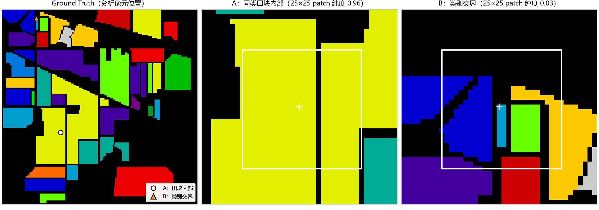
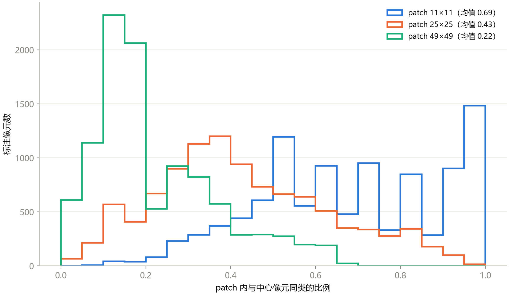
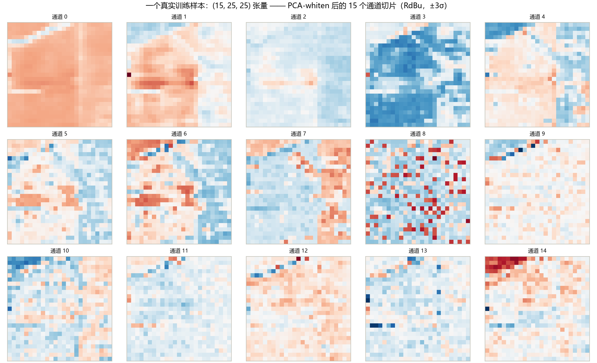

这是《高光谱图像分类》系列的第 5 篇。上一篇我们看到：只看光谱的像素级方法，预测图里到处是椒盐噪声，天花板就在那里。

这一篇回答一个问题：**怎么让模型“看到邻居”？** 答案叫 **patch 范式**，也是之后所有深度模型（1D 之外的那些）共同的数据前提。读完这一篇，数据管线就定型了：第 6 到 10 篇我们只换模型，不再动数据。

## 一、patch 是什么

思路很朴素：判别一个像素的类别时，不光给它自己的 200 个光谱值，还把**以它为中心的一小块邻域**（所有波段）一起交给模型。这一块邻域，就叫 patch。

以 25×25 为例：

- 像素级：一个样本是 1×200 的向量；
- patch 级：一个样本是一个三维的“小立方体”，经过后面要讲的 PCA 之后是 **15×25×25**（15 个通道，每个通道一张 25×25 的小图）。

课程里先给了两个真实样本，让你感受 patch 里到底装着什么。

**怎么读这张图：**

- **左图：** 整张 Indian Pines 的标签图，上面标出两个被分析的像素：白色圆圈 A（在一大块黄色田里面），橙色三角 B（在左上角靠近几块小田的位置）；
- **中图：** 以 A 为中心的 41×41 邻域，**白色方框是 25×25 的 patch**，十字是中心像素。颜色还是类别编号，黑色是未标注；
- **右图：** B 周围的同样大小邻域，白框还是 25×25。

**能看到什么：**

- **A（田块内部）：** 25×25 的白框几乎全落在同一片黄色里，只被一条竖着的黑色细缝（未标注）穿过。标题给出这个窗口里“同类像素占比”是 **0.96**；
- **B（类别交界处）：** 白框里同时有蓝色、天蓝色、绿色、橙色、紫色等很多块，中心的那一条天蓝色小细条只占窗口很小一部分，“同类占比”只有 **0.03**。

**这说明什么：** 同样是 25×25，两个像素“看到的邻居”完全不同。A 看到的是一片同类的海洋，B 看到的是一幅拼图。**patch 不是一个“同质窗口”，它提供的是这个像素所处的环境。** 这也是后面模型能学到“田块中心长这样、田块边缘长那样”的原因。

**不能读出什么：** 这两个像素是被**挑出来**的，一个是纯度几乎最高的，一个是几乎最低的，用来演示两个极端。**不代表大多数像素长这样。** 大多数像素在两者之间，看下一张图。

## 二、窗口多大？一个“三难”取舍

**怎么读这张图：**

- **横轴：** 窗口里“和中心像素同类的像素所占的比例”，从 0 到 1；
- **纵轴：** 有多少个有标注的像素落在这个比例区间（总共 10,249 个）；
- **三条线：** 三种窗口大小，蓝色 11×11，橙色 25×25，绿色 49×49。图例里给了均值。

**能看到什么：**

- **蓝线（11×11）：** 分布偏右，在 1.0 附近有一个高峰，均值 0.69；
- **橙线（25×25）：** 分布在中间，大约集中在 0.2 到 0.6 之间，均值 0.43；
- **绿线（49×49）：** 挤在最左边，在 0.1 到 0.2 附近有一个很高的峰，均值 0.22。

我重新运行了课程的脚本，三个均值是 **0.6882、0.4301、0.2215**，和图一致。另外还可以算出：纯度不低于 0.9 的像素，11×11 窗口里有 25.0%，25×25 里只有 1.1%，49×49 里是 0；纯度低于 0.5 的，分别是 20.6%、66.7% 和 93.3%。

**这说明了窗口大小的“三难”：**

- **窗口太小（11）：** 邻居更“纯”，但能看到的上下文很少，退回接近像素级；
- **窗口太大（49）：** 上下文很多，但混进了很多别的东西，计算也更贵，边界信息会淹没中心像素；
- **25×25 是 Indian Pines 上被长期使用的折中**，课程里所有深度模型统一用 25。

### 我补算的一个数：这个“纯度”到底算的是什么？

课程里对“同类占比”的定义是：窗口里**所有像素**中，和中心像素标签相同的比例。注意这里的“所有像素”，包括了两种**不是别的类、只是没有标签**的像素：

1. **没标注的像素（标签 0）：** Indian Pines 只有 48.7% 的像素有标注，窗口里经常有一块黑色；
2. **镶边补的零：** 靠近图像边缘的窗口，会伸出图外，用零填充。

所以“0.43”里，有一部分只是“没有标注”，并不都是“别的类”。我又算了一个口径：**只在窗口里“有标注”的像素中**，统计和中心同类的比例（这个口径把未标注和镶边都排除了）：

| 窗口 | 课程口径（占整个窗口） | 只看有标注的邻居 |
|---|---:|---:|
| 11×11 | 0.69 | 0.89 |
| 25×25 | 0.43 | 0.67 |
| 49×49 | 0.22 | 0.42 |

也就是说，25×25 的窗口里，**如果只看有标注的邻居，平均大约三分之二和中心同类**，而不是 43%。两个口径都对，只是回答的问题不一样：课程的口径回答“窗口有多纯”，我补的口径回答“有标签的邻居里多少和我同类”。**读图的时候要知道分母是什么。**

（这是我用课程的标签文件补算的，不是课程里的数字；算法和课程一样，只是换了分母。）

## 三、一个样本喂给模型的样子

**怎么读这张图：** 这是图 A 那个像素对应的训练样本，也就是模型真正“吃进去”的东西。它有 15 个通道，每个通道是一张 25×25 的小图，排成 3 行 5 列，标题是“通道 0”到“通道 14”。颜色用的是红蓝色带：红色表示偏正、蓝色表示偏负，范围是 ±3 个标准差。

**这 15 个通道是什么：** 是对整张图做 PCA（主成分分析）、取前 15 个主成分得到的。第 4 篇说过，主成分不是原来的波段，而是原波段的线性组合。

**能看到什么：**

- **通道 0（第一主成分）：** 整体是一片同样的橙红色，能隐约看见田块的边界、一条细缝。方差最大的成分，主要是整体亮度的结构；
- **中间的通道（如 3、4、6、7）：** 能看到明显的大块图案，不同田块的颜色不一样；
- **靠后的通道（如 8、9、11、13）：** 越来越像噪点，没有明显结构，有的几乎是一片接近白色的淡色（接近 0）。

**这说明什么：**

- **“方差排序不等于判别力排序”在样本级的样子：** 靠后的主成分看起来像噪声，但不一定对分类没用，这是第 4 篇提过的警惕；
- 所有通道的颜色深浅差不多，是因为做了 **whiten（白化）**：每个主成分除以自己的标准差，所有通道均值 0、方差 1。没有白化，第 1 个主成分的数值会是第 15 个的几十倍，网络初始化和学习率都得为“通道间尺度失衡”买单。

**不能读出什么：** 这张图是**一个**样本。不要从“通道 8 像噪声”推出“可以把后面的通道扔掉”，那要靠验证集上的结果来定。

## 四、这条数据管线，一步一步

课程把整个数据管线固定成下面这几步，之后所有模型都用它：

**1. 整图 PCA（15 个分量，白化）。** 先对整张图的光谱维做 PCA，取 15 个，白化。为什么是 15？第 4 篇说过：累计解释了 98% 的方差，加上文献里的经验值，是个折中，不是魔法数。

**关于一个“协议灰色地带”：** 课程的 PCA 是在**整张图**（包括测试像素和没标注的像素）上拟合的。PCA 是无监督的，只用方差结构，这是领域里的惯例，一般被看作可接受；但更严格的做法是**只在训练像素上拟合**，对测试像素只做变换。两种做法的数字不能直接比，写论文要写明。

**2. 镶边。** 图像边缘的像素，25×25 的窗口会伸出图外。办法是先在图像四周补上 12 圈（25 的一半取整）零。（也可以用镜像补，课程用零填充，最简单，也与多数论文一致，代价是边缘样本里带一圈假的“0”。）

**3. 窗口取奇数。** 25 = 12 + 1 + 12，有唯一的中心像素，切片关于中心对称。取偶数（比如 24）的话，“中心”落在四个像素的交界上，要么错半格，要么不对称，所以全领域默认奇数。

**4. 现切，不存。** 每个样本只由“中心像素的坐标”决定，所以数据集里只存一张**索引表**，要用的时候再从镶边后的整图里切一块。内存里永远只有一份整图。

**5. 转置，标签减一。** 切出来是 `(25, 25, 15)`（高、宽、通道），而 PyTorch 的卷积要 `(15, 25, 25)`，需要一次转置；类别标签是 1 到 16，而交叉熵要从 0 开始，所以训练时减一，预测时再加回来。**这一对“减一、加一”只要错一个，所有的标签就整体错位一格**，指标会莫名其妙地低，很难排查。

**6. 预测时：整张图都是样本，而且绝不能打乱顺序。** 预测的时候，把整张图（包括背景）都当作样本，按行优先的顺序一个个取窗口、过模型，最后把输出按同样的顺序拼回 145×145 的图。**顺序就是坐标**，一旦 shuffle，预测图就整体错位了，而且从外面看不出来。训练时恰恰相反，要打乱。

| 加载器 | 样本 | 打乱 | 用途 |
|---|---|---|---|
| 训练 | 训练集的有标注像素 | **是** | 每一轮换顺序 |
| 验证 | 验证集的有标注像素 | 否 | 验证精度 |
| 预测 | 整张图所有像素 | **否** | 整图推理，顺序即坐标 |

还有一个细节：**随机性要挂在同一棵“种子树”上**：划分（sklearn）、索引打乱（numpy）、网络初始化（torch）这三处，都由同一个随机种子控制，实验才可复现。

## 五、三个常见的误解

**误解 1：“patch 越大，成绩越好。”** 图 2 说明了，窗口大了纯度会掉；而且还有一个后面几篇会讲的问题，窗口越大，相邻两个样本的窗口重叠越多（25×25 的窗口，相邻两个样本共享大约 96% 的内容），**随机划分下训练和测试里有几乎相同的窗口**，成绩会偏乐观。所以“patch 大”和“成绩高”之间的关系，很可能被泄漏混在一起。

**误解 2：“patch 里的邻居都是同类。”** 不是。窗口大部分是别的东西或者没标注的区域；模型学到的是**结构**，不是“邻居投票”。

**误解 3：“PCA 只是为了省算力。”** 它同时做了两件事：降维，以及白化（让各通道尺度一致）。

## 六、这一篇你该带走的

1. **patch = 上下文快照。** 一个样本从 1×200 变成 15×25×25；
2. **25×25 的窗口，同类占比平均 0.43（占整个窗口）或 0.67（只看有标注的邻居）。** 要知道分母；
3. **管线固定：** 整图 PCA-白化 → 镶边 → 索引表现切 → 转置、标签减一 → 训练打乱、预测不打乱；
4. **两个协议上的灰色地带：** PCA 在整图拟合；窗口重叠带来的泄漏。写论文要说明。

## 自测三问

1. 为什么窗口要取奇数？
2. 25×25 的窗口里，为什么会有一大半“不同类”的像素？这些像素都是“别的类”吗？
3. 预测整张图时，为什么不能打乱顺序？

（答案提示：要有唯一的中心；也有没标注的和镶边补的零；顺序就是坐标。）

## 下一篇预告

数据管线定好了，下一篇我们终于开始“换模型”：**1D、2D、3D 卷积神经网络**。三种卷积分别在“哪个方向”上滑动？谁在光谱上看，谁在空间上看，谁两个一起看？它们的参数量和计算量差多少？课程用了七张图来讲，我们一张张看。

---

> 配套课程：[masskx/HSI-Learning](https://github.com/masskx/HSI-Learning) 第 4 章。三张图取自仓库；三个纯度均值和比例是我用仓库脚本重新跑出来的；“只看有标注邻居”的口径是我补算的。
