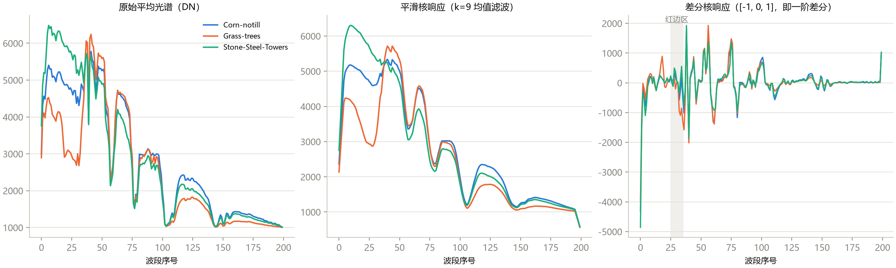
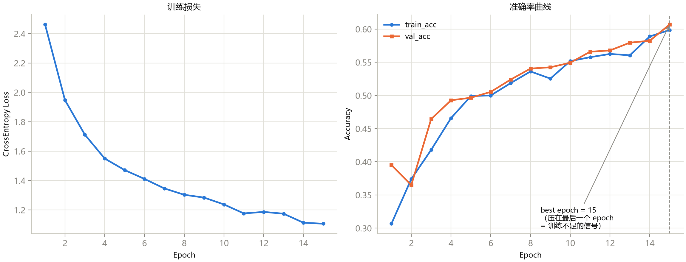
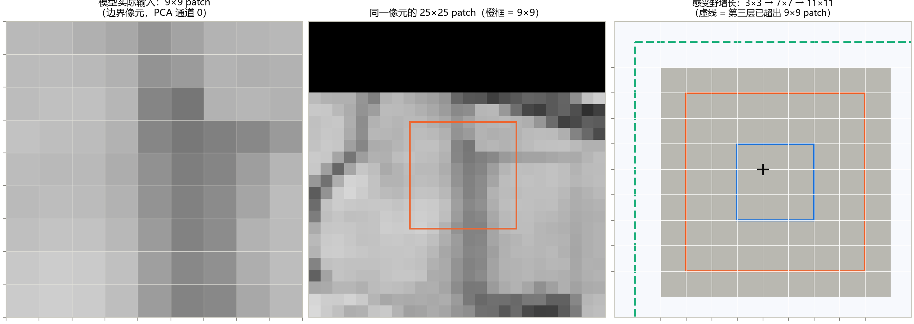
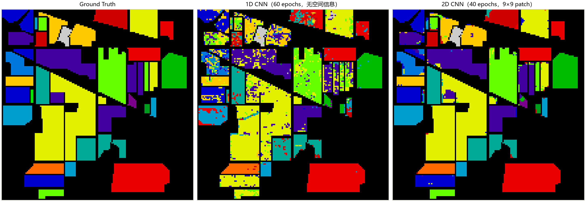
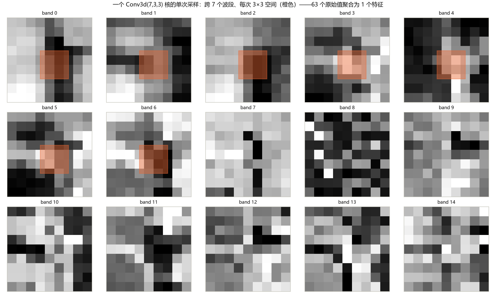
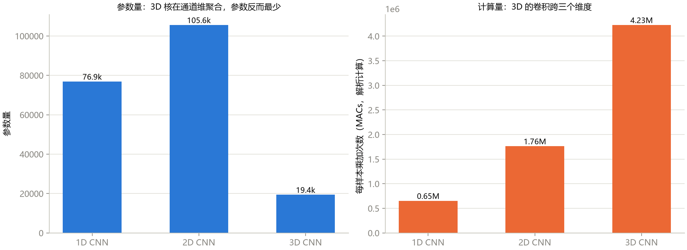
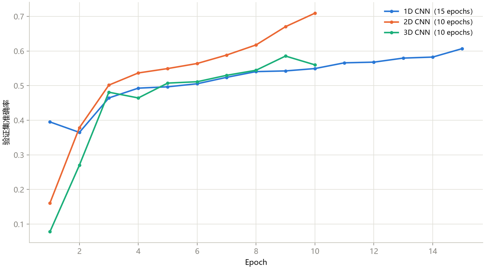
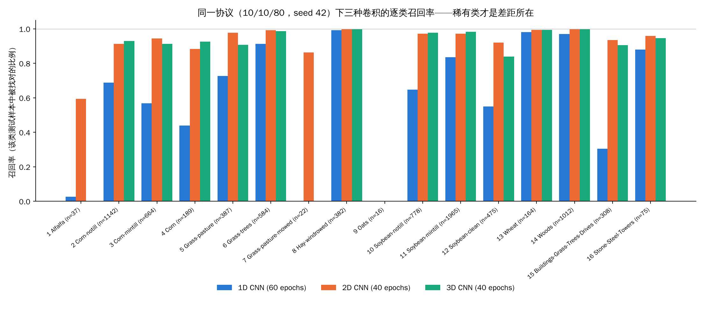
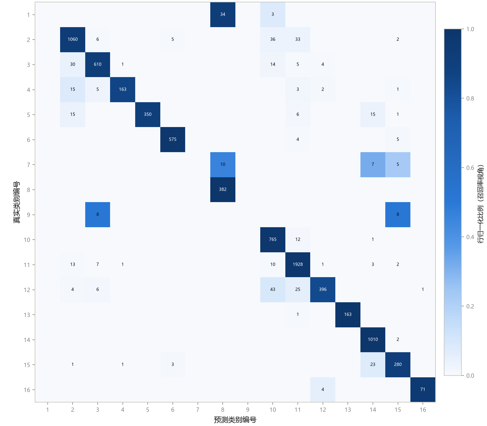

这是《高光谱图像分类》系列的第 6 篇。上一篇我们把数据管线定下来了：整图 PCA、镶边、取 patch、转置、顺序即坐标。从这一篇起，**数据不动，只换模型**。

先说好一件事：这一篇的所有训练结果，我都在自己的机器上**重新训练过一遍**（CPU，课程仓库里的原脚本，种子和划分都和课程一致），和课程记录的数字对照着写。哪些图是课程自带的，哪些是我补的，文末都有交代。

## 一、先回答一个问题：三种卷积到底差在哪

一张 Indian Pines 的立方体是 145×145×200。把它的一个样本交给神经网络，有三种“看法”：

| 模型 | 输入长什么样 | 卷积核往哪个方向滑 | 它看得到什么 | 它看不到什么 |
|---|---|---|---|---|
| **1D CNN** | 一个像素的 200 个波段，形状 1×200 | 沿光谱轴 | 光谱曲线的形状：哪里有谷、哪里有坡 | 邻居是谁（完全没有空间信息） |
| **2D CNN** | PCA 降到 12 个通道的 9×9 小块，形状 12×9×9 | 沿两个空间轴；光谱通道被一次性聚合 | 空间纹理、田块边界 | 光谱的先后顺序（通道之间是并列的，没有“相邻”的概念） |
| **3D CNN** | PCA-15 的 9×9 小块，当作单通道的 15×9×9 体 | 沿“光谱分量”和两个空间轴，三个方向一起滑 | 光谱和空间的联合模式 | 没有硬伤，代价是贵 |

有一个很容易混的点，课程里特意强调了：**2D 卷积并不是“一次只看一个通道”**。普通的 `Conv2d` 每个输出值会把**所有输入通道**聚合起来（本课输入 12 个通道、核 3×3，一次聚合 12×3×3=108 个值，不是 9 个）。2D 和 3D 的区别不在于“要不要跨通道”，而在于**核在光谱方向上要不要也滑动、要不要共享权重**。

下面按 1D、2D、3D 的顺序，一张图一张图地看。

## 二、1D CNN：把光谱当成一条“信号”

### 图 1：卷积就是一排滑动滤波器

**怎么读这张图：**

- **三张子图的横轴**都是“波段序号”，0 到 199，**不是波长**。Indian Pines 的这个版本删掉了一批吸水严重的波段，所以序号和真实波长不是线性对应，不能直接换算成纳米；
- **左：** 三个类别（Corn-notill 蓝、Grass-trees 橙、Stone-Steel-Towers 绿）的平均光谱，纵轴是原始的数字量（DN）；
- **中：** 用一个 9 点均值滤波器（每个位置取前后 9 个值的平均）处理后的曲线；
- **右：** 用 `[-1, 0, 1]` 这个差分核处理后的曲线，每个位置的值等于“后一个波段减前一个波段”，也就是光谱的斜率。

**能看到什么：**

- 中图的曲线比左图平滑得多，细小的毛刺被抹掉了，但整体形状没变。这是**低通滤波**：压噪声；
- 右图里，大部分位置的值都在 0 附近，只有少数几处出现大的起伏；最左边（波段 0 附近）有一个很深的负值，是因为光谱一开头从很低的值陡升。

**这说明什么：** 一个只有 3 个参数的小核，就能把“光谱的斜率”变成一个显式的特征。`Conv1d` 层就是一排这样的小核；和手写核的唯一区别是，**核的数值是训练出来的，不是人定的**。

**不能读出什么，以及一处我想提醒的地方：** 课程在图里用灰色竖带标了“红边区”，并说差分响应在红边区“出现明显尖峰”。我看这张图的感受是：灰带附近确实有起伏，但**图中最高的那个尖峰在波段 40 前后**，而回头看左图，三条曲线在 40 前后都有一个很突兀的“缺口”（曲线先掉下去再弹回来），更像是个别波段的异常，而不是平滑的红边。我没有逐波段去查这个缺口的成因，所以只提醒：**这张图适合用来理解“差分核做什么”，不适合当作“红边位置”的证据**。

### 1D CNN 的结构，看三个数字就够

课程里的 1D 模型总共有 **76,880 个参数**：三个“卷积、批归一化、激活、池化”块，通道数 16→32→64，核宽 7→5→3；最后接两层全连接。把池化也算进去，第三层卷积的**理论感受野是 26 个输入位置**（推导：核 7 → 7；池化后 8；核 5 → 16；池化后 18；核 3 → 26）。

这 26 并不是“26 个真实的窄波段”，原因同上：删过带，序号不等于波长。

### 图 2：训练曲线，读出“训练不足”

**怎么读这张图：** 一个 epoch 就是把训练集完整过一遍。**左**是训练损失（越低说明在训练集上拟合得越好），**右**是训练准确率（蓝）和验证准确率（橙）。虚线标出了验证准确率最高的那个 epoch。

**能看到什么：**

- 损失从 2.46 一路降到 1.1 左右，到最后一个 epoch 还在降；
- 训练准确率和验证准确率两条线**几乎贴在一起**，都在稳步上升，最后一个 epoch 的验证准确率约 0.6，**最好的 epoch 恰好是 15，也就是最后一个**。

**这说明什么：** 这是一张教科书式的“**训练不足**”的图，三条证据指向同一个结论：（1）损失还在降；（2）验证准确率还在升；（3）最好的 epoch 贴在预算的最右边。反过来，如果是**过拟合**，应该看到的是训练准确率继续涨、验证准确率停住甚至掉下去，两条线**分叉**。这里没有分叉，所以问题不是“学太多了”，而是“还没学够”。

**我重新跑的结果：** 把 epoch 从 15 提到 60，结果是 **OA 61.0% → 75.0%**（课程记录 61.10% → 75.27%）。同一个模型，什么都没改，只是把训练做完。

**不能读出什么：** “最好的 epoch 压在最右边”只是提示还没到平台，**不证明**再训练一定能提升多少。我重新跑 60 个 epoch 时，最好的 epoch 是第 51，和课程记录的第 55 差了几个，说明在平台附近这个位置本身就带随机性。

## 三、2D CNN：加入邻居以后，发生了什么

### 图 3：模型实际吃进去的东西，和感受野

**怎么读这张图：**

- **左：** 模型真正的输入，一个边界像素的 9×9 patch，显示的是 PCA 后的第 0 个通道。因为做了白化，各通道均值 0、方差 1，所以对比度天然偏低，看起来发灰；
- **中：** 同一个像素的 25×25 patch（上一篇用的尺寸），橙框是 9×9 的位置。**顶部大片黑色是镶边补的零**，说明这个像素在图像的上边缘；
- **右：** 三个同心方框，示意卷积叠层以后“一个输出值能看到多大一块输入”：蓝 3×3、橙 7×7、绿虚线 11×11。

**能看到什么：** 左图里有一条竖着的深色带，从上到下贯穿整个 9×9；中图可以看出这条深色带在更大的范围里是一条延伸出去的“线”（像一条路或者田埂），9×9 的窗口刚好把它框住了。

**这说明什么：** 卷积网络靠层层叠加来扩大视野，不需要一开始就看很大的窗口。

**我在这里发现的一处不一致（请你读课程时留意）：** 右图画的是 3→7→11，这是**三层 3×3 卷积、不含池化**的结果。但课程里实际的 2D 网络是“卷积 → 2×2 池化 → 卷积 → 卷积”。把池化算进去，感受野应该是 **3 → 4 → 8 → 12**（用的是上一节的递推公式：`r' = r + (k-1)·j`，池化后 `j` 翻倍）。课程正文后面其实已经改成了 12×12，**但图和图注还停留在 11**。我自己用这个公式核算了一遍，正文的 12 是对的，图是旧的。

### 图 4：1D 和 2D 的整图预测，肉眼就能分出高下

**怎么读这张图：** 三张图是同一块地。**左**是地面真值（Ground Truth），每种颜色对应一个类别，黑色是没有标注的背景。**中**是 1D CNN（训练 60 个 epoch，只看光谱）的整图预测，**右**是 2D CNN（训练 40 个 epoch，9×9 邻域）的整图预测。（预测图只显示有标注的区域，背景被掩掉了。）

**能看到什么：**

- **中图：** 即使是看起来“预测对”的大田块，里面也撒满了零星的错色点，像盐粒；有的田块（比如左上角和中部偏左的几块小田）几乎被打碎成花斑；
- **右图：** 和左图几乎一模一样，田块边缘整齐，大块区域颜色干净；残留的错误集中在田块的边界和几个小角落。

**这说明什么：** 1D 模型一个像素一个像素地独立判断，**相邻的两个同类像素可能被判成不同的类**，这就是“椒盐噪声”的来源。2D 模型因为看到了邻居，输出自然更平滑一致。

**不能读出什么（很重要）：** 右图“几乎复刻真值”**不等于**模型泛化得这么好。原因上一篇说过：随机划分下，9×9 的 patch 和训练样本大量重叠，**一个测试像素的 patch 里平均混着大约 8 个训练像素**。更进一步，这张预测图是对**整张图**做的预测，里面本来就包含训练用过的像素。所以这张图是“好看”，不是“独立考试成绩”。第三篇里我做的空间分块实验，就是为了量化这件事。

### 数字对照：我重新训练的结果

| 模型 | 训练量 | 我重跑 OA / AA | 课程记录 OA / AA | 我重跑的最佳 epoch |
|---|---|---|---|---|
| 1D CNN | 15 epochs | 60.99 / 44.52 | 61.10 / 44.64 | 15/15 |
| 1D CNN | 60 epochs | 75.00 / 59.52 | 75.27 / 60.15 | 51/60 |
| 2D CNN | 10 epochs | 70.04 / 49.19 | 70.01 / 49.18 | 10/10 |
| 2D CNN | 40 epochs | 95.80 / 87.01 | 95.83 / 87.04 | 40/40 |
| 3D CNN | 10 epochs | 59.88 / 31.99 | 59.82 / 31.90 | 9/10 |
| 3D CNN | 40 epochs | 94.70 / 76.92 | 94.55 / 76.53 | 39/40 |

（协议 C：10% 训练 / 10% 验证 / 80% 测试，种子 42，Indian Pines，测试集 8200 个样本。）

**怎么理解这张表：** 重跑和课程记录最多差 0.6 个百分点，**方向和量级完全一致**，没有任何一个结论被推翻。差异来自 PyTorch 版本、线程数这类不可控的细节；我没有去追查具体来源，所以只能说“复现到了可接受的误差内”，不能说“逐位一致”。同时，**2D 40 个 epoch 的最佳 epoch 就是 40/40，也就是说它还压在预算边上**，95.8% 并不是它的上限。

## 四、3D CNN：参数最少，计算最贵

### 图 5：一个 3D 卷积核，一次到底“吃”进多少东西

**怎么读这张图：** 15 张小图，是**同一个 9×9 patch 的 15 个 PCA 分量**（band 0 到 band 14），每一张就是 3D 网络输入体积的一个“切片”。橙色的 3×3 方块，是第一层卷积核（尺寸 7×3×3）在**一次**采样时的覆盖范围：它横跨 band 0 到 band 6，一共 7 张切片，每张切片取 3×3。

**能看到什么：** 橙色方块出现在前 7 张切片上，后 8 张没有；每张切片是独立拉伸对比度显示的，所以不同切片之间的亮度不可直接比较。

**这说明什么：** 一个输出值聚合的是 1×7×3×3 = **63 个输入值**。2D 卷积一次只聚合 `C_in×3×3` 个值，3D 在光谱方向上多了 7 倍的跨度。这就是“3D 贵”的第一个来源。

**不能读出什么：** 注意切片的轴是 **PCA 分量**，不是原始波长。13 个分量的覆盖（三层叠加后的理论光谱感受野）**不等于 130 纳米**，课程里也特别提醒了这一点。靠后的切片（band 8 以后）看起来更像噪点：PCA 分量越靠后，包含的信号越少、噪声占比越高，而白化又把每个分量都放大到同样的尺度，所以噪声被“拉”了出来。

### 图 6：参数量和计算量，是两把尺子

**怎么读这张图：** 左图是参数量，右图是每个样本的乘加次数（MACs，大致等于做一次前向要算多少次乘法）。

**能看到什么：**

| | 1D CNN | 2D CNN | 3D CNN |
|---|---|---|---|
| 参数量 | 76.9k | 105.6k | **19.4k** |
| 每样本计算量（MACs） | 0.65M | 1.76M | **4.23M** |

**这说明什么：** 3D 的参数不到 2D 的五分之一，计算量却是 2D 的 2.4 倍、1D 的 6.5 倍。为什么？

- **参数少：** 一个 3D 核的参数个数只由核的体积决定（`输入通道 × 7 × 3 × 3`），和输出有多大无关；所以输出通道只要 8、16、24 就够，不用像 2D 那样堆到 32、64、128；
- **计算贵：** 计算量 = 输出元素的个数 × 每个元素聚合多少输入。3D 的输出是一个体积（第一层输出 8×9×9×9），元素个数多，每个元素聚合的输入也多。

这两个数我都**独立核算了一遍**：我写了一个很短的脚本，用 PyTorch 的 hook 数每一层的乘加，得到参数 76,880 / 105,584 / 19,416，MACs 为 653,184 / 1,763,712 / 4,226,872，和图上的 0.65M / 1.76M / 4.23M 完全一致。

**不能读出什么：** MACs 是个**理论**数字，不等于墙钟时间。我顺手在本机 CPU 上（2 个线程，随机输入，批大小 256）测了每个训练步的耗时，重复两次：**3D 约 75 毫秒，2D 约 25 到 29 毫秒，1D 约 35 到 49 毫秒**。也就是说 3D 大约是 2D 的 2.6 到 3 倍，比 MACs 之比（2.4 倍）略大，和课程“实际差距通常比 MACs 之比更明显”的说法方向一致。但有一个反常识的地方：**1D 的 MACs 最少，实测却比 2D 慢**。我没有深挖原因，推测是 1D 的特征图很长（200 个位置，16 个通道）、批归一化和池化这类“不算乘加”的操作占了主要时间，也就是内存搬运成了瓶颈。这只是推测，而且这个计时很粗糙（机器上没有别的任务时测的，但两次重复之间 1D 就差了 14 毫秒），**不要把它当成严谨的性能结论**。

### 图 7：验证曲线，“起步慢”不等于“模型差”

**怎么读这张图：** 默认配置下，三个模型的验证准确率随 epoch 的变化。蓝是 1D（15 个 epoch），橙是 2D（10 个 epoch），绿是 3D（10 个 epoch）。**注意三条线的长度不同，终点也不同。**

**能看到什么：**

- 橙线（2D）上升最快，到第 10 个 epoch 已经超过 0.7，而且还在往上冲；
- 绿线（3D）第 1 个 epoch 只有约 0.08，起步最慢，在第 3 个 epoch 追上蓝线，第 9 个 epoch 摸到 0.58 后在第 10 个 epoch 回落了一点；
- 蓝线（1D）慢慢爬，到第 15 个 epoch 才到 0.6。

**这说明什么，以及一个必须小心的坑：** 如果只看这张图，你会得出“3D 最差”的结论（10 个 epoch 时它的 OA 只有 59.9%，是三个里最低的）。但当把三个模型都训练到 40 个 epoch，**3D 的 OA 是 94.7%，和 2D 的 95.8% 同一个量级**。这就是为什么**同一个协议下比较模型，必须确认每个模型都训练到了平台期**，否则你比的不是模型，而是训练预算。

这一点对你以后读论文也适用：看到“我们的方法比基线高 X 个点”时，先问一句：**两边的训练预算是否对齐？有没有训练到收敛？**

## 五、把三个模型放在一起：谁在哪里赢，谁在哪里输

### 图 8：逐类召回率（这是我补的图）

课程里是用总分（OA、AA）比较的。但总分会掩盖很多信息，所以我用重跑出来的混淆矩阵，画了一张**逐类召回率**的图。召回率的意思是：某一类的测试样本里，有多少比例被模型找对了。

**怎么读这张图：** 横轴是 16 个类别，括号里是该类在测试集里的样本数 n；每一类有三根柱子：蓝（1D，60 个 epoch）、橙（2D，40 个 epoch）、绿（3D，40 个 epoch）。柱子越高，说明这一类被找得越全。**没有柱子，是因为召回率为 0。**

**能看到什么：**

1. **大类（样本多）上，2D 和 3D 都接近满分**：Hay-windrowed、Woods、Wheat、Soybean-mintill 等，召回率都在 0.97 以上；
2. **1D 的短板在“光谱相近的作物”上：** Corn（0.44）、Corn-mintill（0.57）、Soybean-clean（0.55）、Buildings-Grass-Trees-Drives（0.31）这几类，2D 和 3D 都比 1D 高出 0.3 到 0.6；
3. **三个小类是真正的分水岭：**
   - **Alfalfa（37 个测试样本）：** 1D 找到 1 个（0.03），2D 找到 22 个（0.595），**3D 一个都没找到（0）**；
   - **Grass-pasture-mowed（22 个）：** 1D 是 0，2D 是 0.864（19 个），**3D 是 0**；
   - **Oats（16 个）：** 三个模型**全是 0**。

**这说明什么：** OA 看起来 3D 和 2D 只差 1.1 个点（94.7 对 95.8），AA 却差了 10 个点（76.9 对 87.0），原因全在这几个小类上：3D 把 Alfalfa 和 Grass-mowed 两个类整个丢了。**OA 高、AA 低，是在提示你：有几个小类没学会。** 这正是第三篇里强调的“看 OA 之外，还要看 AA 和混淆矩阵”。

**不能读出什么：** “3D 的稀有类不如 2D”**不能**从这张图推出。原因：（1）这只是一颗种子的一次运行；（2）Alfalfa 的测试样本只有 37 个，多找对或者少找对几个，召回率就会晃 10 个百分点；（3）3D 在 40 个 epoch 时最佳 epoch 是 39/40，**仍然压在预算边缘**，没训练完。要下这个结论，至少需要多个种子的均值和标准差，这是后面科研篇会讲的内容。

### 图 9：3D CNN 的混淆矩阵，看“错在哪里”

**怎么读这张图：** 行是**真实类别**，列是**预测类别**，格子里的数字是样本数，颜色深浅是**行归一化**后的比例（也就是召回率视角）。正确的预测都在对角线上，不在对角线上的格子就是错误。

**能看到什么：**

- **对角线很深**，说明大多数类都找得很准，比如第 2 类 1060 个、第 11 类 1928 个、第 14 类 1010 个；
- 第 1 行（Alfalfa）：**34 个被判成第 8 类（Hay-windrowed）**，3 个被判成第 10 类，对角线上空空如也；
- 第 9 行（Oats，共 16 个）：被分到了第 3 类和第 15 类两个格子，各约 8 个，同样没有一个落在对角线上；
- 玉米和大豆这几类之间有成片的小数字，例如第 12 行（Soybean-clean）有 43 个被判成第 10 类（Soybean-notill）；第 3 行（Corn-mintill）有 30 个被判成第 2 类（Corn-notill）。

**这说明什么：** 稀有类的错误是**有方向的**：Alfalfa 几乎全部流向了 Hay-windrowed，Oats 流向了几个别的类。这说明模型不是“随机乱猜”，而是把少样本的类**吸附到了某个光谱上最像的大类**。看混淆矩阵，比只看总分更能告诉你下一步该改什么。

**我在这里发现的一处不一致：** 课程正文说 Oats 的 16 个样本里“8 个判成 Corn-mintill、8 个判成 Stone-Steel-Towers”。但这张图里，第二个格子的位置在**第 15 列，是 Buildings-Grass-Trees-Drives，不是第 16 列的 Stone-Steel-Towers**（第 16 列在这一行是空的）。我用自己重跑的混淆矩阵核对，Oats 的流向是 Buildings-Grass-Trees-Drives 8 个、Corn-mintill 7 个、Corn 1 个，和图一致，和文字不一致。**这是类别序号对错位的小笔误**（第三篇里我提到过类似的一处），不影响结论，但引用课程原文时要留意。

## 六、三个常见的误解

**误解 1：“2D 一次只看一个通道，3D 才会跨通道。”** 不对。普通 2D 卷积每个输出都聚合全部输入通道。差别在于核在光谱方向上有没有“滑动并共享权重”。

**误解 2：“参数少就快。”** 图 6 已经说明：3D 的参数最少，MACs 却最多。参数量和计算量是两把尺子。

**误解 3：“OA 差一点点，模型就差不多。”** OA 被大类主导（Soybean-mintill 一类就有近 2000 个测试样本），AA 对每类一视同仁。3D 和 2D 的 OA 只差 1.1，AA 却差 10，这就是证据。

## 七、这一篇你该带走的

1. **三种卷积 = 三种“看法”：** 1D 看光谱形状，2D 看空间邻居，3D 同时看两者；
2. **诊断三步：** 看损失还在不在降；看训练和验证曲线有没有分叉；看最佳 epoch 有没有压在预算最右边；
3. **比较模型要先对齐训练预算**，否则 10 个 epoch 的 3D 会被误判为“最差”；
4. **看到好看的预测图要先问：这是独立考试，还是包含了训练像素？**
5. **OA 之外必看 AA 和混淆矩阵**；小类的结论一定要多种子验证。

## 自测三问

1. 一个 `Conv3d(1, 8, kernel_size=(7,3,3))` 在一次采样里聚合多少个输入值？对比 `Conv2d(12, 32, 3)` 呢？
2. 为什么训练曲线上“训练和验证两条线贴在一起、还在上升”，说明是训练不足而不是过拟合？
3. 3D CNN 在 10 个 epoch 时垫底、40 个 epoch 时追平 2D，这对你读论文有什么警示？

（答案提示：63 对 108；过拟合会分叉；先问训练预算是否对齐、是否到了平台期。）

## 下一篇预告

2D 丢了光谱细节，3D 贵又慢，那能不能**两个都要**？下一篇看两个经典的“组合式”网络：**HybridSN**（先 3D 后 2D）和 **SSRN**（残差连接）。你会看到：一个 99.2% 的准确率为什么反而是个“警示信号”，以及参数量的大头竟然不在卷积层。

---

> 配套课程：[masskx/HSI-Learning](https://github.com/masskx/HSI-Learning) 第 5、6、7 章。图 1、2、3、4、5、6、7、9 取自仓库；图 8（逐类召回率）和“重跑对照表”“参数量与 MACs 核算”是我在本机补做的，脚本在系列的 `_工具/collect_cnn_results.py`。
