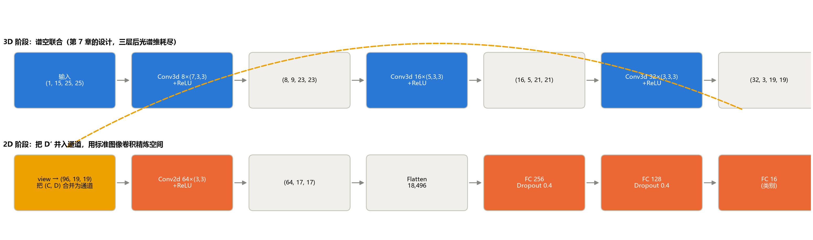
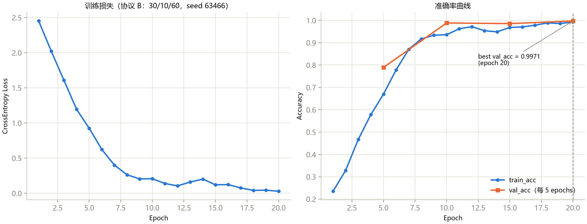
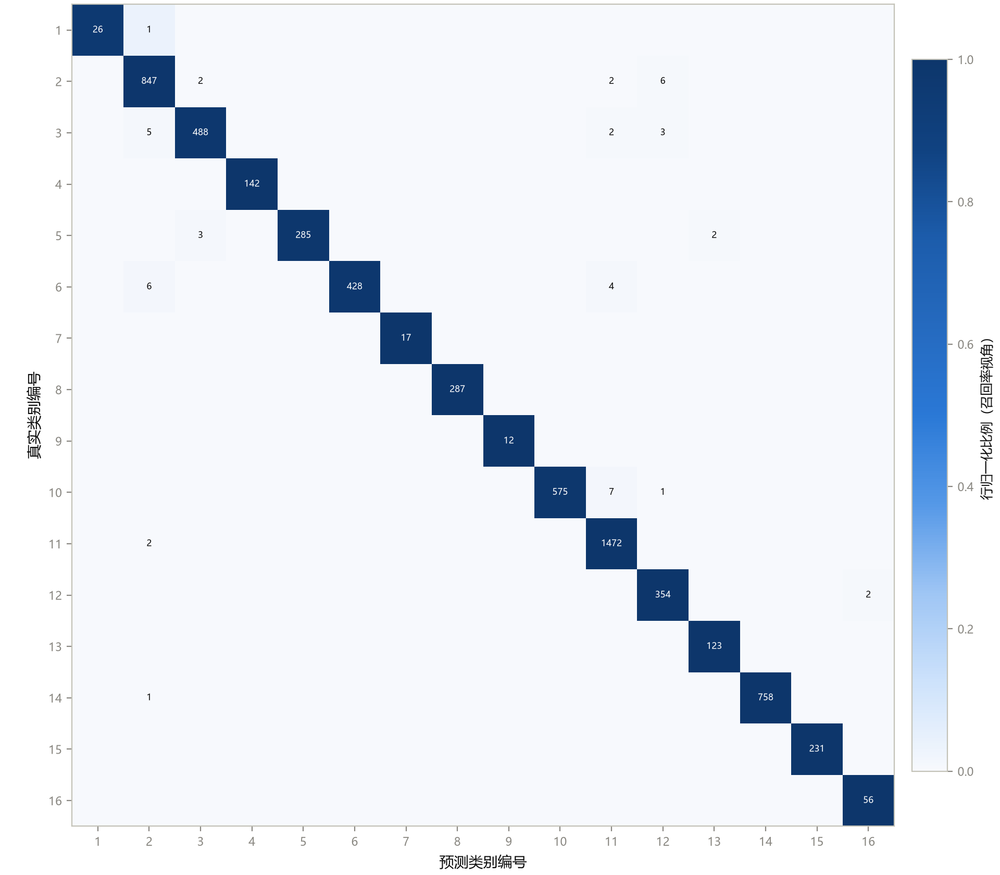
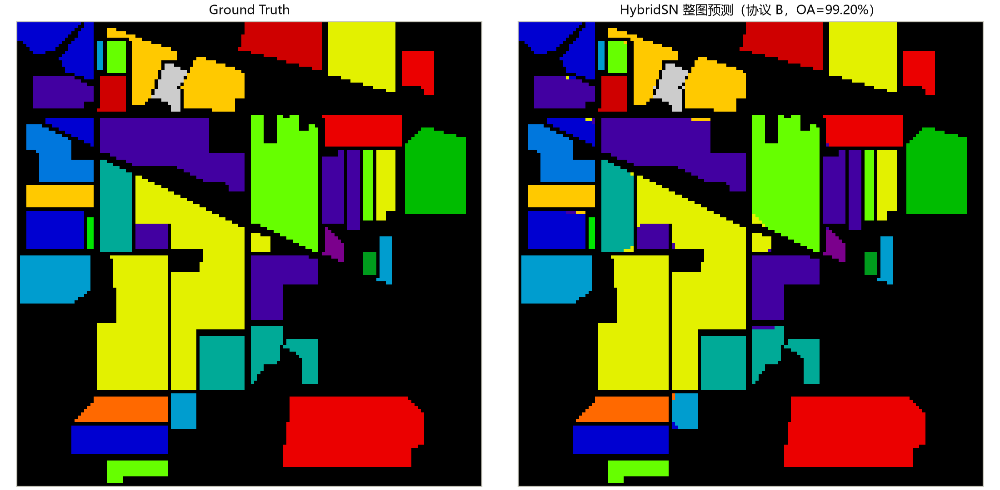
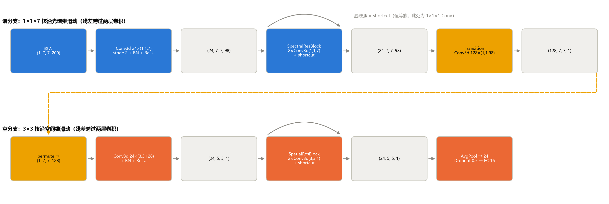
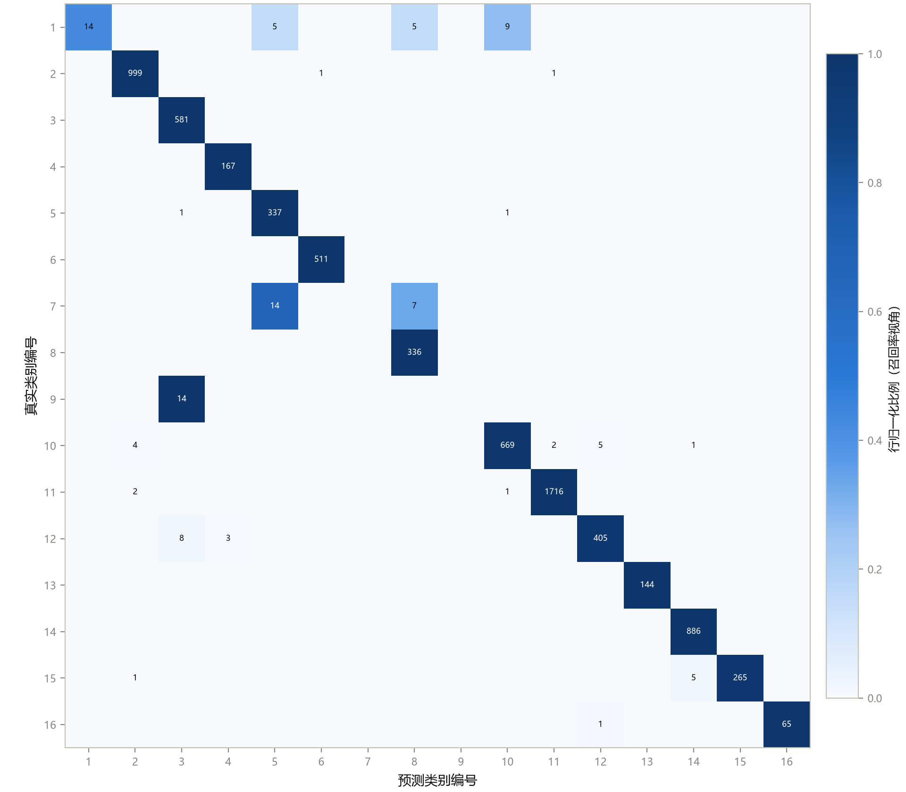
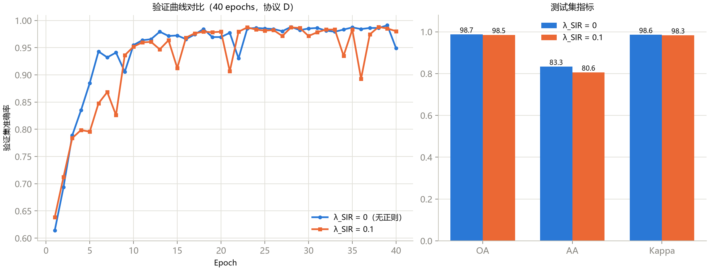

这是《高光谱图像分类》系列的第 7 篇。

上一篇我们看到了三种卷积的各自短板：2D 丢了光谱细节，3D 又贵又慢，稀有类还不稳。这一篇看两个**组合式**网络，它们是 HSI 分类里最经典的两条思路：

- **HybridSN**：先用 3D 卷积拿到“光谱加空间”的联合特征，再用一层便宜的 2D 卷积精炼空间；
- **SSRN**：不用联合核，而是把轴拆开：先只沿光谱做一个残差块，再只沿空间做一个残差块。

这一篇有三个“反直觉”：

1. **HybridSN 的参数几乎全在全连接层，不在卷积层**；
2. **协议 B 下 99.2% 的准确率，不是好消息，而是“考试太容易”的信号**；
3. **SSRN 的 OA 是课程里所有模型里最高的，但 AA 却比 HybridSN 低 13 个点**。

同样地，所有结果我都在本机重新训练过，课程的图都逐张读过。

## 一、HybridSN：先联合，后精炼

### 图 1：结构图，看形状怎么一路变

**怎么读这张图：** 分两排。**上排（蓝色）是 3D 阶段**，从左到右：输入 (1,15,25,25)，即“1 个通道、15 个 PCA 分量、25×25 空间”；经过三层 3D 卷积（核 7×3×3、5×3×3、3×3×3，输出通道 8、16、32），灰色方块里写的是每一步之后的真实形状。**下排（橙色）是 2D 阶段**：先用 `view` 把 3D 特征重排成 (96,19,19)（黄色方块），再过一层 2D 卷积（64 个 3×3 核），拉平成 18,496 维，接三层全连接（256、128、16）。顶部那条黄色虚线弧表示“上排最后一层的输出，接到下排第一个黄色方块”。（这张图右边的方块被裁掉了一点，是原图本身的小瑕疵，不影响读数。）

**能看到什么：**

- **光谱维在上排被“耗尽”**：15 → 9 → 5 → 3；
- **空间维也在悄悄收缩**：25 → 23 → 21 → 19 → 17。因为这四层卷积**都没有补零**，每层在边界上丢一圈；
- 黄色那一步 `view`：(32, 3, 19, 19) 变成 (96, 19, 19)。32 个通道乘上 3 个光谱深度，合成 96 个“通道”，**纯重排，数值没有丢失也没有混合**。

**这说明什么：** 设计哲学是“**3D 解决信息在哪里，2D 解决算得便宜**”：浅层用少量 3D 层抓住谱空联合，后面用廉价的 2D 把空间特征做精。

**不能读出什么：** 这张图画的是形状，不是“哪一层重要”。要知道每层的贡献，需要做消融（删掉一层重新训练）。

### 参数和计算量：我自己数了一遍

| 层 | 输出形状 | 参数量 |
|---|---|---:|
| Conv3d 1→8，核 7×3×3 | (8, 9, 23, 23) | 512 |
| Conv3d 8→16，核 5×3×3 | (16, 5, 21, 21) | 5,776 |
| Conv3d 16→32，核 3×3×3 | (32, 3, 19, 19) | 13,856 |
| Conv2d 96→64，核 3×3 | (64, 17, 17) | 55,360 |
| **全连接 18,496→256** | (256) | **4,735,232** |
| 全连接 256→128 | (128) | 32,896 |
| 全连接 128→16 | (16) | 2,064 |
| **合计** | | **4,845,696** |

用 PyTorch 的 hook 数出来，**总参数 4,845,696，每个样本约 50.82M 次乘加**，和课程一致。**第一个全连接层一层就占 97.7% 的参数**。为什么？因为卷积栈输出的是 64×17×17 = 18,496 维的特征图，拉平以后每一维都要连到 256 个神经元，18,496 × 256 ≈ 473 万。

**这说明什么：** 前面几篇一直在讲“卷积核怎么设计”，但 HybridSN 的参数大头根本不在卷积里。**哪一层是参数大户，取决于你在哪里拉平。** 一个很自然的“论文创新点”就藏在这里：用全局平均池化替代拉平，可以把这一层缩小两个数量级（课程里把它列为后续选题，我没有做这个实验，所以不知道精度会损失多少）。

另一个细节：**HybridSN 里没有批归一化**。这是对 2020 年论文的忠实复现。复现老论文时，“结构要按原文，即使你知道更好的做法”，否则就不叫复现。

## 二、HybridSN 的成绩：从 99.2% 读出一个警示

### 图 2：训练曲线，一条“饱和”的曲线

**怎么读这张图：** 协议 B：30% 训练、10% 验证、60% 测试。**左图**是训练损失，**右图**是训练准确率（蓝）和验证准确率（橙，每 5 个 epoch 才验证一次，所以只有 4 个点：第 5、10、15、20 个 epoch）。虚线标出最好的 epoch。

**能看到什么：**

- 损失从 2.45 降到接近 0.03，第 8 个 epoch 就已经降到 0.3 以下；
- 训练准确率在第 8 个 epoch 前后达到 0.9，最后接近 0.99；
- 验证准确率：第 5 个 epoch 是 0.79，**第 10 个 epoch 就到了 0.99 左右**，之后几乎是平的，最好的是第 20 个 epoch 的 0.9971。

**这说明什么：** 和第 5、6 篇里“损失还在降、验证还在升、最佳 epoch 压边”的“训练不足”曲线完全不同：**这里模型 10 个 epoch 就吃饱了**。这是一个**饱和协议**：30% 的训练量、一个 480 万参数的大模型、以及 25×25 的大窗口（相邻窗口共享约 96% 的内容）。

### 图 3：混淆矩阵，几乎全对

**怎么读这张图：** 行是真实类别，列是预测类别，格子里是数量，颜色是行归一化后的比例（和前面几篇一样）。

**能看到什么：** 对角线几乎是一整条深蓝，对角线以外只有零星的小数字。前面几篇里让人头疼的稀有类，在这里**几乎都对了**：第 9 行（Oats）12/12，第 7 行（Grass-pasture-mowed）17/17，第 1 行（Alfalfa）26/27，第 16 行 56/56。

**这说明什么：** **当混淆矩阵开始“全对”，它作为诊断工具的价值就趋近于零了**：你没法从一个全对的矩阵里读出“模型哪里不行”。

**不能读出什么：** 不能得出“HybridSN 解决了小样本和稀有类问题”。看一个数字：Oats 一共只有 20 个像素，按 30/10/60 划分，**训练集里只有 6 个 Oats**，测试集 12 个。只见过 6 个样本，却在 12 个测试样本上全对，这更像是 25×25 的大窗口让测试样本的邻域和训练样本高度重叠，模型“认出了邻居”，而不是学会了“Oats 长什么样”。怎么检验？下一篇我用空间不相交划分做了这个检验：随机划分下 99% 的 2D CNN，在更严格的考场里只剩 35%。

### 图 4：整图预测，和真值“看不出区别”

**怎么读这张图：** 左边是真值，右边是 HybridSN 的整图预测（协议 B，OA=99.20%），背景（黑色）被掩掉。

**能看到什么：** 每一块田都是整块的同一种颜色，边缘整齐，只有极少数零星的像素散落在田块的边缘，颜色和真值不同。

**这说明什么，以及不能读出什么：** 看起来很美，但再次提醒：**这张预测图是整图预测，里面包含了训练过的像素**，它不是“独立考试”的答卷。

### 我重新训练的结果

我用课程的脚本 `train_hybridsn.py`，在**协议 C（10/10/80，种子 42，PCA-15，25×25 窗口，40 个 epoch）**下重新训练了一次：

| | 我重跑 | 课程记录 |
|---|---|---|
| OA | 97.24 | 96.66 |
| AA | 93.56 | 93.28 |
| Kappa | 0.9685 | 0.9619 |
| 最佳 epoch | 40/40 | 40/40 |

逐类看，我重跑的 **Oats 召回是 1.000**（16 个测试样本全对，课程记录同样是 1.000，是课程里第一次稀有类 Oats 被找出来）；Alfalfa 0.730（和课程一致）；Grass-pasture-mowed 0.682（课程是 0.818）；Stone-Steel-Towers 0.907（课程是 0.800）。

**怎么理解：** OA 比课程高 0.6 个点，几个稀有类的召回有明显出入。**这很正常**：稀有类的测试样本只有二十来个（Grass-mowed 22 个，差 3 个样本就是 13 个百分点），同一个种子在不同环境下训练轨迹就会不同。再次说明：**稀有类的单次数字不能当结论**。最佳 epoch 是 40/40，说明还压在预算边上。

同样地，我用课程脚本的默认设置重跑了**协议 B（30% 训练、10% 验证、60% 测试，种子 63466，20 个 epoch）**：

| | 我重跑 | 课程记录 |
|---|---|---|
| OA | 99.48 | 99.20 |
| AA | 99.29 | 99.18 |
| Kappa | 0.9941 | 0.9909 |
| 最佳验证准确率 | 0.9990（第 20 个 epoch） | 0.9971（第 20 个 epoch） |

**怎么理解：** 两次的数字都在 99% 以上，差别只有零点几个点。**“协议 B 是一个饱和协议”这个结论被复现了。**这里还要看一下划分表：协议 B 下 Oats 总共 20 个像素，**训练 6 个、验证 2 个、测试 12 个**。6 个训练样本、12 个测试样本，后者全部找对，这不是靠“学会了识别 Oats”，更可能是靠“窗口里的邻居”。

## 三、SSRN：把轴拆开，各用一个残差块

### 先补一课：残差是什么

深层网络有一个反直觉的困境：层数加多了，训练误差反而可能变高（不是过拟合，是优化本身变难了）。残差的解法只有一行：让每一层学习“相对于输入的偏移量”，而不是目标本身：

**输出 = F(x) + x**

那个“+ x”是一条**直通的近路**：反向传播时梯度可以沿这条路直接传回浅层；如果某一层没用，F 学成 0，这层就退化成“什么都不做”，网络至少不会变差。

### 图 5：SSRN 的结构图

**怎么读这张图：** 上排（蓝色）是**谱分支**：输入是 7×7 的空间窗口，每个像素保留**完整的 200 个波段**（没有做 PCA）。第一层卷积核形状是 (1,1,7)，**只沿光谱方向滑动**（步长 2，把 200 压到 98 或 97 左右）；接着是一个“谱残差块”（两层 (1,1,7) 卷积，拱形虚线是 shortcut 近路）。然后黄色的“过渡”层，用一个很长的核把整条光谱压成一个值，得到 128 个通道。下排（橙色）是**空间分支**：先 permute 把 128 通道换成深度轴，再用 (3,3,128) 的核做一次卷积，然后是“空间残差块”（两层 3×3 卷积 + shortcut），最后平均池化、Dropout、全连接输出 16 类。

**能看到什么：** 和 HybridSN 的“先 3D 联合、后 2D 精炼”不同，SSRN 的思路是**因式分解**：谱分支只管光谱，空间分支只管空间，中间用过渡层衔接。

**我在这里发现的一处不一致：** 图里把谱分支输出的光谱长度写成 **98**（过渡层的核也写成 (1,1,98)），但课程正文的表格写的是 **97**。我用代码实际跑了一遍：谱分支输出是 (24, 7, 7, **97**)，所以**图是错的，表是对的**，差一位。不影响理解，但你读图的时候心里要有数。

### 参数：86% 在“过渡层”

| 层 | 输出形状 | 参数量 |
|---|---|---:|
| 谱分支第一层 | (24, 7, 7, 97) | 192 |
| 谱残差块（含 shortcut） | (24, 7, 7, 97) | 8,712 |
| **过渡卷积 (1,1,97)，24→128** | (128, 7, 7, 1) | **298,112** |
| 空间分支第一层 | (24, 5, 5, 1) | 27,672 |
| 空间残差块（含 shortcut） | (24, 5, 5, 1) | 11,016 |
| 全连接 | (16) | 400 |
| **合计** | | **346,392** |

（各行不含批归一化层，批归一化共 288 个参数，已计入合计。）

我数出来的总参数是 **346,392**，每个样本约 **57.43M 次乘加**，和课程一致。**过渡卷积一层就占 86%**。这是上一节“参数大户取决于设计”的又一个例子：HybridSN 的大户是全连接，SSRN 的大户是那一层要“记住整条光谱怎么汇总”的过渡卷积。

另外一个值得注意的数字：SSRN 的窗口只有 **7×7**，而 HybridSN 是 **25×25**。这是后面比较两者时一个绕不过去的差别。

### 图 6：SSRN 的混淆矩阵（协议 D）

**怎么读这张图：** SSRN 用的是课程里的“协议 D”：每一类各自按 20% 训练、10% 验证、70% 测试来分（保证每类都有样本）。矩阵的读法同前。

**能看到什么：** 对角线整体很深，绝大多数类几乎全对（例如第 2 类 999 个、第 11 类 1716 个、第 14 类 886 个）。**但有三行的对角线是浅的或者空的**：

- 第 1 行（Alfalfa，共 33 个测试样本）：只有 14 个对，其余分到了第 5、8、10 类（5、5、9 个）；
- 第 7 行（Grass-pasture-mowed）：**一个都没对**，14 个被判成第 5 类（Grass-pasture），7 个被判成第 8 类（Hay-windrowed）；
- 第 9 行（Oats，14 个测试样本）：**全部被判成第 3 类（Corn-mintill）**。

**这说明什么：** 整体 OA 能到 98%+，是因为大类几乎全对；但**三个稀有类没有学会**，所以 AA 很低。SSRN 的 7×7 窗口只能看到很小的上下文，而稀有类往往是小块、零散的田，窗口里混杂了别的东西。（课程把“patch 尺寸”列为候选解释，但没有做对照实验去证明，所以这只是一个猜想。）

### 我重新训练的结果（协议 D，40 个 epoch）

我用课程脚本 `train_ssrn.py` 重新训练了一次（每类 20% 训练、10% 验证、70% 测试，种子 1334，不做 PCA，7×7 窗口，批大小 16，RMSprop）：

| | 我重跑 | 课程记录 |
|---|---|---|
| OA | 98.54 | 98.73 |
| AA | 81.09 | 83.33 |
| Kappa | 0.9833 | 0.9856 |
| 最佳 epoch | 39/40 | （课程只记了 40 个 epoch） |

**怎么理解：** OA 差 0.19 个点，AA 差 2.24 个点。**这 2.24 个点几乎全部来自一个类**：Alfalfa。我重跑的 Alfalfa 召回只有 0.061（33 个测试样本里对了 2 个），而课程图 6 的混淆矩阵里是 14 个（0.424）。一个类的召回差 0.36，摊到 16 个类的平均上就是 0.36 ÷ 16 ≈ 2.3 个点，和观察到的 AA 差距（2.24）几乎吻合。另外两个稀有类 Grass-pasture-mowed（0/21）和 Oats（0/14）在两次运行里都是 0。

**这再一次说明：** 稀有类的单次数字会随着优化轨迹整个翻转；一个 33 个测试样本的类，决定了 AA 的两个点。写论文时，AA 的差异要用多个种子的均值和标准差来说。

同样的脚本，只训练 10 个 epoch（notebook 默认预算）：我重跑 **OA 95.45、AA 71.79，最佳 epoch 是 10/10**，课程记录是 94.92 和 69.73，同样是“最佳 epoch 压在预算边上”的训练不足。训练从 10 个 epoch 延长到 40 个，OA 涨了 3 个点、AA 涨了近 10 个点：**第 6 篇里那个“先看最佳 epoch 有没有压边”的习惯，在这里又用上了一次。**

### 图 7：一个“预期是正收益，结果两次是负的”的实验

课程里还加了一个自定义的正则（“空间方差惩罚”，旧名叫 SIR）：假设同一个窗口里不同位置的谱特征应该相近，把“特征在空间位置上的方差”加到损失里。注意：**这是课程自己加的扩展，课程已经声明它不是 SSRN 原论文的方法，不能用它的结果去评价原论文。**

**怎么读这张图：** **左图**是 40 个 epoch 里的验证准确率，蓝色是不加正则（λ=0），橙色是加了（λ=0.1）。**右图**是最终的测试集 OA、AA、Kappa，蓝橙配色同左。

**能看到什么：**

- 左图：两条线在前 10 个 epoch 里橙线更慢（第 6 到 8 个 epoch 约 0.83 到 0.87，蓝线已到 0.93 到 0.94），后面基本重合，都在 0.98 附近；两条线**在后半程都有突然的下跌**（蓝线第 22 个 epoch 掉到 0.93，最后一个 epoch 也掉到 0.95；橙线掉得更频繁，最低到 0.89）；
- 右图：OA 98.7 对 98.5，AA 83.3 对 80.6，Kappa 98.6 对 98.3。**加正则的一组略低。**

**这说明什么：** 在这两次单种子运行里，这个正则**没有带来收益**。课程在 5% 和 20% 两个训练率下各做了一次，都是略负。

**不能读出什么：** 一次单种子的运行，AA 差 2.8 个点，在稀有类主导的 AA 上完全可能只是波动。课程的第 12 章后来用 3 个种子重做了这个实验：基线 OA 98.64 ± 0.16，加 SIR 是 98.50 ± 0.17，去掉残差是 98.19 ± 0.32。（这组多种子数据我没有重跑：9 次 SSRN 训练在我的机器上要两个小时以上。）

## 四、同台比较：OA 冠军不等于好模型

课程在协议 C（10/10/80，种子 42）下把五个深度模型放在一起：

| 模型 | 关键差异 | OA | AA | Kappa |
|---|---|---:|---:|---:|
| 1D CNN | 不看空间 | 75.27 | 60.15 | 0.7147 |
| 3D CNN | 联合核，窗口 9 | 94.55 | 76.53 | 0.9377 |
| 2D CNN | PCA-12 通道，窗口 9 | 95.83 | 87.04 | 0.9525 |
| HybridSN | 3D+2D，窗口 25 | 96.66 | **93.28** | 0.9619 |
| SSRN | 分轴残差，窗口 7，不做 PCA | **97.87** | 79.84 | **0.9756** |

**怎么读这张表：** OA 最高的是 SSRN（97.87），AA 最高的是 HybridSN（93.28）。**两个“冠军”不是同一个模型。**

表里 HybridSN 和 SSRN 这两行我都重新训练过：HybridSN 我重跑是 97.24 / 93.56（见上文）；SSRN 用脚本的 `--mode sklearn`（协议 C，40 个 epoch）重跑是 **OA 97.89、AA 79.77、Kappa 0.9759**，最佳 epoch 39/40，和课程的 97.87 / 79.84 / 0.9756 几乎一致，**“OA 最高但 AA 偏低”这个形态被复现了**。

**这说明什么：** SSRN 的 AA 比 HybridSN 低 13.4 个点：SSRN 在三个稀有类（Alfalfa、Grass-pasture-mowed、Oats）上召回为 0，而 HybridSN 靠 25×25 的大窗口把 Oats 找了出来。**OA 被大类主导，一个模型可以靠牺牲稀有类换到更高的 OA。**

**不能读出什么：** 这张表**不能**说“HybridSN 比 SSRN 好”或者“窗口大就好”。两者的预处理（PCA-15 对比不做 PCA）、窗口（25 对 7）、优化器、训练预算全都不同；而且，我在下一篇里的实验会告诉你，在随机划分下，窗口越大，泄漏的“红利”也越大。**要证明“窗口大小导致稀有类差异”，需要在同一个协议下只改窗口大小。**

## 五、这一篇你该带走的

1. **HybridSN = 三层 3D + view 重排 + 一层 2D。** 空间维 25→17 无 padding，形状手算极易出错，让框架算（dummy forward）；
2. **参数大户取决于拉平的位置**：HybridSN 的全连接占 97.7%，SSRN 的过渡卷积占 86%；
3. **混淆矩阵“全对”不是好消息**：协议 B 的 99.2% 是饱和信号，诊断价值趋近于零；
4. **SSRN = 谱残差块 + 过渡 + 空间残差块。** 残差提供“近路”，但不保证“加深无代价”；
5. **OA 冠军不等于好模型。** SSRN OA 最高，AA 比 HybridSN 低 13 个点；
6. **比较模型要对齐协议。** 结构、划分、预处理、窗口、预算，缺一项的比较都是空话。

## 自测三问

1. HybridSN 里 `view` 把 (32, 3, 19, 19) 变成 (96, 19, 19)，为什么不会丢信息？它和 (3, 32, 19, 19) 的排布在信息上等价吗？
2. 第一个全连接层占 97.7% 的参数，怎么把它减小一个数量级？你预期会有什么代价？
3. 一个模型的 OA 比另一个高 1 个点、AA 却低 13 个点，你会怎么在论文里写它们的比较？

（答案提示：纯重索引，不丢信息，但改变输入通道与下一层权重的对应；全局平均池化或 1×1 卷积压缩，代价是空间位置信息被平均；要同时报告 OA、AA 和逐类召回，写明协议。）

## 下一篇预告

这一篇里我留了一个悬念：HybridSN 的 99.2% 和 2D CNN 的 95.8%，到底含多少“水分”？下一篇我把这个实验做了：**同一个 2D CNN、同样的训练样本数，随机划分 99.0%，空间不相交划分只剩 34.9%**。而一个只看光谱的 SVM 在同样的考场里反而更高。

---

> 配套课程：[masskx/HSI-Learning](https://github.com/masskx/HSI-Learning) 第 8、9 章。图 1–7 取自仓库；HybridSN 和 SSRN 的参数量、计算量、重新训练结果是我在本机核对的；“图 9-1 写 98、表写 97”的发现是我自己跑代码得到的。
