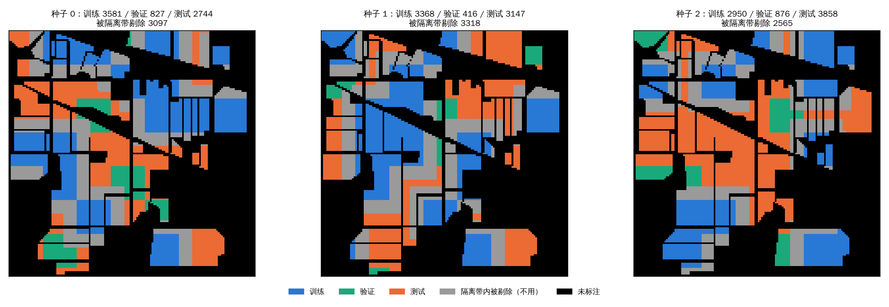
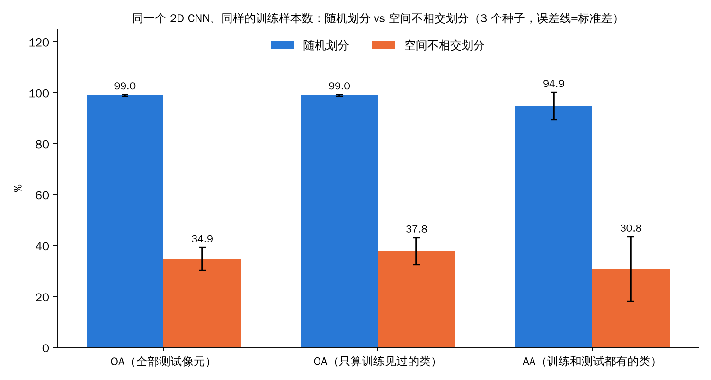
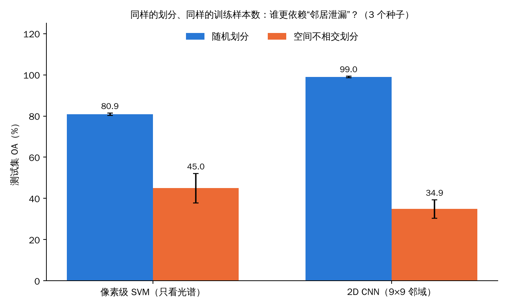

这是《高光谱图像分类》系列的第 8 篇。

前面几篇里，有一句话我重复了很多遍：**随机划分下，patch 模型的高准确率含水分**。课程里算过一笔账（9×9 的 patch，一个测试像素的窗口里平均混着约 8 个训练像素），但那只是**算术**，没有给出一个答案：**水分到底有多少？** 课程第 6 章正文把空间不相交划分留作“进阶练习”（后来的课堂版 notebook 里加了一个演示，下面会说到）。

这一篇，我把这个练习做了。结果比我预想的更极端，所以我会用比平时更大的篇幅，把**实验怎么设计、每张图怎么读、结果能说明什么、不能说明什么**讲清楚。

先给结论，免得你读到最后：

- 同一个 2D CNN、同样的训练样本数（约 3000 个）：**随机划分 OA 99.0%，空间不相交划分 OA 34.9%**；
- 一个只看光谱的像素级 SVM：**随机划分 80.9%，空间不相交划分 45.0%**；
- 在“空间不相交”这个更严格的考场里，**SVM 反而比 CNN 高了 10 个点**。

但请你先别急着得出“CNN 没用”的结论。这个实验有很多限制，我会在后面专门有一节讲。

## 一、先说一个概念：什么叫“空间不相交”

随机划分的做法是：把所有有标注的像素放进一个池子，随机抽 70% 当训练、10% 当验证、20% 当测试。因为一块田里有几百个相邻的、几乎一样的像素，**同一块田既出现在训练集里，也出现在测试集里**。

对像素级模型（比如 SVM）来说，这种“同一块田的像素分到两边”已经让成绩偏乐观；对 patch 模型来说，情况更糟：**测试像素的 9×9 窗口和训练像素的 9×9 窗口，会共享很多原始像素**。模型可能不是学会了“这是大豆”，而是记住了“这块田的这一片长这样”。

**空间不相交划分**的做法是：先把图像切成方块，**整块方块**分给训练或测试，这样同一块田的大部分区域只会出现在一边。还要再加一条：**隔离带**。

为什么要隔离带？因为只按方块切，方块边界上的两个像素还是相邻的，它们的 9×9 窗口仍然重叠。所以我再加了一个规则：**任何验证或测试像素，只要它和某个训练像素的距离（切比雪夫距离）不超过 8，就整个丢掉不用**。距离不超过 8 正好是“两个 9×9 窗口有公共像素”的充要条件。这样可以保证：**任何一个测试 patch，都和任何一个训练 patch 没有共同的输入像素**。

## 二、实验是怎么设计的

我尽量保持“只改划分这一件事”：

| 项目 | 设置 |
|---|---|
| 数据 | Indian Pines，有标注像素 10,249 个 |
| 模型 | 课程的 2D CNN（`SpectralSpatialCNN2D`，105,584 个参数） |
| 预处理 | 和课程一样：PCA-12（白化，整图拟合）+ 标准化（只用训练像素拟合），9×9 patch |
| 训练 | 课程默认：Adam，学习率 1e-3，权重衰减 1e-4，批大小 256，**40 个 epoch**；取验证集最高的那个 epoch |
| 空间不相交划分 | 切成 20×20 的方块；随机取约 30% 的方块训练、约 10% 验证、其余测试；**再用隔离带剔除** |
| 随机划分（对照） | **训练、验证、测试的样本数，和对应的空间不相交那一次完全相同**，只是在全部有标注像素里随机抽 |
| 种子 | 3 个（0、1、2），每个种子的两种划分各训练一次 |
| 对照模型 | 像素级 SVM（RBF，C=100，gamma=scale，原始 200 个波段，和课程一致），同样的划分、同样的样本数 |

指标我报三个，因为空间划分会让一些类别在训练里或测试里整个消失（后面会看到）：

- **OA（全部测试像素）**：所有测试像素里分类正确的比例；
- **OA（只算训练见过的类）**：只统计那些类别在训练集里出现过的测试像素（训练里根本没有的类，模型不可能学会）；
- **AA（训练和测试都有的类）**：只对“训练和测试里都出现的类”取召回率的平均。

## 三、图 1：划分长什么样

**怎么读这张图：** 三张图是同一张 Indian Pines 标签图（145×145），每个像素按它的用途着色：**蓝色**是训练，**绿色**是验证，**橙色**是测试，**灰色**是“落在隔离带里、被剔除不用”的验证/测试像素，**黑色**是没有标注的背景。三张图对应三个随机种子。每张图的标题里给出了训练、验证、测试的像素数，以及被隔离带剔除的像素数。

**能看到什么：**

- 同一种颜色基本成块出现：蓝色的训练区在种子 0 里集中在右上和左下；橙色的测试区在种子 0 里集中在图的中部偏左；
- **蓝色和橙色之间几乎总隔着一圈灰色**，这就是隔离带；
- 灰色占了相当大的比例：三个种子分别剔除了 **3097、3318、2565** 个像素，和最终测试集的大小（2744、3147、3858）是同一个量级。**也就是说，为了保证测试 patch 和训练 patch 互不重叠，我们丢掉了大量本来可以用于测试的数据。**
- 最终的训练像素数分别是 3581、3368、2950，约占全部标注像素的 29%–35%。

**这说明什么：** 严格的空间不相交，是**有代价**的：你要么减小训练集，要么减小测试集，要么接受测试集的类别组成变得很不一样。Indian Pines 只有 145×145，很多类别只由一两块田组成，一旦把那一两块田分到某一边，另一边就看不到这个类了。

**不能读出什么：** 方块划分本身是我设计的，方块边长（20）、训练比例（约 30%）都是我定的，不是什么“标准”。换一种设计，数字会变。

### 类别缺失的情况

| 种子 | 训练集里完全没有的类 | 测试集里完全没有的类 |
|---|---|---|
| 0 | Alfalfa、Corn、Grass-pasture-mowed | Hay-windrowed、Oats、Buildings-Grass-Trees-Drives、Stone-Steel-Towers |
| 1 | Grass-pasture-mowed | Alfalfa、Hay-windrowed、Oats、Stone-Steel-Towers |
| 2 | Hay-windrowed、Oats | Alfalfa、Grass-pasture-mowed、Wheat、Stone-Steel-Towers |

**怎么读这张表：** 每一行是一个种子。左列是“训练集里没有、但测试集里却有的类”（模型不可能学会），右列是“测试集里没有的类”（这个类不参与评估）。**随机划分没有这个问题：16 个类在训练和测试里都出现。**

**这说明什么：** 在种子 0 里，Alfalfa（36 个测试像素）、Corn（237 个）、Grass-pasture-mowed（28 个）这三个类的测试像素，模型在训练时一个都没见过，**必然全错**。所以我才要同时报告“只算训练见过的类”的 OA。

## 四、图 2：同一个 2D CNN，两种划分的差距

**怎么读这张图：** 横轴是三个指标（左起：全部测试像素的 OA；只算训练见过的类的 OA；训练和测试都有的类的 AA）。每个指标有两根柱子：蓝色是随机划分，橙色是空间不相交划分。柱顶的数字是 3 个种子的平均值，黑色的细线是标准差（这里只是描述 3 次运行之间的波动）。

**能看到什么：**

| 指标 | 随机划分 | 空间不相交划分 |
|---|---|---|
| OA（全部测试像素） | 99.0 ± 0.3 | **34.9 ± 4.4** |
| OA（只算训练见过的类） | 99.0 ± 0.3 | **37.8 ± 5.4** |
| AA（训练和测试都有的类） | 94.9 ± 5.3 | **30.8 ± 12.7** |

具体到每个种子：随机划分的 OA 分别是 99.4%、98.7%、98.8%；空间不相交划分的 OA 分别是 **40.2%、35.1%、29.3%**。

**这说明什么：**

1. **差距是巨大的**，而且和“训练见过的类”这个口径关系不大：就算只统计训练里出现过的类，OA 也只有 37.8%。所以“类别缺失”不是主要原因；
2. 随机划分下的 99.0%，和课程里协议 B（30% 训练）的 99.2% 是同一个量级：**那个“饱和”的数字，在这里被我用一个更严格的考场打回了原形**；
3. 空间不相交下的波动很大（OA 的标准差 4.4，AA 的标准差 12.7）：换一个方块的分法，成绩就差十几个点。

**一个旁证：验证集本身也不可靠。** 在空间不相交划分下，验证集是和训练集隔离开的，我用它选“最好的 epoch”。结果在种子 1、2 里，**最好的 epoch 居然是第 1 个**（也就是训练 1 个 epoch 的模型在验证集上最好），验证准确率只有 0.47 和 0.30。这说明在这种划分下，**验证集和训练集的分布差得很远，“验证集上的最优”几乎不指示“测试集上的最优”**。随机划分下则很正常：最好的 epoch 在第 38、15、38，验证准确率 0.997–0.998。

**不能读出什么：** 34.9% 不是“这个模型在真实应用中的准确率”。它是一个**故意设置得很严格**的考场：训练里的田和测试里的田完全不同，而且很多类只有一两块田。真实部署的表现，应该在 99% 和 35% 之间，具体在哪里取决于你部署的地点和训练数据的覆盖。

## 五、图 3：如果换成只看光谱的 SVM 呢？

只看一个模型，容易下错结论。所以我用**完全相同的划分、相同的训练样本数**，跑了一个只看光谱的 SVM（课程里的设置，原始 200 个波段，没有标准化）。

**怎么读这张图：** 左边一组是 SVM，右边一组是 2D CNN；每组里蓝色是随机划分，橙色是空间不相交划分，纵轴是测试集 OA（%），柱顶的数字是 3 个种子的平均值。

**能看到什么：**

| 模型 | 随机划分 | 空间不相交 | 掉了多少 |
|---|---|---|---|
| 像素级 SVM | 80.9 ± 0.6 | 45.0 ± 7.1 | 约 36 个点 |
| 2D CNN | 99.0 ± 0.3 | 34.9 ± 4.4 | 约 64 个点 |

每个种子上，SVM 的空间不相交 OA 分别是 45.6%、53.4%、36.0%，而 CNN 是 40.2%、35.1%、29.3%——**三个种子里 SVM 都更高**。

**这说明什么：**

1. **两个模型都大幅下降。** 这一点很重要：SVM 没有 patch，不存在“窗口重叠”，它的下降说明空间不相交下降的**一部分**来自“同一块田的像素分到两边”这件事本身，也来自“测试地块是新地块”这件事；
2. **CNN 掉得更多**，在随机划分下领先 SVM 约 18 个点（99.0 对 80.9），在空间不相交下反而落后约 10 个点（34.9 对 45.0）。一个自然的解释是：CNN 额外享受了窗口重叠带来的“邻居记忆”红利，这部分红利一旦被隔离带拿走，优势就消失了，甚至反转；
3. **但我只能说这是一个“自然的解释”，不是被证明的结论。** 要证明 CNN 靠“邻居记忆”，需要更多对照：比如只改窗口大小（patch 1、5、9、25）看红利怎么变，或者不用隔离带只用方块划分，看成绩落在哪里。我没有做这些。

## 六、这个结果能说明什么，不能说明什么

**能说明：**

- 随机划分下 patch 模型的 95%–99% **不能**当作“模型学会了识别地物”的证据；
- 评价高光谱模型的泛化，**划分方式本身就是最大的变量**，比换哪个网络结构的影响大得多（在这个实验里，换划分掉了 36–64 个点，而课程里 1D 到 HybridSN 的整个演化线也就是 20 来个点）；
- 在空间不相交划分下，“更复杂的模型更好”不一定成立。

**不能说明：**

1. **“2D CNN 不如 SVM。”** 我只试了一种 CNN 配置，没调参，训练预算是课程默认的 40 个 epoch，模型选择用的又是一个很不靠谱的验证集。一个调好的、用了数据增强和正则的模型，可能表现完全不同；
2. **“空间不相交的 35% 才是真实水平。”** 这是一个故意严苛的设置，而且 Indian Pines 的特点（很多类只有一两块田）把这个设置推到了极端。在有更多独立地块、更均匀覆盖的数据集上，数字会高得多；
3. **“所有 patch 模型都有这个问题。”** 我只测了一个 2D CNN，没有测 HybridSN、SSRN、Transformer；
4. **“泄漏就是 99% 和 35% 之间的全部差距。”** 空间不相交划分同时改变了好几件事：同一块田不再出现在两边、测试田是新田、训练覆盖的类变少、训练分布和测试分布不同。我没有把这几件事一件一件拆开；
5. 样本量：3 个种子，标准差很大，不能做显著性判断。

**如果你要在论文里用这个思路**，建议至少做三件事：（1）同时报告随机划分和空间不相交两种成绩；（2）说明块大小、隔离带宽度、每个种子的类别覆盖；（3）多种子，并把“类别缺失”的情况写清楚。

## 七、这一篇你该带走的

1. **随机划分 + patch 模型 = 邻居记忆。** 同一个 2D CNN，同样的训练样本数，随机划分 99.0%，空间不相交 34.9%；
2. **像素级模型也受影响，只是程度不同**：SVM 从 80.9% 掉到 45.0%；
3. **隔离带是关键**：距离不超过 patch 边长减 1，两个窗口就会有公共像素，必须剔除；
4. **严格也有代价**：我们丢掉了和测试集一样多的数据；很多类整个消失；验证集也变得不可靠；
5. **结论要克制**：这是一个故意严苛的考场、一种配置、3 个种子，它告诉你“高分不可信”，但没有告诉你“真实水平是多少”。

## 自测三问

1. 为什么只按方块划分还不够，还要加“隔离带”？隔离带的宽度为什么取 8（patch 是 9×9）？
2. 在空间不相交划分下，为什么要同时报告“OA（只算训练见过的类）”？
3. 这个实验里 SVM 在空间不相交下比 CNN 高，你能想到哪几个办法，来验证“是邻居记忆造成的”这个解释？

（答案提示：方块边界相邻的像素窗口仍重叠；距离 ≤ 8 等价于两个 9×9 窗口有公共像素；训练里没有的类不可能学会，会把 OA 拉低；改窗口大小看红利变化、不用隔离带对照、让 CNN 只看中心像素。）

## 下一篇预告

接下来我们回到模型家族：**注意力和 Transformer**。课程里有一个“诚实到刺眼的负结果”：一个 8.5 万参数的谱 Transformer，训练了 120 个 epoch，OA 只有 69%，比 SVM 低 11 个点。为什么？注意力图能告诉我们什么，又不能告诉我们什么？

---

> 配套课程：[masskx/HSI-Learning](https://github.com/masskx/HSI-Learning) 第 6 章 6.4 节（泄漏账本）和第 8 章（协议饱和）。课程的修订记录里提到，课堂版 notebook 的空间划分演示也“在边界两侧保留 patch 半径缓冲”，思路和我这里的隔离带相同；**我没有读它的实现，也没有拿它的结果来对比**。本文的实验和图是我独立设计和运行的：脚本在本系列的 `_工具/exp_disjoint_cnn.py`、`exp_disjoint_svm.py`、`exp_disjoint_viz.py`，原始数据在本文 `imgs/` 目录的三个 json 文件里。
