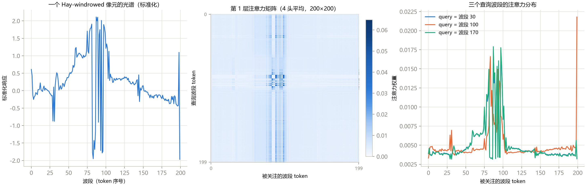
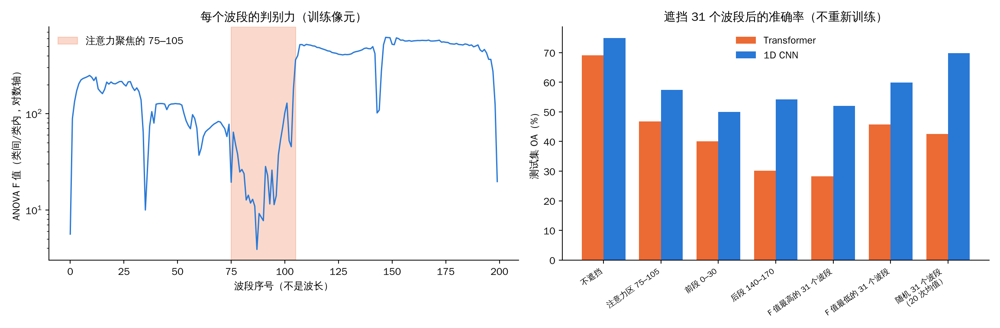
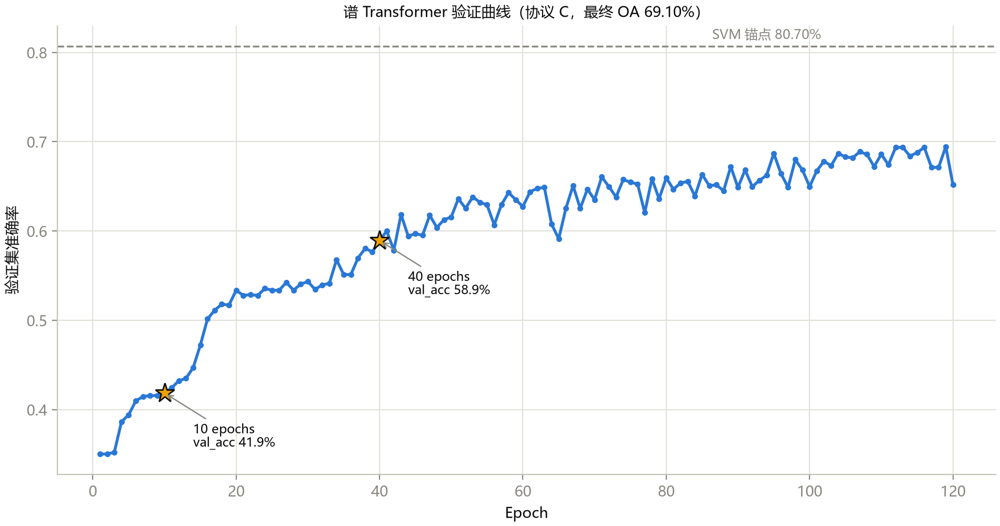
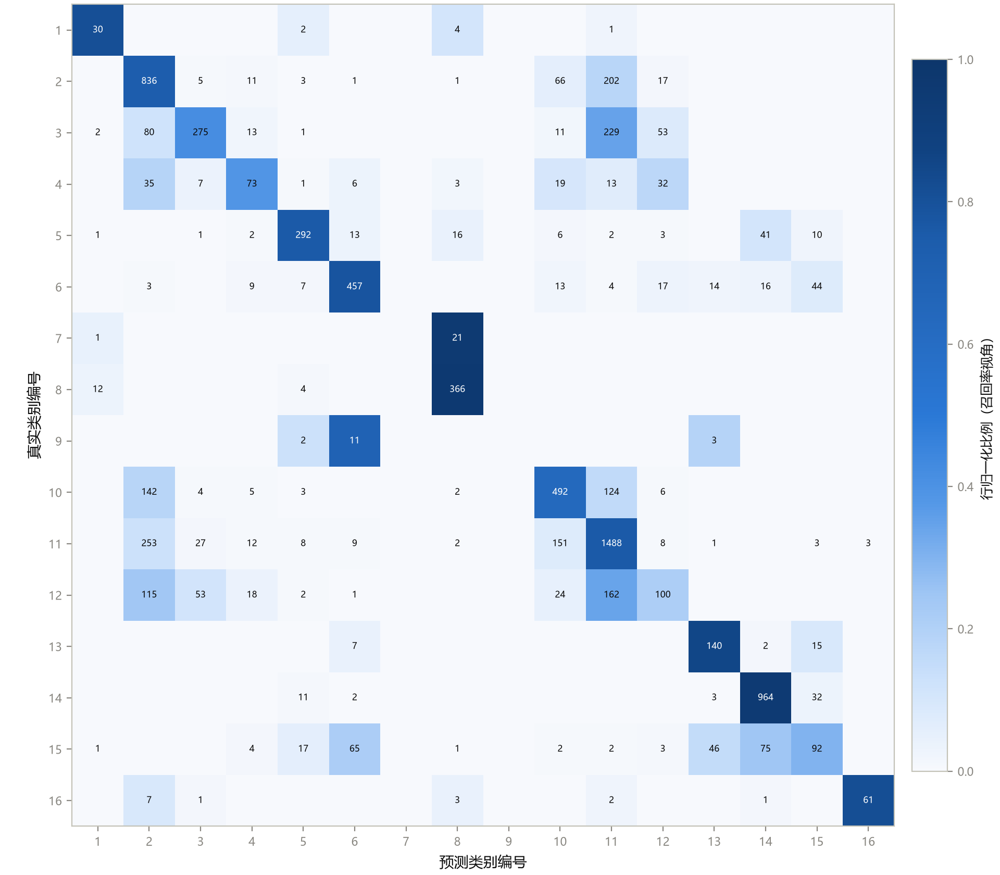
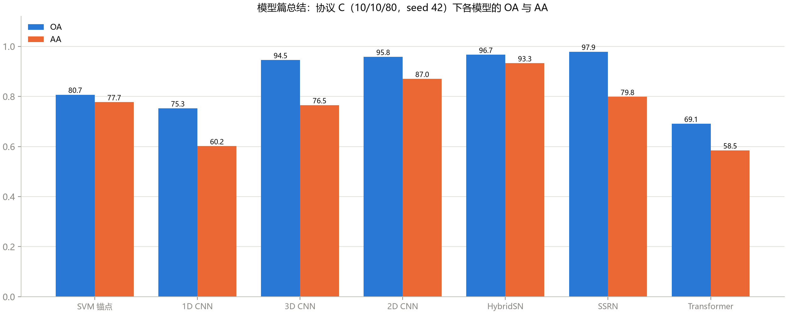

这是《高光谱图像分类》系列的第 9 篇，也是模型篇的最后一篇。

前面的 CNN（以及 HybridSN、SSRN）都有一个共同点：**把“局部性”这类先验写进了结构里**，卷积核天生只看一小块邻域，权重在位置间共享。这一篇换一套哲学：**不预先规定“该看哪里”，让网络自己学**。这就是注意力（attention）和 Transformer。

故事的结局先说：在 Indian Pines 的 10% 小样本协议下，一个 8.5 万参数的谱 Transformer，训练了 120 个 epoch，OA 只有 69%，**比 SVM 低 11 个点，比同样输入的 1D CNN 也低**。课程里把它称为“一个诚实到刺眼的负结果”。这一篇我想回答三个问题：

1. 它到底是什么？注意力图能告诉我们什么、不能告诉我们什么？
2. 它输在哪里？
3. 它输是因为“数据太少”，还是别的原因？（这一点课程只给了解释，没有做实验。**我做了。**）

## 一、从“看邻居”到“看全部”：自注意力的四步

卷积的回答是：固定权重、局部窗口、全局共享。自注意力的回答是：**每个位置动态决定看谁、看多少**。机制四步：

1. 每个位置的向量经过三个线性变换，得到**查询**（query）、**键**（key）、**值**（value）；
2. 位置 i 对位置 j 的“相关性” = 查询_i 与键_j 的点积，除以一个缩放因子；
3. 对每个 i，把它对所有 j 的相关性做 softmax，得到一组加起来等于 1 的**注意力权重**；
4. 位置 i 的输出 = 所有位置的“值”按这组权重加权求和。

和卷积的本质区别：

| | 卷积 | 自注意力 |
|---|---|---|
| 一层能看多远 | 固定的小窗口，靠叠层慢慢扩大 | **整个序列** |
| 权重 | 训练完就固定，和输入无关 | **每个输入现算** |
| 位置信息 | 结构自带 | 必须额外加（位置编码） |
| 计算量随序列长度 | 线性 | **平方** |

### 高光谱里怎么用：波段即 token

课程的教学模型是这样搭的：一个像素的 200 个波段值（已标准化），**每个波段值是一个 token**。每个标量通过一个线性层变成 64 维的向量，加上一个可学习的位置编码（告诉模型这是第几个波段），然后送进 2 层、4 头的标准 Transformer 编码器，对 200 个 token 取平均，再接分类头。

| 项 | 数值 |
|---|---|
| 总参数 | 85,200 |
| 每样本计算量 | 16.81M 次乘加（约是 3D CNN 的 4 倍） |

计算量多出来的部分，主要来自“200 × 200 的注意力矩阵”：每层每个样本光是算“查询×键”和“权重×值”就要 2 × 200² × 64 ≈ 5.1M 次，两层合计约 10.2M，所以注意力那一块的代价和 token 数的平方成正比。（如果像把 25×25 的 patch 每个像元当一个 token，token 数是 625，这一块会涨到约 100M。）

## 二、读图：模型学到了什么（和没学到什么）

### 图 1：注意力矩阵

**怎么读这张图：** 三个子图。

- **左：** 一个 Hay-windrowed 像素的**标准化光谱**，横轴是波段序号（token 序号），纵轴是标准化后的数值；
- **中：** 第 1 层的注意力矩阵（4 个头取平均）。**纵轴是“查询”波段，横轴是“被关注”的波段**，颜色越深，注意力越大。每一行加起来等于 1；
- **右：** 取三个查询波段（30、100、170），把它们各自对所有波段的注意力画成三条曲线。

**能看到什么：**

1. **左图：** 在 83 到 100 号波段附近，这个像素的标准化光谱剧烈上下震荡，在 −2 和 +2 之间反复来回，最后一个波段（199）还有一个孤立的向下尖刺；
2. **中图：** 整张矩阵大部分是很浅的蓝色，但有一块**竖条纹**，大约在 85 到 100 号列，这些列在**几乎所有行**里都比较深；右边缘（199 号列）也有一道细线；
3. **右图：** 三个不同的查询（30、100、170）的注意力曲线**几乎重合**，都在 75 到 105 号波段形成峰；其中 100 号查询（橙色）在 199 号波段还有一个很高的尖峰（约 0.022，而其余位置大多在 0.004 左右）。

**课程的解读：** “三个查询都强烈聚焦 75–105 号波段（近红外/红边区），模型自主发现了全图判别力最强的光谱区间；199 号 token 的强关注对应光谱末端的伪影，模型在‘警惕噪声源’。”

**我的读法，和课程不完全一样：**

1. **三个不同的查询给出几乎一样的注意力分布，竖条纹贯穿所有行**，这说明这一层的注意力**不太随查询而变**：它更像是在给每个波段打一个“全局重要性分数”，而不是“根据当前波段去找相关的波段”；
2. 模型“关注”的 75–105 号波段，正好是左图里**标准化后震荡最剧烈**的那一段。注意力高，既可能是因为这段波段**判别力强**，也可能只是因为它们的**数值波动大、噪声大**，所以对输出的影响大；
3. “近红外/红边”这个物理解释，需要波长表来核实。数据集的说明里已经声明：corrected 版本删掉了吸水严重的波段，**波段序号不是线性波长**。课程自己的修订记录也已经说明：“注意力图不是已证实的物理归因”。

**不能读出什么：** 注意力权重高，**不等于**“分类决策靠它”。已知的局限包括：权重和梯度贡献不等价、多头平均会掩盖单个头的行为。**标准做法是把注意力图当成“假设”，再用遮挡实验去验证。**下面我就做了这个检验。

### 图 2：遮挡实验——注意力聚焦的波段，真的重要吗？（我补做的检验）

**设计：** 用刚才训练好的 120 个 epoch 的 Transformer（以及第 6 篇里 60 个 epoch 的 1D CNN 作对照），**不重新训练**，只改测试输入：把一组波段在标准化空间里置 0（也就是换成训练集的平均值），看测试集 OA 掉多少。遮挡的组：

- **注意力区**：75 到 105 号波段（31 个）；
- **同样宽度的另外两段连续波段**：0 到 30、140 到 170（用来对照“连续遮挡”本身的伤害）；
- **随机 31 个波段**，重复 20 次取均值（对照“遮挡 31 个波段”的一般伤害）；
- **判别力最高 / 最低的 31 个波段**。这里的“判别力”我用每个波段的 ANOVA F 值来量（类间差异除以类内差异，只用训练像素算）。

**怎么读这张图：**

- **左图：** 横轴是波段序号，纵轴是每个波段的 F 值（**对数轴**，每格差 10 倍），值越高说明这个波段对区分类别越有用；橙色阴影是注意力聚焦的 75–105；
- **右图：** 每组两根柱子，橙色是 Transformer，蓝色是 1D CNN，纵轴是遮挡之后的测试集 OA。

**能看到什么：**

| 遮挡什么 | Transformer OA | 1D CNN OA |
|---|---|---|
| 不遮挡 | 69.1 | 75.0 |
| 注意力区 75–105 | 46.7 | 57.5 |
| 前段 0–30 | 40.0 | 50.0 |
| 后段 140–170 | 30.2 | 54.2 |
| 判别力最高的 31 个 | 28.3 | 52.1 |
| 判别力最低的 31 个 | 45.8 | 59.9 |
| 随机 31 个（20 次均值，最小到最大） | 42.5（37.5 到 47.6） | 69.8（64.2 到 72.5） |

1. **左图：75–105 恰好覆盖了整条曲线里判别力最低的一段**：F 值最低跌到 4 左右（波段 88 附近），而其余大部分波段都在 100 到 600 之间。这一段的平均 F 值是 47.7，全部波段的中位数是 215，**低了约 4.5 倍**；20 次随机抽 31 个波段，**没有一次**的平均 F 值比它低；
2. **右图：遮挡注意力区，Transformer 从 69.1 掉到 46.7（掉 22 个点），但这比“随机遮挡 31 个波段”（平均 42.5）掉得还少**；
3. 在**三段同样宽度的连续波段**里，遮挡 75–105 的伤害是**最小的**（Transformer：46.7，对比 0–30 的 40.0 和 140–170 的 30.2；1D CNN：57.5，对比 50.0 和 54.2）。

**这说明什么：** **“注意力聚焦的波段”不是“模型依赖的波段”。**事实上，被聚焦的这一段，恰恰是判别力最低、对输出影响（用遮挡来量）也最小的那一段。结合图 1 左图（这一段标准化之后震荡得最厉害），一个更合理的猜测是：注意力的高权重**更像是被数值波动大的“噪声 token”吸引**，而不是在“发现判别力最强的光谱区间”。

**不能读出什么（这个检验同样有局限，请当成一个反例，不要当成定论）：**

1. 遮挡是把输入换成训练均值，这对模型来说是一个**从没见过的输入**；Transformer 对遮挡非常脆弱（随机遮 31 个波段就掉了 27 个点），所以它不是一个“干净”的因果检验；
2. 只有**一个训练好的模型、一个种子**；
3. F 值只衡量**单个波段**各自的判别力，不代表波段组合起来的信息；
4. 连续遮挡和随机分散遮挡的影响不一样（1D CNN 对连续遮挡更敏感），所以“75–105 比随机遮挡伤害小”这一点比较的是不同类型的遮挡，要看的主要是上面的第 3 条（三段同宽的连续遮挡之间的比较）；
5. 我**没有**验证“注意力被噪声吸引”这个猜测，只是提出它。

**一个更一般的教训：** 课程里自己的修订记录也承认“注意力图不是已证实的物理归因”。我的检验提供了一个具体的例子：**一张看起来“很有道理”的注意力图（模型自主发现了红边！），用一个最简单的干预实验检验，就站不住了。**

### 图 3：训练曲线，一条“还在爬但追不上”的线

**怎么读这张图：** 横轴是 epoch（共 120 个），纵轴是验证集准确率，蓝线是每个 epoch 的验证准确率，**两颗星**分别标出训练 10 个 epoch 和 40 个 epoch 的位置，**灰色虚线**是 SVM 的 80.7%（协议 C 的锚点）。

**能看到什么：**

- 前 3 个 epoch，验证准确率几乎是平的，约 0.35；
- 10 个 epoch 时 41.9%，40 个 epoch 时 58.9%，之后继续缓慢上升，后半段在 0.65 到 0.69 之间**上下抖动**（抖动的幅度约 0.03）；
- 到最后一个 epoch，曲线还没有完全拉平，但和灰色虚线之间还有约 11 个点的距离。

**这说明什么：** 和第 5、6 篇里的“训练不足”不同，这次即使训练到第 119 个 epoch（最佳 epoch），**仍然比 SVM 低 11.6 个点，也低于同输入的 1D CNN（75.3%）**。

课程给出的表：

| 训练预算 | OA | AA | 最佳 epoch |
|---|---|---|---|
| 10 个 epoch（notebook 默认） | 41.48 | 17.59 | 10/10 |
| 40 个 epoch | 57.95 | 42.37 | 40/40 |
| **120 个 epoch** | **69.10** | **58.48** | 119/120 |

**我重新训练了 120 个 epoch：OA 69.10、AA 58.48、Kappa 0.6438，最佳 epoch 119/120，和课程记录小数点后两位完全一致**，逐类召回也对得上：Alfalfa 0.811、Corn-mintill 0.414、Soybean-clean 0.211、Buildings-Grass-Trees-Drives 0.299，Grass-pasture-mowed 和 Oats 都是 0。这是本系列里第一个“逐位复现”的深度模型。（为什么这个模型能逐位一致、前面的 CNN 只能接近，我没有追查。）

**所以这个负结果是可靠的、可复现的**：不是某次训练的运气不好。

### 图 4：混淆矩阵，错误流向哪里

**怎么读这张图：** 行是真实类别，列是预测类别，格子里是数量，颜色是行归一化比例（同前几篇）。

**能看到什么：** 对角线明显比 CNN 的混淆矩阵浅，而且**对角线以外的格子又多又深**：

- 第 3 行（Corn-mintill，共 664 个测试样本）：只有 275 个对，**229 个被判成第 11 类（Soybean-mintill）**，80 个被判成第 2 类；
- 第 12 行（Soybean-clean，共 475 个）：只有 100 个对，**162 个被判成第 11 类**，115 个被判成第 2 类；
- 第 15 行（Buildings-Grass-Trees-Drives，共 308 个）：只有 92 个对，65 个被判成第 6 类，75 个被判成第 14 类；
- 第 7 行（Grass-pasture-mowed）：22 个里 21 个被判成第 8 类（Hay-windrowed）；
- 第 1 行（Alfalfa）：30 个对（召回 0.81），是几个稀有类里最好的，课程称之为“意外地高”。

**这说明什么：** 错误是**大面积的、流向大类的**：玉米和大豆这一族之间互相混淆，大量样本被吸到 Soybean-mintill（第 11 类）这个最大的类里。这是一个“还没学会细分”的模型的典型形态。

### 图 5：模型篇总结

**怎么读这张图：** 每个模型两根柱子，蓝色 OA、橙色 AA，横轴从左到右：SVM、1D CNN、3D CNN、2D CNN、HybridSN、SSRN、Transformer。

**能看到什么：**

| 模型 | OA | AA |
|---|---|---|
| SVM | 80.7 | 77.7 |
| 1D CNN | 75.3 | 60.2 |
| 3D CNN | 94.5 | 76.5 |
| 2D CNN | 95.8 | 87.0 |
| HybridSN | 96.7 | **93.3** |
| SSRN | **97.9** | 79.8 |
| Transformer | 69.1 | 58.5 |

**这说明什么：** 三点：（1）**空间上下文是最大的增益**：1D 到 2D/3D 涨了约 20 个点；（2）结构精化（HybridSN、SSRN）在 95% 以上的区间里挤出最后几个点；（3）换更“先进”的范式（Transformer）在小样本下**反而倒退**到最后一名。

**不能读出什么（这张图最容易误读的地方）：** 这些数字来自**不同的设置**：SSRN 不做 PCA、窗口只有 7×7，HybridSN 窗口是 25×25，SVM 和 1D CNN、Transformer 不看空间。第 7、8 篇已经说过，随机划分下大窗口的结果含“邻居泄漏”。所以这张图适合当成“这门课走过了哪些模型”的总览，**不适合当成“谁比谁强”的排行榜**。

DATA_CURVE_PLACEHOLDER

## 四、这一篇你该带走的

1. **自注意力 = 动态、全局、学出来的权重**，代价是平方的计算量和额外的位置编码；
2. **波段即 token** 是最自然的高光谱 Transformer 用法，不需要 patch 工程；
3. **注意力图是假设，不是证明**：同一层里不同查询给出几乎相同的分布，说明它更像“全局重要性”；是否真的重要，要用遮挡这类干预实验来检验；
4. **结构选择是“先验对数据”的预算分配**：把先验写进结构（卷积），小样本下省数据；撤掉先验（Transformer），要用数据把它买回来；
5. **负结果要留下**：“Transformer 在 10% 训练率下输给 SVM”这件事，对你理解 Transformer 的适用范围，比一个 97% 的数字更有价值。

## 自测三问

1. 一个 200 个 token、64 维、2 层的 Transformer，注意力部分每个样本大约要多少次乘加？token 数涨到 625 呢？
2. 注意力图上三个不同的查询给出几乎一样的分布，这说明什么？
3. 你想验证“模型靠 75–105 号波段做分类”，除了画注意力图，还能做什么实验？

（答案提示：2 × 2 × 200² × 64 ≈ 10.2M，涨到 625 约 9.8 倍；注意力更像全局重要性而不是随查询变化；遮挡或扰动这些波段，看准确率掉多少，并和随机遮挡同样数量的波段对照。）

## 下一篇预告

模型篇到此结束。下一篇是“实战补遗”：前面几篇里稀有类（Oats 只有 20 个像素）一直是个反复出现的难题，课程在这里**开药**了：加权交叉熵和 Focal Loss。我用 3 个种子把它们重新比了一遍，同时还会讲换数据集（Salinas、Pavia University）和论文里标配的“分析三件套”。

---

> 配套课程：[masskx/HSI-Learning](https://github.com/masskx/HSI-Learning) 第 10 章。图 1、3、4、5 取自仓库；遮挡实验、学习曲线和 Transformer 的重新训练是我在本机补做的，脚本在本系列的 `_工具/exp_transformer_checks.py`、`exp_transformer_data.py`。
