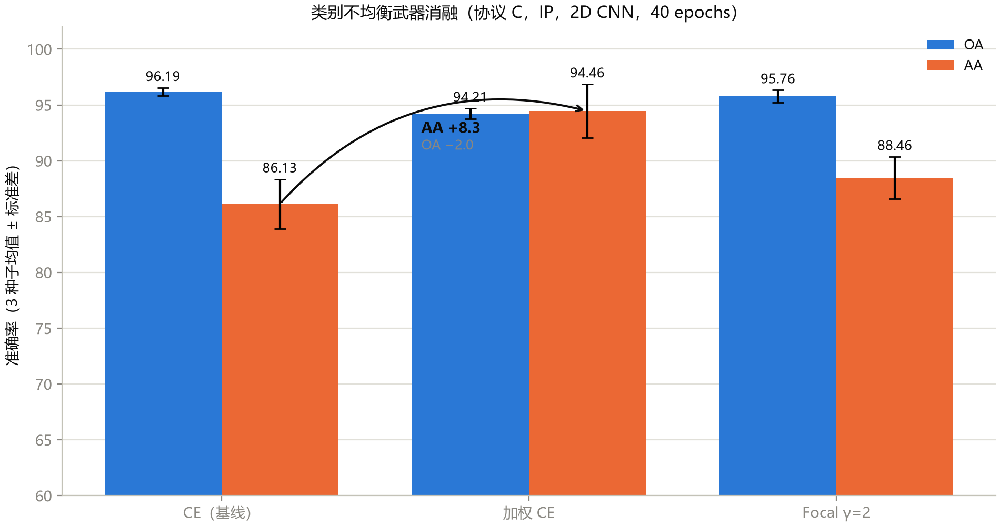
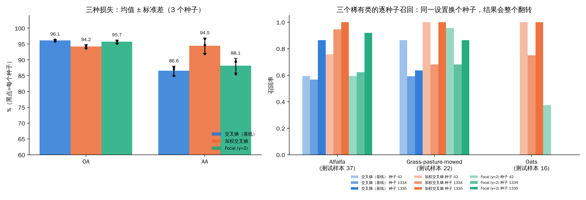
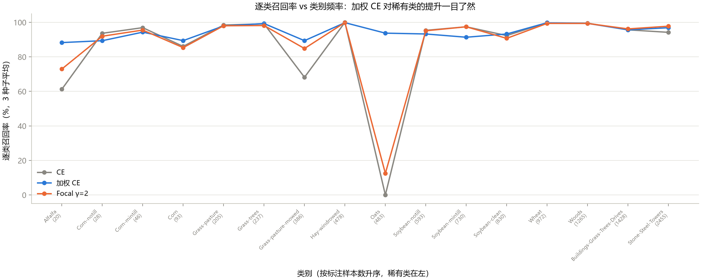
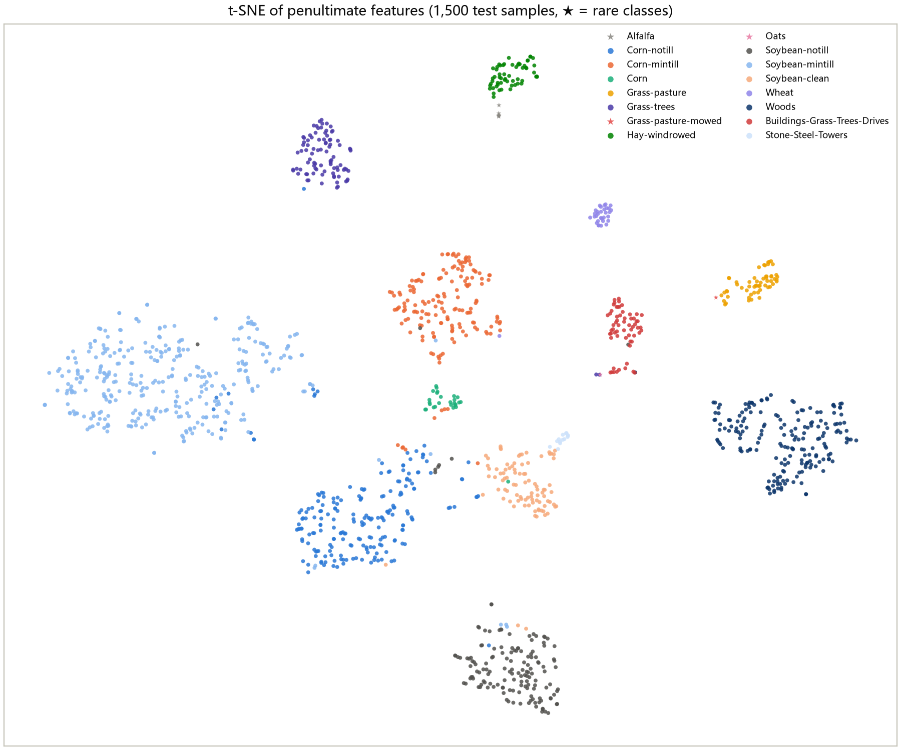
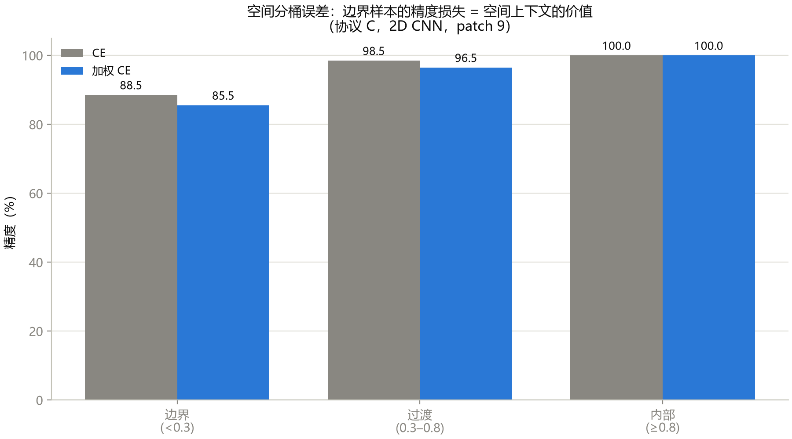

这是《高光谱图像分类》系列的第 10 篇。

前面几篇里，**稀有类**一直是个反复出现的角色：Oats 只有 20 个像素，Alfalfa 46 个，Grass-pasture-mowed 28 个。10% 的训练率下，它们在训练集里只有两三个到五个样本，模型几乎学不会。AA（平均每类准确率）总是被它们拖垮。

课程里前面的章节只**诊断**，不开药。这一章开药了。这一篇我会把“药效”重新验证一遍：同一个 2D CNN，三种损失函数，三个种子，九次训练。然后讲讲换数据集和论文里的“分析三件套”。

## 一、类别不均衡的“药方”

先说问题。标准的交叉熵损失对每个训练样本一视同仁。Soybean-mintill 有两千多个像素，Oats 只有二十个，那么训练时 Soybean-mintill 提供的“梯度”就比 Oats 多出一百倍。模型学会了“多数类优先”，稀有类就被忽略。

课程列了四种药：

| 药 | 做法 | 好处 | 代价 |
|---|---|---|---|
| **加权交叉熵** | 每一类的损失乘以一个权重，样本越少权重越大（权重 = 总样本数 ÷ (类数 × 该类样本数)） | 一行代码 | 大类被压，OA 会降 |
| **Focal Loss** | 把“已经分得很对”的样本的损失调小，让模型更关注难样本；γ=2 | 不需要知道各类的数量 | 多一个超参 γ |
| 过采样 | 稀有类样本在每个批次里重复出现 | 不改损失 | 过拟合风险 |
| 两阶段训练 | 先均衡预训练，再全量微调 | 精度稳 | 训练成本翻倍 |

课程实现并比较了前两种。

### 实验设计（我重新做了一遍）

- 模型：第 6 篇里的 2D CNN，PCA-12，9×9 窗口，40 个 epoch；
- 协议 C：10% 训练、10% 验证、80% 测试，Indian Pines；
- 种子：42、1334、1335（课程用的是同样三个）；
- 三种损失：交叉熵、加权交叉熵、Focal（γ=2）。

### 图 1：三种损失的 OA 和 AA（课程原图）

**怎么读这张图：** 每种损失两根柱子，蓝色是 OA（所有测试像素里分对的比例），橙色是 AA（每类准确率的平均）；柱顶数字是 3 个种子的均值，黑色细线是种子之间的标准差。中间那条弧线表示“从交叉熵换成加权交叉熵之后”的变化：AA +8.3、OA −2.0。

**能看到什么：**

| 损失 | OA | AA |
|---|---|---|
| 交叉熵 | 96.19 ± 0.35 | 86.13 ± 2.22 |
| 加权交叉熵 | 94.21 ± 0.48 | 94.46 ± 2.40 |
| Focal γ=2 | 95.76 ± 0.57 | 88.46 ± 1.89 |

**这说明什么：** 这是一个经典的**“公平换精度”**的权衡：加权交叉熵用大约 2 个点的 OA，换来了 8 个多点的 AA；Focal 居中，只换来 2 个点的 AA，OA 几乎没掉。**两个指标回答的是不同的问题**：OA 问“整体对了多少”，AA 问“每个类别是否都照顾到了”。该选哪个，取决于你的应用是更怕整体出错，还是更怕漏掉某个稀有类。

### 我重新训练的结果

我把这九次训练都重新跑了一遍：

| 损失 | 我重跑的 OA | 我重跑的 AA | 课程记录的 OA | 课程记录的 AA |
|---|---|---|---|---|
| 交叉熵 | 96.14 ± 0.30 | 86.56 ± 1.42 | 96.19 ± 0.35 | 86.13 ± 2.22 |
| 加权交叉熵 | 94.24 ± 0.49 | 94.45 ± 2.40 | 94.21 ± 0.48 | 94.46 ± 2.40 |
| Focal γ=2 | 95.73 ± 0.48 | 88.15 ± 2.28 | 95.76 ± 0.57 | 88.46 ± 1.89 |

（± 后面是 3 个种子的样本标准差。）

**怎么理解：** 九行数字和课程记录的差别都在零点几个点以内，加权交叉熵一行几乎完全一致。**方向、幅度和结论都被复现了。**

### 图 2：我自己画的版本，加上每个种子的点

课程的图只给了均值和误差线。我加了每个种子的单独数字，并把三个稀有类单独拿出来看。

**怎么读这张图：**

- **左图**：同样的 OA、AA，柱子是均值，黑色小圆点是每个种子的单次结果，误差线是标准差。（纵轴从 60 开始，不是从 0，这样差别才看得清；代价是视觉上会放大差距，看数字不要看柱子的相对高度。）
- **右图**：三个稀有类（Alfalfa 37 个测试样本、Grass-pasture-mowed 22 个、Oats 16 个）在 9 次训练里的召回率，每个类下面有 9 根柱子：蓝色是交叉熵，橙色是加权交叉熵，绿色是 Focal，每种颜色里的三根是三个种子（颜色由浅到深依次是种子 42、1334、1335）。

**能看到什么：**

1. 交叉熵（蓝）：**Oats 在三个种子里全是 0**；Alfalfa 是 0.59、0.57、0.86，Grass-pasture-mowed 是 0.86、0.59、0.64——**同样的设置，换个种子，召回率可以差 0.3**；
2. 加权交叉熵（橙）：Oats 是 1.0、0.75、1.0，Alfalfa 是 0.76、0.95、1.0，Grass-pasture-mowed 是 1.0、0.68、1.0——全面提高，但仍有明显的种子间差异（Grass-pasture-mowed 最低 0.68）；
3. Focal（绿）：Oats 只在种子 42 里被找出来一点（0.38），另外两个种子还是 0；Grass-pasture-mowed 有所改善，Alfalfa 和交叉熵基本持平，整体不如加权交叉熵稳定。

**这说明什么：** 加权交叉熵对稀有类的作用是真实的，而且**在三个种子里方向一致**。但稀有类的单个数字很不稳定：交叉熵下 Alfalfa 的召回在三个种子里从 0.57 到 0.86。这意味着：**如果你只跑一个种子，就可能得出“我的新方法让 Alfalfa 的召回提高了 0.3”这种完全由运气决定的结论。**

### 代价由谁付

用我重跑的 9 次训练，算每一类在“加权交叉熵”相对“交叉熵”的召回变化（3 个种子均值）：

| 类 | 交叉熵 | 加权交叉熵 | 变化 |
|---|---|---|---|
| Oats | 0.0 | 91.7 | +91.7 |
| Alfalfa | 67.6 | 90.1 | +22.5 |
| Grass-pasture-mowed | 69.7 | 89.4 | +19.7 |
| Corn | 86.1 | 89.6 | +3.5 |
| Corn-notill | 94.0 | 89.5 | −4.6 |
| Soybean-mintill | 97.3 | 91.5 | −5.8 |

**怎么读：** 收益集中在三个稀有类上；代价由几个**大类**付：Soybean-mintill（1965 个测试样本）掉了 5.8，Corn-notill（1142 个）掉了 4.6。因为这两个类样本最多，它们的一点点下降就足以把 OA 拉低 2 个点。**这就是“公平”的价格：把原来分给大类的“注意力”，挪给了小类。**

### 图 3：逐类召回图，以及我发现的一处标注错位

**怎么读这张图：** 横轴是 16 个类别，纵轴是召回率（3 个种子的均值）。灰线是交叉熵，蓝线是加权交叉熵，橙线是 Focal。图标题说“按标注样本数升序，稀有类在左”，每个类名下面的括号里是该类的样本数。

**能看到什么：** 灰线在 Oats 那个点掉到 0，在 Alfalfa 和 Grass-pasture-mowed 上只有 60%–70%；蓝线几乎是一条平的高线，三个稀有类都被拉到 85% 以上；橙线在中间。

**这张图的问题：** 横轴的类名其实是**按类别编号排列**的（Alfalfa、Corn-notill、Corn-mintill……一直到 Stone-Steel-Towers），而括号里的样本数是**从小到大排好序的数列**（20、28、46、93、……2455）。两者对不上：按这张图，Alfalfa 有 20 个样本、Oats 有 483 个、Stone-Steel-Towers 有 2455 个，但真实情况是 Alfalfa 46 个、Oats 20 个、Stone-Steel-Towers 93 个，Soybean-mintill 才是 2455 个。我读了生成这张图的脚本：它把一个已经排好序的样本数列表（`FREQ`）直接按位置贴在了没有排序的类名上。**所以“稀有类在左”这句话在图上并不成立，括号里的数字是错的；折线上各点的数据本身没错（Oats 在第 9 个位置、数值就是 Oats 的召回）。**读这张图的时候，请忽略括号里的数字和“稀有类在左”这句话，只看类名和折线。

## 二、换一个数据集：Salinas 与 Pavia University

论文审稿的第一个问题往往是：**“只有一个数据集？”** Indian Pines 单个数据集上的结论，很容易被质疑泛化性。课程的管线已经为另外两个数据集预留了配置，这一节就是把它们跑通。（三个数据集各自的尺寸、波段数、类别数，在本系列第 2 篇里有专门介绍。）

**实操的五步**（每一步都有一个真实的坑）：

1. **下载数据**：原始站点在本环境不可达，课程从 GitHub 上带 `.mat` 文件的仓库拿；
2. **核对键名**：`.mat` 文件里的变量名必须和配置一致（`Salinas_corrected.mat` 里是 `salinas_corrected`，`PaviaU.mat` 里是 `paviaU`），不同来源的键名可能不同，加载后先 `print(keys())`；
3. **核对形状**：Salinas 512×217×204（16 类），Pavia University 610×340×103（9 类）；
4. **零改动跑通**：命令行里加一个 `--dataset SA`；分类头的输出维度自动随类别数变化；
5. **记分板加一列**。

我把两个数据集用课程脚本重新跑了一遍（2D CNN，协议 C：10% 训练、10% 验证、80% 测试，种子 42，40 个 epoch）：

| 数据集 | 尺寸 | 波段 | 类别 | 训练样本 | 测试样本 | OA | AA | Kappa | 最佳 epoch | PCA-12 保留方差 |
|---|---|---|---|---|---|---|---|---|---|---|
| Indian Pines（3 种子均值） | 145×145 | 200 | 16 | 1,025 | 8,200 | 96.14 | 86.56 | 0.9560 | 37–40 | 97.43% |
| **Salinas** | 512×217 | 204 | 16 | 5,412 | 43,304 | **99.79** | **99.90** | **0.9976** | 26/40 | 99.97% |
| **Pavia University** | 610×340 | 103 | 9 | 4,277 | 34,222 | **99.69** | **99.50** | **0.9959** | 20/40 | 99.86% |

课程记录的两行是 99.77 / 99.90 / 0.9975 和 99.66 / 99.49 / 0.9955，我的结果几乎一致。（课程表里 Salinas 的训练样本写的是 5,499，我这次的运行是 5,412，也就是 54,129 个标注像素的 10%，我没有追查这个差别的来源。）

**怎么读这张表：**

- Salinas 和 Pavia 的 OA、AA 都在 99.5% 以上，AA 和 OA 几乎一样高：**没有稀有类拖后腿**，因为这两个数据集的类别分布要均匀得多（Salinas 最小的类有 916 个像素，Pavia University 最小的类有 947 个，对比 Indian Pines 的 Oats 只有 20 个；最大类与最小类的比值分别是 12.3、19.7 和 122.8）；
- “训练样本”这一列：Salinas 的训练样本是 5,412 个，是 Indian Pines 的 5 倍多；
- “PCA-12 保留方差”：Salinas 前 12 个主成分就保留了 99.97% 的方差，Indian Pines 只有 97.43%。

**这说明什么：** 流程被验证了：键名、形状、零改动跑通、分类头自动适配。**但是 99% 以上的数字不能当成“模型有多强”的证据**：这是一个饱和口径（训练样本多，加上上一篇我们讲过的、随机划分下 patch 窗口的重叠泄漏）。我没有在这两个数据集上做空间不相交的实验，不知道泄漏到底有多大，但也没有理由认为它会比 Indian Pines 上更小。**跨数据集的价值是证明方法没有只对一个数据集“过拟合”，而不是再刷一个 99%。**

## 三、读陌生的开源仓库：30 分钟五步法

课程里把“读别人的论文代码”做成了一个流程，我觉得值得抄下来：

1. **README 和目录树（2 分钟）**：找训练入口、数据路径、依赖；
2. **配置系统（5 分钟）**：超参数写在哪？是硬编码、yaml 还是命令行参数？这决定你能不能不改代码就对齐协议；
3. **数据管线（8 分钟）**：从 `.mat` 到一个批次的完整路径，对照第 5 篇讲的 patch 范式；
4. **模型定义（8 分钟）**：逐层对照论文，找论文和代码不一致的地方；
5. **训练循环（7 分钟）**：优化器、学习率调度、损失、评估间隔，对齐论文声称的训练预算。

课程拿 HybridSN 的一个开源 Keras 实现做了演示：结构、Dropout、无批归一化、无空间 padding、Adam 学习率这些都和课程的 PyTorch 版本一致，唯一的出入是 PCA 的维数：一个 notebook 用 15，另一个用 30。**这是一个提醒：读论文时，“PCA 维数”要当作协议的一部分来核对。**

## 四、论文里的“分析三件套”

除了混淆矩阵，近几年遥感论文的分析小节里，常见的是三样东西：t-SNE、Grad-CAM、空间分桶误差。

### 图 4：t-SNE，把特征“压平”看一眼

**怎么读这张图：** 取 2D CNN 倒数第二层的 128 维特征，随机抽 1,500 个测试样本，用 t-SNE 压到二维。每个点是一个像素，**颜色是它的真实类别**，五角星是三个稀有类（Alfalfa、Grass-pasture-mowed、Oats）。两个点离得近，表示模型认为它们“长得像”。**这张图的横纵坐标本身没有意义**，t-SNE 只保证“近的点在原空间也近”，不保证距离的数值或簇的大小有意义。

**能看到什么：**

- 大部分类别形成了**清晰分离的小簇**：Hay-windrowed（深绿）、Wheat（淡紫）、Grass-pasture（黄）、Woods（深蓝）等；
- Soybean-mintill（浅蓝，图左边那一大片）又大又散，Corn-notill（蓝）和 Soybean-clean（浅橙）靠得很近，中间有几个点混在一起；
- 五角星：Alfalfa（灰色，在 Hay-windrowed 绿色簇的正下方，只有三四个点）、Grass-pasture-mowed（红色，在 Grass-pasture 黄色簇的左边缘，只有一个点）、Oats（粉色五角星）在图里几乎看不到，只有极少几个点。

**这说明什么：** 特征空间里，同类样本大多聚在一起，说明模型学到了有区分力的表示；三个稀有类**要么紧贴着某个大类的边缘，要么只有零星几个点**，印证了前面的结论：它们在特征空间里没有属于自己的“地盘”。

**不能读出什么：** 这只是 1500 个**随机抽的**样本（总共 8200 个），稀有类按比例本来就只有几个点；t-SNE 的结果依赖随机种子和超参数（困惑度），不同运行簇的位置会变；它也**不能证明**模型“学会”了什么，只能提示“特征大致可分”。我用课程脚本和我自己训练的模型重新画了一遍，布局和簇的相对位置几乎一样。

### 图 5：空间分桶误差，错误都出在哪里

**怎么读这张图：** 把每个测试像素按它周围的“同类标注比例”分成三个桶：**边界**（小于 0.3）、**过渡**（0.3 到 0.8）、**内部**（0.8 以上）。每个桶里，灰色是交叉熵、蓝色是加权交叉熵的准确率。

**能看到什么：** 准确率随着“比例”变高而升高：边界桶 88.4%（交叉熵）和 85.5%（加权），过渡桶 98.5% 和 96.5%，内部桶两个都是 100%。我重新算了一遍，**每个桶里的测试样本数**（图上没有标）：边界桶 2262 个，过渡桶 5439 个，内部桶只有 499 个（总共 8200）。交叉熵一共错了 344 个：边界桶 263 个、过渡桶 81 个、内部桶 0 个。

**这说明什么：** **76% 的错误出在只占 28% 样本的“边界”桶里**，内部的像素几乎不会错。直觉上很合理：类别交界处的像素，窗口里混着两种甚至多种地物，最难判断。

**不能读出什么（课程自己也强调了这一点）：**

1. 图标题说“边界样本的精度损失 = 空间上下文的价值”，这是**过度解读**：这张图只是把误差按位置分了桶，**没有对照一个“没有空间上下文”的模型**，所以不能量化“空间上下文值多少”；
2. 这里的“比例”是 **25×25 窗口**里同类标注像素占的面积比例（而模型实际只看 9×9），而且**未标注的像素（背景）也会拉低这个比例**，所以它不是严格意义上的“地物纯度”；
3. 类别频率、位置、标注覆盖都可能同时影响分桶结果。

### Grad-CAM：课程把旧图撤了

Grad-CAM 是用“某一类的得分对卷积特征图求梯度”，得到“模型在判这一类时更看哪块区域”的热力图。课程原来的那张图其实只是“通道均值响应”，**不是真正的 Grad-CAM，已经撤下**，修正版要重新执行后才有，所以我这里不放图。要记住的有两点：（1）热力图不会自动证明“中心区域因果上重要”；（2）它的分辨率受限于特征图的大小，只能回答“看的是哪个大致区域”，不能回答“具体哪个像元”。

## 五、这一篇你该带走的

1. **稀有类的药方有价格**：加权交叉熵用约 2 个点 OA 换约 8 个点 AA，代价主要由大类（Soybean-mintill、Corn-notill）付；
2. **稀有类的单次结果会翻盘**：交叉熵下 Alfalfa 的召回在三个种子里从 0.57 到 0.86，一定要多种子；
3. **图要核对，不要只看**：连课程自带的图都有标注错位，读别人的图（也包括读我的图）都要看坐标轴和标签是否对得上；
4. **t-SNE、分桶图是“提示”不是“证明”**：它们告诉你该去哪里找问题，不能证明机制；
5. **读陌生仓库先找配置，再找数据管线**。

## 自测三问

1. 加权交叉熵的 AA 提升 8.3 个点，种子间标准差 2.4，这够不够在论文里写“显著提升了稀有类召回”？还缺什么？
2. 一张图的横轴类名按编号排列，括号里的样本数却是排好序的数列，你怎么发现的？还有什么办法能系统地避免这类错误？
3. t-SNE 图里两个类别的簇靠得很近，能不能说明“模型分不开这两个类”？

（答案提示：只有 3 个种子，标准差不是置信区间，要配对种子的差值、更多数据集和统计方法；用已知的数字（如 Oats 只有 20 个）去核对图；不能，要看混淆矩阵和召回，t-SNE 只是提示。）

## 下一篇预告

下一篇进入课程的**第四部分**：小样本和开集。当训练样本少到“每类只有几个”，或者测试时会出现训练时没见过的类，分类问题要怎么重新定义？更重要的是：**评估要怎么做才不骗人？**

---

> 配套课程：[masskx/HSI-Learning](https://github.com/masskx/HSI-Learning) 第 15 章。图 1、3、4、5 取自仓库；图 2、损失消融的重跑、逐类召回对比、分桶图每个桶的样本数是我在本机补做的（脚本在本系列的 `_工具/collect_loss_ablation.py`）；图 3 的标注错位是我读了生成脚本后确认的。
