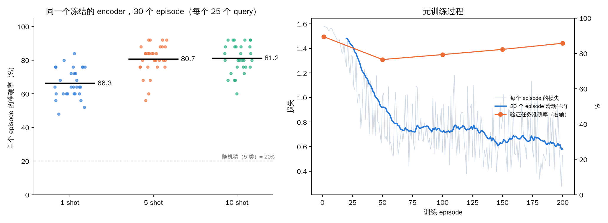
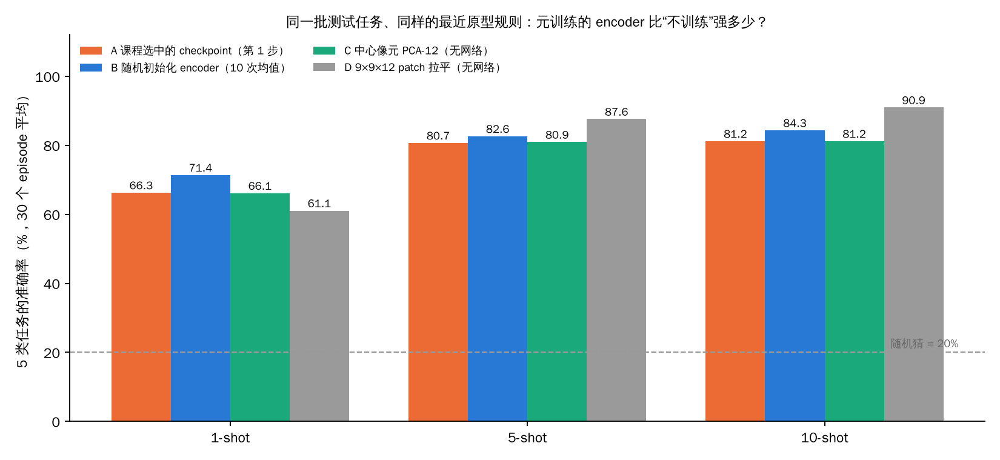
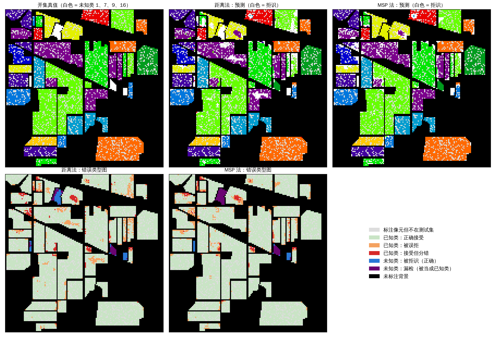
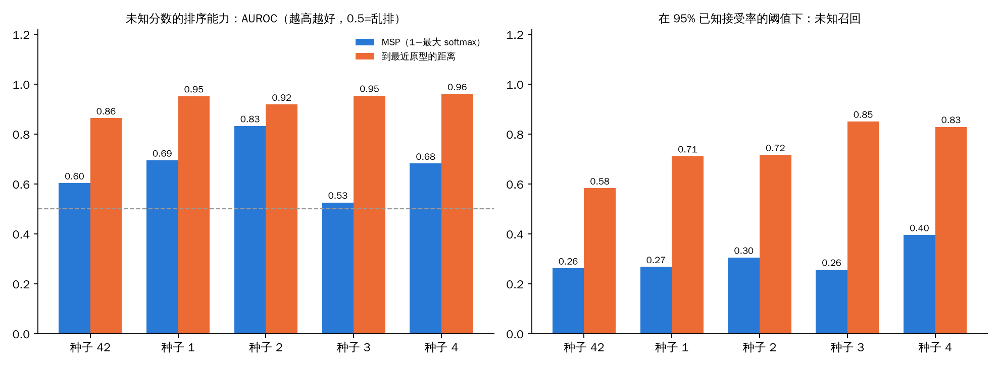

这是《高光谱图像分类》系列的第 11 篇。

前面十篇有一个共同的前提：**训练集和测试集是同一批类别，而且每个类都有比较充足的标注**（哪怕只有 10%）。这个前提在现实里经常不成立：

- 新到一个地区，**每类只能标几个样本**；
- 测试时遇到了**训练时根本没见过的地物**，模型却被迫把它归到某个已知类。

这就是**小样本分类**（few-shot）和**开集分类**（open-set）。两个设定里，模型都不复杂，**真正难的是评估**：怎么评才不骗人？这一篇我会用课程的脚本重新跑一遍，并做两个课程里没有的对照。

## 一、先分清三件事

| 设定 | 训练时 | 测试时 | 要回答的问题 |
|---|---|---|---|
| **闭集**（前十篇） | 16 类都有标注 | 还是这 16 类 | 已知类能分多准？ |
| **小样本** | 一部分类有较多标注 | **新类**，每类只给几个标注（支持集）| 看几个例子就能认出新类吗？ |
| **开集** | 一部分类（已知类）有标注 | 已知类 + **未知类** | 既能分已知类，又能识别“这是没见过的”吗？ |

另外一个提醒（课程反复强调）：**标签 0 是“未标注的背景”，不是“未知类”**。未标注只是没人标，它里面可能是任何东西，不能当作未知类的真值。

## 二、小样本：原型网络

### “少”到底指什么？

“5-way 5-shot”的意思是：**一个任务**里有 5 个类，每类给 5 个有标签的样本（叫**支持集**），然后用它们去分类这 5 个类的其他样本（叫**查询集**）。

**它不等于“整个模型只用了 25 个标注样本”。**模型的特征提取器（encoder）是在**别的类**上训练的，那一步用了多少标注，要另外算。课程的设置是这样：

| | 类别（Indian Pines 类别编号） | 用途 |
|---|---|---|
| 元训练类 | 2、3、5、6、10、11（Corn-notill、Corn-mintill、Grass-pasture、Grass-trees、Soybean-notill、Soybean-mintill） | 训练 encoder |
| 元验证类 | 1、4、7、8、9（Alfalfa、Corn、Grass-pasture-mowed、Hay-windrowed、Oats） | 选 checkpoint |
| 元测试类 | 12、13、14、15、16（Soybean-clean、Wheat、Woods、Buildings-Grass-Trees-Drives、Stone-Steel-Towers） | 最终评估：5 类任务 |

训练 encoder 用到的标注是这 6 个类的**全部像素：6,898 个**。所以更准确的说法是：“**用 6,898 个标注训练了一个特征提取器，然后在 5 个新类上，每类只看 5 个例子**”。

### 原型网络的核心：两步

1. 把支持集的每个样本过 encoder 得到特征，**同一类的特征取平均，得到该类的“原型”**；
2. 一个查询样本，算它的特征到每个原型的**平方欧氏距离**，取负数作为得分，最近的原型就是预测类别。

一个手算例子（课程里的）：两个类的原型是 (1, 0) 和 (9, 0)，一个查询点在 (4, 0)。到两个原型的平方距离是 9 和 25，所以得分是 (−9, −25)，预测第一类。**分类不需要一个固定类数的全连接头**：来了新类，把它的支持集特征取平均，就多了一个原型。

训练的时候也是**按“任务”训练**（episodic training）：每一步随机抽 5 个类、每类取支持集和查询集，算损失、更新 encoder，让训练任务的形式和测试任务一样。

### 图 1：K-shot 成绩（课程脚本重跑）

**怎么读这张图：**

- **左图：** 用**同一个训练好的、冻结的 encoder**，在 30 个测试任务（episode）上分别用 1、5、10 个支持样本分类。**每个点是一个 episode**（5 类、25 个查询样本）的准确率，黑线是 30 个 episode 的平均，虚线是随机猜的 20%；
- **右图：** 元训练过程。灰蓝色细线是每个训练 episode 的损失，蓝色粗线是 20 个 episode 的滑动平均；**橙色的点（右纵轴）是在元验证任务上的准确率**，只在第 1、50、100、150、200 个 episode 测了 5 次。

**能看到什么：**

1. 左图：1-shot 平均 **66.3%**，5-shot **80.7%**，10-shot **81.2%**；单个 episode 的波动很大：1-shot 在 48% 到 84% 之间，5-shot 在 56% 到 92% 之间；
2. 5-shot 到 10-shot **几乎没有提高**：我算了这 30 个 episode 的逐对差值：5-shot 比 1-shot 平均高 14.4 个点（标准误 2.0），10-shot 比 5-shot 只高 0.5 个点（标准误 1.4），30 个 episode 里 10-shot 好的有 18 个、差的有 8 个、持平 4 个；
3. 右图：训练损失从 1.58 降到 0.6 左右，**但元验证准确率是：第 1 个 episode 0.895，第 50 个 0.765，第 100 个 0.793，第 150 个 0.823，第 200 个 0.857**。也就是说，**验证准确率最高的是第 1 个 episode，也就是几乎没训练的时候**。

**这说明什么：**

- “支持集多一些，成绩更好”不是每次都成立：从 5-shot 到 10-shot 的 0.5 个点，和 episode 间的波动（标准差约 9 个点）比起来完全可以忽略；
- 第 3 点更有意思：课程的脚本是按“验证准确率最高”来选 checkpoint 的，所以**最终拿去测试的 encoder，是训练第 1 步之后的那个，几乎就是随机初始化**。我在配置文件里也确认了：`best_step: 1`。

**我重新跑的结果：K=1/5/10 分别是 66.27 / 80.67 / 81.20，和课程的运行记录逐位一致**（数据文件的哈希值也和课程记录的一致）。

### 图 2：一个课程没有做的对照——“元训练”到底有没有用？

既然选中的是第 1 步的 encoder，一个很自然的问题是：**如果完全不训练、甚至不用神经网络，结果会差多少？**我在课程保存的**同一批 30 个测试任务**上，用同样的“最近原型”规则做了对照：

- **A**：课程选中的 checkpoint（第 1 步）；
- **B**：同样结构、**没有训练**的随机初始化 encoder（10 个不同的随机初始化取平均）；
- **C**：**完全不用网络**，只用 PCA-12 并标准化后的**中心像元**特征；
- **D**：不用网络，把 9×9×12 的 patch **拉平成 972 维**的特征。

**怎么读这张图：** 横轴是 1、5、10 个支持样本，每组四根柱子（A 橙、B 蓝、C 绿、D 灰），纵轴是 30 个测试 episode 的平均准确率，柱顶是数字，虚线是随机猜的 20%。

**能看到什么：**

| 特征 | 1-shot | 5-shot | 10-shot |
|---|---|---|---|
| A 课程选中的 checkpoint | 66.3 | 80.7 | 81.2 |
| B 随机初始化 encoder（10 次均值） | 71.4 | 82.6 | 84.3 |
| C 中心像元 PCA-12（无网络） | 66.1 | 80.9 | 81.2 |
| D 9×9×12 patch 拉平（无网络） | 61.1 | **87.6** | **90.9** |

（B 的 10 次随机初始化之间，1-shot 在 64.5% 到 77.3% 之间，5-shot 在 79.1% 到 88.0% 之间，波动约 ±3 个点。）

**这说明什么：**

1. **A 和 C 几乎一模一样**（66.3 对 66.1，80.7 对 80.9，81.2 对 81.2）：课程选中的 encoder，效果和“直接拿 PCA 后的中心像元特征做最近原型”没有区别；
2. B（随机、没训练的网络）**平均还略高于 A**；
3. D（不用任何网络，直接把 patch 拉平）在 5-shot 和 10-shot 下**反而最好**（87.6、90.9），只有 1-shot 最差。

**所以：这套教学实验里“小样本分类成绩”的大部分，来自 PCA 特征本身的区分力和“最近原型”这个规则，而不是元训练学到的东西。**

**不能读出什么（很重要）：**

- 这**不等于**“元学习没用”：课程的教学设置只训练 200 个 episode，学习率 1e-4，而且训练时特征层的批归一化一直用的是初始统计量（脚本里为了避免“用查询批更新统计”这样做的），这是一个很短、很轻的训练，不是一个调好的元学习；
- 我只做了种子 42 的一个设置，随机初始化的波动约 ±3 个点；
- 一个“测试类和训练类来自同一块图像”的设置，**类别不交，不等于空间不交**：测试类的像素和训练类的像素在空间上可能挨着，窗口里有重叠。第 8 篇说过的问题仍然存在。

**但这个对照是一个很好的习惯：**任何“学出来的方法”，都应该和“不学的最简单基线”放在同一个表里。

## 三、开集：既分已知，又拒识未知

### 设定

课程默认**把 4 个类当作“未知”**：原始类编号 1、7、9、16（Alfalfa、Grass-pasture-mowed、Oats、Stone-Steel-Towers），其余 12 个类是已知类。训练只用已知类的标注；测试时，已知类和未知类的像素都出现。

**注意：** 选这 4 类是为了演示，并不是说“未知 = 稀有”。它们在测试集里一共只有 **187 个像素**，占 8,237 个测试像素的 2.3%。

### 两种“未知分数”

分类器在已知类上训练后，给每个测试像素一个“有多像未知”的分数，分数越大越像未知：

- **MSP**（最大 softmax 概率）：分数 = 1 − 最大的那个 softmax 概率。模型越不确定，越像未知；
- **距离**：分数 = 特征到**最近的已知类原型**的距离。离所有已知类都远，就越像未知。

### 先校准，再测试

阈值怎么定？课程的做法：**只用已知类的验证集**，让 95% 的已知验证像素被接受（分数低于阈值），这个阈值就是“拒识线”。冻结模型和阈值后再去测试。**测试类的标签不能用来选阈值**，否则就是作弊。

### 五个必须一起报告的指标

| 指标 | 回答的问题 |
|---|---|
| 拒识前已知类分类准确率 | 分类器本身能不能区分已知类 |
| AUROC（未知为正类） | 未知分数的**排序**能力（不依赖阈值） |
| 已知误拒率 | 多少已知像素被错误地拒绝 |
| 已知正确接受率 | 已知像素里，最终“被接受且分对”的比例 |
| 未知召回 / 漏检 | 多少未知被识别出来 / 被强行归到已知类 |

**一个常见误区：**只报 AUROC。AUROC 只看排序，**不是某个固定阈值下的最终准确率**。拒识也会牺牲已知类的可用性：全部拒绝，未知召回是 100%，但已知类一个也用不了。

### 图 3：开集的预测图和错误类型图（课程脚本的输出，我重新画）

**怎么读这张图：** 上排三张：开集真值（**白色是未知类的像素**）、距离法的预测、MSP 法的预测（这两张里**白色是被拒识**）。已知类在三张图里用相同的颜色。只画了测试集里的像素，其余有标注的像素用浅灰，背景是黑色。下排两张是**错误类型图**，右下是图例：

- 浅绿：已知类，正确接受；
- 橙色：已知类，**被误拒**（本来是已知类，却被拒识了）；
- 红色：已知类，接受但**分错**；
- 蓝色：未知类，**被拒识**（正确）；
- 紫色：未知类，**漏检**（被当成了某个已知类）。

**能看到什么：**

| | 已知正确接受 | 已知被误拒 | 已知接受但分错 | 未知被拒识 | 未知漏检 |
|---|---|---|---|---|---|
| 距离法 | 7,333 | 530 | 187 | 109 | 78 |
| MSP 法 | 7,458 | 484 | 108 | 49 | 138 |

（已知像素共 8,050 个，未知像素 187 个。）

- 上排左图：4 个未知类大多是几块**整块的小田**（白色），最明显的在图的上部中间和中下部；
- 上排中、右：两种方法的白色（拒识）**既出现在那几块未知的田里，也零散出现在已知类的田里**，距离法在图中部偏左的几块已知田里有明显的白色成片（那里被大量误拒）；
- 下排：绝大多数像素是浅绿（正确接受）；**未知田块**在距离法下一部分是蓝色（被识别），另一部分是紫色（漏检）；在 MSP 法下**几乎整块是紫色（漏检）**。

**这说明什么：** 两种方法在“已知类误拒率”上差不多（都是 6% 左右，因为阈值都按 95% 的接受率校准），**但距离法找回的未知多得多**：未知召回 58.3%，MSP 只有 26.2%。（109 ÷ 187 和 49 ÷ 187。）**白色不都是“正确的检测”**，很大一部分白色是已知类被误拒。

### 图 4：5 个种子，结果有多稳

**怎么读这张图：** 左图是 AUROC（0.5 是乱排，1 是完美），右图是在“95% 已知接受率”的阈值下的**未知召回**。每个种子两根柱子：蓝色是 MSP，橙色是距离。种子 42 是课程用的那个。

**能看到什么：**

| 指标 | MSP | 距离 |
|---|---|---|
| AUROC（5 个种子均值 ± 标准差） | **0.67 ± 0.11**（0.53 到 0.83） | **0.93 ± 0.04**（0.86 到 0.96） |
| 未知召回（5 个种子均值 ± 标准差） | 0.30 ± 0.06 | 0.74 ± 0.11 |
| 已知误拒率 | 0.057 ± 0.004 | 0.056 ± 0.007 |
| 拒识前已知类准确率 | 0.964 ± 0.007（两种方法共用同一个分类器） | |

**这说明什么：**

1. **在这个设置下，距离法在 5 个种子里都比 MSP 好**，AUROC 高 0.09 到 0.43，未知召回高一倍以上，而已知误拒率几乎一样；
2. **MSP 的 AUROC 在种子间波动非常大**：从 0.53（几乎等于乱排）到 0.83。距离法的波动小得多；
3. 已知类的分类准确率（0.953 到 0.971）很稳定，**说明“分类器很好”完全不能保证“拒识很好”**。

**我必须提醒的一点：** 课程自己在课堂验收记录里保存的种子 42 的结果是 MSP AUROC **0.89**、距离 **0.88**，也就是 MSP 略好；而**我在同一个种子 42 下重跑的是 0.60 和 0.86**。5 个种子里我没有任何一次看到 MSP 到 0.89。这说明：**MSP 这类“置信度”分数的好坏，对训练的随机轨迹、甚至运行环境非常敏感**，不要根据单次运行下“谁更好”的结论。课程里更早的一版旧结果（MSP 0.68、距离 0.96）还被撤回了，原因就是同类。

**不能读出什么：** “距离法优于 MSP”只在**这个设置**（IP、4 个未知类、这个分类器、5 个种子）下成立；未知类换一组，结果可能不同；5 个种子不是显著性检验；187 个未知像素很少，召回的波动本身也大。课程的建议是：未知类组合改变后要**重新完整评估**，不能只挑 AUROC 最高的那个组合。

## 四、这一篇你该带走的

1. **“少”要说清楚是哪一步少**：5-shot 的 25 个标注只是一个任务的支持集，encoder 的训练标注要另外报（这里是 6,898 个）；
2. **K 变大不一定更好**：5-shot 到 10-shot 的 0.5 个点，被 9 个点的 episode 波动淹没；
3. **学出来的方法要和“不学的基线”放在一起**：课程选中的 encoder，效果和直接用 PCA 特征做最近原型没有区别；
4. **开集要五个指标一起报**：只报 AUROC 会掩盖已知类的误拒和未知的漏检；
5. **阈值只用已知验证集校准**，测试类标签不能参与；
6. **置信度类的未知分数波动很大**，多种子是前提。

## 自测三问

1. 一篇论文声称“用 25 个标注样本达到 92% 的准确率”，你会问哪几个问题？
2. 为什么原型网络的 checkpoint 选了第 1 个 episode，这个信号告诉你什么？你会怎么改实验设计？
3. 开集里“把所有像素都拒识”能不能得到很高的“未知召回”？为什么这样的系统没法用？

（答案提示：这 25 个标注是不是只指支持集、encoder 用了多少标注、测试类是否见过、选模型用的是不是测试集；说明元训练没有带来可测量的收益，要加更长的训练、调学习率、并和不训练基线对比；可以，但已知类的可用率变成 0，所以要同时报已知正确接受率。）

## 下一篇预告

最后一篇：**科研篇**。从读论文、设计实验、写论文，到课程最后的“毕业实战”。我会把课程的一个示例选题**真的做一遍**：先写立项书，再跑实验。结果会让你知道，“假设不成立”为什么是科研里的常态。

---

> 配套课程：[masskx/HSI-Learning](https://github.com/masskx/HSI-Learning) 第 16、17 章及课堂验收记录。课程的小样本和开集章节在 2026-10-09 的修订里撤回了旧结果，改用新的协议（类别不交、只用已知验证集校准阈值）；本文使用的是新版脚本。图 1、3、4 是我用课程脚本重跑（开集另加 4 个种子）后重新画的；图 2 的对照实验是我自己设计的（脚本 `_工具/exp_protonet_controls.py`）；课程的原始输出没有被改动。
