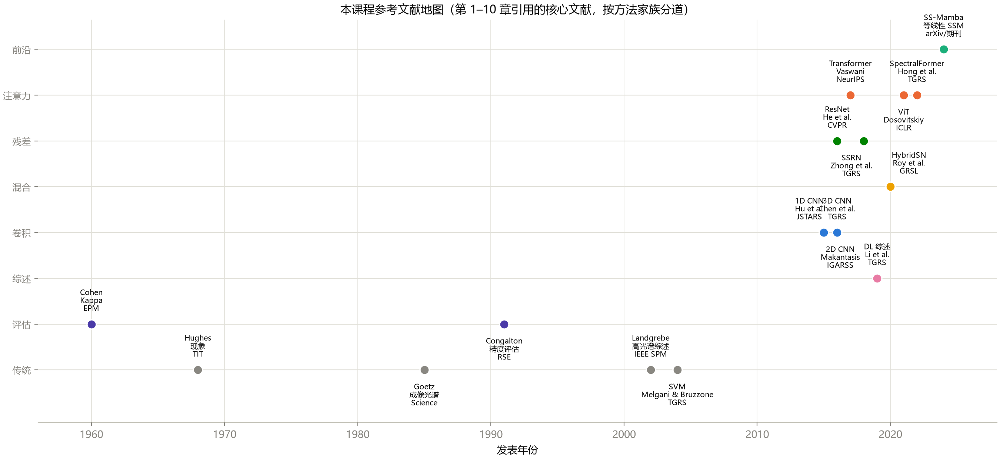
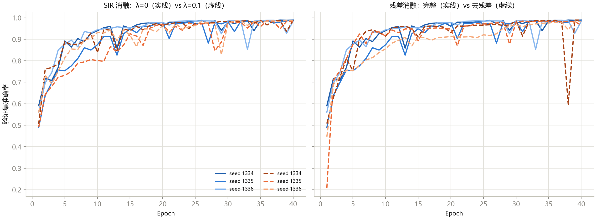
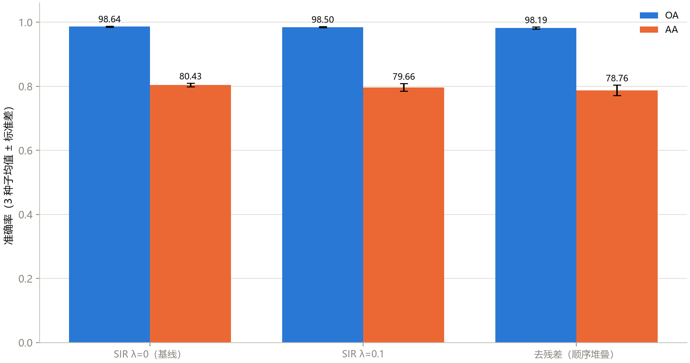
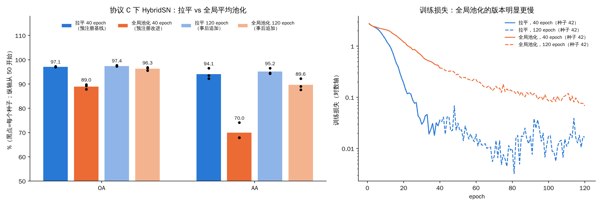

这是《高光谱图像分类》系列的第 12 篇，也是最后一篇。

前 11 篇讲的是“怎么做实验”。这一篇讲“怎么做研究”：从读论文、设计实验、写论文，到课程最后的“毕业实战”。但我不想只复述这几章的方法论，因为方法论最容易“看懂了、做不到”。

所以我做了一件事：**把课程列出的一个示例选题，从头到尾真的做了一遍**：先写立项书（并且提交到仓库，实验开始之前），再跑实验，再如实报告结果。结果是：**我预先写下的假设，不成立。**

## 一、科研篇一共讲了四件事

| 章 | 主题 | 一句话 |
|---|---|---|
| 11 | 文献检索与论文精读 | 三遍精读法 + 复现 checklist：复现失败最常见的原因不是代码 bug，而是协议没对齐 |
| 12 | 实验设计与可复现 | 可检验的假设 = 自变量 + 因变量 + 控制变量；多种子、均值 ± 标准差；消融一次只改一个变量 |
| 13 | 论文写作与投稿 | IMRaD 是一套“论证协议”：每一节回答审稿人必问的一个问题 |
| 14 | 毕业实战 | 六阶段：选题、基线复现、改进实现、实验消融、写作、模拟投稿 |

### 图 1：课程的文献时间线（第 11 章）

**怎么读这张图：** 横轴是发表年份，纵轴是方法家族（从下到上：传统、评估、综述、卷积、混合、残差、注意力、前沿），每个点是一篇文献，旁边标了方法、作者和期刊。

**能看到什么：**

- **传统方法和评估指标**（Hughes 现象 1968、Cohen Kappa 1960、Congalton 精度评估 1991、SVM 2004）在最左边，年代跨度很大；
- **深度学习方法集中在 2015 年以后**：1D CNN（2015）、2D/3D CNN（2015–2016）、ResNet（2016）、SSRN（2018）、HybridSN（2020）、SpectralFormer（2022），最右侧是 2024 年的 SS-Mamba；
- 图里有两处标签挤在一起（1D CNN 和 3D CNN 的标签重叠），是原图的小瑕疵。

**这说明什么：** 课程在图注里提了一个有意思的观察：**评估类文献几乎五十年不变，而方法在这 10 年里换了好几代**。协议和指标的“半衰期”比模型长得多，这也是为什么第 3 篇（评价）要花那么多笔墨。

**不能读出什么：** 这只是**课程引用过的文献**，不是这个领域的完整版图；横轴上的点的疏密不代表某个时期研究的多少。

### 三遍精读法

- **第一遍（约 10 分钟）**：标题、摘要、引言末段、图表标题、结论。回答五个问题：解决什么问题？已有方法的缺点？核心思路一句话？怎么验证的？值不值得读第二遍？**90% 的论文止步于此，这是筛选，不是精读**；
- **第二遍（约 1 小时）**：通读，重点两条线：方法节的符号和实验节的数据集、划分、超参；看不懂的点记下来，不死磕；
- **第三遍（数小时，只对核心论文）**：合上论文，凭理解写伪代码，再对照原文补齐差异，列出“论文没写清楚的所有细节”。

## 二、实验设计：多种子，以及图的读法

课程第 12 章用了 9 次训练（3 个配置 × 3 个种子）示范“多种子消融”。

### 图 2：9 条验证曲线

**怎么读这张图：** 两个子图，横轴是 epoch（0 到 40），纵轴是验证准确率。**左图**比较“不加正则（实线）”和“加正则（虚线）”，**右图**比较“完整残差（实线）”和“去掉残差（虚线）”。每组各有 3 条线，对应 3 个种子，颜色深浅区分种子。

**能看到什么：**

- 左图：实线和虚线**交织在一起**，两组之间的差别被淹没在种子之间的差别里；
- 即使到了第 30 个 epoch 以后，**所有曲线都在上下抖动**：实线里有几条在后期突然掉到 0.85 到 0.93，再弹回来；
- 右图：有一条“去残差”的曲线（最深的那条虚线）在第 38 个 epoch 掉到了约 0.60，下一个 epoch 又回到 0.99；另一条“去残差”曲线第 1 个 epoch 只有 0.21。

**这说明什么：** 一个重要的实验常识：**验证曲线在训练后期仍然会抖动**。如果你的模型选择规则是“取验证集准确率最高的那个 epoch”，那你选的其实有一部分是**抖动的最高点**。这也解释了为什么前面几篇里“最佳 epoch”会比较飘。

**不能读出什么：** 课程说得很克制：那条第 38 个 epoch 的骤降“是一条运行轨迹的观察”，不能唯一归因于“没有残差连接”。

### 图 3：消融柱状图，注意纵轴

**怎么读这张图：** 三组：完整的 SSRN（λ=0）、加课程自定义正则（λ=0.1）、去掉残差；每组两根柱，蓝色 OA、橙色 AA，黑线是标准差。

**能看到什么：** 三组柱子**几乎一样高**。数字是：

| 配置 | OA | AA |
|---|---|---|
| 完整 SSRN | 98.64 ± 0.16 | 80.43 ± 0.53 |
| 加正则 | 98.50 ± 0.17 | 79.66 ± 1.20 |
| 去残差 | 98.19 ± 0.32 | 78.76 ± 1.61 |

**一个读图提醒：** 这张图的纵轴是从 **0** 开始的，OA 柱子都顶着 100，0.4 个点的差别在视觉上根本看不出来。**柱状图适合比较“大差异”，要看“零点几个点”的差异，请直接看数字**（或者用点加误差线，纵轴只放需要的范围）。这个读法本身，也是第 10 篇里我自己的图把纵轴放到 60 开始时要提醒的事：**换一种纵轴，同一组数据会给人完全不同的印象。**

**这说明什么：** 三个配置的 OA 差别都在 0.5 个点以内，AA 的差别最大约 1.7 个点，3 个种子下，“去残差”的 OA 在三个种子里都低于基线，课程据此写的是“观察到一致方向的下降”，措辞很克制。

## 三、写作与投稿：五条值得抄的纪律

第 13 章把论文结构、摘要、引言、方法、实验、LaTeX 和投稿流程都过了一遍，我只摘最有操作性的五条：

1. **写作顺序不等于阅读顺序**：先写方法和实验（你最确定的），最后写引言、相关工作、摘要；
2. **引言三段式**：问题段（为什么重要）、缺口段（别人做到哪、缺什么，每句带引用）、贡献段（不超过 4 条，每条都能在实验节找到对应的表或图）；
3. **贡献点要可证伪**：写“我们提出了 X 模块”，就必须有 X 的消融行；
4. **摘要里必须有数字**：OA/AA/Kappa + 数据集 + 协议；
5. **返修信：先谢后答、有问必答、能用实验说话就不用形容词**：审稿人要的对比实验，直接给新表。

## 四、迷你 Capstone：我真的做了一遍

课程第 14 章给了三个示例选题，我选了工作量最小的一个：**HybridSN 轻量化：用全局平均池化替代拉平。**

动机来自第 7 篇：HybridSN 的第一个全连接层占了 97.7% 的参数（473 万），因为它要吃一个 18,496 维的拉平向量。如果在拉平之前先对每个通道做全局平均池化，这一层的输入就只有 64 维，参数能降到 1.6 万。

### 第 1 步：立项书（在任何一次训练开始之前写下）

> **假设**：在课程协议 C（10/10/80，Indian Pines）下，把 HybridSN 的“拉平 → 全连接 18,496→256”换成“全局平均池化 → 全连接 64→256”，参数量减少约 97%，**OA 的下降不超过 1 个百分点，AA 不下降**。
>
> **控制变量**：课程的 `train_hybridsn.py` 一行不改，只替换模型类；PCA-15、25×25 窗口、Adam、批 256、40 个 epoch；
> **实验矩阵**：1 个数据集 × 3 个种子（42、1334、1335）× 2 个配置 = 6 次训练；
> **成功判据（事先约定）**：三个种子里 OA 平均降幅不超过 1 个点且 AA 平均不降。
> **风险与退路**：假设可能不成立，那就写成“拉平层的参数换来了多少精度”的代价分析。

这份立项书在实验开始前就已经写好并提交到仓库（见本文夹里的“立项书（实验开始前写下）.md”，仓库的提交时间早于所有 GAP 实验结果的产生时间）。

### 第 2 步：基线和改进，三个种子

| 种子 | 基线 OA / AA | 全局平均池化 OA / AA | OA 差 | AA 差 |
|---|---|---|---|---|
| 42 | 97.24 / 93.56 | 89.83 / 67.94 | −7.41 | −25.62 |
| 1334 | 97.10 / 92.21 | 87.87 / 67.97 | −9.23 | −24.24 |
| 1335 | 97.00 / 96.51 | 89.23 / 74.09 | −7.77 | −22.42 |
| **均值** | **97.11 / 94.09** | **88.98 / 70.00** | **−8.14** | **−24.09** |

参数量：4,845,696 → 127,104（减少 97.4%）。我顺手数了一下计算量：约 50.82M → 46.10M 次乘加，**只少了 9%**（拉平那一层只占了全部乘加的不到 10%）。

### 第 3 步：对照立项书的判据

- **OA 平均降幅 ≤ 1 个点？** 实际降了 **8.14 个点**，三个种子的降幅都在 7.4 到 9.2 之间。**不成立。**
- **AA 不下降？** 实际降了 **24 个点**。**不成立。**

**结论：在“课程协议 C、40 个 epoch”这个预算下，立项书里的假设被明确否定。**

### 第 4 步：但这个结论还不能下

训练日志里有一个值得注意的现象：

| | 基线（拉平） | 全局平均池化 |
|---|---|---|
| 训练损失，第 1 个 epoch | 2.72 | 2.77 |
| 训练损失，第 36 个 epoch | 0.03 | **0.48** |
| 训练准确率，第 36 个 epoch | 0.99 | **0.86** |

全局平均池化的模型，在 40 个 epoch 结束时**训练损失还在下降、训练准确率才 0.86**，也就是说它**根本没训练完**。立项书把预算固定为 40 个 epoch，这个预算对基线是够的，对全局平均池化的版本明显不够。所以“它不如基线”这个结论有一部分可能只是“它需要更长的训练”。

**这是一个事后的发现。** 它**不改变**上面的判定（预先约定的判据就是 40 个 epoch，没有成立），但它提示了一个**探索性的追加实验**。**我把这一段明确标成“事后追加”**：我是看到上面的结果之后才决定做的。

### 探索性追加：训练预算翻三倍

6 个配置全部用 **120 个 epoch**（三倍预算）重新训练：基线（拉平）和改进（全局平均池化）各 3 个种子。

**怎么读这张图：**

- **左图：** 横轴是两个指标（OA、AA），每个指标四根柱子：深蓝是“拉平、40 个 epoch”（预注册基线），深橙是“全局池化、40 个 epoch”（预注册改进），浅蓝和浅橙是对应的“120 个 epoch”（事后追加）。黑点是三个种子各自的结果，柱顶数字是均值。**纵轴从 50 开始**，看数字别看柱子的相对高度；
- **右图：** 种子 42 的训练损失（纵轴是对数轴）。蓝色是拉平，橙色是全局池化，实线是 40 个 epoch 的那次，虚线是 120 个 epoch 的那次（前 40 个 epoch 的前半段两条线重合是因为种子相同，训练轨迹相同）。

**能看到什么：**

| 种子 | 拉平（120）OA / AA | 全局池化（120）OA / AA | OA 差 | AA 差 |
|---|---|---|---|---|
| 42 | 97.27 / 94.26 | 96.84 / 92.25 | −0.43 | −2.01 |
| 1334 | 97.34 / 94.65 | 95.55 / 87.63 | −1.79 | −7.02 |
| 1335 | 97.68 / 96.56 | 96.57 / 89.05 | −1.11 | −7.51 |
| **均值** | **97.43 / 95.16** | **96.32 / 89.64** | **−1.11** | **−5.52** |

1. **预算翻三倍后，差距大幅缩小**：OA 的平均差从 −8.14 缩到 −1.11，AA 的平均差从 −24.09 缩到 −5.52；
2. 右图：拉平版本的损失很快降到 0.02 以下并在那里抖动；**全局池化的损失到第 120 个 epoch 还在缓慢下降（约 0.07）**；全局池化三个种子的最佳 epoch 是 120、119、106，**仍然贴着预算的右边缘**；
3. 差距集中在**稀有类**：用三个种子的逐类召回均值看，全局池化版比拉平版低的类主要是 Grass-pasture-mowed（−42 个点，92.4 对 50.0）、Oats（−27，91.7 对 64.6）、Alfalfa（−20，90.1 对 70.3），大类几乎没变（Soybean-mintill −2.1，Corn-notill +0.3），个别类反而更好（Corn +11.6）。

**这说明什么：** 用三倍预算，全局平均池化版本“接近但仍不如”基线：参数少 97%，代价是约 1 个点的 OA 和约 5.5 个点的 AA，**而且这个代价几乎全落在三个稀有类上**。如果当初把预算定在 120 个 epoch，预先约定的判据（OA 降幅 ≤ 1 个点，AA 不降）仍然不成立：OA 降了 1.11，AA 降了 5.52。

**不能读出什么：** 这是事后追加的探索，只有 3 个种子、1 个数据集；全局池化版本最佳 epoch 仍然贴边，**再训练更久可能还会缩小差距**，我没有继续；没有调学习率、没有试其他池化方式（比如先压到 4×4 再拉平）；“稀有类受损更大”是三个种子的均值，稀有类的测试样本只有二十几个，波动大（比如 Grass-pasture-mowed 一共 22 个测试样本）。

### 这次 Capstone 教了我什么

1. **立项书里的“风险与退路”不是形式**：假设不成立是常态，我事先写好了“退路是代价分析”，所以现在这个负结果可以直接写成一节；
2. **先约定判据，再看数据**：如果我是看完结果再决定“降 8 个点也算可接受”，这个实验就失去了意义；
3. **只改一个变量，也可能同时改了“可训练性”**：全局平均池化不仅减少了参数，还改变了梯度的传递路径，训练变慢了。“参数少”和“训练容易”不是一回事；
4. **预算是协议的一部分**：同一个改动，40 个 epoch 下 OA 降 8 个点，120 个 epoch 下只降 1 个点。比较两种结构前，先问两边是否都训练到了平台期；
5. **总分会掩盖代价落在谁身上**：120 个 epoch 下 OA 只差 1.1，但 AA 差 5.5，代价几乎全落在三个稀有类上；
6. **这个实验有明显的局限**：只有一个数据集（论文要求至少三个）、3 个种子、一种池化方式、没调学习率；**所以结论只对“课程协议 C、Indian Pines、这两种训练预算”成立**。

## 五、课程自己也在“纠错”：一个值得学的科研习惯

我读课程仓库时有一个很深的印象：它**公开了自己的纠错记录**（`docs/teaching/errata.md`）。其中列出：Kappa 的算例错、波段序号和波长混用、感受野漏掉池化、把课程自定义的正则归给了原论文、用“标准差”判显著性、Grad-CAM 其实只是通道均值、少样本实验里测试集参与了训练监控、开集实验里特征和标签错配……并且把旧图撤下来，不把旧结果当成新实现的执行证据。

这是一个比任何一个数字都重要的习惯：**公开纠错，把“撤回”写进仓库**。

我在读的过程中还发现了几处课程没列出来的不一致，在系列的 `README.md` 里汇总了（包括 Oats 错分去向写成了错误的类别、几张图的坐标轴和图注有出入）。它们都不影响课程的主要结论，但**对你读课程、做对照的人有用**。

## 六、这个系列，一句话回顾

| 篇 | 一句话 |
|---|---|
| 1 | 高光谱数据是一个“每个像素带一条光谱曲线”的立方体，标签 0 是未标注而不是一个类 |
| 2 | 三个数据集的尺寸、分辨率、类别分布差别很大，数值不等于反射率 |
| 3 | 同一个 SVM，换一种划分，OA 掉 7 个点：划分、泄漏与 OA/AA/Kappa 要一起看 |
| 4 | 传统基线的排名由协议决定，换协议就能倒过来；特征尺度和 gamma 要一起调 |
| 5 | patch 是上下文快照，窗口大小是“纯度、泄漏、计算量”的三难 |
| 6 | 1D/2D/3D 卷积三种“看法”；训练不足、AA 比 OA 更暴露问题 |
| 7 | HybridSN 的参数在全连接层，SSRN 的参数在过渡层；99.2% 是饱和信号 |
| 8 | 同一个 2D CNN，随机划分 99.0%，空间不相交 34.9% |
| 9 | Transformer 在小样本下输给 SVM；注意力聚焦的波段，遮挡实验里反而最不重要 |
| 10 | 加权交叉熵用 2 个点 OA 换 8 个点 AA；稀有类的单次结果会翻盘 |
| 11 | 小样本成绩和“不训练”的 PCA 基线几乎一样；开集里距离法稳定优于 MSP，但 MSP 波动极大 |
| 12 | 科研是“先写判据再看数据”；预注册的假设不成立，追加实验也只是“接近但仍不如” |

## 七、一条给你的学习路线

如果你想把这门课当成一个真正的学习计划，我建议：

1. **先读第 1–4 篇**，亲手跑一遍 SVM，理解划分和指标；这一步最容易被跳过，却最重要；
2. **然后读第 5–7 篇**，跑 1D、2D、3D CNN 和 HybridSN，**每个模型先看最佳 epoch 有没有压边**；
3. **第 8 篇的实验自己做一遍**：把你最喜欢的模型换成空间不相交划分，看看数字掉多少；
4. **多种子**。从现在开始，任何“A 比 B 好”都跑 3 个以上的种子；
5. **写立项书**：假设、判据、风险与退路，在实验之前提交；
6. **最后才是论文**：用课程提供的 IEEEtran 骨架，先写方法和实验。

## 自测三问

1. 为什么立项书要在实验开始之前写下判据？如果结果出来再定“多少算成功”，会出什么问题？
2. 一个只改一个变量的实验，结果显示“新方法更差”，你是否可以直接下结论说“新方法无效”？要先检查什么？
3. 一张柱状图的纵轴从 0 开始，三个配置的柱子几乎一样高，你能不能说“三个配置没有差别”？

（答案提示：事后定判据容易把“能接受的差距”调整到刚好等于观测值，实验就没有了检验力；要先检查训练预算是否足够、是否到了平台期、是否有别的变量被同时改变；不能，纵轴从 0 开始会掩盖零点几个点的差异，要看数字和不确定性。）

---

> 配套课程：[masskx/HSI-Learning](https://github.com/masskx/HSI-Learning) 第 11–14 章和课堂修订记录。图 1、2、3 取自仓库；迷你 Capstone（全局平均池化变体、6 次训练、预先写好的立项书）是我在本机做的，脚本在本系列的 `_工具/exp_hybridsn_gap.py`，它只替换模型类，其余全部是课程的原脚本。
